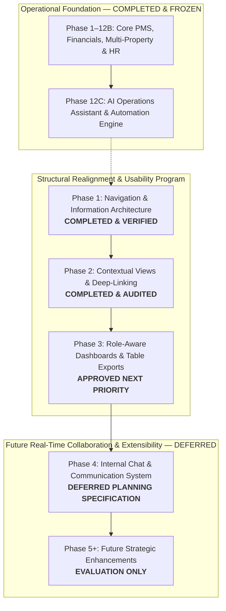
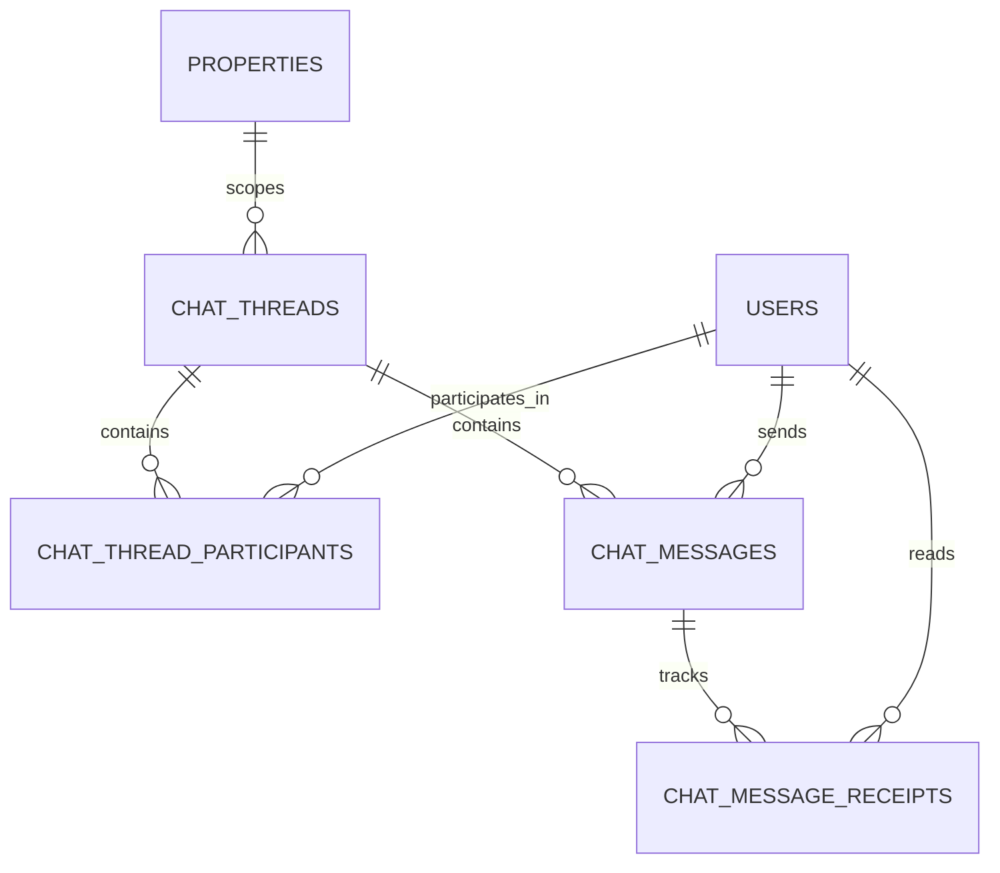

# BFA Apartments Management System — Master Development Roadmap

**Document Version:** 2.0  
**Date:** October 22, 2026  
**Status:** **AUTHORITATIVE MASTER ROADMAP & PLANNING SPECIFICATION**  
**Guiding Mandate:** Establish a coherent, risk-managed multi-phase roadmap for BFA Apartments Management System that preserves existing stability (384/384 passing tests across 34 suites, frozen Phase 12C Operations Assistant, strict one-night stay business logic, and authoritative financial integrity) while methodically enhancing system navigation, contextual workflows, role-specific usability, and future collaborative communications.

---

## 1. Master Phasing Horizon & Visual Roadmap

---

## 2. Phase Summaries & Execution Status

### Phase 1: Navigation and Information Architecture Realignment
- **Status:** **COMPLETED & VERIFIED**
- **Evidence Report:** [`BFA_PHASE_1_VERIFICATION_REPORT.md`](file:///c:/xampp/htdocs/BFA/BFA_PHASE_1_VERIFICATION_REPORT.md)
- **Delivered Capabilities:**
  - Unbundled 7-item "Operations" catch-all into 3 focused business groups:
    - *Properties & Units* (`/app/properties`, `/app/apartments`, `/app/calendar`)
    - *Front Office & Bookings* (`/app/front-office`, `/app/reservations`, `/app/guests`)
    - *Maintenance & Care* (`/app/maintenance`, `/app/inspection`)
  - Created first-class `/app/properties` view for property portfolio asset management.
  - Consolidated Reports, Analytics, and Audit into *Reports & Intelligence*.
  - Re-anchored Team & RBAC under *System Administration*.
  - Preserved backward compatibility and responsive sidebar navigation.

---

### Phase 2: Contextual Detail Views & Deep-Linking
- **Status:** **COMPLETED & AUDITED (PASS WITH ISSUES)**
- **Implementation Report:** [`BFA_PHASE_2_IMPLEMENTATION_REPORT.md`](file:///c:/xampp/htdocs/BFA/BFA_PHASE_2_IMPLEMENTATION_REPORT.md)
- **Verification Report:** [`BFA_PHASE_2_VERIFICATION_REPORT.md`](file:///c:/xampp/htdocs/BFA/BFA_PHASE_2_VERIFICATION_REPORT.md)
- **Delivered Capabilities:**
  - Connected related operational entities across physical, booking, guest, financial, and repair domains:
    - *Property $\rightarrow$ Units:* Quick-view building inventory and direct apartment filtering.
    - *Unit $\rightarrow$ History & Status:* Active occupant banner, live reservations, maintenance tickets, and inspection audits.
    - *Reservation $\rightarrow$ Contextual Actions:* 1-click modal actions to record payment, report maintenance, or view guest CRM profile.
    - *Guest $\rightarrow$ CRM Profile:* Comprehensive stay history across all properties, total nights, total spend, and booking records.
  - Deep-link query parameters implemented across all 8 core pages (`unitId`, `propertyId`, `search`, `openNew`, `guestId`, `tab`).
  - Strict 1-night maximum stay policy enforced end-to-end.
  - Authoritative financial records queried without data duplication.
- **Pre-Phase 3 Remediation Items (Non-Blocking):**
  - **DEF-01:** Correct route mismatch in `ReservationsPage.jsx` button (`/app/financials` $\rightarrow$ `/app/financial?tab=payments`) and register route alias in `App.jsx`.
  - **DEF-02:** Add reactive `useEffect` listening to `[searchParams]` in `PropertiesPage.jsx`.

---

### Phase 3: Role-Aware Dashboards & Universal Table Exports
- **Status:** **APPROVED NEXT PRIORITY (READY FOR AUTHORIZATION)**
- **Planning Specification:** Section 4 of [`BFA_STRUCTURAL_IMPLEMENTATION_PLAN.md`](file:///c:/xampp/htdocs/BFA/BFA_STRUCTURAL_IMPLEMENTATION_PLAN.md)
- **Planned Scope:**
  1. **Modular Dashboard Widgets (`DashboardPage.jsx`):**
     - *Front Desk Queue Widget (`RECEPTIONIST`, `ADMIN`, `MANAGER`):* Daily arrivals, in-house guests, departures, and 1-click check-in.
     - *Work Orders Queue Widget (`STAFF`, `MANAGER`):* High/critical maintenance issues, assigned technician, and dirty turnover rooms.
     - *Executive Financial Widget (`OWNER`, `ADMIN`, `MANAGER`):* Gross revenue, cash flow, outstanding receivables aging, ADR, and RevPAR.
     - *Agent Performance Widget (`AGENT`):* Client bookings, pending arrivals, earned commissions, and payout records.
     - *Platform Health Widget (`SUPER_ADMIN`):* Multi-property status, database latency, and system audit trail alerts.
  2. **Universal CSV Export on Core Tables:**
     - Standardized client-side CSV download on `ApartmentsPage`, `ReservationsPage`, `GuestsPage`, and `EmployeesPage`.
- **Release Gate:** 384/384 backend tests passing, 0 build errors in `npm run build`.

---

### Phase 4: Internal Chat & Communication System (DEFERRED PLANNING SPECIFICATION)
- **Status:** **PLANNING ONLY — DEFERRED POST-PHASE 3**
- **Objective:** Introduce secure, contextual, low-latency messaging between authenticated BFA staff and team members.

#### 1. Strategic Rationale & Phase Placement
- **Strict Post-Phase 3 Scheduling:** Chat depends heavily on a stable UI shell, established role-specific contexts, and verified entity deep-links. Introducing real-time messaging before dashboards and exports are finalized risks cross-cutting regressions.
- **Internal Staff Only for Initial Release (v1):** The initial version targets authorized internal operations staff only. Tenant- and guest-facing messaging involves external public authentication, spam prevention, and customer SLA management, and is explicitly reserved for future consideration.
- **Zero Implementation Footprint:** No migrations, backend controllers, frontend components, or packages are installed in this planning phase.

#### 2. Detailed Scope Evaluation
1. **Secure 1-to-1 Messaging:** Authenticated private messaging between authorized staff users (e.g. Receptionist to Maintenance Technician, Property Manager to Receptionist).
2. **Team & Property Channels:** Scoped group conversations for property operational teams (e.g. `Grand Horizon - Front Office`, `Victoria Heights - Maintenance Team`) and management channels.
3. **Unread Counts, Read Receipts & In-App Alerts:**
   - Real-time unread badge counter in `Topbar.jsx`.
   - Toast notifications for incoming direct messages or mentions.
   - Message read states (sent, delivered, read) with audit timestamps.
4. **Contextual Entity Links:**
   - Ability to attach or link authoritative records directly within chat bubbles:
     - Properties (`/app/properties?search=...`)
     - Units (`/app/apartments?unitId=...`)
     - Reservations (`/app/reservations?search=...`)
     - Guests (`/app/guests?guestId=...`)
     - Maintenance Tickets (`/app/maintenance?propertyId=...`)
     - Inspections (`/app/inspections?propertyId=...`)
   - Interactive preview cards inside messages providing 1-click navigation to the authoritative detail view.
5. **Role-Based & Property-Scoped Access Control:**
   - Strict property scoping: A receptionist assigned to Property A cannot view, join, or receive messages from Property B team channels.
   - Multi-property managers and Super Admins retain cross-property oversight where assigned.
6. **Responsive Interface:**
   - Global slide-over chat drawer accessible from any page without navigating away from ongoing work (e.g., during active guest check-in).
   - Collapsible mobile sheet ensuring zero obstruction on small viewports.
7. **Content Safety, Delivery & Retention:**
   - Strict server-side input sanitization (XSS mitigation).
   - Character limit enforcement and rate-limiting middleware.
   - Audit trail integration for message logging and regulatory compliance.
8. **Integration with Existing Architecture:**
   - Handshake authentication leveraging existing JWT tokens and session credentials.
   - Zero disruption to existing `users` and `employees` tables.

#### 3. Real-Time Transport Evaluation

| Option | Transport Mechanism | Latency | Infrastructure & Docker Impact | Recommendation |
|---|---|---|---|---|
| **Option A** | **WebSockets (`socket.io` / `ws`)** | **Sub-second (Real-Time)** | Requires WebSocket upgrade headers in `nginx/default.conf` and socket auth middleware in Express. | **Primary Recommended Option** for full two-way chat experience. |
| **Option B** | **Server-Sent Events (SSE) + REST POST** | **Near Real-Time (<1s)** | Unidirectional server push via standard HTTP; REST POST for sending messages. Native Nginx proxying with `proxy_buffering off;`. | **Viable Alternative** if WebSocket proxying poses infrastructure friction. |
| **Option C** | **HTTP Polling (Short / Long)** | **High Latency (3–10s)** | No infrastructure changes; creates database query overhead under multi-property load. | **Emergency Fallback Only**. |

#### 4. Candidate Data Entities (Planning Considerations Only)
*The following schemas represent architectural planning models, not executed migrations:*

- **`chat_threads`:** `id`, `thread_type` (`DIRECT`, `PROPERTY_GROUP`, `DEPARTMENT_GROUP`), `property_id` (nullable FK), `title`, `created_by`, `status`, `created_at`, `updated_at`.
- **`chat_thread_participants`:** `id`, `thread_id` (FK), `user_id` (FK), `role` (`ADMIN`, `MEMBER`), `last_read_message_id`, `last_read_at`, `is_muted`, `joined_at`.
- **`chat_messages`:** `id`, `thread_id` (FK), `sender_id` (FK), `message_type` (`TEXT`, `SYSTEM_EVENT`, `CONTEXT_LINK`), `content`, `context_entity_type`, `context_entity_id`, `context_metadata` (JSON), `is_edited`, `is_deleted`, `created_at`.
- **`chat_message_receipts`:** `id`, `message_id` (FK), `user_id` (FK), `status` (`DELIVERED`, `READ`), `updated_at`.

#### 5. Scope Boundaries: v1 Required vs Future Enhancements

| Capability | v1 (Internal Staff Only) | v2+ (Future Enhancements) |
|---|---|---|
| 1-to-1 Direct Staff Messaging | **Required** | Expanded |
| Property-Scoped Staff Channels | **Required** | Expanded |
| Real-Time Message Push | **Required** | Expanded |
| Unread Topbar Counter & Badges | **Required** | Push Notifications / Service Worker |
| Contextual Entity Preview Cards | **Required** | Interactive Action Buttons Inside Cards |
| Text Input Sanitization & XSS Defense | **Required** | Virus Scanning for Uploads |
| Audit Trail Logging | **Required** | Exportable Chat Transcripts |
| File / Image Attachments | *Excluded (Deferred)* | **v2 Enhancement** |
| Live Typing Indicators | *Excluded (Deferred)* | **v2 Enhancement** |
| Markdown / Rich Text Formatting | *Excluded (Deferred)* | **v2 Enhancement** |
| Voice Memos / Audio Messages | *Excluded (Deferred)* | **v2 Enhancement** |
| Guest / Tenant Messaging Portal | *Excluded (Deferred)* | **v3 Enhancement** |
| Operations Assistant Bot in Chat | *Excluded (Deferred)* | **v3 Enhancement** |

#### 6. Dependencies & Open Decisions Requiring Approval
- **Pre-Conditions:**
  1. Completion and verification of Phase 3.
  2. Active staff presence directory endpoint.
  3. Production Nginx WebSocket proxy configuration review.
- **Decisions Requiring User Approval:**
  1. Transport protocol authorization: WebSockets vs SSE.
  2. Data retention and message archival policy (e.g. 180-day automated purge vs indefinite soft-delete).
  3. UI presentation paradigm: Slide-over global drawer vs dedicated `/app/chat` route.

---

### Phase 5+: Future Strategic Enhancements (EVALUATION ONLY)
The following potential modules remain cataloged in [`BFA_STRUCTURAL_GAP_REGISTER.md`](file:///c:/xampp/htdocs/BFA/BFA_STRUCTURAL_GAP_REGISTER.md) for future consideration after Phase 4:
- **GAP-STRUC-09: Visitor Gate Log & Visitor Access Module:** Dedicated gatekeeper check-in for visitors, contractors, and vehicles at guarded estate properties.
- **GAP-STRUC-10: Amenity & Facility Reservation Module:** Dedicated booking workflow for shared clubhouse facilities (swimming pool, gym, event hall).
- **Guest Self-Service Communication Portal:** External guest-facing messaging with magic link or authenticated reservation code login.

---

## 3. Strict Verification & Regression Gate

Every phase in this roadmap is bound by the established release gate:
1. **Full Backend Test Suite:** All 34 test suites (384/384 tests) in `backend/tests/` must pass with 0 failures.
2. **Business Rule Integrity:**
   - Strict one-night maximum stay policy remains enforced (`backend/tests/oneNightRule.test.js`).
   - Phase 12C Operations Assistant and automation engine tests pass (88/88 tests).
3. **Frontend Production Build:** `npm run build` in `frontend/` must complete with 0 errors.
4. **Clean Rollback Strategy:** All changes in structural phases remain modular and cleanly revertible without database schema corruption.
