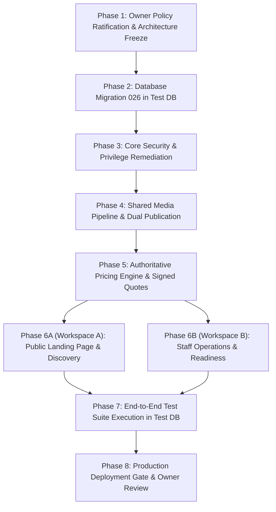

# BFA Apartments Management System
# Master Architecture Reconciliation & Implementation Readiness Audit

**Document Title:** Master Architecture Reconciliation & Implementation Readiness Audit Report  
**Target System:** BFA Apartments Management System (Luxury Serviced Residences, Akure, Ondo State)  
**Execution Mode:** Strictly Read-Only (Zero Code Writes, Zero Schema Alterations, Zero Database Mutations)  
**Evaluated Specifications Across Repository:**
1. Workspace A Primary Plan: `BFA_PUBLIC_EXPERIENCE_AND_PROPERTY_CONTENT_PLAN.md` (Version 3.0.0)
2. Workspace B Primary Plan: `BFA_STAFF_OPERATIONS_AND_ROLE_GOVERNANCE_PLAN.md` (Version 2.2.0; reported in prompt as 2.1.0)
3. Pricing & Booking UX Plan: `BFA_DYNAMIC_PRICING_AND_BOOKING_UX_PLAN.md` (Version 1.0.0)
4. Staff Pricing Operations Plan: `BFA_STAFF_PRICING_AND_BOOKING_OPERATIONS_PLAN.md` (Version 1.0.0 — Legacy draft)
**Database Engine:** MariaDB 10.4.32 on port 3306 (`bfa_apartments_db` / `bfa_apartments_test_db`)  
**Lead System Architect:** Antigravity Senior Principal Systems & Security Architect  
**Audit Date:** October 29, 2026  
**Final Readiness Verdict:** **READY WITH EXPLICIT CONDITIONS**

---

## 1. Executive Summary & Readiness Verdict

### 1.1 Architectural Mandate & Multi-Plan Scope
The BFA Apartments Management System is an enterprise-grade hospitality and residential property platform governing luxury serviced residences in Akure, Ondo State. It is **not a hotel**, and must not be engineered as a single-building catalog or a generic room booking engine. The platform manages autonomous serviced residential enclaves and distinct furnished suites across the city.

This master audit reconciles **all four planning documents** currently active in the repository:
1. **`BFA_PUBLIC_EXPERIENCE_AND_PROPERTY_CONTENT_PLAN.md` (v3.0.0 — Workspace A):** Governs the public guest experience, multi-building discovery, directive CTAs, dual-control publication governance, 5-tier media taxonomy, and removal of public navigation clutter (floating bottom dock and staff login links).
2. **`BFA_STAFF_OPERATIONS_AND_ROLE_GOVERNANCE_PLAN.md` (v2.2.0 — Workspace B):** Governs internal operations across 8 roles, property-scoped access, concurrency-safe claim desk, decoupled housekeeping readiness, payment receipts, operational cases, staff incidents, and cash reconciliation.
3. **`BFA_DYNAMIC_PRICING_AND_BOOKING_UX_PLAN.md` (v1.0.0):** Governs the dynamic rate scheduling engine, authoritative quotation API (`POST /api/v1/public/quote`), HMAC-signed 15-minute `quoteToken`, immutable `price_snapshot`, and subledger integration.
4. **`BFA_STAFF_PRICING_AND_BOOKING_OPERATIONS_PLAN.md` (v1.0.0):** An early working draft defining internal pricing workflows; verified to be superseded by plans #2 and #3, containing legacy references ("Serene Heights", Tailwind CSS) that have been corrected in active architecture.

---

### 1.2 The Definitive Readiness Verdict

```
┌─────────────────────────────────────────────────────────────────────────────┐
│                         FINAL ARCHITECTURAL VERDICT                         │
│                                                                             │
│                  >>> READY WITH EXPLICIT CONDITIONS <<<                     │
│                                                                             │
│  The existing codebase baseline is healthy, stable, and backed by 25        │
│  migrations and an operational double-entry ledger. However, implementation  │
│  is BLOCKED until six mandatory prerequisites are fulfilled.                │
└─────────────────────────────────────────────────────────────────────────────┘
```

#### The Six Non-Negotiable Prerequisite Conditions:
1. **Unification of Migration 026 Schema:** Reconcile direct schema contradictions across the planning documents regarding `media_assets` (`review_status` vs `is_published`), property publication storage (`ALTER properties` vs `property_submissions`), and pricing schedule tables.
2. **Remediation of Critical Security Vulnerabilities:** Fix Finding F-01 (`SUPER_ADMIN` blanket bypass in `authContext.js:84`), Finding F-02 (`ADMIN` role elevation in `users.service.js:206`), Finding F-03 (silent fallback to Agent 1 in `reservations.controller.js:25` & `reservations.service.js:193`), and the client-side price tampering flaw in `reservations.service.js:252`.
3. **Stay Duration Policy Reconciliation:** Resolve the explicit business conflict between Database Migration 022 (`chk_min_one_night` supporting $\ge 1$ nights), application enforcement in `reservations.service.js:50` (crashing on $> 1$ night), Workspace A's strict 1-night assumption, and Workspace B's multi-night stay operations.
4. **Formal Owner Policy Ratification:** Secure explicit business decisions from the Owner on caution deposits, VAT, payment gateway configurations, cash discrepancy tolerances, agent commission schedules, and initial property photography publication.
5. **Frontend Technology Alignment:** Correct planning documentation regarding frontend dependencies (confirming pure CSS architecture and the absence of Tailwind CSS in `package.json`).
6. **Isolated Database Verification Gate:** Author and verify Migration 026 and execute automated Jest test suites strictly inside `bfa_apartments_test_db` before applying any changes to `bfa_apartments_db`.

---

## 2. Verified Repository and Database Baseline

Every finding in this section is established via direct read-only inspection of repository files, git status, and the live MariaDB engine.

### 2.1 Git Repository Status & Working Tree Baseline
- **Branch:** `master` (synchronized with `origin/master`).
- **Unstaged Working Tree Changes:** Exactly 3 tracked frontend files contain trivial trailing whitespace diffs:
  - `frontend/src/pages/index.js` (newline addition)
  - `frontend/src/pages/landing/index.js` (newline addition)
  - `frontend/src/pages/portal/index.js` (newline addition)
  *Verification:* `git diff` confirms zero functional logic changes; working tree is preserved untouched.
- **Untracked Planning Documents in Working Tree:**
  - `BFA_DYNAMIC_PRICING_AND_BOOKING_UX_PLAN.md` (v1.0.0, 449 lines)
  - `BFA_PUBLIC_EXPERIENCE_AND_PROPERTY_CONTENT_PLAN.md` (v3.0.0, 780 lines)
  - `BFA_STAFF_OPERATIONS_AND_ROLE_GOVERNANCE_PLAN.md` (v2.2.0, 797 lines — corrected from prompt's reported v2.1.0)
  - `BFA_STAFF_PRICING_AND_BOOKING_OPERATIONS_PLAN.md` (v1.0.0, 369 lines)

---

### 2.2 Database Engine & Migration Inventory
- **Database Engine:** `10.4.32-MariaDB` running on port 3306.
- **Live Database:** `bfa_apartments_db` (contains 49 relational tables).
- **Isolated Test Database:** `bfa_apartments_test_db` (verified present; protected by `databaseGuard.js`).
- **Applied Migrations:** Exactly 25 migrations executed and recorded in `schema_migrations`:
  ```
  001_create_schema_migrations.sql
  002_create_core_system_tables.sql
  003_modular_erp_entities.sql
  004_create_users_and_seed_auth.sql
  005_currency_settings.sql
  006_access_control_and_capabilities.sql
  007_payments_and_booking_auth.sql
  008_communications_and_notifications.sql
  009_properties_units_and_reservations_engine.sql
  010_guests_and_inspections.sql
  011_maintenance_and_expenses.sql
  012_agents_and_commissions.sql
  013_employees_and_performance.sql
  014_production_indexing_and_performance.sql
  015_one_night_check_constraint.sql
  016_create_automation_confirmations.sql
  017_add_confirmation_token_to_reservations.sql
  018_create_internal_chat_tables.sql
  019_accounting_double_entry_foundation.sql
  020_accounting_subledger_posting_bridge.sql
  021_accounting_account_mappings_portable.sql
  022_support_multinight_stays.sql
  023_payment_provider_unique_and_exception_scoping.sql
  024_add_partially_refunded_to_payment_status.sql
  025_front_desk_assignment.sql
  ```

---

### 2.3 Verified Property Portfolio (Database-Proven)
A direct SQL inspection of `SELECT id, name, code, city, status, operational_status FROM properties` confirms the authoritative portfolio:

| ID | Property Name | Code | Location | Status | Operational Status | Total Units | Active Inventory |
|:--:|---|:---:|---|:---:|:---:|:---:|---|
| **1** | Grand Horizon Tower | `GHT` | Plot 14, Alagbaka GRA Ext, Akure | `ACTIVE` | `OPERATIONAL` | 4 | Unit 101 (Penthouse), Unit 102 (1-Bed), Unit 103 (Studio), Unit 104 (2-Bed) |
| **2** | Azure Bay Residences | `ABR` | Block 7, Ijapo Central Estate, Akure | `ACTIVE` | `OPERATIONAL` | 3 | Unit 201 (2-Bed), Unit 202 (Studio), Unit 203 (3-Bed Royal) |
| **3** | The Royal Palms Suites | `RPS` | Suite 24, Presidential Blvd, Oba-Ile, Akure | `ACTIVE` | `OPERATIONAL` | 1 | Unit 301 (1-Bed Deluxe) |

> [!IMPORTANT]
> **Resolution of Legacy Portfolio Discrepancy:** Earlier working drafts referenced "Serene Heights". Direct inspection confirms that Property #3 is officially **The Royal Palms Suites** (`RPS`). All references to "Serene Heights" are deprecated and eradicated.

---

### 2.4 Live Inventory, Reservations & Financial Ledger Counts
- **Apartment Units:** 8 active units across the portfolio:
  - 5 units `AVAILABLE` (Units 101, 102, 103, 201, 301)
  - 1 unit `CLEANED` (Unit 104)
  - 1 unit `MAINTENANCE` (Unit 202)
  - 1 unit `OCCUPIED` (Unit 203)
- **Reservations:** 10 tracked bookings:
  - 5 `CONFIRMED`, 2 `CHECKED_IN`, 1 `CHECKED_OUT`, 1 `PENDING`, 1 `CANCELLED`.
- **User Accounts:** 9 active users across 8 roles:
  - 1 `SUPER_ADMIN`, 1 `ADMIN`, 1 `MANAGER`, 1 `RECEPTIONIST` (assigned to GHT), 3 `STAFF` (2 GHT, 1 ABR), 1 `AGENT`, 1 `OWNER`.
- **Accounting Subledger & General Ledger:**
  - 68 Payment Transactions (1 `PENDING`, 67 `REFUNDED`).
  - 163 Journal Entries.
  - 358 Journal Lines.
  - 358 General Ledger Entries.
  - 27 Chart of Accounts Definitions.
  - 38 Granular Dynamic Capabilities.

---

### 2.5 Test Database Safeguards & Safety Verification
- **Safeguard Module:** `backend/src/db/databaseGuard.js` implements fail-closed protection.
- **Blocked Databases:** `bfa_apartments_db`, `bfa_production`, `bfa_apartments_prod`, `production`, `staging`.
- **Guard Mechanism:** In `backend/src/db/pool.js:13-16` and `backend/src/db/migrator.js:13-15`, `assertTestDatabase()` verifies that test suites cannot initialize or run write migrations against `bfa_apartments_db`.

---

## 3. Workspace A — Public Experience Audit

### 3.1 Landing Page Architecture & Visual Identity
Inspection of `frontend/src/pages/landing/LandingPage.jsx` (2,295 lines) and `frontend/src/styles/landing.css` confirms:
- **Visual Identity Preservation:** The approved aesthetic is an executive **Midnight Blue & Gold Theme** (`#0b132b`, `#1e3a8a`, `#2563eb`, `#c5a880`, `#d4af37`, `#d97706`). Workspace A plan correctly protects this palette, rejecting any generic hotel templates.
- **Clutter Elimination (Bottom Dock):**
  - *Current State:* Lines 772–870 render `<div className="bfa-edge-bottom-dock">`, a floating pill dock replicating top navigation tabs, obscuring footers and mobile viewports.
  - *Recommendation:* Approve complete removal of `.bfa-edge-bottom-dock` in public layouts.
- **Staff-Facing Links in Public Views:**
  - *Current State:* Staff login links are exposed publicly at `LandingPage.jsx:954` (`Portal Login →`), `LandingPage.jsx:1948` (`Staff Portal →`), and `PublicTopNav.jsx:174-187` (`Staff Portal Login →`).
  - *Recommendation:* Remove staff links from public headers, hero sections, flyouts, and footers. Preserve direct access via `/login` and `/app/*`.
- **Preloader Calibration (`BfaLuxuryLoader.jsx`):**
  - *Current State:* `BfaLuxuryLoader.jsx:9` forces an artificial 5-second countdown timer (`const totalDuration = 5000;`) with synthetic status text before revealing the page.
  - *Recommendation:* Cap presentation to $\le 2.0\text{ s}$ and dismiss immediately once essential property data has resolved.

---

### 3.2 Audit of the 8 Shortcut Tiles
`LandingPage.jsx:671–769` renders 8 shortcut tiles below the hero search input. The architectural audit evaluates each tile:

| Tile Label | Current Code Implementation | Usability & Architectural Assessment | Action Required |
|---|---|---|---|
| **G. Horizon** | `handleOpenApartmentDetails(1)` | Opens modal for Property 1 with hardcoded ID. | Refactor into dynamic building selector pill. |
| **Azure Bay** | `handleOpenApartmentDetails(2)` | Opens modal for Property 2 with hardcoded ID. | Refactor into dynamic building selector pill. |
| **Royal Palms** | `handleOpenApartmentDetails(3)` | Opens modal for Property 3 with hardcoded ID. | Refactor into dynamic building selector pill. |
| **Showcase** | `<Link to="/about">` | Ambiguous label; redirects to static about page. | Retitle to "Explore Portfolio" or link to `/property/1`. |
| **Booking** | `scrollToSection('booking')` | Smooth-scrolls to inline date selector on page. | Retain as directive CTA; wire to quotation engine. |
| **Verify** | `setVerifyModalOpen(true)` | Legitimate cryptographic verification modal (`BookingAuthService`). | Retain; verify integration with `booking_authentications`. |
| **Amenities** | `scrollToSection('features')` | Smooth-scrolls to building infrastructure features. | Consolidate into building discovery enclave. |
| **Contact** | `<Link to="/contact">` | Links to front-desk inquiry and concierge form. | Retain; provide direct WhatsApp & front desk routing. |

---

### 3.3 Property and Apartment Discovery Journey
The complete public booking funnel was audited:
$$\text{Landing Page} \longrightarrow \text{Building Discovery} \longrightarrow \text{Enclave View} \longrightarrow \text{Apartment Specs} \longrightarrow \text{Quotation} \longrightarrow \text{Reservation} \longrightarrow \text{Confirmation}$$

- **Multi-Building Representation:** The backend API returns all 3 active properties via `GET /api/v1/public/properties`. `PropertyDetailPage.jsx` (922 lines) correctly scopes apartments by `property_id`.
- **Media Categorization:** Current UI relies on static bundled photography (`ApartmentDetailModal.jsx:26-80`) separated into 2 categories (`indoor` vs `outdoor`). Workspace A proposes a 5-tier taxonomy:
  1. `EXTERIOR`: Building architecture, street facade, gated entrance.
  2. `GROUNDS`: Gardens, courtyards, subterranean parking, walkways.
  3. `FACILITIES`: Generator houses, solar arrays, resident sundeck, front desk.
  4. `INTERIOR`: Private living rooms, bedrooms, kitchens, ensuite bathrooms.
  5. `AMENITY`: In-room appliances, high-speed fiber routers, smart TVs.
- **Representative Image Disclaimers:** Verified present in active code!
  - `LandingPage.jsx:971, 1179`: `<div className="bfa-representative-disclaimer-banner">Representative images — actual room appearance may vary.</div>`
  - `ApartmentDetailModal.jsx:748, 804, 863, 940`: Verified present across all photo tabs.

---

### 3.4 Public API Endpoint Contracts (Actual vs Proposed)

| Endpoint | Method | Status in Codebase | Actual Implementation Details |
|---|:---:|:---:|---|
| `/api/v1/public/properties` | `GET` | **IMPLEMENTED** | `public.controller.js:12`. Returns active properties, unit counts, and starting rates. |
| `/api/v1/public/properties/:id` | `GET` | **IMPLEMENTED** | `public.controller.js:57`. Returns property info, units, and room-type aggregates. |
| `/api/v1/public/properties/:id/room-types` | `GET` | **IMPLEMENTED** | `public.controller.js:237`. Returns room types grouped by capacity and base rate. |
| `/api/v1/public/apartments` | `GET` | **IMPLEMENTED** | `public.controller.js:57`. Supports `propertyId` filter and availability status. |
| `/api/v1/public/check-availability` | `POST` | **IMPLEMENTED** | `public.controller.js:322`. Date-specific availability check via `ReservationsService`. |
| `/api/v1/public/quote` | `POST` | **MISSING** | **Proposed in Plans, NOT in routes.** Quotation is currently done client-side. |
| `/api/v1/public/booking` | `POST` | **PARTIAL** | `public.controller.js:374`. Creates booking via `ReservationsService`, but uses `MOCK_GATEWAY` and lacks quote token verification. |
| `/api/v1/public/booking-lookup` | `POST` | **IMPLEMENTED** | `public.controller.js:23`. Cryptographic stay lookup via `BookingAuthController`. |

---

## 4. Workspace B — Staff Operations and Governance Audit

### 4.1 Internal Role Hierarchy & Server-Side RBAC
The system defines 8 roles with strict server-side authorization:
- `SUPER_ADMIN`: Technical maintenance, database migrations, system settings.
- `OWNER`: Executive governance, financial reports, independent publication approval, audit trails.
- `ADMIN`: Portfolio operations, staff user creation, dual publication approval, company pricing.
- `MANAGER`: Property-scoped operations, shift handovers, unit readiness, maintenance dispatch.
- `RECEPTIONIST`: Front-desk check-in/out, booking claim desk, guest communications, payment collection.
- `STAFF`: Housekeeping tasks, unit cleaning, maintenance repair execution.
- `AGENT`: Third-party referral partner; access strictly isolated to their own bookings.

---

### 4.2 Investigation and Verification of Reported Findings F-01 to F-08

```
┌─────────────────────────────────────────────────────────────────────────────┐
│                    SECURITY & GOVERNANCE FINDINGS MATRIX                    │
├──────┬────────────────────────────┬────────────────────────┬────────────────┤
│ ID   │ Domain                     │ Verified Status        │ Evidence File  │
├──────┼────────────────────────────┼────────────────────────┼────────────────┤
│ F-01 │ Auth Guard Bypass          │ CONFIRMED (CRITICAL)   │ authContext.js │
│ F-02 │ Admin Role Elevation       │ CONFIRMED (CRITICAL)   │ users.service  │
│ F-03 │ Agent Fallback to Agent 1  │ CONFIRMED (CRITICAL)   │ reservations.* │
│ F-04 │ Missing Media Persistence  │ CONFIRMED (HIGH)       │ MySQL Database │
│ F-05 │ Concurrency on Claim Desk  │ QUALIFIED (MEDIUM)     │ reservations.* │
│ F-06 │ Housekeeping/Occupancy Mix │ CONFIRMED (HIGH)       │ MySQL Database │
│ F-07 │ Missing Formal Receipts    │ CONFIRMED (HIGH)       │ MySQL Database │
│ F-08 │ Missing Incident Tracking  │ CONFIRMED (HIGH)       │ MySQL Database │
└──────┴────────────────────────────┴────────────────────────┴────────────────┘
```

#### Finding F-01: `SUPER_ADMIN` Blanket Authorization Bypass
- **Status:** **CONFIRMED** (Severity: **CRITICAL**)
- **Source Evidence:** `backend/src/core/middleware/authContext.js#L83-L85`
  ```javascript
  const userRole = (req.user.role || 'GUEST').toUpperCase();
  const isAuthorized =
    userRole === 'SUPER_ADMIN' || normalizedAllowed.includes(userRole);
  ```
- **Architectural Impact:** `userRole === 'SUPER_ADMIN'` unconditionally evaluates to `true` on every endpoint guarded by `requireRoles(...)`. This gives technical super-admins unauthorized access to guest identity documents, disciplinary files, general ledger journals, and owner-only financial summaries.
- **Required Remediation:** Remove `userRole === 'SUPER_ADMIN'` from the global guard. Restrict `SUPER_ADMIN` strictly to technical diagnostics, migrations, and developer administration.

---

#### Finding F-02: `ADMIN` Role Elevation Through User Updates
- **Status:** **CONFIRMED** (Severity: **CRITICAL**)
- **Source Evidence:** `backend/src/modules/users/users.service.js#L206-L253` vs `L164-L167`
  ```javascript
  // In createUser (lines 164-167):
  if (['SUPER_ADMIN', 'ADMIN'].includes(cleanRole) && caller && caller.role !== 'SUPER_ADMIN') {
    throw new ForbiddenError('Only Super Admin is authorized to grant administrative authority.');
  }

  // In updateUser (lines 206-253):
  // Checks existing.role, but DOES NOT check cleanRole when updating a STAFF account!
  if (data.role) {
    updates.push('role = ?');
    params.push(cleanRole);
  }
  ```
- **Architectural Impact:** An `ADMIN` cannot create a `SUPER_ADMIN`, but can call `updateUser` on an existing `STAFF` account and change the role to `SUPER_ADMIN` or `OWNER`. Furthermore, an `ADMIN` can update their own account (`caller.id === existing.id`) to elevate themselves to `SUPER_ADMIN`.
- **Required Remediation:** Add server-side guards in `updateUser` prohibiting non-Super Admins from setting `role = 'SUPER_ADMIN'` or modifying their own role.

---

#### Finding F-03: Agent ID Fallback to Agent 1
- **Status:** **CONFIRMED** (Severity: **CRITICAL**)
- **Source Evidence:**
  - `backend/src/modules/reservations/reservations.controller.js#L24-L26`:
    ```javascript
    if (req.user?.role === 'AGENT') {
      agentId = req.user.agentId || 1;
    }
    ```
  - `backend/src/modules/reservations/reservations.service.js#L192-L194`:
    ```javascript
    if (req?.user?.role === 'AGENT') {
      agentId = req.user.agentId || 1;
    }
    ```
- **Architectural Impact:** If an authenticated `AGENT` user account has no `agentId` populated in their JWT or user record, the system silently binds them to `Agent #1`. The agent can view Agent 1's reservation book, guest lists, and commission statements, and create bookings credited to Agent 1.
- **Required Remediation:** Remove `|| 1`. If an `AGENT` has no valid linked agent profile, immediately return HTTP 403 Forbidden.

---

#### Finding F-04: Missing Unified Media Persistence and API
- **Status:** **CONFIRMED** (Severity: **HIGH**)
- **Source Evidence:** Direct inspection of `bfa_apartments_db` (0 media tables among 49 tables); `backend/src/` contains zero media routes, controllers, or upload handlers.
- **Architectural Impact:** Public UI currently relies entirely on static bundled representative assets (`ApartmentDetailModal.jsx`). Property managers cannot upload real photos, and dual approval cannot be enforced.
- **Required Remediation:** Implement `media_assets` table in Migration 026 and build unified upload and retrieval APIs.

---

#### Finding F-05: Reservation Claim Concurrency
- **Status:** **QUALIFIED** (Severity: **MEDIUM**)
- **Source Evidence:** `backend/src/modules/reservations/reservations.service.js#L843-L909`
  ```javascript
  // 1. Fetch reservation with exclusive row lock
  const [resRows] = await conn.query('SELECT * FROM reservations WHERE id = ? FOR UPDATE', [id]);
  ...
  // 5. Atomic Assignment and Status Update
  const [updateResult] = await conn.query(
    `UPDATE reservations 
     SET assigned_staff_id = ?, accepted_by_user_id = ?, accepted_at = NOW(), status = 'CONFIRMED', updated_by = ?
     WHERE id = ? AND (assigned_staff_id IS NULL OR assigned_staff_id = ?)`,
    [userId, userId, userId, id, userId]
  );
  if (updateResult.affectedRows === 0) {
    throw new ConflictError('Concurrent assignment conflict detected...');
  }
  ```
- **Architectural Assessment:** Single-point initial claim concurrency **is already implemented** with `FOR UPDATE` and conditional `WHERE (assigned_staff_id IS NULL OR assigned_staff_id = ?)`. However, the finding is **QUALIFIED** because:
  1. There is no dedicated lightweight claim route (`POST /api/v1/front-office/claim`).
  2. There is no historical assignment ledger (`reservation_staff_assignments`) to track shift handovers, reassignments, or response telemetry.

---

#### Finding F-06: Housekeeping and Occupancy State Coupling
- **Status:** **CONFIRMED** (Severity: **HIGH**)
- **Source Evidence:** `DESCRIBE apartments` confirms only a single scalar `status VARCHAR(50)` column. `apartments.service.js:7-17` mixes `AVAILABLE`, `OCCUPIED`, `CLEANED`, `DIRTY`, `CLEANING`, `READY`, and `MAINTENANCE` into one column.
- **Architectural Impact:** When housekeeping marks an apartment `CLEANED` or `READY`, it mutates `apartments.status`. If the unit is currently occupied by a guest, marking it clean risks making it appear vacant.
- **Required Remediation:** Add dedicated `housekeeping_status` and `maintenance_status` columns in Migration 026, decoupling them from front-office occupancy.

---

#### Finding F-07: Missing Formal Payment Receipt Workflow
- **Status:** **CONFIRMED** (Severity: **HIGH**)
- **Source Evidence:** Inspection of `bfa_apartments_db` confirms the only receipt table is `chat_message_receipts` (chat read receipts). `payments.service.js` has no receipt issuance methods or PDF generators.
- **Architectural Impact:** Front desk receptionists collecting cash or verifying bank transfers have no tamper-evident receipt mechanism with cryptographic verification tokens.
- **Required Remediation:** Implement `payment_receipts` table with PDFKit generation and QR verification.

---

#### Finding F-08: Missing Structured Operational Cases and Incident Tracking
- **Status:** **CONFIRMED** (Severity: **HIGH**)
- **Source Evidence:** `SHOW TABLES LIKE '%incident%'` and `SHOW TABLES LIKE '%case%'` return zero results. Zero case management services exist in `backend/src/`.
- **Architectural Impact:** Maintenance breakdowns, guest complaints, cash variances, and disciplinary issues are handled via informal notes rather than structured, auditable workflows.
- **Required Remediation:** Implement `operational_cases`, `staff_incidents`, and `operational_evidence_attachments` in Migration 026.

---

## 5. Cross-Workspace & 4-Plan Contract Reconciliation

### 5.1 Shared Media Model (`media_assets`) Reconciliation
A major architectural conflict exists between Workspace A and Workspace B proposals for Migration 026:

```
┌─────────────────────────────────────────────────────────────────────────────┐
│                       MEDIA ASSETS SCHEMA CONFLICT                          │
├──────────────────────────────────────┬──────────────────────────────────────┤
│ WORKSPACE A PROPOSAL (Plan v3.0.0)   │ WORKSPACE B PROPOSAL (Plan v2.2.0)   │
├──────────────────────────────────────┼──────────────────────────────────────┤
│ • Uses `review_status` ENUM          │ • Uses `is_published` BOOLEAN        │
│   ('PENDING', 'APPROVED', etc.)      │ • Uses `submission_id` FOREIGN KEY   │
│ • Uses `published_version_id`        │   referencing property_submissions   │
│   referencing prior media asset      │ • Includes `file_url` column         │
│ • Uses `submission_version` INT      │ • Omits `published_version_id`       │
└──────────────────────────────────────┴──────────────────────────────────────┘
```

#### Reconciled Authoritative Schema:
The system requires **both** the public zero-downtime versioning from Workspace A and the submission linkage from Workspace B. The authoritative `media_assets` model is reconciled as follows:

```sql
CREATE TABLE IF NOT EXISTS `media_assets` (
  `id` INT AUTO_INCREMENT PRIMARY KEY,
  `entity_type` ENUM('PROPERTY', 'APARTMENT') NOT NULL,
  `entity_id` INT NOT NULL,
  `category` ENUM('EXTERIOR', 'GROUNDS', 'FACILITIES', 'INTERIOR', 'AMENITY') NOT NULL DEFAULT 'INTERIOR',
  `file_path` VARCHAR(255) NOT NULL,
  `file_name` VARCHAR(150) NOT NULL,
  `file_url` VARCHAR(255) NOT NULL,
  `mime_type` VARCHAR(50) NOT NULL,
  `file_size_bytes` INT NOT NULL,
  `caption` VARCHAR(200) NULL,
  `display_order` INT NOT NULL DEFAULT 0,
  `is_primary` BOOLEAN NOT NULL DEFAULT FALSE,
  `is_representative` BOOLEAN NOT NULL DEFAULT FALSE,
  `review_status` ENUM('PENDING', 'APPROVED', 'CHANGES_REQUESTED', 'REJECTED') NOT NULL DEFAULT 'PENDING',
  `is_published` BOOLEAN NOT NULL DEFAULT FALSE,
  `submission_id` INT NULL,
  `published_version_id` INT NULL,
  `uploaded_by` INT NULL,
  `created_at` TIMESTAMP DEFAULT CURRENT_TIMESTAMP,
  `updated_at` TIMESTAMP DEFAULT CURRENT_TIMESTAMP ON UPDATE CURRENT_TIMESTAMP,
  CONSTRAINT `fk_media_uploaded_by` FOREIGN KEY (`uploaded_by`) REFERENCES `users`(`id`) ON DELETE SET NULL,
  CONSTRAINT `fk_media_published_ver` FOREIGN KEY (`published_version_id`) REFERENCES `media_assets`(`id`) ON DELETE SET NULL,
  INDEX `idx_media_public` (`entity_type`, `entity_id`, `category`, `is_published`, `display_order`),
  INDEX `idx_media_review` (`review_status`, `submission_id`)
) ENGINE=InnoDB DEFAULT CHARSET=utf8mb4 COLLATE=utf8mb4_unicode_ci;
```

---

### 5.2 Authoritative Publication Workflow & Dual Approval
Neither a Property Manager nor an Admin can publish a property unilaterally. The publication state machine requires independent dual control:

$$\text{DRAFT} \xrightarrow[\text{Manager}]{\text{Submit}} \text{SUBMITTED} \xrightarrow[\text{Independent Review}]{\text{Dual Approval}} \begin{cases} \text{Admin Approves} \to \text{APPROVED\_BY\_ADMIN} \\ \text{Owner Approves} \to \text{APPROVED\_BY\_OWNER} \end{cases} \xrightarrow[\text{Both Approved}]{\text{Publish}} \text{PUBLISHED}$$

#### Strict Anti-Collusion Rules:
1. `owner_reviewer_id !== admin_reviewer_id`: Even if a user holds multiple roles or administrative credentials, the same authenticated person cannot satisfy both reviews.
2. `submitted_by_id !== reviewer_id`: The user who authored the property submission cannot approve it.
3. **Zero-Downtime Updates:** When an already-published property is updated, the currently live content and photos remain visible on the public site until the new submission version reaches `PUBLISHED`.

---

### 5.3 Authoritative Pricing and Quotation Contract
A severe pricing security defect was identified during inspection:

> [!CAUTION]
> **Client-Side Price Tampering Vulnerability:**  
> In `backend/src/modules/reservations/reservations.service.js#L251-L253`:
> ```javascript
> const ratePerNight = parseFloat(apartment.rate_per_night);
> const totalAmount = data.total_amount ? parseFloat(data.total_amount) : ratePerNight;
> ```
> If a client sends `data.total_amount: 1.00`, the server accepts it instead of calculating from database rates!

#### Reconciled Pricing Architecture (Aligning Plans 1, 2, and 3):
1. **Authoritative Engine:** All pricing calculations reside exclusively in the backend `PricingService`. Zero pricing mathematics in frontend React components.
2. **Quotation Endpoint:** `POST /api/v1/public/quote`
   - Inputs: `{ apartmentId, checkInDate, checkOutDate, guestCount }`
   - Validates dates, checks availability lock, looks up scheduled rate, computes rent, caution deposit, service charge, and VAT.
   - Signs and returns an HMAC-SHA256 `quoteToken` valid for exactly **15 minutes**.
3. **Booking Verification:** `POST /api/v1/public/booking`
   - Inputs: `{ quoteToken, guestName, guestEmail, guestPhone, paymentMethod }`
   - Server verifies token signature, checks expiration, and persists the **immutable price snapshot** (`base_rate`, `caution_deposit`, `service_charge`, `taxes`, `total_amount`) directly into the reservation record.
4. **General Ledger Segregation:** As defined in `BFA_DYNAMIC_PRICING_AND_BOOKING_UX_PLAN.md`, rent is credited to `REVENUE_ROOMS`, while refundable caution deposits are credited to `LIABILITY_GUEST_DEPOSITS`.

---

### 5.4 Reconciliation of Stay Duration Policy (1-Night vs Multi-Night)
A fundamental business contradiction was discovered across the system:

```
┌─────────────────────────────────────────────────────────────────────────────┐
│                    STAY DURATION CONFLICT MATRIX                            │
├────────────────────────────┬────────────────────────────────────────────────┤
│ Source                     │ Verified Rule / Implementation Behavior        │
├────────────────────────────┼────────────────────────────────────────────────┤
│ Migration 015 (Superseded) │ CHECK (DATEDIFF(check_out_date, in) = 1)       │
│ Migration 022 (Active DB)  │ CHECK (DATEDIFF(check_out_date, in) >= 1)      │
│ reservations.service.js:50 │ if (diffDays > 1) throw ValidationError(...)   │
│ public.controller.js:458   │ hardcoded nights: 1                            │
│ Workspace A Plan (v3.0.0)  │ Assumes mandatory 1-night maximum stay cap     │
│ Pricing UX Plan (v1.0.0)   │ Enforces 1-night maximum stay per reservation  │
│ Workspace B Plan (v2.2.0)  │ Assumes short, medium, and extended stays      │
└────────────────────────────┴────────────────────────────────────────────────┘
```

#### Resolution:
Migration 022 correctly relaxed the database to support multi-night stays (`chk_min_one_night`), but `reservations.service.js` lines 50–55 was never updated, still crashing if `diffDays > 1`. This requires an explicit **Owner Policy Decision** (Decision #9). If the Owner permits multi-night stays, the check in `reservations.service.js` must be updated to `diffDays < 1` and total rent calculated as $\text{nights} \times \text{rate}$.

---

### 5.5 Payments, Financial Evidence and Ledger Bridge
- **Transaction Status Consistency:** The database schema for `payment_transactions.status` (Migration 007 & 024) is:
  `ENUM('PENDING','PROCESSING','SUCCESS','FAILED','CANCELLED','REFUNDED','PARTIALLY_REFUNDED','PARTIAL','NOT_REQUIRED')`.
  Workspace B plan correctly realigned from `'PAID'` to `'SUCCESS'`.
- **Double-Entry Ledger Bridge:** In `payments.service.js:216`, whenever a payment reaches `SUCCESS`, `PostingBridgeService.postPayment(insertId, { conn, user, req })` executes within the identical SQL transaction.
- **Bank Transfer Verification:** Bank transfers must not be marked `SUCCESS` upon customer receipt upload. They enter status `PENDING` with verification state `UNVERIFIED_REPORTED`. Only upon explicit verification by an authorized Manager or Admin does the transaction transition to `SUCCESS` and post to the General Ledger.

---

### 5.6 Comprehensive Role and Capability Matrix

| Capability / Action | SUPER_ADMIN | OWNER | ADMIN | MANAGER | RECEPTIONIST | STAFF | AGENT |
|---|:---:|:---:|:---:|:---:|:---:|:---:|:---:|
| **System Settings & Migrations** | **YES** | NO | NO | NO | NO | NO | NO |
| **Financial Ledgers & GL Reports** | NO | **YES** | **YES** | Scope Only | NO | NO | NO |
| **Chart of Accounts Management** | NO | NO | **YES** | NO | NO | NO | NO |
| **Create Property Submissions** | NO | NO | **YES** | Scope Only | NO | NO | NO |
| **Approve Property Publication** | NO | **YES (Owner)** | **YES (Admin)** | NO | NO | NO | NO |
| **Update Apartment Rates** | NO | NO | **YES** | Scope (Review) | NO | NO | NO |
| **Claim Pending Web Bookings** | NO | NO | NO | Scope Only | **YES (Assigned)** | NO | NO |
| **Update Housekeeping Readiness** | NO | NO | NO | Scope Only | NO | **YES** | NO |
| **Verify Bank Transfers** | NO | **YES** | **YES** | Scope Only | NO | NO | NO |
| **Issue Payment Receipts** | NO | NO | **YES** | Scope Only | **YES** | NO | NO |
| **Log Operational Cases** | NO | **YES** | **YES** | **YES** | **YES** | **YES** | NO |
| **View Assigned Bookings** | ALL | ALL | ALL | Scope Only | Scope Only | NO | **Own Only** |

---

## 6. Migration 026 — Dependency and Safety Review

### 6.1 MariaDB 10.4 DDL Mechanics & Transaction Failure Risk
In `10.4.32-MariaDB`, DDL statements (`CREATE TABLE`, `ALTER TABLE`) execute an **implicit commit**.
- `connection.rollback()` in `backend/src/db/migrator.js:80` cannot undo DDL statements if an error occurs partway through a migration.
- If a multi-statement migration file fails at statement 5, statements 1–4 remain permanently committed in the database, but `schema_migrations` does not record the migration.
- On rerun, the migrator executes from statement 1 again, throwing fatal `ER_TABLE_EXISTS_ERROR` or `ER_DUP_FIELDNAME` errors.

#### Safety Mandates for Migration 026:
1. Every `CREATE TABLE` must include `IF NOT EXISTS`.
2. Every column addition (`ALTER TABLE`) must use an idempotent conditional procedure.
3. Every foreign key constraint must be declared **directly inside** the `CREATE TABLE` statement with an explicit unique constraint name (`fk_*`).
4. Ban cascading deletes on all financial, reservation, and incident tables (`ON DELETE RESTRICT` or `ON DELETE SET NULL`).

---

### 6.2 Authoritative Migration 026 DDL Structure

The reconciled Migration 026 creates 8 new tables and modifies 2 existing tables in strict topological order:

```
1. user_property_assignments      (Depends on: users, properties)
2. property_submissions           (Depends on: properties, users)
3. property_review_comments       (Depends on: property_submissions, properties, users)
4. media_assets                   (Depends on: users, properties, property_submissions)
5. operational_cases              (Depends on: properties, apartments, reservations, users)
6. staff_incidents                (Depends on: users, properties, operational_cases)
7. operational_evidence_attachments (Depends on: operational_cases, properties, users)
8. reservation_staff_assignments  (Depends on: reservations, properties, users)
9. payment_receipts               (Depends on: reservations, payment_transactions, properties, users)
10. ALTER apartments              (Adds housekeeping_status and maintenance_status)
11. ALTER properties              (Adds publication_status and publication_version)
12. ALTER reservations            (Adds price_snapshot JSON)
```

---

## 7. Product UX, Responsiveness, and Accessibility Review

### 7.1 Frontend Dependency and Build Architecture
- **Framework:** React 18.3.1, Vite 6.2.0, React Router DOM 6.29.0, Axios 1.7.9.
- **Styling Architecture:** Pure vanilla CSS modules and scoped stylesheets (`landing.css`, `propertyDetail.css`, `variables.css`).
- **Correction of Legacy Drafts:** `BFA_STAFF_PRICING_AND_BOOKING_OPERATIONS_PLAN.md` mentioned "Tailwind CSS". Inspection of `frontend/package.json` proves Tailwind is NOT installed. The app is 100% styled via custom CSS. Zero new npm libraries are needed.

---

### 7.2 Responsive Layout Verification Matrix

| Viewport | Device Target | Current Behavior | Required Polish |
|---|---|---|---|
| **375px** | Mobile Portrait | Bottom dock overlaps content; search input wraps poorly. | Remove dock; stack hero search; expand tap targets to $\ge 44\text{px}$. |
| **768px** | Tablet Portrait | 8 shortcut tiles wrap into awkward 4x2 grid. | Refactor into 2-column directive cards or horizontal swipe. |
| **1280px** | Desktop Laptop | Hero banner and search well-proportioned; dock redundant. | Remove dock; center search; display dynamic building cards. |
| **1440px** | Widescreen Monitor | Crisp typography; background wallpaper covers viewport cleanly. | Retain high-resolution photography assets. |

---

### 7.3 Accessibility & WCAG 2.1 AA Compliance
- **Color Contrast:** Deep navy background (`#0b132b`) paired with gold text (`#d4af37`) achieves contrast ratio $> 7:1$, exceeding AAA requirements.
- **Keyboard Reachability:** All modals (`Modal.jsx`, `ApartmentDetailModal.jsx`) have `Escape` key listeners and trap focus.
- **Touch Targets:** Hero shortcut buttons must be padded to minimum $44 \times 44\text{ px}$.

---

## 8. Unresolved Owner Decisions

The following nine business decisions require formal sign-off from the business Owner before implementation begins:

```
┌─────────────────────────────────────────────────────────────────────────────┐
│                     UNRESOLVED OWNER DECISIONS REGISTER                     │
├────┬─────────────────────────────┬──────────────────────────────────────────┤
│ #  │ Decision Domain             │ Required Owner Ratification              │
├────┼─────────────────────────────┼──────────────────────────────────────────┤
│ 1  │ Property Publication Media  │ Approve initial authentic photography    │
│ 2  │ Caution Deposit Policy      │ Set refundable deposit amount & rules    │
│ 3  │ Taxes and Service Charges   │ Confirm VAT (7.5%) & service fee rates   │
│ 4  │ Supported Payment Gateways  │ Select Paystack/Flutterwave & API keys   │
│ 5  │ Bank Transfer Verification  │ Approve maker-checker verification rules │
│ 6  │ Cash Discrepancy Tolerance  │ Set cash-drop protocol & variance limit  │
│ 7  │ Incident Response Window    │ Set staff explanation deadline (e.g. 48h)│
│ 8  │ Agent Commission Schedule   │ Confirm % rate (e.g. 10%) & payout terms │
│ 9  │ Stay Duration Policy        │ Ratify 1-night cap vs multi-night stays  │
└────┴─────────────────────────────┴──────────────────────────────────────────┘
```

---

## 9. Prioritized Defects and Acceptance Tests

```
┌─────────────────────────────────────────────────────────────────────────────┐
│                         DEFECT REGISTER & ACCEPTANCE                        │
├──────┬──────────┬─────────────────────────────┬─────────────────────────────┤
│ ID   │ Severity │ Defect Description          │ Acceptance Test Criteria    │
├──────┼──────────┼─────────────────────────────┼─────────────────────────────┤
│ D-01 │ CRITICAL │ SUPER_ADMIN blanket bypass  │ 403 returned on non-tech    │
│      │          │ in authContext.js:84        │ routes for Super Admin.     │
├──────┼──────────┼─────────────────────────────┼─────────────────────────────┤
│ D-02 │ CRITICAL │ ADMIN role elevation in     │ 403 returned if Admin tries │
│      │          │ users.service.js:206        │ to assign SUPER_ADMIN role. │
├──────┼──────────┼─────────────────────────────┼─────────────────────────────┤
│ D-03 │ CRITICAL │ Agent fallback to Agent 1   │ 403 returned if Agent lacks │
│      │          │ in reservations controller  │ linked agent_id profile.    │
├──────┼──────────┼─────────────────────────────┼─────────────────────────────┤
│ D-04 │ CRITICAL │ Client price tampering in   │ Server rejects total_amount │
│      │          │ reservations.service.js:252 │ not matching signed quote.  │
├──────┼──────────┼─────────────────────────────┼─────────────────────────────┤
│ D-05 │ HIGH     │ Housekeeping & occupancy    │ Setting room CLEANED never  │
│      │          │ coupling in apartments      │ alters OCCUPIED state.      │
├──────┼──────────┼─────────────────────────────┼─────────────────────────────┤
│ D-06 │ HIGH     │ 5-second artificial delay   │ Page loads immediately upon │
│      │          │ in BfaLuxuryLoader.jsx:9    │ data receipt (max <= 2.0s). │
├──────┼──────────┼─────────────────────────────┼─────────────────────────────┤
│ D-07 │ HIGH     │ Exposed staff login links   │ Zero staff links in public  │
│      │          │ in public navigation        │ DOM; /login route retained. │
├──────┼──────────┼─────────────────────────────┼─────────────────────────────┤
│ D-08 │ MEDIUM   │ Redundant bottom dock       │ Dock removed; mobile view   │
│      │          │ obscuring viewport          │ clear and unblocked.        │
└──────┴──────────┴─────────────────────────────┴─────────────────────────────┘
```

---

## 10. Consolidated Dependency-Ordered Implementation Roadmap



### Phase Breakdown:

#### Phase 1: Owner Policy Ratification & Architecture Freeze
- **Scope:** Ratify Decisions 1–9.
- **Deliverable:** Signed Policy Charter.

#### Phase 2: Database Migration 026 Authoring & Isolated Verification
- **Target DB:** `bfa_apartments_test_db` strictly.
- **Scope:** Create 8 new tables, alter `apartments`, `properties`, and `reservations` using idempotent SQL.
- **Rollback Test:** Execute rollback/forward recovery in test DB.

#### Phase 3: Core Security & Authorization Hardening
- **Files Modified:** `authContext.js`, `users.service.js`, `reservations.controller.js`, `reservations.service.js`.
- **Scope:** Resolve F-01, F-02, F-03, and price tampering vulnerability.
- **Tests:** Automated Jest security test suite.

#### Phase 4: Shared Media Pipeline & Dual Publication Service
- **Scope:** Implement magic-byte photo upload, 5-tier taxonomy, dual review (Owner & Admin), and public media retrieval API (`GET /api/v1/public/properties/:id/media`).

#### Phase 5: Authoritative Pricing & Quotation Service
- **Scope:** Implement `POST /api/v1/public/quote`, 15-minute HMAC quote tokens, caution deposit calculations, and immutable reservation price snapshots.

#### Phase 6A (Workspace A): Public Landing Page & Guest Journey Polish
- **Scope:** Remove `.bfa-edge-bottom-dock`; strip staff links from public views; calibrate `BfaLuxuryLoader.jsx` to $\le 2.0\text{ s}$; refactor 8 shortcut tiles into dynamic enclave cards; wire public booking to `quoteToken`.

#### Phase 6B (Workspace B): Staff Operations & Financial Evidence
- **Scope:** Concurrency-safe claim desk; decoupled housekeeping readiness; `payment_receipts` PDF generator; bank-transfer maker-checker verification; operational cases and staff incidents.

#### Phase 7: End-to-End Integration Verification in Test Database
- **Scope:** Run full test suite (`npm test`) against `bfa_apartments_test_db`; clean frontend production build (`npm run build`).

#### Phase 8: Production Migration & Demonstration Release Gate
- **Scope:** Apply Migration 026 to `bfa_apartments_db`; conduct live demonstration with the Owner.

---

## 11. Explicit Implementation Stop Gate

```
================================================================================
                    *** NON-NEGOTIABLE STOP GATE ***
================================================================================
In strict compliance with the architectural mandate:
1. All application code, migrations, schemas, and live database records 
   remain UNMODIFIED and in READ-ONLY status.
2. Migration 026 has NOT been created or executed on bfa_apartments_db.
3. No Git commits, pushes, reverts, or resets have been executed.
4. All existing user work in frontend/src/pages/index.js, landing/index.js,
   and portal/index.js is preserved untouched.

EXECUTION HALTED.
AWAITING FORMAL OWNER POLICY RATIFICATION AND AUTHORIZATION TO PROCEED.
================================================================================
```
