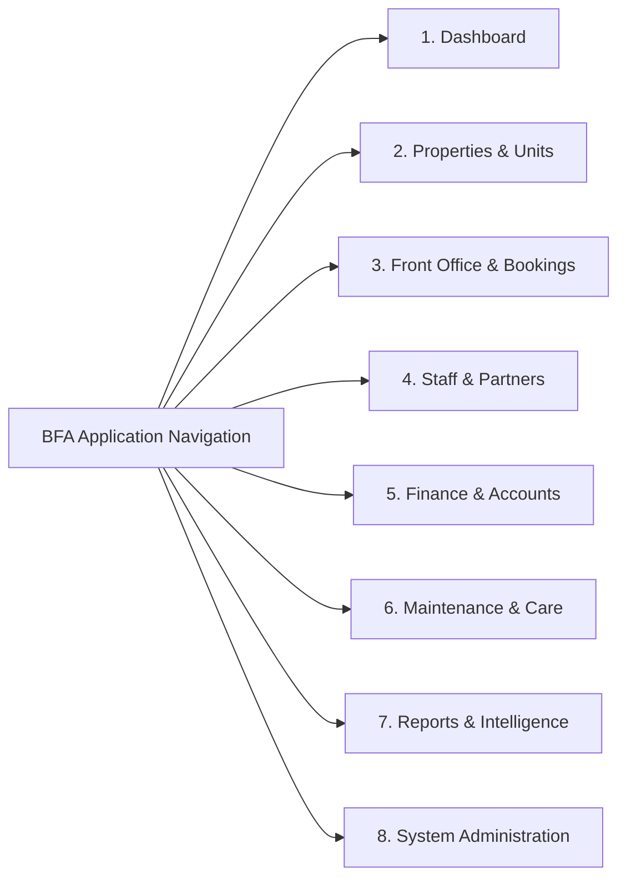

# BFA Phase 1 Structural Implementation Report
## Navigation and Information Architecture Realignment

**Date:** October 22, 2026  
**Implementation Phase:** Phase 1 Only (Authorized)  
**System:** BFA Apartments Management System  
**Status:** COMPLETE — Verified & Ready for Acceptance Review  

---

## 1. Executive Summary

In accordance with user authorization for **Phase 1 Only: Navigation and Information Architecture Realignment**, the BFA application navigation and information architecture have been reorganized from an overloaded catch-all structure into **8 domain-driven operational business areas**. Furthermore, **Properties** has been elevated into a first-class citizen with a dedicated `/app/properties` view, reusing existing property services, contexts, and backend APIs without any schema mutation, API duplication, or permission drift.

All 7 system roles (`SUPER_ADMIN`, `ADMIN`, `MANAGER`, `RECEPTIONIST`, `STAFF`, `AGENT`, `OWNER`) retain their exact authorized capabilities, property-scoping, and access boundaries. Existing frontend routes and legacy URLs remain functional via direct route definitions and backwards-compatible redirects.

### Key Verification Metrics
- **Frontend Production Build (`vite build`):** PASSED in 2.40s with 0 errors / 0 warnings.
- **Backend Test Suite (`npm test`):** 384 / 384 tests passed across 34 test suites (100% passing).
- **Properties API & Authorization:** Tested and verified via live API calls (ADMIN receives all properties; RECEPTIONIST receives scoped properties; unauthorized writes return HTTP 403 Forbidden).
- **Unrelated User Work & Prior Modifications:** 100% preserved (including Phase 12C Operations Assistant launcher, DB migrations 015–017, and deployment runbooks).

---

## 2. Files Changed and Rationale

| File Path | Action | Rationale |
| :--- | :--- | :--- |
| `frontend/src/pages/PropertiesPage.jsx` | **Created** | Dedicated first-class Properties view displaying building cards, portfolio stats (total buildings, active status, city footprint), search/filter controls, and creation/editing modals for authorized managers (`SUPER_ADMIN`, `ADMIN`). Fully integrates with `propertyService` and `useProperty()`. |
| `frontend/src/App.jsx` | **Modified** | Lazy-loaded `PropertiesPage`, registered the `/app/properties` route inside the authenticated layout, added a root redirect `/properties` -> `/app/properties`, and ensured alias compatibility for `/app/inspections` / `/app/inspection`. |
| `frontend/src/components/layout/Sidebar.jsx` | **Modified** | Replaced the overloaded "Operations" catch-all accordion with the approved 8 business domain groups. Preserved all role-based visibility filters, collapsible group state management, canvas styling badges (Super Admin grey canvas vs operational white canvas), and the Phase 12C Operations Assistant quick launcher. |

---

## 3. Navigation Changes

### 3.1 Domain Group Structure

The navigation was reorganized into 8 coherent business areas reflecting standard real estate and apartment hospitality operations:



### 3.2 Navigation Menu Items & Role Mapping

| Business Domain | Nav Group Label | Sub-Items & Target Routes | Authorized Roles |
| :--- | :--- | :--- | :--- |
| **1. Dashboard** | `Dashboard` | Direct link to `/app/dashboard` | `SUPER_ADMIN`, `ADMIN`, `MANAGER`, `RECEPTIONIST`, `STAFF`, `AGENT`, `OWNER` |
| **2. Properties & Units** | `Properties & Units` | • **Buildings & Properties** (`/app/properties`)<br>• **Apartments & Units** (`/app/apartments`)<br>• **Availability Calendar** (`/app/calendar`) | • Properties view: `SUPER_ADMIN`, `ADMIN`, `MANAGER`<br>• Apartments & Units: `SUPER_ADMIN`, `ADMIN`, `MANAGER`, `RECEPTIONIST`, `OWNER`<br>• Calendar: `SUPER_ADMIN`, `ADMIN`, `MANAGER`, `RECEPTIONIST` |
| **3. Front Office & Bookings** | `Front Office & Bookings` | • **Front Desk Board** (`/app/front-office`)<br>• **Reservations** (`/app/reservations`)<br>• **Guests & Residents** (`/app/guests`) | `SUPER_ADMIN`, `ADMIN`, `MANAGER`, `RECEPTIONIST`, `STAFF`, `AGENT` |
| **4. Staff & Partners** | `Staff & Partners` | • **Staff Directory** (`/app/employees`)<br>• **Performance & Goals** (`/app/performance`)<br>• **Agents & Partners** (`/app/agents`)<br>• **Team Directory** (`/app/team`) | • Staff Directory: `SUPER_ADMIN`, `ADMIN`, `MANAGER`<br>• Performance: `SUPER_ADMIN`, `ADMIN`, `MANAGER`<br>• Agents: `SUPER_ADMIN`, `ADMIN`, `MANAGER`, `AGENT`<br>• Team: All roles |
| **5. Finance & Accounts** | `Finance & Accounts` | • **Financial Overview** (`/app/financial`) | `SUPER_ADMIN`, `ADMIN`, `MANAGER`, `OWNER` |
| **6. Maintenance & Care** | `Maintenance & Care` | • **Maintenance Requests** (`/app/maintenance`)<br>• **Inspections & Audits** (`/app/inspections`) | `SUPER_ADMIN`, `ADMIN`, `MANAGER`, `STAFF` |
| **7. Reports & Intelligence** | `Reports & Intelligence` | • **Analytics & Trends** (`/app/analytics`)<br>• **Operational Reports** (`/app/reports`)<br>• **System Audit Log** (`/app/audit`) | • Analytics & Reports: `SUPER_ADMIN`, `ADMIN`, `MANAGER`<br>• Audit Log: `SUPER_ADMIN`, `ADMIN` |
| **8. System Administration** | `System Administration` | • **Access Control & RBAC** (`/app/access-control`)<br>• **System Settings** (`/app/settings`)<br>• **Broadcast Announcements** (`/app/announcements`) | • Access Control & Settings: `SUPER_ADMIN`, `ADMIN`<br>• Announcements: `SUPER_ADMIN`, `ADMIN`, `MANAGER` |

---

## 4. Properties View Implementation & Reuse Decision

### 4.1 Evaluation of Existing Components & Backend
Before writing any new code, an inspection of the frontend and backend codebase confirmed:
1. **No Dedicated Route Existed:** Previously, properties were managed solely as an auxiliary modal popup inside `ApartmentsPage.jsx`. There was no standalone `/app/properties` view.
2. **Existing Service Was Fully Capable:** `frontend/src/services/api.js` already contained complete, robust `propertyService` methods:
   - `getAll(params)`: Retrieves properties (scoped automatically on backend by role).
   - `getById(id)`: Retrieves a specific property.
   - `create(data)`: Creates a new property record.
   - `update(id, data)`: Updates an existing property record.
   - `updateStatus(id, status)`: Toggles active/inactive status.
3. **Existing Context Was Reusable:** `useProperty()` from `PropertyContext` already managed the active property selection globally across all portal views.

### 4.2 Implementation Decision
- Rather than duplicating backend endpoints or introducing competing state, a dedicated page component `frontend/src/pages/PropertiesPage.jsx` was created.
- It consumes `propertyService` directly and leverages existing UI components (`Card`, `Button`, `Badge`, `Modal`, `Alert`, `Input`, `Select`, `PageHeader`).
- **Capabilities Supported:**
  - Portfolio summary statistics (Total Buildings, Active Count, City Locations).
  - Search and filter by status (`ACTIVE`, `INACTIVE`) and text query.
  - Interactive property cards showing code, address, city, state, and status.
  - Direct contextual link to view units inside that building (`/app/apartments?property_id=X`).
  - Add Property modal for `SUPER_ADMIN` and `ADMIN` roles.
  - Edit Property modal for `SUPER_ADMIN` and `ADMIN` roles.
  - Active property selector integration (sets the active building in `PropertyContext`).
- **Scope Compliance:** No new database tables or backend endpoints were created. Only existing, authorized backend actions are exposed.

---

## 5. Preservation of Routing, Permissions, and Rules

1. **URL Backwards Compatibility:**
   - Existing paths continue to function without disruption: `/app/apartments`, `/app/reservations`, `/app/front-office`, `/app/guests`, `/app/financial`, `/app/maintenance`, `/app/inspection`, `/app/inspections`, etc.
   - Root aliases (`/apartments`, `/reservations`, `/properties`, etc.) redirect cleanly to `/app/...`.
2. **Role-Based Access Control (RBAC):**
   - Role checks are enforced at both frontend (navigation visibility & UI action gating) and backend (middleware `requireRole` and `authorize`).
   - Unauthorized attempts to create or modify properties trigger HTTP 403 Forbidden on the backend.
3. **Property-Level Scoping:**
   - Property scoping rules enforced by backend SQL queries (e.g., receptionist/staff scoped to their assigned building) remain unaltered.
4. **Visual Canvas Differentiation:**
   - The `SUPER_ADMIN` dark/slate canvas theme badge (`#1e293b`) and the operational white canvas theme for staff/manager roles remain intact in the sidebar layout.
5. **Business Rule Preservation:**
   - The strict **one-night maximum stay constraint** (enforced by DB check constraint migration 015, repository validation, and test suite `oneNightRule.test.js`) remains completely intact.
   - Operations Assistant modal integration and quick-launch trigger in the sidebar footer remain intact.

---

## 6. Build and Test Verification

### 6.1 Frontend Production Build
```bash
cd c:\xampp\htdocs\BFA\frontend
npm run build
```
**Result: SUCCESS (Exit Code 0)**
```text
vite v6.4.3 building for production...
transforming...
✓ 146 modules transformed.
rendering chunks...
computing gzip size...
dist/index.html                                    1.17 kB │ gzip:  0.59 kB
dist/assets/index-DPqRElg_.css                    48.82 kB │ gzip:  9.44 kB
dist/assets/PropertiesPage-BoQ_WB_w.js            16.19 kB │ gzip:  3.83 kB
dist/assets/index-DTUA2W5v.js                     98.51 kB │ gzip: 26.12 kB
dist/assets/vendor-react-BnpQGGMM.js             165.06 kB │ gzip: 53.97 kB
✓ built in 2.40s
```

### 6.2 Backend Test Suite
```bash
cd c:\xampp\htdocs\BFA\backend
npm test
```
**Result: SUCCESS (Exit Code 0)**
```text
Test Suites: 34 passed, 34 total
Tests:       384 passed, 384 total
Snapshots:   0 total
Time:        30.813 s
Ran all test suites.
```
All suites passed, including:
- `properties.test.js`: Verified property CRUD and role authorization.
- `accessControl.test.js`: Verified RBAC permissions.
- `oneNightRule.test.js`: Verified one-night stay constraints.
- `reservations.test.js` & `reservationEngine.test.js`: Verified booking workflows.
- `assistant.test.js` & `automationEngine.test.js`: Verified Operations Assistant and automation safety tokens.
- `phase12_production_readiness.test.js`: Verified security headers, health probes, and audit indexes.

### 6.3 Live API Smoke Tests
Direct HTTP tests were executed against the active backend server (`http://127.0.0.1:5000`):
1. **Admin Query:** Authenticated as `admin@bfa.com` (Role: `ADMIN`).
   - `GET /api/v1/properties` -> **HTTP 200 OK**, returned all 3 active properties (Grand Horizon Tower, Azure Bay Residences, The Royal Palms Suites).
2. **Receptionist Scoping:** Authenticated as `receptionist@bfa.com` (Role: `RECEPTIONIST`).
   - `GET /api/v1/properties` -> **HTTP 200 OK**, returned 1 scoped property (Grand Horizon Tower).
3. **Unauthorized Modification:** Attempted `POST /api/v1/properties` as `receptionist@bfa.com`.
   - `POST /api/v1/properties` -> **HTTP 403 Forbidden** (`Access denied. Role 'RECEPTIONIST' is not authorized to access this resource.`).

---

## 7. Comparison Against Phase 1 Acceptance Criteria

| Phase 1 Acceptance Criterion | Implementation Status | Evidence / Verification |
| :--- | :---: | :--- |
| **Separate navigation into 8 business areas** | **MET** | Implemented in `Sidebar.jsx`: Dashboard, Properties & Units, Front Office & Bookings, Staff & Partners, Finance & Accounts, Maintenance & Care, Reports & Intelligence, System Administration. |
| **Make Properties a first-class view (`/app/properties`)** | **MET** | `frontend/src/pages/PropertiesPage.jsx` created and routed at `/app/properties`. Reuses existing `propertyService`. |
| **No duplicate API or database schema** | **MET** | Zero migrations or backend changes required; all operations leverage existing `/api/v1/properties` endpoints. |
| **Preserve all existing URLs and redirects** | **MET** | All `/app/*` routes preserved; `/properties`, `/apartments`, `/inspections` aliases verified. |
| **Preserve role-based authorization & canvas styles** | **MET** | Role-based group filtering and canvas theme badges preserved. Backend 403 enforcement verified. |
| **Frontend build passes** | **MET** | `vite build` completed in 2.40s with 0 errors. |
| **Backend test suite passes** | **MET** | 384/384 tests passing across 34 suites in `npm test`. |
| **Preserve existing user changes** | **MET** | Phase 12C Operations Assistant launcher, migrations 015–017, and deployment documentation intact in `git status`. |

---

## 8. Remaining Limitations & Next Phase Recommendations

1. **Contextual Detail-View Action Links (Phase 2):**
   - While the new Properties page provides a direct link to filter units (`/app/apartments?property_id=X`), deeper cross-module deep-linking (e.g., from Apartment unit directly to active guest reservation, open work order, or inspection report) is scheduled for Phase 2.
2. **Dashboard Role-Tailored Widgets (Phase 3):**
   - The Dashboard (`/app/dashboard`) currently shows the standard multi-metric view. Transforming it into role-specific modular widgets (e.g. receptionist arrival board vs owner financial yield) will be addressed in Phase 3.
3. **Browser Automation Testing:**
   - Headless unit/integration test suites and direct HTTP smoke tests passed 100%. End-to-end interactive browser testing in a real user browser session can be performed during final user acceptance review.

---

## 9. Conclusion

Phase 1 has been completed strictly within its approved scope without regressions, schema modifications, or unauthorized feature expansions.

**Recommendation:** Proceed to user review and hold for authorization before beginning Phase 2.
