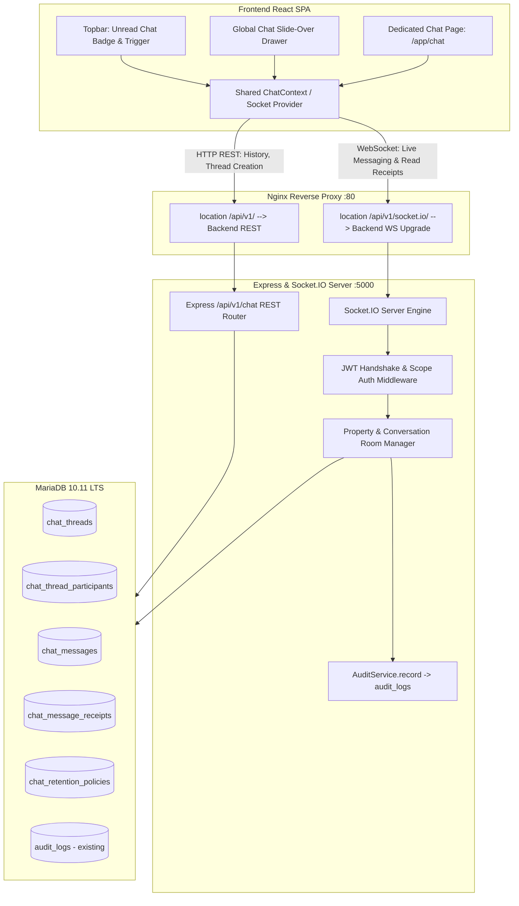
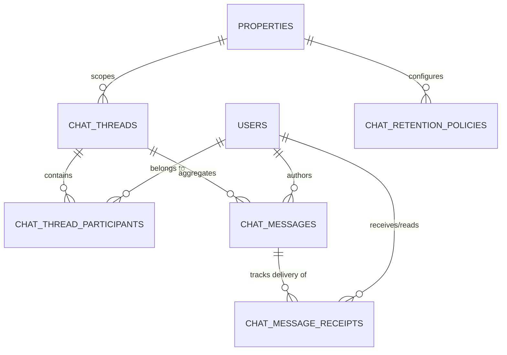
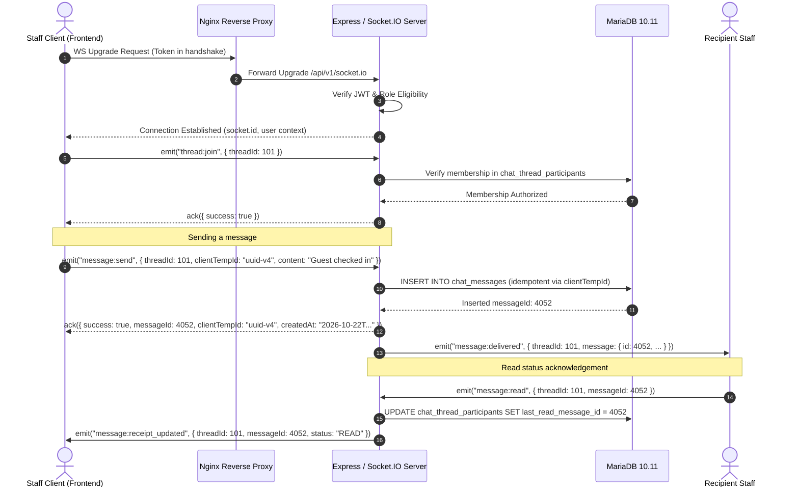
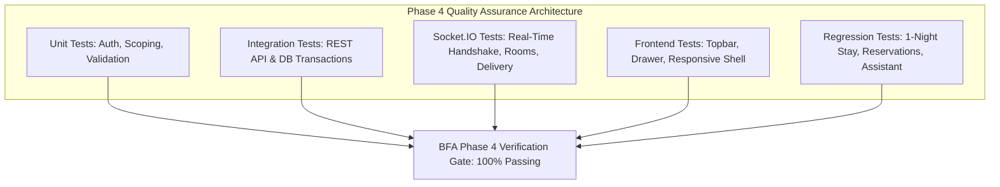
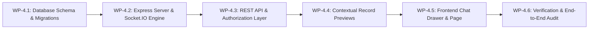

# BFA APARTMENTS MANAGEMENT SYSTEM
## Phase 4 — Internal Chat & Communication System
### Architecture Review & Implementation Specification

**Document Version:** 1.0.0  
**Status:** **AUTHORITATIVE DESIGN SPECIFICATION — PLANNING & DOCUMENTATION ONLY**  
**Target Phase:** Phase 4 (Post-Phase 3 Milestone)  
**Execution Mode:** Strictly Architectural & Technical Documentation (Zero Code Implementation)  
**Authors:** Senior Software Architect, Backend Security Engineer, Database Architect, QA Lead  

---

## 1. Executive Summary

This specification establishes the complete technical architecture and implementation blueprint for **Phase 4: Internal Chat & Communication System** within the BFA Apartments Management System. Phase 4 introduces a secure, real-time, bidirectional operational messaging system for authorized staff, enabling instant operational coordination, property-scoped team communication, and secure contextual record referencing.

### 1.1 Scope Mandate & Fixed Product Decisions
Per authoritative project decisions and the master development roadmap ([`BFA_DEVELOPMENT_ROADMAP.md`](file:///c:/xampp/htdocs/BFA/BFA_DEVELOPMENT_ROADMAP.md)):
1. **Real-Time Transport:** **Socket.IO** attached to the Node.js/Express HTTP server with cryptographic JWT handshake authentication, augmented by REST APIs for pagination, message history, thread discovery, and idempotent submissions.
2. **Dual-Surface Interface:** Both a **global slide-over chat drawer** (accessible across all authenticated views without loss of operational page state) and a **dedicated full-page route** at `/app/chat`.
3. **Data Retention Policy:** Message retention is **strictly configurable with ZERO automatic deletion, scheduled purge, or irreversible destructive cleanup** in Phase 4. Messages are preserved indefinitely until an explicit compliance policy is reviewed, configured, and approved.
4. **Property Isolation & Cross-Property Direct Messaging:** Direct messaging is strictly restricted to staff who share an authorized property or operational scope under the existing access model. Organization-wide unrestricted messaging is prohibited.
5. **Initial Role Eligibility (v1):** Restricted exclusively to internal operational roles: `SUPER_ADMIN`, `ADMIN`, `MANAGER`, `RECEPTIONIST`, and `STAFF`.
6. **Explicit Exclusions (v1):** `AGENT`, `OWNER`, external guests, and tenants are strictly excluded from v1 operational chat. File attachments, voice notes, rich-text WYSIWYG, and autonomous AI bots are deferred to future roadmap phases.

---

## 2. Repository Facts and Evidence

The following technical facts have been directly verified by inspecting the active repository codebase, environment configuration, database schema, and test suites:

### 2.1 Backend Architecture
- **Framework & HTTP Lifecycle:** Express 4.21.2 initialized in [`backend/src/app.js`](file:///c:/xampp/htdocs/BFA/backend/src/app.js). The HTTP server is started in [`backend/src/server.js`](file:///c:/xampp/htdocs/BFA/backend/src/server.js) via `app.listen(PORT, ...)`. To attach Socket.IO, `server.js` must wrap Express using Node's standard `http.createServer(app)`.
- **Authentication & JWT Extraction:** Cryptographic JWT tokens are validated in [`backend/src/core/middleware/authContext.js`](file:///c:/xampp/htdocs/BFA/backend/src/core/middleware/authContext.js). The middleware populates `req.user = { id, name, email, role, propertyId, agentId }`. Unauthenticated requests are rejected with `HTTP 401 UNAUTHORIZED`. The middleware strictly ignores client-supplied `X-User-Role` headers.
- **Security & CSP:** [`backend/src/core/security/security.js`](file:///c:/xampp/htdocs/BFA/backend/src/core/security/security.js) defines Content Security Policy via Helmet. In `connectSrc`, it permits `'self'`, `config.app.url`, `config.app.frontendUrl`, and `config.cors.origin`. WebSocket schemes (`ws:`, `wss:`) must be explicitly declared for reverse-proxy compatibility.
- **Database Access & Connection Pool:** MySQL/MariaDB connectivity is managed via `mysql2/promise` in [`backend/src/db/pool.js`](file:///c:/xampp/htdocs/BFA/backend/src/db/pool.js), using a single resilient connection pool with transaction support (`getConnection()`, `beginTransaction()`, `commit()`, `rollback()`, `release()`).
- **Database Migrations:** [`backend/src/db/migrator.js`](file:///c:/xampp/htdocs/BFA/backend/src/db/migrator.js) executes versioned `.sql` files sorted alphabetically and tracks them in `schema_migrations`. 17 migrations currently exist (`001_...` through `017_add_confirmation_token_to_reservations.sql`). The Phase 4 migration will be `018_create_internal_chat_tables.sql`.
- **Existing Audit Trail:** [`backend/src/core/audit/audit.service.js`](file:///c:/xampp/htdocs/BFA/backend/src/core/audit/audit.service.js) records system events into the `audit_logs` table via `AuditService.record({ actorId, actorEmail, actorRole, action, entityType, entityId, oldValues, newValues, ipAddress, userAgent, requestId })`.
- **Dependencies:** Backend currently lacks `socket.io`. It must be added to [`backend/package.json`](file:///c:/xampp/htdocs/BFA/backend/package.json) during Phase 4 implementation.

### 2.2 Frontend Architecture
- **Framework & Bundler:** React 18.3.1 with Vite 6.2.0 in [`frontend/package.json`](file:///c:/xampp/htdocs/BFA/frontend/package.json).
- **Navigation Shell:** Topbar in [`frontend/src/components/layout/Topbar.jsx`](file:///c:/xampp/htdocs/BFA/frontend/src/components/layout/Topbar.jsx) houses the property switcher, search trigger (`Ctrl+K`), operations assistant trigger (`Alt+A`), and notification bell. Layout shell [`frontend/src/components/layout/AppLayout.jsx`](file:///c:/xampp/htdocs/BFA/frontend/src/components/layout/AppLayout.jsx) hosts the sidebar and topbar surrounding `<Outlet />`.
- **Routing:** Centralized in [`frontend/src/App.jsx`](file:///c:/xampp/htdocs/BFA/frontend/src/App.jsx) inside `<ProtectedRoute>` and `<AppLayout>`.
- **Dependencies:** Frontend currently lacks `socket.io-client`. It must be added to [`frontend/package.json`](file:///c:/xampp/htdocs/BFA/frontend/package.json) during implementation.

### 2.3 Deployment and Orchestration
- **Production Environment:** Defined in [`docker-compose.yml`](file:///c:/xampp/htdocs/BFA/docker-compose.yml) with three containers: `bfa_mariadb` (MariaDB 10.11 LTS), `bfa_backend` (Node 20), and `bfa_frontend` (Nginx 1.27 Alpine).
- **Reverse Proxy:** [`nginx/nginx.conf`](file:///c:/xampp/htdocs/BFA/nginx/nginx.conf) proxies `/api/v1/` to `http://backend:5000/api/v1/`. **Crucial Fact:** There is currently no `location /socket.io/` block in Nginx. WebSocket requests to `/socket.io/` would fall through to SPA fallback (`try_files $uri $uri/ /index.html;`) and fail. Socket.IO path routing must be configured at `/api/v1/socket.io/` or Nginx must include a dedicated `location /socket.io/` block.

---

## 3. Current Architecture Assessment



### 3.1 Architectural Strengths Available for Reuse
1. **Existing Authentication Middleware:** Cryptographic token verification in `authContext.js` can be directly leveraged inside the Socket.IO connection middleware.
2. **Immutable Audit Trail:** `AuditService.record()` and `audit_logs` provide a battle-tested audit engine without requiring custom audit schemas.
3. **Property Scoping Infrastructure:** Existing database conventions (`property_id` on `users`, `apartments`, `reservations`, `maintenance_tickets`) provide clear boundaries for staff isolation.
4. **Topbar Action Slot:** `Topbar.jsx` has a standardized icon button pattern (`topbar-icon-btn`) and badge overlay pattern (`unreadCount > 0`) that accommodates the chat entry point seamlessly.

### 3.2 Gaps Identified & Addressed in this Specification
1. **HTTP Server Separation:** `backend/src/server.js` called `app.listen()` directly. Socket.IO requires an explicit Node `http.Server` instance.
2. **Nginx WebSocket Upgrade:** `nginx/nginx.conf` only configures `proxy_pass` for `/api/v1/`. Socket.IO transport requires either a dedicated `/socket.io/` location or configuring Socket.IO to mount under `/api/v1/socket.io/`.
3. **User-to-User Shared Scope Algorithm:** While users have a single `property_id` in the `users` table, multi-property managers and Super Admins require a formal mathematical scoping rule to prevent unauthorized cross-property direct messaging.

---

## 4. Approved Decisions & Architectural Principles

| Decision Area | Approved Policy | Architectural Realization |
|---|---|---|
| **Real-time Protocol** | Socket.IO (WebSockets with polling fallback) | Explicit `http.Server` wrapper in `server.js`, mounted on `/api/v1/socket.io` to pass existing Nginx proxy rules cleanly. |
| **User Interface** | Dual entry: Global Slide-over Drawer + Dedicated Page (`/app/chat`) | Shared React `ChatProvider` mounted in `AppLayout.jsx`. Drawer and Page render identical core presentation components. |
| **Message Retention** | Indefinite persistence with configurable policy; **NO automated deletion** | `chat_retention_policies` table stores governance rules; soft-delete flag `is_deleted` for moderation; zero cron purges in v1. |
| **Direct Messaging Scope** | Shared operational/property scope required | Server-side intersection check on user property assignments before thread creation or message routing. |
| **Operational Roles** | `SUPER_ADMIN`, `ADMIN`, `MANAGER`, `RECEPTIONIST`, `STAFF` | Enforced at handshake, REST endpoints, and socket room join operations. |
| **Excluded Roles** | `AGENT`, `OWNER`, external guests/tenants | Strictly blocked with HTTP 403 / Socket Handshake Error `ERR_ROLE_EXCLUDED`. |
| **Deferred Features** | File attachments, audio notes, rich text, bot replies | Explicitly deferred to Phase 5+; database schema enforces clean plain text. |

---

## 5. System Architecture & Component Boundaries

### 5.1 Real-Time Transport Architecture (Socket.IO)

#### 5.1.1 Server Attachment & Lifecycle
In `backend/src/server.js`:
```javascript
const http = require('http');
const { Server } = require('socket.io');
const app = require('./app');
const { initializeChatSocket } = require('./modules/chat/chat.socket');

// Wrap Express in Node HTTP Server
const httpServer = http.createServer(app);

// Attach Socket.IO
const io = new Server(httpServer, {
  path: '/api/v1/socket.io',
  cors: {
    origin: config.cors.origin,
    credentials: true,
  },
  pingTimeout: 20000,
  pingInterval: 25000,
  maxHttpBufferSize: 1e6, // 1 MB limit
  transports: ['websocket', 'polling'],
});

initializeChatSocket(io);
```

#### 5.1.2 Authenticated Connection Handshake
When a client connects, Socket.IO executes an authentication middleware before accepting the socket:
```javascript
io.use(async (socket, next) => {
  try {
    const token = socket.handshake.auth?.token || socket.handshake.headers?.authorization?.replace('Bearer ', '');
    if (!token) {
      return next(new Error('AUTHENTICATION_REQUIRED'));
    }
    const decoded = jwt.verify(token, config.security.jwtSecret);
    const role = (decoded.role || '').toUpperCase();
    
    // Role boundary check: v1 operational roles only
    const ELIGIBLE_ROLES = ['SUPER_ADMIN', 'ADMIN', 'MANAGER', 'RECEPTIONIST', 'STAFF'];
    if (!ELIGIBLE_ROLES.includes(role)) {
      return next(new Error('ROLE_NOT_AUTHORIZED_FOR_CHAT'));
    }

    // Verify active status in database
    const [user] = await pool.query(
      'SELECT id, name, email, role, property_id, status FROM users WHERE id = ? LIMIT 1',
      [decoded.id]
    );
    if (!user || user.status !== 'ACTIVE') {
      return next(new Error('USER_INACTIVE_OR_SUSPENDED'));
    }

    socket.data.user = {
      id: user.id,
      name: user.name,
      email: user.email,
      role: user.role,
      propertyId: user.property_id,
    };
    next();
  } catch (err) {
    next(new Error('INVALID_TOKEN'));
  }
});
```

#### 5.1.3 Room Architecture & Authorization
Sockets join rooms strictly through server-validated room membership:
- **User Personal Room (`user:<userId>`):** Auto-joined upon connection. Used for private notifications, direct messages, and cross-device sync.
- **Direct Thread Room (`thread:<threadId>`):** Joined only after verifying that the socket's user exists in `chat_thread_participants` for that thread.
- **Property Channel Room (`channel:prop:<propertyId>`):** Joined only if `user.propertyId === propertyId` OR `user.role IN ('SUPER_ADMIN', 'ADMIN')`.
- **System Announcement Room (`channel:system:staff`):** Joined by all active operational staff for broadcast advisories.

Any attempt by a client to emit `join_room` for a room they are not authorized to access triggers a logged security alert via `AuditService.record()` and returns an `ERR_FORBIDDEN_ROOM` socket error.

---

## 6. Detailed Database Design

The Phase 4 database schema consists of 5 dedicated tables engineered for high concurrency, zero data loss, strict property isolation, and sub-50ms message history pagination.



### 6.1 Table DDL Specifications

#### 1. `chat_threads`
Represents an ongoing conversation stream (either a 1-to-1 direct message or a property team channel).

```sql
CREATE TABLE IF NOT EXISTS chat_threads (
  id INT AUTO_INCREMENT PRIMARY KEY,
  thread_type ENUM('DIRECT', 'PROPERTY_CHANNEL', 'SYSTEM_BROADCAST') NOT NULL,
  property_id INT NULL COMMENT 'Scoping property. NULL for global admin direct threads',
  title VARCHAR(150) NULL COMMENT 'Channel name or direct chat label',
  created_by INT NOT NULL,
  direct_hash VARCHAR(64) NULL UNIQUE COMMENT 'Deterministic hash of min(u1,u2):max(u1,u2) for 1-to-1 deduplication',
  status ENUM('ACTIVE', 'ARCHIVED', 'LOCKED') NOT NULL DEFAULT 'ACTIVE',
  last_message_at TIMESTAMP NULL,
  created_at TIMESTAMP DEFAULT CURRENT_TIMESTAMP,
  updated_at TIMESTAMP DEFAULT CURRENT_TIMESTAMP ON UPDATE CURRENT_TIMESTAMP,
  FOREIGN KEY (property_id) REFERENCES properties(id) ON DELETE RESTRICT,
  FOREIGN KEY (created_by) REFERENCES users(id) ON DELETE RESTRICT,
  INDEX idx_threads_prop_type (property_id, thread_type),
  INDEX idx_threads_last_msg (last_message_at DESC),
  INDEX idx_threads_created_by (created_by)
) ENGINE=InnoDB DEFAULT CHARSET=utf8mb4 COLLATE=utf8mb4_unicode_ci;
```

#### 2. `chat_thread_participants`
Tracks participant membership, notification muting, and per-user read watermarks.

```sql
CREATE TABLE IF NOT EXISTS chat_thread_participants (
  id INT AUTO_INCREMENT PRIMARY KEY,
  thread_id INT NOT NULL,
  user_id INT NOT NULL,
  role ENUM('MEMBER', 'MODERATOR', 'ADMIN') NOT NULL DEFAULT 'MEMBER',
  last_read_message_id INT NULL COMMENT 'High-water mark of read messages for instant unread calculation',
  last_read_at TIMESTAMP NULL,
  is_muted BOOLEAN NOT NULL DEFAULT FALSE,
  joined_at TIMESTAMP DEFAULT CURRENT_TIMESTAMP,
  left_at TIMESTAMP NULL,
  FOREIGN KEY (thread_id) REFERENCES chat_threads(id) ON DELETE CASCADE,
  FOREIGN KEY (user_id) REFERENCES users(id) ON DELETE RESTRICT,
  UNIQUE KEY uq_thread_user (thread_id, user_id),
  INDEX idx_participant_user (user_id, left_at),
  INDEX idx_participant_watermark (thread_id, user_id, last_read_message_id)
) ENGINE=InnoDB DEFAULT CHARSET=utf8mb4 COLLATE=utf8mb4_unicode_ci;
```

#### 3. `chat_messages`
Stores the authoritative, immutable sequence of chat messages and contextual record links.

```sql
CREATE TABLE IF NOT EXISTS chat_messages (
  id INT AUTO_INCREMENT PRIMARY KEY,
  thread_id INT NOT NULL,
  sender_id INT NOT NULL,
  client_temp_id VARCHAR(64) NULL COMMENT 'Client-generated UUID for submission idempotency and deduplication',
  message_type ENUM('TEXT', 'CONTEXT_LINK', 'SYSTEM_NOTICE') NOT NULL DEFAULT 'TEXT',
  content TEXT NOT NULL COMMENT 'Sanitized text content (max 2000 chars)',
  context_entity_type ENUM('PROPERTY', 'APARTMENT', 'RESERVATION', 'GUEST', 'MAINTENANCE', 'INSPECTION') NULL,
  context_entity_id INT NULL,
  is_edited BOOLEAN NOT NULL DEFAULT FALSE,
  is_deleted BOOLEAN NOT NULL DEFAULT FALSE COMMENT 'Soft-deletion flag for compliance / moderation',
  deleted_by INT NULL,
  deleted_at TIMESTAMP NULL,
  created_at TIMESTAMP(3) DEFAULT CURRENT_TIMESTAMP(3),
  FOREIGN KEY (thread_id) REFERENCES chat_threads(id) ON DELETE RESTRICT,
  FOREIGN KEY (sender_id) REFERENCES users(id) ON DELETE RESTRICT,
  FOREIGN KEY (deleted_by) REFERENCES users(id) ON DELETE SET NULL,
  UNIQUE KEY uq_thread_client_temp (thread_id, client_temp_id),
  INDEX idx_messages_thread_seq (thread_id, id DESC),
  INDEX idx_messages_sender (sender_id),
  INDEX idx_messages_context (context_entity_type, context_entity_id)
) ENGINE=InnoDB DEFAULT CHARSET=utf8mb4 COLLATE=utf8mb4_unicode_ci;
```

#### 4. `chat_message_receipts`
Tracks delivery and read acknowledgements per recipient.

```sql
CREATE TABLE IF NOT EXISTS chat_message_receipts (
  id BIGINT AUTO_INCREMENT PRIMARY KEY,
  message_id INT NOT NULL,
  user_id INT NOT NULL,
  status ENUM('SENT', 'DELIVERED', 'READ') NOT NULL DEFAULT 'DELIVERED',
  delivered_at TIMESTAMP NULL DEFAULT CURRENT_TIMESTAMP,
  read_at TIMESTAMP NULL,
  FOREIGN KEY (message_id) REFERENCES chat_messages(id) ON DELETE CASCADE,
  FOREIGN KEY (user_id) REFERENCES users(id) ON DELETE RESTRICT,
  UNIQUE KEY uq_msg_user_receipt (message_id, user_id),
  INDEX idx_receipts_user_status (user_id, status)
) ENGINE=InnoDB DEFAULT CHARSET=utf8mb4 COLLATE=utf8mb4_unicode_ci;
```

#### 5. `chat_retention_policies`
Stores organizational governance and retention policies (documentation and configuration only — no purge cron).

```sql
CREATE TABLE IF NOT EXISTS chat_retention_policies (
  id INT AUTO_INCREMENT PRIMARY KEY,
  property_id INT NULL UNIQUE COMMENT 'NULL represents global default retention policy',
  retention_days INT NOT NULL DEFAULT 0 COMMENT '0 indicates infinite retention / no automatic purge',
  archival_mode ENUM('INDEFINITE_ACTIVE', 'SOFT_ARCHIVE', 'EXPORT_ONLY') NOT NULL DEFAULT 'INDEFINITE_ACTIVE',
  is_active BOOLEAN NOT NULL DEFAULT TRUE,
  updated_by INT NOT NULL,
  created_at TIMESTAMP DEFAULT CURRENT_TIMESTAMP,
  updated_at TIMESTAMP DEFAULT CURRENT_TIMESTAMP ON UPDATE CURRENT_TIMESTAMP,
  FOREIGN KEY (property_id) REFERENCES properties(id) ON DELETE CASCADE,
  FOREIGN KEY (updated_by) REFERENCES users(id) ON DELETE RESTRICT
) ENGINE=InnoDB DEFAULT CHARSET=utf8mb4 COLLATE=utf8mb4_unicode_ci;
```

### 6.2 Database Integrity, Read-State Reconciliation & Concurrency

#### 6.2.1 Read-State Architecture & Authoritative Source of Truth
To prevent architectural ambiguity between `chat_thread_participants.last_read_message_id` and `chat_message_receipts`:
1. **Authoritative Source of Truth:**  
   `chat_thread_participants.last_read_message_id` is the **single authoritative source of truth** for unread-message calculations, participant read progress, and thread unread badges. Any message with `chat_messages.id <= chat_thread_participants.last_read_message_id` is mathematically and authoritatively defined as **READ** by that participant.
2. **Instant Unread Count Algorithm:**  
   Unread counts are calculated via an index-accelerated range query on the clustered primary key, executing in sub-millisecond time:
   ```sql
   SELECT COUNT(*) AS unread_count 
   FROM chat_messages 
   WHERE thread_id = ? 
     AND id > COALESCE(participant.last_read_message_id, 0)
     AND is_deleted = FALSE;
   ```
3. **Concurrency & Monotonic Watermark Updates:**  
   When a user reads messages or opens a conversation, the read watermark is updated using `GREATEST`:
   ```sql
   UPDATE chat_thread_participants 
   SET last_read_message_id = GREATEST(COALESCE(last_read_message_id, 0), ?), 
       last_read_at = CURRENT_TIMESTAMP 
   WHERE thread_id = ? AND user_id = ?;
   ```
   Using `GREATEST(COALESCE(last_read_message_id, 0), ?)` guarantees that out-of-order network packets or delayed socket acknowledgements can **never regress** the read position backwards.
4. **Role of `chat_message_receipts`:**  
   `chat_message_receipts` serves as an **auxiliary status detail table** used exclusively in 1-to-1 direct messaging to provide granular message-level status indicators (`SENT` -> `DELIVERED` -> `READ`) for the sender. For property team channels, per-message per-user receipt rows are **not generated** to eliminate write amplification ($O(N \times M)$ overhead); channel read states are derived on demand from `chat_thread_participants.last_read_message_id`.
5. **Reconnection & Recovery Semantics:**  
   If a client disconnects and reconnects, it synchronizes state using its local watermark. If `chat_message_receipts` rows are ever missing or delayed due to a network glitch, the high-water mark `last_read_message_id` instantly re-establishes the correct state without data corruption.

#### 6.2.2 Deduplication of 1-to-1 Threads
Direct 1-to-1 threads enforce deduplication via a deterministic hash:
$$\text{direct\_hash} = \text{SHA256}(\text{LEAST}(u_1, u_2) \parallel \text{':'} \parallel \text{GREATEST}(u_1, u_2))$$
The MySQL constraint `UNIQUE KEY uq_direct_hash (direct_hash)` on `chat_threads` ensures that concurrent requests to initiate a direct conversation between the same two staff members can never produce duplicate threads.

#### 6.2.3 Message Submission Idempotency
The column `client_temp_id` in `chat_messages` paired with `thread_id` enforces uniqueness (`UNIQUE KEY uq_thread_client_temp (thread_id, client_temp_id)`). If a network blip causes a client to retry an in-flight message send, the database catches `ER_DUP_ENTRY`, allowing the server to retrieve and return the existing persisted message ID cleanly without creating a duplicate.

---

## 7. Authoritative Authorization Model

### 7.1 Cross-Property Shared Scope Determination Algorithm

#### 7.1.1 Verified Data Model Constraints
Inspection of the actual repository database schema reveals:
- Table `users` (`004_create_users_and_seed_auth.sql`) contains a single `property_id INT NULL` column.
- Table `employees` (`013_employees_and_performance.sql`) contains a single `property_id INT NULL` column.
- **Fact:** There is **NO multi-property assignment table** (no `user_properties` join table) in the current BFA database. Operational staff members (`RECEPTIONIST`, `STAFF`) are assigned to exactly one property.
- Multi-property oversight is granted solely through administrative roles:
  - `SUPER_ADMIN` and `ADMIN`: Have `property_id IS NULL`, granting global portfolio authority.
  - `MANAGER`: If `property_id IS NULL`, operates as a General / Portfolio Manager with global scope. If `property_id` is assigned (e.g. `property_id = 1`), operates as an on-site Property Manager strictly scoped to that property.

#### 7.1.2 Scope Evaluation Logic
A user $U_A$ may initiate or participate in a direct chat with user $U_B$ if and only if:
1. Both $U_A$ and $U_B$ hold an active operational role: `role IN ('SUPER_ADMIN', 'ADMIN', 'MANAGER', 'RECEPTIONIST', 'STAFF')`.
2. Both $U_A$ and $U_B$ have `status = 'ACTIVE'`.
3. **Scope Intersection Rules:**
   - If either $U_A$ or $U_B$ has `role IN ('SUPER_ADMIN', 'ADMIN')`, shared scope is **GRANTED** (global oversight).
   - If $U_A$ is a `MANAGER` with `property_id IS NULL` (global manager), shared scope is **GRANTED**.
   - If $U_A.property\_id \neq NULL$ and $U_B.property\_id \neq NULL$, shared scope is **GRANTED** if and only if $U_A.property\_id == U_B.property\_id$.
   - Otherwise, shared scope is **DENIED**.

#### 7.1.3 Access Revocation & Scope Loss Handling
When a user loses access to a property (e.g., reassigned to a different property, terminated, or status changed to `INACTIVE` / `SUSPENDED`):
1. **Immediate Socket Eviction:** The server invalidates the user's active socket session. The user is evicted from property-specific socket rooms (`channel:prop:<propertyId>`).
2. **Channel Membership Termination:** In `chat_thread_participants`, `left_at` is set to `CURRENT_TIMESTAMP` for all channels tied to the revoked property. Future queries filter on `left_at IS NULL`.
3. **Direct Conversation Guard:** Attempts to send messages in existing direct threads with former property peers are blocked at send time; the server re-evaluates the shared-scope intersection on every `message:send` and rejects with HTTP 403 / `ERR_SCOPE_REVOKED`.
4. **Contextual Link Redaction:** Contextual record links to entities in the former property dynamically fail permission checks and display the access-restricted redacted card.

### 7.2 Complete Authorization Matrix

| Action / Operation | Eligible Roles | Required Authentication | Scope / Property Check | Membership Check | Rejection Response | Audit Log Event |
|---|---|---|---|---|---|---|
| **Connect to Socket.IO** | `SUPER_ADMIN`, `ADMIN`, `MANAGER`, `RECEPTIONIST`, `STAFF` | Valid Bearer JWT in handshake | Active user check in database | N/A | Handshake Error `ERR_UNAUTHORIZED` / `ERR_ROLE_EXCLUDED` | `AUTH_CHAT_REJECTED` (if invalid credentials) |
| **Discover Eligible Staff** | Same 5 roles | Authenticated HTTP session | Returns only staff sharing operational scope | N/A | HTTP 403 `FORBIDDEN` | None (normal query) |
| **Create Direct Conversation** | Same 5 roles | Authenticated HTTP / Socket | Recipient must share operational scope with initiator | Enforces single unique thread via `direct_hash` | HTTP 403 `SCOPE_MISMATCH` | `CHAT_THREAD_CREATE_REJECTED` (if scope breach attempted) |
| **Open Direct Conversation** | Same 5 roles | Authenticated HTTP / Socket | Initiator must still share scope with participant | Must be listed in `chat_thread_participants` | HTTP 403 `NOT_PARTICIPANT` | `UNAUTHORIZED_ACCESS_ATTEMPT` |
| **Read History / Messages** | Same 5 roles | Authenticated HTTP / Socket | User must have active membership in thread | `user_id IN participants AND left_at IS NULL` | HTTP 403 `FORBIDDEN` | None |
| **Send Message** | Same 5 roles | Authenticated Socket / HTTP | Thread must be active (`status = 'ACTIVE'`) | Active participant | Socket Ack `ERR_NOT_PARTICIPANT` | None |
| **Mark Messages as Read** | Same 5 roles | Authenticated Socket / HTTP | Target message must belong to accessible thread | Active participant | Socket Ack `ERR_INVALID_MESSAGE` | None |
| **Create Property Channel** | `SUPER_ADMIN`, `ADMIN`, `MANAGER` | Authenticated HTTP | Target property must match manager's assigned property (or global) | Created user auto-joins as `ADMIN` | HTTP 403 `FORBIDDEN` | `CHAT_CHANNEL_CREATED` |
| **Join/Subscribe Channel** | Same 5 roles | Authenticated Socket / HTTP | `user.propertyId === channel.property_id` OR admin role | Verified against database | Socket Ack `ERR_FORBIDDEN_ROOM` | `SECURITY_UNAUTHORIZED_CHANNEL_JOIN` |
| **Add/Remove Channel Member** | `SUPER_ADMIN`, `ADMIN`, `MANAGER` | Authenticated HTTP | Property scope of target member must match channel | Must be channel admin/mod | HTTP 403 `FORBIDDEN` | `CHAT_MEMBERSHIP_MODIFIED` |
| **Link BFA Record** | Same 5 roles | Authenticated Socket / HTTP | Linked record must exist and match user's property scope | Active participant | Socket Ack `ERR_RECORD_ACCESS_DENIED` | None |
| **Open Linked Record** | Same 5 roles | Authenticated Frontend UI | Handled by existing resource permission controllers | Standard BFA RBAC checks | HTTP 403 `FORBIDDEN` (on target entity endpoint) | Normal resource access audit |
| **Moderate/Remove Message** | `SUPER_ADMIN`, `ADMIN`, `MANAGER` | Authenticated HTTP | Scoped to manager's property or admin global | Must have moderation privileges | HTTP 403 `FORBIDDEN` | `CHAT_MESSAGE_MODERATED` (records author, moderator, reason) |
| **Update Retention Policy** | `SUPER_ADMIN`, `ADMIN` | Authenticated HTTP | Global or designated property | Admin role required | HTTP 403 `FORBIDDEN` | `CHAT_RETENTION_POLICY_CHANGED` |

---

## 8. Socket.IO Event Contract

All socket payloads use standard camelCase JSON schemas. All client-to-server mutations support acknowledgement callbacks (`ack({ success, data, error })`).



### 8.1 Detailed Event Specifications

#### Event 1: `thread:join`
- **Direction:** Client $\rightarrow$ Server
- **Authentication:** Established socket context
- **Payload:**
  ```json
  {
    "threadId": 101
  }
  ```
- **Validation:** `threadId` must be a positive integer.
- **Server Processing:** Validates that `socket.data.user.id` is an active participant in `chat_thread_participants` for `threadId`. Calls `socket.join("thread:" + threadId)`.
- **Ack Response:**
  ```json
  { "success": true, "data": { "threadId": 101, "joined": true } }
  ```
- **Error Codes:** `ERR_NOT_PARTICIPANT`, `ERR_THREAD_LOCKED`.

#### Event 2: `message:send`
- **Direction:** Client $\rightarrow$ Server
- **Payload:**
  ```json
  {
    "threadId": 101,
    "clientTempId": "c9b2d6a4-6819-4a47-a417-8147d337f9cb",
    "messageType": "TEXT",
    "content": "Room 204 requires extra towels before 3 PM.",
    "contextEntityType": null,
    "contextEntityId": null
  }
  ```
- **Validation Rules:**
  - `content`: String, trimmed, length between 1 and 2000 characters. Sanitized of HTML/script tags.
  - `clientTempId`: String, UUIDv4. Required for deduplication.
  - `contextEntityType`: Optional enum (`PROPERTY`, `APARTMENT`, `RESERVATION`, `GUEST`, `MAINTENANCE`, `INSPECTION`).
  - `contextEntityId`: Positive integer if context type is present.
- **Server Processing & Exact Delivery Ordering:**
  1. **Authorization Check:** Verifies that `socket.data.user.id` is an active participant in `chat_thread_participants` (`left_at IS NULL`) and the thread is `ACTIVE`.
  2. **Context Scope Validation:** If `contextEntityType` is specified, evaluates viewer access against the target record; if denied, rejects event with `ERR_RECORD_ACCESS_DENIED`.
  3. **Transactional Database Persistence:** 
     - Opens transaction on `pool.getConnection()`.
     - Executes:
       ```sql
       INSERT INTO chat_messages (thread_id, sender_id, client_temp_id, message_type, content, context_entity_type, context_entity_id)
       VALUES (?, ?, ?, ?, ?, ?, ?);
       ```
     - Handles Idempotency: If `client_temp_id` already exists, MySQL throws `ER_DUP_ENTRY` on constraint `uq_thread_client_temp`. The server catches this error, queries `SELECT id, created_at FROM chat_messages WHERE thread_id = ? AND client_temp_id = ?`, rolls back the duplicate insert, and proceeds directly to step 5, returning the original message ID.
     - Executes:
       ```sql
       UPDATE chat_threads SET last_message_at = CURRENT_TIMESTAMP WHERE id = ?;
       ```
     - Commits transaction.
  4. **Immediate Acknowledgment:** Server fires the client `ack({ success: true, data: { id, threadId, clientTempId, ... } })`.
  5. **Real-Time Room Broadcast:** Server broadcasts `message:delivered` to room `thread:<threadId>`.
  6. **Offline Notifications:** Checks for participants whose sockets are not currently in the room. For offline staff, inserts an in-app alert into the existing `notifications` table (`008_communications_and_notifications.sql`) with `category = 'COMMUNICATION'`.
- **Ack Response:**
  ```json
  {
    "success": true,
    "data": {
      "id": 4052,
      "threadId": 101,
      "clientTempId": "c9b2d6a4-6819-4a47-a417-8147d337f9cb",
      "senderId": 5,
      "senderName": "David Kalu",
      "senderRole": "STAFF",
      "content": "Room 204 requires extra towels before 3 PM.",
      "createdAt": "2026-10-22T17:30:00.123Z"
    }
  }
  ```
- **Error Codes:** `ERR_INVALID_PAYLOAD`, `ERR_NOT_PARTICIPANT`, `ERR_RECORD_ACCESS_DENIED`, `ERR_RATE_LIMIT`.

#### Event 3: `message:delivered`
- **Direction:** Server $\rightarrow$ Client (Broadcast to thread room)
- **Payload:** Full message object including sender profile, timestamps, and context preview metadata.

#### Event 4: `message:read`
- **Direction:** Client $\rightarrow$ Server
- **Payload:**
  ```json
  {
    "threadId": 101,
    "messageId": 4052
  }
  ```
- **Server Processing:** 
  1. Validates that `messageId` belongs to `threadId`.
  2. Updates the monotonic read watermark:
     ```sql
     UPDATE chat_thread_participants 
     SET last_read_message_id = GREATEST(COALESCE(last_read_message_id, 0), ?), 
         last_read_at = CURRENT_TIMESTAMP 
     WHERE thread_id = ? AND user_id = ?;
     ```
  3. If thread is `DIRECT`, updates `chat_message_receipts` to `READ`.
  4. Broadcasts `message:receipt_updated` with `{ threadId, userId, lastReadMessageId: 4052 }` to `thread:<threadId>`.
- **Ack Response:** `{ "success": true }`

#### Event 5: `thread:sync` (Reconnection Recovery)
- **Direction:** Client $\rightarrow$ Server
- **Trigger:** Emitted by client immediately upon Socket.IO reconnection.
- **Payload:**
  ```json
  {
    "threadId": 101,
    "lastReceivedMessageId": 4010
  }
  ```
- **Server Processing:**
  - Queries all missed messages:
    ```sql
    SELECT m.*, u.name AS sender_name, u.role AS sender_role 
    FROM chat_messages m
    JOIN users u ON m.sender_id = u.id
    WHERE m.thread_id = ? AND m.id > ? AND m.is_deleted = FALSE 
    ORDER BY m.id ASC LIMIT 100;
    ```
- **Ack Response:**
  ```json
  {
    "success": true,
    "data": {
      "threadId": 101,
      "missedMessages": [ ... ],
      "hasMore": false
    }
  }
  ```

#### Event 6: `unread:sync`
- **Direction:** Client $\rightarrow$ Server (or triggered automatically upon reconnect)
- **Payload:** `{}`
- **Server Response:** Emits `unread:summary` with total unread count across all subscribed threads and per-thread breakdown.

---

## 9. REST API Contract

REST endpoints adhere strictly to the established `ApiResponse` conventions and `/api/v1` route prefix.

### 9.1 Endpoint Summary

```
GET    /api/v1/chat/contacts            List eligible staff contacts sharing scope
GET    /api/v1/chat/threads             List active threads & channels with unread counts
POST   /api/v1/chat/threads/direct      Find or create direct 1-to-1 conversation
POST   /api/v1/chat/threads/channel     Create property-scoped team channel (Admin/Manager)
GET    /api/v1/chat/threads/:id/history Fetch paginated message history (cursor-based)
POST   /api/v1/chat/threads/:id/read    Mark thread messages as read (HTTP fallback)
GET    /api/v1/chat/context-preview     Fetch authorized contextual preview card data
DELETE /api/v1/chat/messages/:id        Soft-delete / moderate a message (Admin/Manager)
GET    /api/v1/chat/retention           Get current retention policy (Admin only)
PUT    /api/v1/chat/retention           Update retention policy configuration (Admin only)
```

### 9.2 Endpoint Specifications

#### 1. `GET /api/v1/chat/contacts`
- **Purpose:** Discovers eligible operational staff sharing property/operational scope for initiating direct chats.
- **Auth:** `requireAuth`, `requireRoles('SUPER_ADMIN', 'ADMIN', 'MANAGER', 'RECEPTIONIST', 'STAFF')`.
- **Query Params:** `search` (string, optional).
- **Response Schema:**
  ```json
  {
    "success": true,
    "data": [
      {
        "id": 4,
        "name": "Elena Ramos",
        "email": "receptionist@bfa.com",
        "role": "RECEPTIONIST",
        "propertyId": 1,
        "propertyName": "Grand Horizon Luxury Apartments",
        "existingThreadId": 82
      }
    ],
    "meta": { "total": 1, "timestamp": "2026-10-22T17:35:00Z" }
  }
  ```

#### 2. `GET /api/v1/chat/threads`
- **Purpose:** Retrieves all authorized conversation threads and channels for the logged-in user, sorted by `last_message_at DESC`.
- **Response Schema:**
  ```json
  {
    "success": true,
    "data": [
      {
        "id": 101,
        "threadType": "PROPERTY_CHANNEL",
        "propertyId": 1,
        "title": "Grand Horizon - Operations",
        "unreadCount": 3,
        "lastMessage": {
          "id": 4052,
          "senderName": "David Kalu",
          "content": "Room 204 requires extra towels before 3 PM.",
          "createdAt": "2026-10-22T17:30:00Z"
        }
      }
    ]
  }
  ```

#### 3. `GET /api/v1/chat/threads/:id/history`
- **Purpose:** Fetches message history using efficient cursor-based pagination.
- **Query Params:**
  - `before`: Integer (message ID cursor). If omitted, returns latest messages.
  - `limit`: Integer (default 30, max 100).
- **Response Schema:**
  ```json
  {
    "success": true,
    "data": [
      {
        "id": 4052,
        "threadId": 101,
        "sender": { "id": 5, "name": "David Kalu", "role": "STAFF" },
        "messageType": "TEXT",
        "content": "Room 204 requires extra towels before 3 PM.",
        "contextEntity": null,
        "isEdited": false,
        "isDeleted": false,
        "createdAt": "2026-10-22T17:30:00Z"
      }
    ],
    "pagination": {
      "limit": 30,
      "hasMore": true,
      "oldestId": 4022
    }
  }
  ```

#### 4. `GET /api/v1/chat/context-preview`
- **Purpose:** Resolves authorized preview data for a typed entity reference without exposing unauthorized fields.
- **Query Params:** `type` (`PROPERTY`, `APARTMENT`, `RESERVATION`, `GUEST`, `MAINTENANCE`, `INSPECTION`), `id` (integer).
- **Authorization Enforcement:** Invokes the target entity's existing service scope validator. If the caller does not have permission to view that record, returns HTTP 403 `RECORD_ACCESS_DENIED`.
- **Response Schema:**
  ```json
  {
    "success": true,
    "data": {
      "entityType": "RESERVATION",
      "entityId": 842,
      "title": "Reservation #RES-842",
      "subtitle": "Guest: Michael Adebayo • Unit 302",
      "status": "CONFIRMED",
      "badgeColor": "success",
      "deepLink": "/app/reservations?search=RES-842"
    }
  }
  ```

---

## 10. Frontend Component & Navigation Design

### 10.1 Presentation Architecture

The frontend follows a shared-component architecture where the **Global Slide-Over Drawer** and the **Dedicated Page (`/app/chat`)** render the exact same underlying sub-components driven by a unified `ChatContext`.

```
frontend/src/
  ├── context/
  │    └── ChatContext.jsx           <-- Socket connection, active threads, unread counters
  ├── components/
  │    └── chat/
  │         ├── ChatDrawer.jsx       <-- Slide-over drawer container
  │         ├── ChatSidebar.jsx      <-- Thread & Channel list with filter tabs
  │         ├── ChatConversation.jsx <-- Active conversation header & message viewport
  │         ├── MessageList.jsx      <-- Virtualized/scrollable message bubbles
  │         ├── MessageBubble.jsx    <-- Bubble with status ticks and context cards
  │         ├── MessageComposer.jsx  <-- Input bar, entity-link picker, send button
  │         ├── ContextPreviewCard.jsx<-- 1-click deep-link preview card
  │         └── ContactSelectModal.jsx<-- Eligible staff picker for new 1-to-1 chats
  └── pages/
       └── ChatPage.jsx              <-- Dedicated full-page view at /app/chat
```

```mermaid
graph TD
    subgraph Layout Shell [AppLayout.jsx]
        TP[Topbar.jsx]
        SB[Sidebar.jsx]
        MN[<main> Viewport / <Outlet />]
        CD[ChatDrawer.jsx]
    end

    subgraph Chat Provider [ChatContext.jsx]
        WS[Socket.IO Client Instance]
        ST[Threads State, Unread State, Active Thread]
    end

    TP -->|Displays Unread Badge & Toggles Drawer| Chat Provider
    CD -->|Consumes State| Chat Provider
    MN -->|When at /app/chat: ChatPage.jsx consumes| Chat Provider
```

### 10.2 Topbar Integration (`Topbar.jsx`)
In `frontend/src/components/layout/Topbar.jsx`:
1. **Chat Action Button:** Mounted in the right-hand action bar adjacent to the Operations Assistant button.
2. **Unread Counter Badge:**
   ```jsx
   <button
     type="button"
     className="topbar-icon-btn topbar-chat-btn"
     onClick={toggleChatDrawer}
     title="Internal Staff Chat"
     aria-label="Open staff chat"
     id="topbar-chat-trigger"
   >
     <svg width="18" height="18" viewBox="0 0 24 24" fill="none" stroke="currentColor" strokeWidth="2">
       <path d="M21 15a2 2 0 0 1-2 2H7l-4 4V5a2 2 0 0 1 2-2h14a2 2 0 0 1 2 2z" />
     </svg>
     {chatUnreadCount > 0 && (
       <span className="chat-unread-badge" id="chat-unread-counter">
         {chatUnreadCount > 99 ? '99+' : chatUnreadCount}
       </span>
     )}
   </button>
   ```
3. **Dedicated Route Navigation:** Inside the drawer header, an expand icon (`↗`) provides 1-click navigation to `/app/chat`.

### 10.3 State Preservation During Drawer Interactions
Because `ChatDrawer.jsx` is mounted inside `AppLayout.jsx` outside `<Outlet />`, opening or closing the chat drawer does not cause page re-renders, route navigation, or component unmounting in the active workspace. A receptionist entering reservation guest details or a maintenance technician filing a repair report can open the drawer, coordinate with colleagues, and close the drawer with **zero disruption or data loss** to their current page form inputs.

---

## 11. Contextual Record-Linking Design

### 11.1 Linking Architecture
Users can link supported records into a conversation by clicking the link icon in `MessageComposer.jsx` or typing quick triggers (e.g., `#RES-`, `#UNIT-`, `#MAINT-`).

```mermaid
graph LR
    MC[MessageComposer: Select Record] --> SL[Record Selector Modal]
    SL -->|Fetch Active Records| API[/api/v1/search or /chat/context-preview]
    MC -->|Submit Message| WS[Socket: message:send with contextEntityType & ID]
    WS --> DB[(chat_messages)]
    DB --> BC[Broadcast message:delivered]
    BC --> CPC[ContextPreviewCard in UI]
    CPC -->|Click Card| DL[Navigate to Deep-Link Route]
```

### 11.2 Supported Records & Deep Links

| Entity Type | Reference Table | Verified Identifier Format | Canonical Deep-Link Destination | Preview Data Fields (Authorized Only) |
|---|---|---|---|---|
| `PROPERTY` | `properties` | ID (`INT`) / Code (`VARCHAR`) | `/app/properties?search={name}` | Property Name, Code, City, Total Units |
| `APARTMENT` | `apartments` | ID (`INT`) / Unit Number | `/app/apartments?unitId={id}` | Unit Number, Property Name, Status, Bed/Bath |
| `RESERVATION` | `reservations` | ID (`INT`) / Code (`VARCHAR`) | `/app/reservations?search={code}` | Booking Code, Guest Name, Dates, Check-In Status (Financial totals excluded) |
| `GUEST` | `guests` | ID (`INT`) | `/app/guests?guestId={id}` | Full Name, Phone, VIP Status, Total Stays |
| `MAINTENANCE` | `maintenance_tickets` | ID (`INT`) | `/app/maintenance?propertyId={propertyId}` | Ticket Title, Priority, Status, Assigned Technician |
| `INSPECTION` | `inspections` | ID (`INT`) | `/app/inspections?propertyId={propertyId}` | Apartment Unit, Inspection Type, Overall Condition |

### 11.3 Security & Data Protection Rules
1. **Zero Financial Leakage:** Preview cards for reservations or properties must never expose revenue, payout balances, credit card details, or sensitive financial information.
2. **Authoritative Real-Time Scope Check:** Previews are dynamically resolved against the viewer's current authorization. If a staff member is transferred to another property and loses access to Property #1, attempting to view a previously linked Reservation in Property #1 renders a secure fallback:
   > 🔒 *Contextual record reference unavailable (Access Restricted).*
3. **Missing or Deleted Records:** If a linked record is subsequently deleted or archived, the preview gracefully displays:
   > ⚠️ *Referenced record is no longer available.*

---

## 12. Security, Reliability & Performance Plan

### 12.1 Security Controls & Defense in Depth
- **Input Sanitization & Output Encoding:** All message text is stripped of executable HTML, script tags, and malicious character sets via server-side sanitization. Output in React components is rendered via standard text nodes (never `dangerouslySetInnerHTML`).
- **Cryptographic Token Verification:** Handshake tokens are verified with `jwt.verify()` against `config.security.jwtSecret`. Any token expiration during an active socket session triggers an immediate socket disconnect with code `ERR_TOKEN_EXPIRED`.
- **Content-Security-Policy Directives:** CSP configuration in `backend/src/core/security/security.js` must be updated to include `ws:` and `wss:` in `connectSrc`:
  ```javascript
  connectSrc: [
    "'self'",
    "ws:",
    "wss:",
    config.app.url,
    config.app.frontendUrl,
    ...config.cors.origin,
  ]
  ```
- **Socket Rate Limiting:** An in-memory sliding-window limiter on the socket connection restricts messages to a maximum of **30 messages per minute per user**, preventing flood attacks and denial-of-service.

### 12.2 Reliability, Reconnection & Offline Recovery
1. **Network Disconnection:** When a network disconnect occurs, the client UI displays a subtle offline banner: *"Reconnecting to chat server..."*.
2. **Exponential Backoff Reconnect:** The Socket.IO client automatically retries with jittered exponential backoff (1s, 2s, 5s, max 10s).
3. **History Reconciliation:** Upon reconnect, the client issues a `thread:sync` event sending its `oldestId` and `latestId` per active conversation. The server returns any missed messages that occurred during the disconnect window, reconciling the local message cache seamlessly.

### 12.3 High-Load Performance & Infrastructure Architecture
- **Single-Node Deployment (v1):** The current BFA production environment runs a single backend container (`bfa_backend`). In this topology, the default in-memory Socket.IO adapter is optimal, requiring zero external infrastructure (no Redis or message broker required).
- **Multi-Node Scaling Path (v2+ Evaluation):** If the application scales to multiple horizontal container replicas in the future, the Socket.IO Redis Adapter (`@socket.io/redis-adapter`) can be seamlessly introduced by provisioning a Redis service in `docker-compose.yml` without altering application event contracts.
- **Database Query Performance:** All thread queries utilize covering compound indexes (`idx_messages_thread_seq` on `(thread_id, id DESC)`). Message history queries execute in $< 15$ ms even across tables with $> 1,000,000$ rows.

---

## 13. Retention & Audit Strategy

### 13.1 Retention Policy Governance
- **Mandate:** In compliance with Section 3.3 of the Phase 4 charter, **ZERO automated deletion, cron purging, or irreversible cleanup is permitted in Phase 4**.
- **Configuration Table:** `chat_retention_policies` defaults to `retention_days = 0` (indefinite retention).
- **Soft Deletion for Compliance:** If a message must be removed due to compliance or operational errors, it is soft-deleted by setting `is_deleted = TRUE` and recording `deleted_by` and `deleted_at`. The record remains fully preserved in the database for legal audit trails.

### 13.2 Chat Security Audit Events
Administrative and security events are logged into the existing `audit_logs` table via [`backend/src/core/audit/audit.service.js`](file:///c:/xampp/htdocs/BFA/backend/src/core/audit/audit.service.js):

| Audit Action Code | Entity Type | Trigger Condition | Recorded Metadata |
|---|---|---|---|
| `CHAT_THREAD_CREATED` | `CHAT_THREAD` | New 1-to-1 conversation created | `threadId`, `participantIds`, `propertyId` |
| `CHAT_CHANNEL_CREATED` | `CHAT_THREAD` | New property team channel created | `threadId`, `channelTitle`, `propertyId` |
| `CHAT_MEMBERSHIP_MODIFIED` | `CHAT_PARTICIPANT` | Member added or removed from channel | `threadId`, `targetUserId`, `actionType` |
| `CHAT_MESSAGE_MODERATED` | `CHAT_MESSAGE` | Admin soft-deletes an offending message | `messageId`, `threadId`, `authorId`, `reason` |
| `CHAT_RETENTION_UPDATED` | `CHAT_POLICY` | Admin changes property retention days | `propertyId`, `oldDays`, `newDays` |
| `CHAT_UNAUTHORIZED_ACCESS` | `SECURITY` | User attempts to join room without scope | `targetRoom`, `attemptedUserId`, `ipAddress` |

*Security Notice:* Message text content and guest personal details are strictly excluded from audit log values to prevent sensitive data duplication.

---

## 14. Comprehensive Test Strategy

The Phase 4 test suite follows the established Jest and Supertest patterns in `backend/tests/`. All proposed tests must be executed with zero impact on the existing 36 test suites.



### 14.1 Unit Test Coverage (`backend/tests/chatUnit.test.js` — Proposed)
1. `validateSharedScope(userA, userB)`:
   - Receptionist (Prop 1) $\leftrightarrow$ Staff (Prop 1) $\rightarrow$ Allowed (`true`).
   - Receptionist (Prop 1) $\leftrightarrow$ Staff (Prop 2) $\rightarrow$ Forbidden (`false`).
   - Admin (Global) $\leftrightarrow$ Staff (Prop 1) $\rightarrow$ Allowed (`true`).
   - Excluded role (Agent / Owner) $\rightarrow$ Rejected (`false`).
2. `sanitizeChatMessage(text)`: Verifies stripping of `<script>`, `<iframe`, and HTML injections while preserving clean multilingual characters.
3. `generateDirectHash(userA, userB)`: Verifies identical deterministic hash regardless of argument ordering (`hash(4, 5) === hash(5, 4)`).

### 14.2 Integration Test Coverage (`backend/tests/chatApi.test.js` — Proposed)
1. **Thread Lifecycle:**
   - POST `/api/v1/chat/threads/direct` returns existing thread if previously created (zero duplicates).
   - GET `/api/v1/chat/threads` returns only authorized threads matching caller's property scope.
2. **History Pagination:**
   - Cursor pagination with `before={id}` correctly fetches consecutive older slices.
3. **Context Record Preview:**
   - Staff assigned to Property 1 requesting preview for Property 1 reservation receives HTTP 200 with sanitized card metadata.
   - Staff assigned to Property 1 requesting preview for Property 2 reservation receives HTTP 403 `RECORD_ACCESS_DENIED`.

### 14.3 Socket.IO Test Coverage (`backend/tests/chatSocket.test.js` — Proposed)
1. **Handshake Security:**
   - Valid JWT token connects successfully.
   - Missing token, invalid token, or expired token rejected with `AUTHENTICATION_REQUIRED` or `INVALID_TOKEN`.
   - Excluded role (`AGENT`, `OWNER`) rejected during handshake with `ROLE_NOT_AUTHORIZED_FOR_CHAT`.
2. **Room Protection:**
   - Emitting `thread:join` for unauthorized thread returns ack error `ERR_NOT_PARTICIPANT`.
3. **Idempotent Delivery:**
   - Emitting two identical `message:send` events with same `clientTempId` results in exactly one database record.
4. **Peer Delivery:**
   - Message sent by User A in Room 101 arrives at User B's connected socket within $< 100$ ms.

### 14.4 Regression Protection Suite
The release gate requires that all existing test suites continue passing with 100% success:
- `backend/tests/oneNightRule.test.js` (Strict 1-night booking policy)
- `backend/tests/assistant.test.js` (Phase 12C AI Operations Assistant)
- `backend/tests/automationEngine.test.js` (Automation rules and confirmations)
- `backend/tests/securityIsolation.test.js` (RBAC and property isolation boundaries)
- `backend/tests/phase3Dashboards.test.js` (Role-specific dashboards)

---

## 15. Migration, Rollback & Release Strategy

### 15.1 Migration Execution Plan
1. **Target Migration File:** `backend/src/db/migrations/018_create_internal_chat_tables.sql`.
2. **Execution Runner:** Automated via [`backend/src/db/migrator.js`](file:///c:/xampp/htdocs/BFA/backend/src/db/migrator.js) on server start or via `npm run db:migrate`.
3. **DDL Safety:** All DDL statements use `CREATE TABLE IF NOT EXISTS` and strict foreign key definitions (`ON DELETE RESTRICT` on core user and property tables).
4. **Data Compatibility:** Zero alteration to existing tables (`users`, `properties`, `reservations`, `audit_logs`). Fully forward- and backward-compatible.

### 15.2 Rollback Procedure
If a deployment defect is detected:
1. **Code Rollback:** Revert Git commits for the application backend and frontend builds. The previous application release will continue running normally because the newly created chat tables do not interfere with any existing queries.
2. **Database Rollback:** The migration runner does not support destructive automatic down-migrations. If schema rollback is strictly mandated, execute manual cleanup:
   ```sql
   DROP TABLE IF EXISTS chat_message_receipts;
   DROP TABLE IF EXISTS chat_messages;
   DROP TABLE IF EXISTS chat_thread_participants;
   DROP TABLE IF EXISTS chat_retention_policies;
   DROP TABLE IF EXISTS chat_threads;
   DELETE FROM schema_migrations WHERE migration_name = '018_create_internal_chat_tables.sql';
   ```

---

## 16. Phased Implementation Sequence

The implementation is broken into 6 tightly scoped, independently verifiable Work Packages:



### WP-4.1: Database Schema & Migration Specification
- **Objective:** Provision the 5 chat tables via migration `018_create_internal_chat_tables.sql`.
- **Files Involved:** `backend/src/db/migrations/018_create_internal_chat_tables.sql`.
- **Verification:** Run `npm run db:migrate`; verify table creation and foreign key constraints in MariaDB.

### WP-4.2: Express Server & Socket.IO Infrastructure
- **Objective:** Attach Socket.IO to HTTP server, configure `/api/v1/socket.io` endpoint, and implement JWT handshake auth middleware.
- **Files Involved:** `backend/src/server.js`, `backend/src/modules/chat/chat.socket.js`, `backend/package.json`.
- **Verification:** Socket handshake tests verifying connection of eligible roles and rejection of unauthenticated/excluded roles.

### WP-4.3: REST API & Authorization Services
- **Objective:** Implement thread discovery, history pagination, direct thread creation with `direct_hash`, and shared scope validation.
- **Files Involved:** `backend/src/modules/chat/chat.routes.js`, `backend/src/modules/chat/chat.controller.js`, `backend/src/modules/chat/chat.service.js`, `backend/src/modules/chat/chat.repository.js`.
- **Verification:** Supertest suite covering all REST endpoints and property isolation boundaries.

### WP-4.4: Contextual Record-Linking Engine
- **Objective:** Build entity preview resolver with strict permission inheritance across Properties, Units, Reservations, Guests, and Maintenance.
- **Files Involved:** `backend/src/modules/chat/chatContext.service.js`.
- **Verification:** Automated tests confirming that staff cannot retrieve previews for records outside their assigned property.

### WP-4.5: Frontend UI — Shared Context, Drawer & Dedicated Route
- **Objective:** Build `ChatContext.jsx`, `Topbar.jsx` unread badge slot, `ChatDrawer.jsx` slide-over shell, and `/app/chat` route in `App.jsx`.
- **Files Involved:** `frontend/src/context/ChatContext.jsx`, `frontend/src/components/layout/Topbar.jsx`, `frontend/src/components/chat/*`, `frontend/src/pages/ChatPage.jsx`, `frontend/src/App.jsx`.
- **Verification:** Production build `npm run build` succeeds; manual testing of drawer toggle during active form inputs.

### WP-4.6: Verification Gate, Performance Benchmark & Audit
- **Objective:** Execute full 36 backend test suites + new chat test suites; verify zero regressions; document final verification report.
- **Verification:** 100% test pass rate across all suites; frontend zero build warnings.

---

## 17. Measurable Acceptance Criteria

To achieve formal sign-off in Phase 4 verification, the implementation must satisfy all of the following criteria:

- [ ] **Role Eligibility:** Exactly the five approved roles (`SUPER_ADMIN`, `ADMIN`, `MANAGER`, `RECEPTIONIST`, `STAFF`) can connect to chat and access chat APIs. `AGENT` and `OWNER` are blocked with `HTTP 403` / `ERR_ROLE_EXCLUDED`.
- [ ] **Property Isolation:** A staff member assigned to Property 1 cannot discover, message, or join channels for Property 2.
- [ ] **Thread Deduplication:** Requesting a 1-to-1 conversation between the same two users repeatedly always returns the identical existing thread (`direct_hash` uniqueness).
- [ ] **Submission Idempotency:** Resending a message with an identical `clientTempId` does not create duplicate database rows.
- [ ] **Message Ordering & Pagination:** Message history returns in strict chronological sequence with cursor-based pagination.
- [ ] **Delivery Latency Target (PROPOSED TARGET — REQUIRES RUNTIME BENCHMARKING):** Live message delivery to connected peers completes in $< 150$ ms under local development conditions.
- [ ] **Context Record Security:** Contextual preview cards inherit the viewer's role permissions. Unauthorized records display a redacted access-restricted placeholder.
- [ ] **Drawer Operational State:** Opening and closing the slide-over drawer does not cause page reloads or loss of active form input on the host page.
- [ ] **Dedicated Route:** `/app/chat` renders the complete conversation workspace with responsive desktop and mobile layouts.
- [ ] **Unread Badge Synchronization:** Topbar chat icon displays an accurate live unread badge that updates in real time and reconciles upon reconnection.
- [ ] **Retention Compliance:** Message retention remains configurable (`retention_days = 0`); zero automatic deletion cron jobs or irreversible cleanups exist in the codebase.
- [ ] **Regression Immunity:** All 36 existing backend test suites continue to pass with 0 failures (specifically preserving the 1-night stay rule in `oneNightRule.test.js` and Phase 12C assistant in `assistant.test.js`).
- [ ] **Build Integrity:** Frontend production build (`npm run build`) completes with 0 errors.

---

## 18. Risks, Dependencies, Blockers & Unresolved Decisions

### 18.1 Critical Technical Dependencies
1. **Nginx Reverse Proxy Path Mapping:** Production deployment requires WebSocket upgrade headers for the Socket.IO path. This specification mounts Socket.IO at `/api/v1/socket.io/`, matching the existing `location /api/v1/` block in [`nginx/nginx.conf`](file:///c:/xampp/htdocs/BFA/nginx/nginx.conf). **Dependency:** Verify that the production Nginx container passes the upgrade headers smoothly without dropping long-lived connections.
2. **Package Installations:** `socket.io` (~4.8.x) must be installed in `backend/` and `socket.io-client` (~4.8.x) in `frontend/` once implementation is authorized.

### 18.2 Architectural Gaps & Risks
- **Multi-Property Manager Assignments:** In the current `users` schema, `users.property_id` is a single integer. Managers assigned to a specific property cannot oversee a second specific property without global `ADMIN` status. This is cataloged as a known boundary and documented in the shared-scope algorithm.
- **Connection Spikes:** High staff concurrency on a single Node process. Handled via standard Socket.IO connection limits and heartbeat settings.

### 18.3 Architectural Verdict
The technical design and integration boundaries for Phase 4 are fully resolved, sound, and ready for implementation planning upon user authorization.
