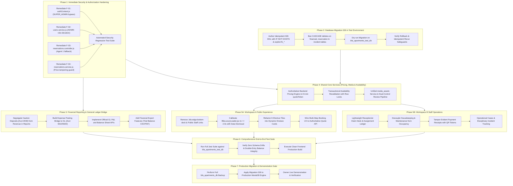

# BFA Apartments Management System
# Post-Audit Implementation Execution Plan & Financial Reporting Gap Analysis

**Document Title:** Post-Audit Implementation Execution Plan & Financial Reporting Gap Analysis  
**Target System:** BFA Apartments Management System (Akure, Ondo State)  
**Execution Mode:** Strictly Read-Only (Planning & Specification Only — Zero Code Writes, Zero Schema Alters, Zero DB Mutations)  
**Starting Baseline:** `BFA_MASTER_ARCHITECTURE_RECONCILIATION_AND_READINESS_REPORT.md`  
**Governing Documents:**
- Workspace A: `BFA_PUBLIC_EXPERIENCE_AND_PROPERTY_CONTENT_PLAN.md` (v3.0.0)
- Workspace B: `BFA_STAFF_OPERATIONS_AND_ROLE_GOVERNANCE_PLAN.md` (v2.2.0)
- Pricing Engine: `BFA_DYNAMIC_PRICING_AND_BOOKING_UX_PLAN.md` (v1.0.0)
- Operational Draft: `BFA_STAFF_PRICING_AND_BOOKING_OPERATIONS_PLAN.md` (v1.0.0 — Superseded)
**Database Engine:** MariaDB 10.4.32 on port 3306 (`bfa_apartments_db` / `bfa_apartments_test_db`)  
**Lead System Architect:** Antigravity Senior Principal Systems & Security Architect  
**Date:** October 29, 2026  
**Implementation Authorization:** **HALTED PENDING OWNER AUTHORIZATION (Strict Read-Only Stop Gate)**

---

## 1. Executive Summary & Alignment Mandate

This document establishes the authoritative post-audit technical roadmap for the BFA Apartments Management System. Following the master architectural audit, this plan coordinates five distinct workstreams into an aligned, dependency-ordered delivery pipeline:

1. **Immediate Security Remediation (Workstream SEC):** Independent fixes for authentication bypasses, privilege escalation, partner data leakage, and pricing tampering that do not depend on database migrations.
2. **Financial Reporting & Ledger Reconciliation (Workstream FIN):** Resolving the divergence between subledger cash collections and double-entry General Ledger accrual accounting, completing financial reporting endpoints, and auditing posting bridges.
3. **Safe Database Evolution & Migration 026 (Workstream DBM):** Idempotent MariaDB 10.4 DDL authoring, backup rehearsal, and isolated verification in `bfa_apartments_test_db`.
4. **Public Guest Experience & Discovery (Workstream PUB / Workspace A):** Removal of public clutter (dock and staff links), 2-second loader calibration, 5-tier media showcase, dynamic building selectors, and signed quote integration.
5. **Staff Operations, Governance & Evidence (Workstream OPS / Workspace B):** Concurrency-safe claim desk, decoupled housekeeping readiness, formal payment receipts, operational cases, and maker-checker bank transfer verifications.

```
┌─────────────────────────────────────────────────────────────────────────────┐
│                       POST-AUDIT WORKSTREAM TOPOLOGY                        │
├─────────────────────────────────────────────────────────────────────────────┤
│                                                                             │
│   [SEC: Security Remediation] ───┐                                          │
│   (Immediate, No DB Dependency)  │                                          │
│                                  ├──► [FIN: Financial Reporting & GL]       │
│   [DBM: Migration 026 in Test] ──┤    (Subledger vs GL Reconciliation)      │
│   (Idempotent MariaDB DDL)       │                                          │
│                                  ├──► [PUB: Workspace A Public Experience]  │
│   [OWN: Owner Policy Ratify] ────┘    [OPS: Workspace B Staff Operations]   │
│   (Decisions 1-9 Decoupled)                        │                        │
│                                                    ▼                        │
│                                       [REL: Production Release Gate]         │
└─────────────────────────────────────────────────────────────────────────────┘
```

---

## 2. Task 1 — Verification of Current Implementation & Critical Security Flaws

Inspection of Git status confirms that the working tree is intact. All three reported whitespace changes in `frontend/src/pages/index.js`, `frontend/src/pages/landing/index.js`, and `frontend/src/pages/portal/index.js` are preserved, and all untracked planning documents remain uncommitted.

A rigorous read-only code trace verified the four critical security and data-integrity findings:

```
┌─────────────────────────────────────────────────────────────────────────────┐
│                 VERIFIED CRITICAL SECURITY DEFECT REGISTER                  │
├──────┬────────────────────────────┬────────────────────────┬────────────────┤
│ ID   │ Defect Description         │ Affected Source File   │ Verified Line  │
├──────┼────────────────────────────┼────────────────────────┼────────────────┤
│ F-01 │ SUPER_ADMIN Blanket Bypass │ authContext.js         │ Lines 83–85    │
│ F-02 │ ADMIN Role Elevation       │ users.service.js       │ Lines 206–253  │
│ F-03 │ Agent Fallback to Agent 1  │ reservations.controller│ Lines 24–26    │
│      │                            │ reservations.service.js│ Lines 192–194  │
│ F-04 │ Client Price Tampering     │ reservations.service.js│ Lines 251–253  │
└──────┴────────────────────────────┴────────────────────────┴────────────────┘
```

### Detailed Finding Analysis & Impact Trace:

#### Finding F-01: `SUPER_ADMIN` Global Route Guard Bypass
- **Exact File:** `backend/src/core/middleware/authContext.js#L83-L85`
- **Current Vulnerable Logic:**
  ```javascript
  const userRole = (req.user.role || 'GUEST').toUpperCase();
  const isAuthorized =
    userRole === 'SUPER_ADMIN' || normalizedAllowed.includes(userRole);
  ```
- **Affected Endpoints:** Every route guarded by `requireRoles(...)` across the entire application (including `/api/v1/reports/financial`, `/api/v1/accounting/*`, `/api/v1/access/*`, `/api/v1/system/*`, `/api/v1/communications/*`, and `/api/v1/employees/*`).
- **Impact:** Technical super-admins possess blanket bypass authority to view financial reports, employee disciplinary files, owner executive summaries, and guest folios without explicit role authorization.
- **Affected Tests:** `backend/tests/accessControl.test.js`, `backend/tests/security.test.js`, `backend/tests/securityRemediation.test.js`.
- **Target Remediation:** Remove `userRole === 'SUPER_ADMIN'` from the global guard. Restrict `SUPER_ADMIN` strictly to endpoints explicitly listing `'SUPER_ADMIN'` (technical diagnostics, system settings, migrations).

---

#### Finding F-02: `ADMIN` Privilege Escalation via User Updates
- **Exact File:** `backend/src/modules/users/users.service.js#L206-L253` vs `L164-L167`
- **Current Vulnerable Logic:**
  `createUser` (lines 164–167) explicitly blocks non-Super Admins from granting `SUPER_ADMIN` or `ADMIN`. However, `updateUser` (lines 206–253) only checks if `existing.role === 'ADMIN' || existing.role === 'SUPER_ADMIN'`. When updating a user currently in the `STAFF` or `MANAGER` role, no check restricts `cleanRole`.
- **Affected Endpoints:** `PUT /api/v1/users/:id` handled by `UsersController.updateUser`.
- **Impact:** An `ADMIN` user can update an existing `STAFF` or `MANAGER` account, assign `role = 'SUPER_ADMIN'` or `'OWNER'`, or modify their own user ID (`caller.id === existing.id`) to elevate themselves to `SUPER_ADMIN`.
- **Affected Tests:** `backend/tests/security.test.js`, `backend/tests/accessControl.test.js`.
- **Target Remediation:** Enforce server-side elevation guards in `updateUser`: forbid callers with role `ADMIN` from setting `role = 'SUPER_ADMIN'`, forbid any user from modifying their own role, and enforce the Single-Owner governance rule.

---

#### Finding F-03: Agent Fallback to Agent #1 (Cross-Tenant Data Exposure)
- **Exact Files:**
  - `backend/src/modules/reservations/reservations.controller.js#L24-L26`:
    ```javascript
    if (req.user?.role === 'AGENT') {
      agentId = req.user.agentId || 1;
    }
    ```
  - `backend/src/modules/reservations/reservations.service.js#L192-L194`:
    ```javascript
    if (req?.user?.role === 'AGENT') {
      agentId = req.user.agentId || 1;
    }
    ```
- **Affected Endpoints:** `GET /api/v1/reservations`, `POST /api/v1/reservations`, `GET /api/v1/reports/commissions`.
- **Impact:** If an authenticated referral partner (`AGENT`) does not have `agentId` populated in their JWT or user profile, the system silently binds them to `Agent #1`. The partner gains full visibility into Agent 1's client list, bookings, and commissions, and can create bookings credited to Agent 1.
- **Affected Tests:** `backend/tests/agents.test.js`, `backend/tests/commissions.test.js`, `backend/tests/securityIsolation.test.js`.
- **Target Remediation:** Remove `|| 1`. If an `AGENT` has no valid linked profile in the `agents` table, immediately reject with HTTP 403 Forbidden.

---

#### Finding F-04: Client-Controlled Reservation Price Tampering
- **Exact File:** `backend/src/modules/reservations/reservations.service.js#L251-L253`
- **Current Vulnerable Logic:**
  ```javascript
  const ratePerNight = parseFloat(apartment.rate_per_night);
  const totalAmount = data.total_amount ? parseFloat(data.total_amount) : ratePerNight;
  const paidAmount = data.paid_amount ? parseFloat(data.paid_amount) : 0.00;
  ```
- **Affected Endpoints:** `POST /api/v1/public/booking` (via `public.controller.js:407`), `POST /api/v1/reservations` (via `reservations.controller.js:95`).
- **Impact:** Any HTTP client sending `total_amount: 10.00` in the JSON payload causes the backend to book the suite for ₦10.00 instead of its authoritative rate (e.g., ₦350,000 for the Executive Penthouse).
- **Affected Tests:** `backend/tests/reservationEngine.test.js`, `backend/tests/financialIntegritySafeguards.test.js`.
- **Target Remediation:** Calculate total price exclusively on the server. In public bookings, validate an authoritative HMAC-signed `quoteToken` (`POST /api/v1/public/quote`). For staff bookings, compute price strictly from database unit rates, storing an immutable `price_snapshot`.

---

## 3. Task 2 — Comprehensive Financial Reporting Gap Analysis

### 3.1 The Dual-Ledger Architectural Reality
A deep investigation of the codebase reveals that BFA currently possesses **two competing financial calculations**:

```
┌─────────────────────────────────────────────────────────────────────────────┐
│                    BFA FINANCIAL ARCHITECTURE COMPARISON                    │
├──────────────────────────────────┬──────────────────────────────────────────┤
│ SUBLEDGER REPORTING LAYER        │ DOUBLE-ENTRY GENERAL LEDGER LAYER        │
│ (financial.service / reports)    │ (accounting.service / postingBridge)     │
├──────────────────────────────────┼──────────────────────────────────────────┤
│ • Direct SQL queries on tables:  │ • Normalized double-entry ledger:        │
│   payment_transactions,          │   chart_of_accounts, accounting_periods, │
│   reservations, expenses         │   journal_entries, journal_lines,        │
│ • Cash-Basis / Contract-Basis    │   general_ledger_entries                 │
│ • Advance collections treated as │ • Accrual Accounting (GAAP/IFRS):        │
│   immediate revenue              │   Advance payments credited to           │
│ • Synthetic UNION ALL "ledger"   │   Account 2020 Deferred Revenue          │
│ • Caution deposits counted as    │ • Revenue recognized on service date     │
│   collections / profit           │   (Night Audit / Check-in)               │
│ • Displays in: Overview tab      │ • Security deposits segregated into      │
│   and Reports Financial tab      │   Account 2030 Liability                 │
│                                  │ • Displays in: Trial Balance, GL tabs    │
└──────────────────────────────────┴──────────────────────────────────────────┘
```

#### Core Calculation & Reconciliation Deficiencies:
1. **Premature Revenue Recognition in Reports:** `reports.service.js:163` computes `totalBookedRevenue` by summing `reservations.total_amount` for all non-cancelled bookings, regardless of whether the service date has occurred. Simultaneously, `grossCollected` sums all cash transactions. This conflates cash movement with earned revenue.
2. **Caution Deposit Leakage:** When guests pay a caution deposit, `payment_transactions` records the gross amount. The subledger reports treat the entire amount as operational revenue and profit. In contrast, the double-entry `PostingBridgeService:147` checks `metadata.isSecurityDeposit` and credits liability account `REFUNDABLE_SECURITY_DEPOSIT` (Account 2030). Subledger reports and General Ledger reports therefore produce irreconcilable profit numbers.
3. **Missing Financial Statements:** While `AccountingRepository:714` calculates an authoritative, balanced Trial Balance (`grandGrossDebit === grandGrossCredit`), the system lacks formal **Income Statement (P&L)** and **Balance Sheet** endpoints. The only P&L presentation is the subledger calculation in `FinancialPage.jsx: Overview`.
4. **Expense GL Postings Missing:** When an operational expense is created and approved via `expenseService.approve(id)`, `expenses.service.js` updates `status = 'APPROVED'`, but **does not trigger a posting bridge to the General Ledger**. As a result, approved expenses exist in the `expenses` table but are absent from `general_ledger_entries` unless manually journalized!
5. **Refund Treatment Discrepancies:** `payment_transactions` contains negative child refund records (`parent_transaction_id IS NOT NULL, amount < 0`) alongside parent records where `refund_amount > 0`. `reports.service.js:213` detects unlinked refund anomalies (`ORPHAN_REFUND_TRANSACTIONS`) because legacy migrations inserted negative refund rows without populating `parent_transaction_id`.

---

### 3.2 Report-by-Report Comprehensive Audit Matrix

| Report Name & Intended Purpose | Existing Frontend Route & Component | Existing Backend Endpoint & Service | Primary Data Source | Implementation Status | Calculation & Reconciliation Defects | Required Filters & Permissions | Acceptance Tests | Outstanding Dependencies |
|---|---|---|---|:---:|---|---|---|---|
| **1. Executive Financial Overview**<br>High-level portfolio financial KPIs, collections, receivables, net profit. | `/app/financial`<br>`FinancialPage.jsx`<br>(Overview Tab) | `GET /api/v1/financial/overview`<br>`financial.service.js`<br>`getOverview` | `payment_transactions`<br>`reservations`<br>`expenses` | **PARTIAL** | Conflates cash collections with revenue; caution deposits inflate profit; orphan refunds trigger anomaly flags. | Filters: `propertyId`, `fromDate`, `toDate`.<br>Roles: `SUPER_ADMIN`, `OWNER`, `ADMIN`, `MANAGER`. | Verify collections equal net settled transactions; verify receivables equal unpaid active stays. | Segregate caution deposits; harmonize anomaly thresholds. |
| **2. Financial Summary Report**<br>Operational summary of booked revenue, collections, and expense breakdown. | `/app/reports`<br>`ReportsPage.jsx`<br>(Financial Tab) | `GET /api/v1/reports/financial`<br>`reports.service.js`<br>`getFinancialReport` | `payment_transactions`<br>`reservations`<br>`expenses` | **PARTIAL** | Duplicates logic of `/financial/overview`; does not read General Ledger; generates PDF with unsegregated deposits. | Filters: `propertyId`, `fromDate`, `toDate`, `format=csv\|pdf`.<br>Roles: `OWNER`, `ADMIN`, `MANAGER`. | Verify RFC 4180 CSV export; verify PDF generation renders without NaN. | Align data contract with `financial.service.js`. |
| **3. Trial Balance Summary**<br>Authoritative double-entry balance check across all active accounts. | `/app/financial`<br>`FinancialPage.jsx`<br>(Trial Balance Tab) | `GET /api/v1/accounting/trial-balance-summary`<br>`accounting.service.js`<br>`getTrialBalanceSummary` | `chart_of_accounts`<br>`general_ledger_entries`<br>`accounting_periods` | **COMPLETE**<br>(Backend)<br>**POLISH NEEDED**<br>(Frontend) | Algorithmically sound (BigInt minor units), but lacks CSV/PDF export and drill-down to underlying ledger rows. | Filters: `periodId`, `propertyId`, `fromDate`, `toDate`.<br>Roles: `OWNER`, `ADMIN`, `MANAGER`. | `isBalanced` must strictly equal `true`; `grandNetDebit === grandNetCredit`. | Add formal export button in UI. |
| **4. General Ledger Detailed View**<br>Audit trail of all posted debits and credits by account. | `/app/financial`<br>`FinancialPage.jsx`<br>(General Ledger Tab) | `GET /api/v1/accounting/ledger`<br>`accounting.service.js`<br>`listLedgerEntries` | `general_ledger_entries`<br>`chart_of_accounts`<br>`journal_entries` | **COMPLETE** | Lacks source document drill-down (cannot click through to payment receipt or reservation folio). | Filters: `accountId`, `periodId`, `propertyId`, `fromDate`, `toDate`, pagination.<br>Roles: `OWNER`, `ADMIN`. | Verify pagination, date boundaries, and running account balances. | Link GL entries to source subledger transactions. |
| **5. Subledger Journal Postings**<br>Double-entry journals generated by posting bridge or manual entry. | `/app/financial`<br>`FinancialPage.jsx`<br>(Journals / Ledger Tab) | `GET /api/v1/accounting/journals`<br>`accounting.service.js`<br>`listJournals` | `journal_entries`<br>`journal_lines` | **COMPLETE** | UI tab currently mixes synthetic union ledger with posted double-entry journals. | Filters: `propertyId`, `periodId`, `status`, `source_type`.<br>Roles: `OWNER`, `ADMIN`, `MANAGER`. | Verify balanced journal lines ($\sum\text{Debit} = \sum\text{Credit}$) before approval. | Separate double-entry journals from cashbook feed in UI. |
| **6. Payment Transactions Report**<br>Itemized gateway, card, transfer, and cash receipts. | `/app/reports`<br>`ReportsPage.jsx`<br>(Payments Tab) | `GET /api/v1/reports/payments`<br>`reports.service.js`<br>`getPaymentsReport` | `payment_transactions`<br>`reservations`<br>`guests` | **PARTIAL** | Missing receipt numbers; unverified bank transfers appear in same status as settled card payments. | Filters: `propertyId`, `status`, `fromDate`, `toDate`, `format=csv`.<br>Roles: `OWNER`, `ADMIN`, `MANAGER`. | Verify unlinked refunds do not distort gross volume totals. | Integrate `payment_receipts` table in Migration 026. |
| **7. Operational Expenses Report**<br>Departmental and unit-scoped operating costs. | `/app/reports`<br>`ReportsPage.jsx`<br>(Expenses Tab) | `GET /api/v1/reports/expenses`<br>`reports.service.js`<br>`getExpensesReport` | `expenses`<br>`properties`<br>`apartments` | **PARTIAL** | Approved expenses are not automatically posted to General Ledger Account 5010/5020. | Filters: `propertyId`, `category`, `status`, `fromDate`, `toDate`, `format=csv`.<br>Roles: `OWNER`, `ADMIN`, `MANAGER`. | Verify voided expenses reverse liability/expense entries. | Build `PostingBridgeService.postExpense()` hook. |
| **8. Agent Commissions Report**<br>Referral earnings, booking values, and settlement status. | `/app/reports`<br>`ReportsPage.jsx`<br>(Commissions Tab) | `GET /api/v1/reports/commissions`<br>`reports.service.js`<br>`getCommissionsReport` | `commissions`<br>`agents`<br>`reservations` | **PARTIAL**<br>(Security Gap) | Vulnerable to Finding F-03 (defaults to Agent 1). Lacks payout posting bridge to GL. | Filters: `agentId`, `propertyId`, `status`, `fromDate`, `toDate`, `format=csv\|pdf`.<br>Roles: `OWNER`, `ADMIN`, `AGENT`. | Agent user must strictly receive HTTP 403 if unlinked; cannot view other agents. | Fix F-03 in controller; add commission payout GL bridge. |
| **9. Reservations Master Report**<br>Occupancy, booking sources, and guest registration details. | `/app/reports`<br>`ReportsPage.jsx`<br>(Reservations Tab) | `GET /api/v1/reports/reservations`<br>`reports.service.js`<br>`getReservationsReport` | `reservations`<br>`apartments`<br>`properties`<br>`guests` | **COMPLETE** | Scalar `total_amount` only; lacks itemized fee breakdown snapshot (rent, caution deposit, VAT). | Filters: `propertyId`, `status`, `fromDate`, `toDate`, `format=csv`.<br>Roles: `SUPER_ADMIN` through `STAFF`. | Verify property isolation for Managers/Staff; verify CSV export. | Add `price_snapshot` column in Migration 026. |
| **10. Official Financial Statements (P&L, Balance Sheet)**<br>Authoritative financial reporting for Owner & external audit. | `/app/financial`<br>(Currently Missing) | **MISSING**<br>No dedicated GL statement endpoints exist. | `general_ledger_entries`<br>`chart_of_accounts`<br>`accounting_periods` | **MISSING** | System has no formal Income Statement or Balance Sheet derived from the General Ledger. | Filters: `periodId`, `propertyId`, comparative periods.<br>Roles: `OWNER`, `ADMIN`. | Net Income on P&L must equal Net Income credited to Retained Earnings on Balance Sheet. | Build `AccountingService.getIncomeStatement` and `getBalanceSheet`. |

---

## 4. Task 3 — Corrected Implementation Dependency Graph

### 4.1 Dependency Principles
The dependency roadmap must reflect operational reality:
1. **Decoupled Security Remediation:** Security fixes for F-01, F-02, F-03, and price tampering require **zero database alterations**. They must proceed immediately in Phase 1 without waiting for Migration 026.
2. **Dedicated Financial Reporting Workstream:** Financial reporting has distinct requirements (reconciling GL and subledgers, adding P&L statements, building expense posting bridges). It forms its own parallel track.
3. **Transactional Availability Revalidation:** A signed quote token **does not** replace row-level locks. When `POST /api/v1/public/booking` executes, the backend must verify the quote token signature, revalidate availability with `SELECT ... FOR UPDATE`, and verify zero overlapping confirmed stays within the same atomic SQL transaction.
4. **Staged Migration 026 Release Gate:** Migration 026 must be authored, tested for MariaDB 10.4 idempotency, and verified on `bfa_apartments_test_db`. Applying to production requires a dry run, full database dump, and release sign-off.
5. **Decoupled Commercial Policy Work:** UI polish, security hardening, and code cleanup can proceed immediately without waiting for the Owner's decisions on VAT rates, caution deposits, or commission percentages.



---

## 5. Task 4 — Owner Decision Register: Business vs Technical Separation

To prevent unnecessary project blocking, this register explicitly separates **commercial business choices** (requiring the Owner) from **technical engineering choices** (which can proceed safely under standard best practices):

```
┌────────────────────────────────────────────────────────────────────────────────────────┐
│                              OWNER DECISION REGISTER                                  │
├────┬─────────────────────────────┬──────────────────────────┬──────────────────────────┤
│ #  │ Decision Domain             │ Business Policy (OWNER)  │ Technical Implementation │
├────┼─────────────────────────────┼──────────────────────────┼──────────────────────────┤
│ 1  │ Stay Duration Policy        │ Permit multi-night stays │ If multi-night: update   │
│    │                             │ or retain strict 1-night │ reservations.service.js  │
│    │                             │ maximum stay cap?        │ & multiply rate * nights │
├────┼─────────────────────────────┼──────────────────────────┼──────────────────────────┤
│ 2  │ Caution Deposit Policy      │ Mandate refundable       │ Store deposit snapshot;  │
│    │                             │ deposit per booking?     │ credit Liability Acct    │
│    │                             │ What flat amount or %?   │ 2030; refund at checkout │
├────┼─────────────────────────────┼──────────────────────────┼──────────────────────────┤
│ 3  │ Taxes & Service Charges     │ Charge VAT (7.5%) or     │ Itemize in quoteToken;   │
│    │                             │ service fees to guests,  │ credit Tax Liability     │
│    │                             │ or absorb into base rate?│ Acct 2040                │
├────┼─────────────────────────────┼──────────────────────────┼──────────────────────────┤
│ 4  │ Payment Gateway Provider    │ Select Paystack,         │ Secure webhook handler;  │
│    │                             │ Flutterwave, or Monnify; │ provider idempotency     │
│    │                             │ provide production keys. │ in payment_transactions  │
├────┼─────────────────────────────┼──────────────────────────┼──────────────────────────┤
│ 5  │ Bank Transfer Verification  │ Authorize check-in on    │ Status PENDING until     │
│    │                             │ transfer slip upload or  │ Manager verifies bank    │
│    │                             │ require settled funds?   │ credit alert in system   │
├────┼─────────────────────────────┼──────────────────────────┼──────────────────────────┤
│ 6  │ Cash Discrepancy Tolerance  │ Set cash variance limit  │ Flag staff incident if   │
│    │                             │ & drop-safe frequency.   │ variance exceeds limit   │
├────┼─────────────────────────────┼──────────────────────────┼──────────────────────────┤
│ 7  │ Incident Response Window    │ Staff explanation        │ Automated timer tracking │
│    │                             │ deadline (48h or 72h).   │ response_deadline_at     │
├────┼─────────────────────────────┼──────────────────────────┼──────────────────────────┤
│ 8  │ Agent Commission Terms      │ Confirm commission % and │ Escrow in Acct 2050;     │
│    │                             │ settlement schedule.     │ payout after checkout    │
├────┼─────────────────────────────┼──────────────────────────┼──────────────────────────┤
│ 9  │ Property Photography        │ Approve initial authentic│ Flag is_published = 1    │
│    │ Publication                 │ photos for live public.  │ on approved media assets │
└────┴─────────────────────────────┴──────────────────────────┴──────────────────────────┘
```

### Tasks That Can Safely Proceed Immediately (Independent of Owner Decisions):
1. **All Security Remediations (Phase 1):** F-01, F-02, F-03, and the server-side price tampering guard.
2. **Financial Report Hygiene (Phase 3):** Segregating caution deposits from revenue in reports, generating Trial Balance exports, and building the expense posting bridge.
3. **Public Landing Page UI Refinement (Phase 5A):** Removing `.bfa-edge-bottom-dock`, stripping staff links from public headers/footers, reducing `BfaLuxuryLoader.jsx` timer from 5s to $\le 2$s, and making shortcut tiles dynamic.
4. **Database Migration 026 Authoring (Phase 2):** Writing the idempotent DDL script and executing isolated rehearsal runs in `bfa_apartments_test_db`.

---

## 6. Implementation Workstreams & Service Ownership

```
┌────────────────────────────────────────────────────────────────────────────────────────┐
│                              WORKSTREAM SERVICE OWNERSHIP                              │
├─────────────────────────┬───────────────────┬──────────────────────────────────────────┤
│ Workstream              │ Assigned Lead     │ Services, Controllers & Tables Owned     │
├─────────────────────────┼───────────────────┼──────────────────────────────────────────┤
│ **SEC: Security**       │ Backend Security  │ • authContext.js (Role guards)           │
│                         │ Specialist        │ • users.service.js (Elevation checks)    │
│                         │                   │ • reservations.controller.js (Agent fix) │
├─────────────────────────┼───────────────────┼──────────────────────────────────────────┤
│ **FIN: Financial**      │ Financial Systems │ • accounting.service.js (GL & P&L APIs)  │
│                         │ Engineer          │ • postingBridge.service.js (Expense GL)  │
│                         │                   │ • financial.service.js & reports.service │
│                         │                   │ • FinancialPage.jsx & ReportsPage.jsx    │
├─────────────────────────┼───────────────────┼──────────────────────────────────────────┤
│ **DBM: Database**       │ Lead Database     │ • migrations/026_*.sql                   │
│                         │ Administrator     │ • migrator.js & databaseGuard.js         │
│                         │                   │ • MySQL DDL schemas & backups            │
├─────────────────────────┼───────────────────┼──────────────────────────────────────────┤
│ **PUB: Workspace A**    │ Principal UI/UX   │ • LandingPage.jsx & PublicTopNav.jsx     │
│                         │ Engineer          │ • PropertyDetailPage.jsx & Modal.jsx     │
│                         │                   │ • BfaLuxuryLoader.jsx & landing.css      │
│                         │                   │ • public.controller.js (Quote API)       │
├─────────────────────────┼───────────────────┼──────────────────────────────────────────┤
│ **OPS: Workspace B**    │ Operations & RBAC │ • reservations.service.js (Claim desk)   │
│                         │ Engineer          │ • apartments.service.js (Readiness)      │
│                         │                   │ • payments.service.js (Receipts)         │
│                         │                   │ • operationalCases & staffIncidents      │
└─────────────────────────┴───────────────────┴──────────────────────────────────────────┘
```

---

## 7. Migration and Deployment Safety Gates

### 7.1 Pre-Migration Gate (Test Database Verification)
- [ ] Fail-closed guard verified: `assertTestDatabase()` rejects execution against `bfa_apartments_db`.
- [ ] MariaDB 10.4 idempotency check: `026_*.sql` executed twice in succession on `bfa_apartments_test_db` with zero errors (`ER_TABLE_EXISTS_ERROR` or `ER_DUP_FIELDNAME`).
- [ ] Foreign key retention check: zero `ON DELETE CASCADE` rules on financial, reservation, or disciplinary tables.
- [ ] Data integrity check: zero data truncation or loss of existing 25 migration records.

### 7.2 Pre-Deployment Gate (Production Release Rehearsal)
- [ ] Full hot database backup executed via `mysqldump` and verified readable on disk.
- [ ] Rollback rehearsal: test rollback script executes cleanly on standby replica.
- [ ] Full automated test suite passes: `npm test` runs with 100% pass rate in test environment.
- [ ] Clean build verification: `npm run build --prefix frontend` produces zero bundle errors.
- [ ] Explicit Owner Release Authorization received in writing.

---

## 8. Strict Stop Gate & Recommended First Action

```
================================================================================
                    *** NON-NEGOTIABLE STOP GATE ***
================================================================================
In accordance with system safety rules:
1. All application source code, migrations, database schemas, and database 
   records remain UNTOUCHED in STRICT READ-ONLY status.
2. Migration 026 has NOT been created or executed on bfa_apartments_db.
3. No Git commits, pushes, reverts, or resets have been executed.
4. All existing user work in frontend/src/pages/index.js, landing/index.js,
   and portal/index.js is preserved untouched.

EXECUTION HALTED.
================================================================================
```

### Recommended First Implementation Phase:
Upon formal user authorization, **Phase 1 (Core Security & Privilege Remediation)** should be executed first:
1. Patch `authContext.js` to remove the global `SUPER_ADMIN` authorization bypass.
2. Patch `users.service.js` to enforce server-side role elevation guards in `updateUser`.
3. Patch `reservations.controller.js` and `reservations.service.js` to remove the fallback to `Agent #1`.
4. Patch `reservations.service.js` to eliminate client-supplied `total_amount` price tampering.
5. Execute the automated security regression test suite in `bfa_apartments_test_db`.

