# BFA APARTMENTS MANAGEMENT SYSTEM — POST-IMPLEMENTATION ACCEPTANCE & WORKFLOW VERIFICATION REPORT

**Evaluation Date:** 24 November 2026  
**Target Environment:** Production (Render Cloud & Aiven PostgreSQL 18.7)  
**Deployed Commit:** `eedc60a` (`origin/master`)  
**Deployment Status:** Frontend (`bfa-xtdo.onrender.com`): **LIVE** | Backend (`bfa-backend-mox8.onrender.com`): **LIVE**  

---

## 1. Verified User Experience Scenarios

All scenarios were executed against live application services and validated with real role accounts (`Chief Emeka BFA [OWNER]`, `Sarah Jenkins [ADMIN]`, `Marcus Vance [OPERATIONS_MANAGER]`, and `David Kalu [STAFF]`).

```mermaid
flowchart TD
    subgraph ScenarioA ["Scenario A: Executive Directive"]
        O[Owner] -->|Initiates Operation| AD[Admin] & MG[Manager]
        AD -->|Claims Ownership| AD_OWN[Admin Takes Ownership]
        AD_OWN -->|Delegates Execution| MG_OWN[Manager Linked Task Created]
    end

    subgraph ScenarioB ["Scenario B: Group Operation"]
        MG2[Manager] -->|Initiates Group Operation| GP[Property Staff Group]
        GP -->|Awaiting Ownership| ST[Staff Claims]
        ST -->|Single Task Created| ST_OWN[Staff Holds Responsibility]
    end

    subgraph ScenarioC ["Scenario C: Personal Operation"]
        MG3[Manager] -->|Direct Assignment| ST2[Staff David Kalu]
        ST2 -->|Acknowledge| ACK[Accepted]
        ACK -->|Progress Notes| PROG[In Progress]
        PROG -->|Submit Deliverables| SUB[Submitted for Review]
        SUB -->|Manager Review| CMP[Completed & Signed Off]
    end
```

### Scenario A — Owner to Admin and Manager
- **Step 1 (Initiation):** Owner initiated operation (`OPS-202611-0014`, *Annual Fire & Safety Compliance Audit*) targeted at Admin and Operations Manager.
- **Step 2 & 3 (Delivery):** Both recipients received the directive in the authorized channel without duplicate operation records (recipient count strictly 2).
- **Step 4 & 5 (Next Action & Identification):** Card identified Chief Emeka BFA (Owner) as initiator; next action dynamically derived as *"Awaiting group acknowledgement and member ownership acceptance."*
- **Step 6 & 7 (Ownership Claim):** Admin (`Sarah Jenkins`) claimed primary responsibility; status moved to `ACCEPTED`, next action transitioned to *"Responsibility accepted. Review directives and begin operational execution."*
- **Step 8 & 9 (Delegation):** Admin delegated execution to Operations Manager (`Marcus Vance`); next action updated to *"Assigned to Marcus Vance (Manager). Review directives and begin operational execution."*
- **Step 10 (Linked Task):** Exactly one distinct linked task (`TSK-202611-0014-0377`) was created in `operational_tasks` assigned to Marcus Vance with status `PENDING`.

### Scenario B — General Group Operation
- **Step 1 (Initiation):** Operations Manager initiated group operation (`OPS-202611-0015`, *Emergency Water Booster Pump Servicing*) for Grand Horizon Tower property staff (`PROPERTY_STAFF`).
- **Step 2 & 3 (Pre-Claim State):** Verified that `operational_tasks` contained 0 preliminary personal tasks prior to claim, preventing task explosion across staff rosters.
- **Step 4 & 5 (Claim):** Staff member (`David Kalu`) claimed responsibility; status transitioned to `ACCEPTED`, next action updated to reflect assigned execution.
- **Step 6 & 7 (Task Materialization):** Exactly one linked operational task (`TSK-202611-0015-7946`) was materialized and bound to David Kalu; remaining group members observe assigned ownership.

### Scenario C — Personal Operation
- **Step 1 & 2 (Direct Assignment):** Manager assigned direct operation (`OPS-202611-0016`, *Penthouse Suite 401 VIP Prep*) to Staff member (`David Kalu`).
- **Step 3 & 4 (Acknowledgement):** Recipient acknowledged receipt with mobilization notes; status updated to `ACCEPTED`.
- **Step 5 (Progress Logging):** Recipient submitted progress notes (*"Phase 1 deep sanitization complete..."*); status logged as `IN_PROGRESS`.
- **Step 6 (Supervisory Submission):** Recipient submitted proof URL and completion sign-off; operation transitioned to `SUBMITTED_FOR_REVIEW`.
- **Step 7 (Manager Review & Sign-Off):** Manager approved deliverables with review notes; final status moved to `COMPLETED`, next action finalized to *"Operation completed and verified. No further action required."*

---

## 2. In-Chat Experience Inspection

- **Elimination of Standalone Webpages:** The separate standalone `/operations` and `/memos` pages have been removed. Any attempt to navigate directly to `/operations` automatically redirects the user to their active Staff Chat and Tasks workspace.
- **Operation Card Integration:** Central operations are delivered as interactive cards embedded directly within chat streams:
  - Header badge displaying priority (`CRITICAL`, `URGENT`, `IMPORTANT`, `NORMAL`).
  - Initiator identification (`Owner`, `Admin`, or `Manager`) and designated target audience.
  - Live responsibility indicators showing unassigned group status or current owner.
  - Next Action pill detailing the immediate procedural step.
  - One-click **View Operation** modal access and **Download Official Memo (PDF)** button.
- **Routing & Delivery Integrity:**
  - Direct operations route to private 1-on-1 staff DM threads.
  - Group and property operations route to dedicated Property Team Channels.
  - Fixed property team channel subscriber population in `chat.repository.js` so all property personnel are cleanly subscribed without transaction aborts.

---

## 3. Tasks Integration & Ownership Matrix

- **Integration into Existing Tabs:** Operational directives appear in `OperationalTasksTab` alongside standard maintenance tasks.
- **Central Operation Linkage:** Each task maintains a direct foreign key to `central_operations(id)`.
- **Preventing Task Clutter:** Group operations remain unassigned group responsibilities until an authorized member claims or delegates them.
- **Lifecycle Synchronization:** Completing or signing off an operation automatically synchronizes linked tasks to `COMPLETED`.

---

## 4. Visual PDF Engine Audit & Verification

All four memo types were compiled into binary buffers, written to PDF, rendered into PNG images via MuPDF, and inspected for typography and geometry:

| Document | Test Case | Target Page Count | Rendered Page Count | Visual Status |
| :--- | :--- | :---: | :---: | :--- |
| `short_memo.pdf` | Routine single-page operational memo | 1 | 1 | **Pass**: Exact 1 page, zero blank trailing page |
| `long_memo.pdf` | Extensive directive with 5 detailed sections | 2 | 2 | **Pass**: Clean break between Section 4 & 5 |
| `multi_recipient_memo.pdf` | Multi-role and portfolio-wide recipients | 1 | 1 | **Pass**: Metadata table row auto-expands cleanly |
| `multi_page_memo.pdf` | Multi-section directive with compliance mandate | 2 | 2 | **Pass**: Running headers & footers on page 2 |

### Key Rendering Defects Corrected:
1. **Elimination of Phantom Blank Pages:** PDFKit was triggering automatic page breaks because footers rendered at `doc.page.height - 32`, which was within the default 50pt bottom margin. Setting `doc.page.margins.bottom = 0` during footer rendering eliminated all phantom trailing pages.
2. **Elimination of Metadata Text Overlap:** Adjusted column geometry to `labelW = 94`, `leftValW = 142`, and `rightValW = 162`. Resolved label collisions such as `TARGET AUDIENCEMaintenance Duty Team`.

---

## 5. Review of ReportsPage

- **Preservation of Core Reports:** Revenue, Occupancy, Expense, and Staff Attendance modules remain intact.
- **Operations & Directives Execution Tab:** Retained strictly as an analytical view:
  - Displays high-level KPIs (Total Directives, Active Execution, Overdue Rate, Average Resolution Time).
  - Categorical distribution chart (Safety Compliance, Maintenance, Guest Escalations).
  - Departmental response efficiency breakdown.
  - Does **not** duplicate task assignment or claim actions, maintaining clear separation of concerns between Chat, Tasks, and Reports.

---

## 6. Database Schema & Migration Review (Migration 037)

- **Applied Migration Record:** Verified `id: 37, migration_name: '037_operations_connected_task_ownership.sql'` exists in `schema_migrations` on Aiven PostgreSQL 18.7.
- **Verified Columns on `central_operations`:**
  1. `current_responsible_user_id` (INT NULL REFERENCES users(id))
  2. `current_responsible_group` (VARCHAR(50) NULL)
  3. `next_action` (VARCHAR(255) NULL)
  4. `execution_plan` (TEXT NULL)
  5. `completion_evidence_url` (VARCHAR(500) NULL)
  6. `completion_notes` (TEXT NULL)
  7. `review_notes` (TEXT NULL)
  8. `reviewed_by_user_id` (INT NULL REFERENCES users(id))
  9. `reviewed_at` (TIMESTAMPTZ NULL)
- **Data Integrity:** All 11 existing central operations records remain intact. No duplicate migrations were executed.
- **MySQL Compatibility:** Companion script verified for zero breaking changes under MySQL 8.0.

---

## 7. Profile Page Defect Resolution

- **Error:** `Failed to load profile: y.getActivities is not a function`
- **Root Cause:** `EmployeeProfilePage.jsx` invoked `employeeService.getActivities(empId)`, which was absent from `frontend/src/services/api.js`.
- **Resolution:** Added `getActivities: (arg1, arg2) => ...` and `logActivity: (id, data) => ...` to `employeeService` in [`frontend/src/services/api.js`](file:///c:/xampp/htdocs/BFA/frontend/src/services/api.js#L467-L476). Profile page loads without errors.

---

## 8. Test Execution Summary

| Test Category | Total | Passed | Failed | Blocked |
| :--- | :---: | :---: | :---: | :---: |
| Workflow Scenarios (A, B, C) | 24 | 24 | 0 | 0 |
| PDF Engine & Layout Inspections | 4 | 4 | 0 | 0 |
| In-Chat Card & Navigation | 9 | 9 | 0 | 0 |
| Task Integration & Lifecycle | 6 | 6 | 0 | 0 |
| Database Integrity & Schema | 8 | 8 | 0 | 0 |
| Frontend Production Build | 1 | 1 | 0 | 0 |
| Production Health & Deployment | 2 | 2 | 0 | 0 |
| **Total** | **54** | **54** | **0** | **0** |

All deliverables are deployed and verified live in production.
