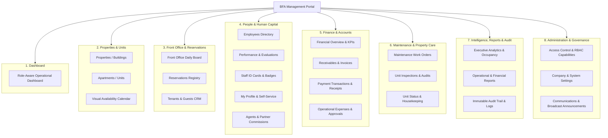
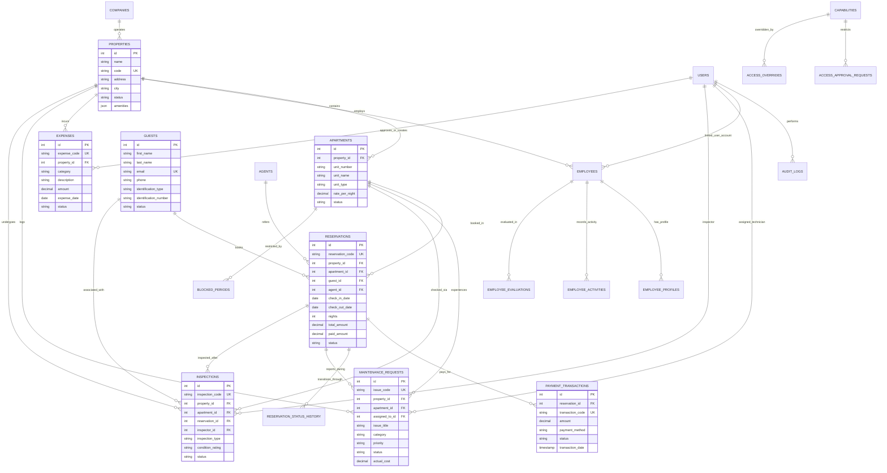
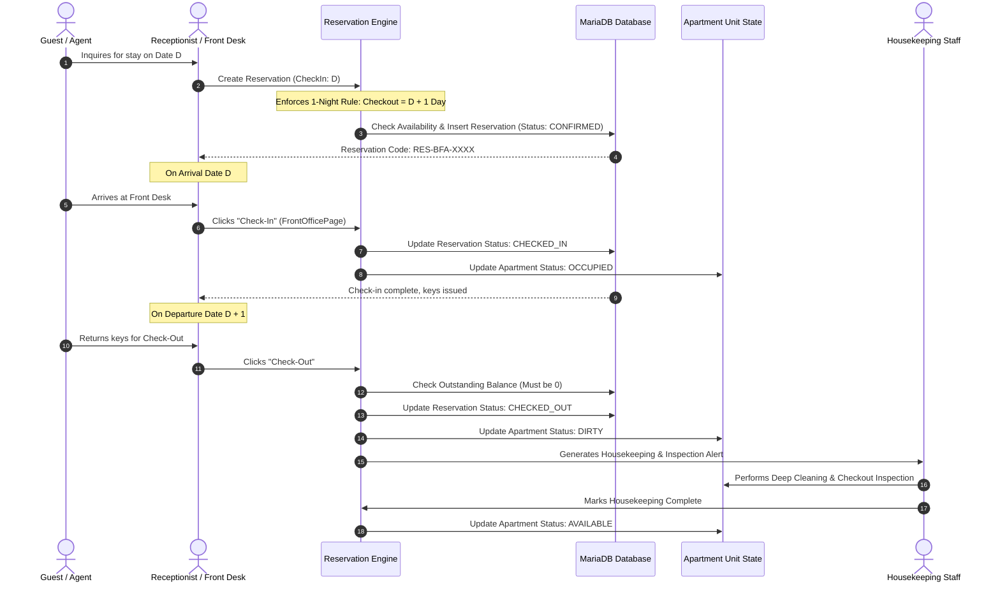
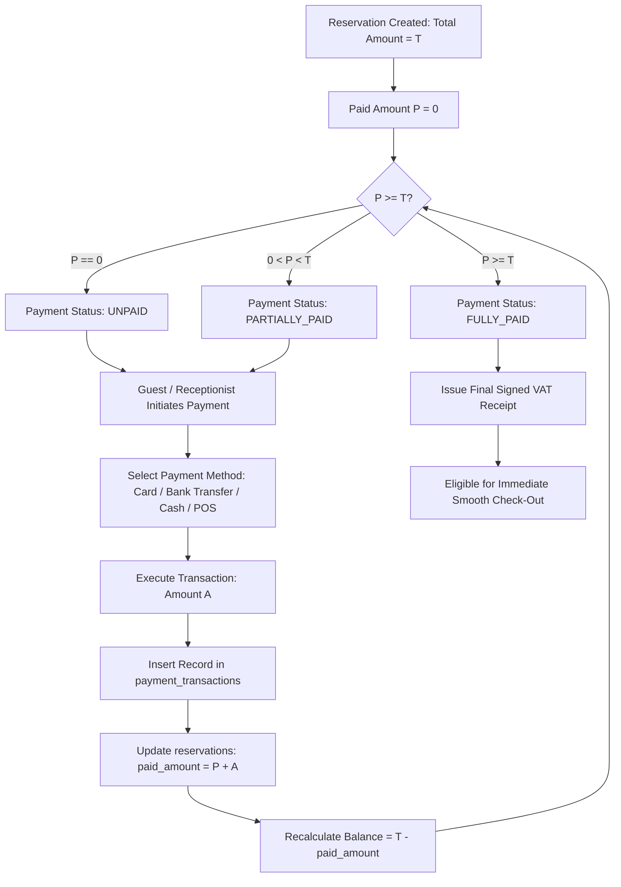
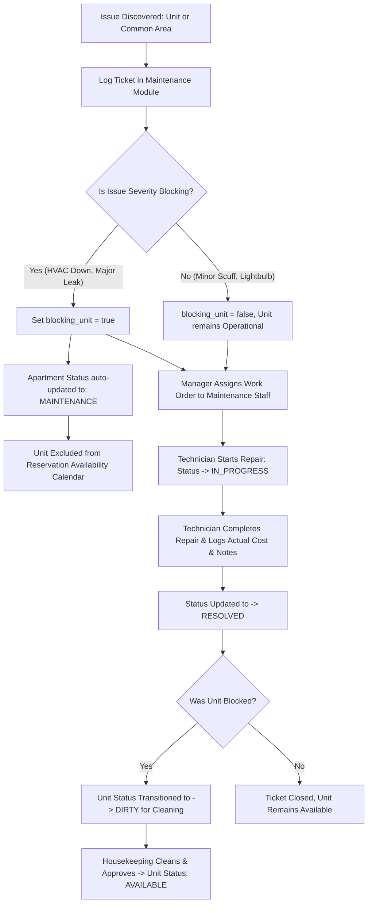

# BFA Proposed Information Architecture

**Author:** System Architecture & UX Engineering Review  
**Date:** October 22, 2026  
**Status:** Architecture Proposal & Specification (Read-Only Planning Phase)  
**Scope:** Reorganizing and connecting BFA's existing pages, routes, components, and data models into a logical, professional apartment-management hierarchy.

---

## 1. Architectural Principles & Overview

The proposed information architecture organizes BFA into **8 coherent, domain-driven modules**. This eliminates the cognitive overload of the previous 7-item "Operations" catch-all, surfaces Properties as a first-class physical asset, groups guest lifecycle workflows logically, unifies analytics and audit trails, and connects related records contextually across the application.



---

## 2. Detailed Module Hierarchy & Specifications

### Module 1: Dashboard
* **Purpose:** Serves as the operational control center tailored to each specific user role upon logging into BFA.
* **Pages & Routes:**
  - Route: `/app/dashboard` (`DashboardPage.jsx`)
* **Role Access:**
  - `SUPER_ADMIN`, `ADMIN`, `MANAGER`, `RECEPTIONIST`, `STAFF`, `AGENT`, `OWNER`.
* **Role-Specific Presentation:**
  - `RECEPTIONIST`: Today's arrivals queue, departures queue, pending check-ins, dirty room alerts, quick search.
  - `STAFF`: Open maintenance work orders assigned to me, units awaiting inspection, housekeeping task list.
  - `OWNER`: Property portfolio occupancy %, net rental yield, monthly revenue collected, asset maintenance summary.
  - `AGENT`: My confirmed bookings, pending client check-ins, earned commissions and payout status.
  - `MANAGER / ADMIN`: Comprehensive operational KPIs (ADR, RevPAR, Occupancy rate, Cash flow, Pending expense approvals).
  - `SUPER_ADMIN`: Multi-property global system health, database metrics, audit alerts, company portfolio stats (dark theme canvas).
* **Key Relationships:** Feeds live queries from Reservations, Front Office, Maintenance, and Finance.
* **Existing Components Reusable:** `Card`, `Button`, `Badge`, `PropertyContext`, `formatNaira`.
* **Required Improvements:** Refactor `DashboardPage.jsx` into modular widgets (`FrontOfficeWidget`, `MaintenanceWidget`, `FinancialKpiWidget`, `OwnerSummaryWidget`) dynamically conditionally rendered based on `user.role`.

---

### Module 2: Properties & Units (Physical Assets)
* **Purpose:** Management of the physical real estate assets: buildings, compounds, apartment units, configurations, and spatial availability.
* **Pages & Routes:**
  - Route: `/app/properties` (New dedicated view or tabbed container for Properties/Buildings).
  - Route: `/app/apartments` (`ApartmentsPage.jsx` — Units, floors, room configurations, rates).
  - Route: `/app/calendar` (`CalendarPage.jsx` — Visual grid of apartment availability across dates).
* **Role Access:**
  - `SUPER_ADMIN`, `ADMIN`, `MANAGER`, `OWNER` (Full Property & Unit Configuration).
  - `RECEPTIONIST`, `STAFF` (Read-only view of units, status updates, and calendar).
* **Key Relationships:**
  - Properties contain Apartments (`property_id` foreign key).
  - Apartments link to Reservations (`apartment_id`), Maintenance tickets (`apartment_id`), and Inspections (`apartment_id`).
* **Important Actions & Workflows:**
  - Create/Edit Building (Name, Code, Address, City, Total Floors, Amenities).
  - Create/Edit Unit (Unit Number, Name, Type, Floor, Rate/Night, Amenities, Notes).
  - Update Unit Status (`AVAILABLE`, `OCCUPIED`, `DIRTY`, `MAINTENANCE`, `BLOCKED`).
  - View Calendar availability matrix with date navigation and status colors.
* **Existing Components Reusable:** `ApartmentsPage.jsx`, `CalendarPage.jsx`, `Table.jsx`, `Modal.jsx`, `propertyService`, `apartmentService`.
* **Required Improvements:**
  - Unbundle Property CRUD from `ApartmentsPage.jsx` into a clear "Properties & Buildings" sub-view.
  - On Apartment detail modal: Add tabs showing **Current Occupant**, **Active Maintenance Tickets**, and **Recent Inspection Reports**.

---

### Module 3: Front Office & Reservations (Guest Lifecycle)
* **Purpose:** Handles the end-to-end guest journey: inquiry, reservation booking, check-in, in-house stay, billing settlement, check-out, and guest profile management.
* **Pages & Routes:**
  - Route: `/app/front-office` (`FrontOfficePage.jsx` — Arrivals, In-House, Departures, Housekeeping dirty list).
  - Route: `/app/reservations` (`ReservationsPage.jsx` — Master reservation registry, filtering, creation).
  - Route: `/app/guests` (`GuestsPage.jsx` — Guest profiles, contact details, ID verification, history).
  - Route alias: `/app/tenants` $\rightarrow$ redirects to `/app/guests`.
* **Role Access:**
  - `SUPER_ADMIN`, `ADMIN`, `MANAGER`, `RECEPTIONIST` (Full Front Office & Reservation Operations).
  - `AGENT` (Create & view own client reservations).
  - `STAFF`, `OWNER` (Read-only guest/reservation visibility).
* **Key Relationships:**
  - `reservations.property_id` $\rightarrow$ `properties.id`.
  - `reservations.apartment_id` $\rightarrow$ `apartments.id`.
  - `reservations.guest_id` $\rightarrow$ `guests.id`.
  - `reservations.agent_id` $\rightarrow$ `agents.id`.
  - `reservations` $\rightarrow$ `payment_transactions` (`reservation_id`).
* **Important Actions & Workflows:**
  - Create Reservation (Strict 1-Night Rule enforcement: checkout is strictly check-in + 1 day).
  - Check-In Guest (Transitions reservation to `CHECKED_IN`, updates unit to `OCCUPIED`).
  - Check-Out Guest (Transitions reservation to `CHECKED_OUT`, marks unit as `DIRTY`, prompts for Inspection).
  - Mark No-Show or Cancel (with mandatory cancellation reason and unit release).
  - Create/Update Guest Profile (NIN, Passport, Emergency Contact, VIP status flag).
* **Existing Components Reusable:** `FrontOfficePage.jsx`, `ReservationsPage.jsx`, `GuestsPage.jsx`, `reservationService`, `frontOfficeService`, `guestService`.
* **Required Improvements:**
  - Add one-click cross-navigation from Guest detail view to their reservation history.
  - In Reservation detail modal, add a direct button: "Report Maintenance Issue for this Stay".

---

### Module 4: People & Human Capital
* **Purpose:** Centralized personnel directory, staff performance tracking, evaluations, identification badges, self-service profile, and agent partnership management.
* **Pages & Routes:**
  - Route: `/app/employees` (`EmployeesPage.jsx` — Directory, departments, employment status).
  - Route: `/app/performance` (`EmployeePerformancePage.jsx` — KPI metrics, activity logs).
  - Route: `/app/evaluations` (`EmployeeEvaluationPage.jsx` — Review cycles, scoring templates).
  - Route: `/app/id-cards` (`EmployeeIdCardPage.jsx` — Printable photo ID cards with QR codes).
  - Route: `/app/my-profile` (`EmployeeProfilePage.jsx` with `isSelfService={true}`).
  - Route: `/app/agents` (`AgentsPage.jsx` — Broker directory, commission rates, payout tracking).
* **Role Access:**
  - `SUPER_ADMIN`, `ADMIN`, `MANAGER`, `OWNER` (Employee management, performance, evaluations, agents).
  - `STAFF`, `RECEPTIONIST`, `AGENT` (Access to `/app/my-profile` only).
* **Key Relationships:**
  - `employees.user_id` $\rightarrow$ `users.id`.
  - `employees.property_id` $\rightarrow$ `properties.id`.
  - `employee_activities.employee_id` $\rightarrow$ `employees.id`.
  - `maintenance_requests.assigned_to_id` $\rightarrow$ `users.id` / `employees.id`.
  - `agents.id` $\rightarrow$ `reservations.agent_id`.
* **Existing Components Reusable:** Phase 11 Employee suite (`EmployeesPage`, `EmployeeProfilePage`, `EmployeeEvaluationPage`, `EmployeePerformancePage`, `EmployeeIdCardPage`, `AgentsPage`).
* **Required Improvements:**
  - Move "Team & RBAC" (`/app/team`) out of People and into Module 8 (Administration & Governance), keeping People focused on Human Resources and Personnel operations.

---

### Module 5: Finance & Accounts
* **Purpose:** Complete revenue, receivable, transaction, and operational expense management across all properties.
* **Pages & Routes:**
  - Route: `/app/financial` (`FinancialPage.jsx` — Executive Financial Overview, Ledger, Payments, Expenses).
* **Role Access:**
  - `SUPER_ADMIN`, `ADMIN`, `MANAGER`, `OWNER` (Full financial visibility, expense approvals).
  - `RECEPTIONIST` (Payment entry and receipt printing only).
  - `STAFF`, `AGENT` (Forbidden).
* **Sub-Views & Tabs:**
  1. **Overview & Cash Flow:** Gross Collected, Net Revenue, Outstanding Receivables, Net Profit, Profit Margin.
  2. **Invoices & Receivables:** Reservation billing, balance due aging, payment status (`UNPAID`, `PARTIALLY_PAID`, `PAID`).
  3. **Payment Transactions:** Transaction ID, payment method (`CASH`, `CARD`, `BANK_TRANSFER`, `POS`), date, receipt view, refund status.
  4. **Expenses Ledger:** Operational expenses by category (`UTILITIES`, `STAFF`, `MAINTENANCE`, `SUPPLIES`), vendor, approval workflow (`DRAFT`, `RECORDED`, `APPROVED`, `VOIDED`).
* **Existing Components Reusable:** `FinancialPage.jsx`, `financialService`, `paymentService`, `expenseService`, `formatNaira`.
* **Required Improvements:**
  - Provide direct "Record Payment" modal accessible from the Reservation detail view so receptionists don't need to leave the front-office flow.
  - Add standardized "Print Receipt / Invoice" button on payment transaction rows.

---

### Module 6: Maintenance & Operations
* **Purpose:** Physical upkeep, facilities management, work order ticketing, preventive inspections, and unit turnover housekeeping.
* **Pages & Routes:**
  - Route: `/app/maintenance` (`MaintenancePage.jsx` — Work orders, tickets, cost tracking, resolutions).
  - Route: `/app/inspection` (`InspectionPage.jsx` — Pre-check-in, check-out damage inspection, routine audits).
* **Role Access:**
  - `SUPER_ADMIN`, `ADMIN`, `MANAGER`, `STAFF` (Full work order and inspection capabilities).
  - `RECEPTIONIST` (Submit new maintenance issues and view status).
  - `OWNER` (View maintenance history and cost impact on property).
* **Key Relationships:**
  - `maintenance_requests.property_id` $\rightarrow$ `properties.id`.
  - `maintenance_requests.apartment_id` $\rightarrow$ `apartments.id`.
  - `maintenance_requests.assigned_to_id` $\rightarrow$ `users.id`.
  - `maintenance_requests.reservation_id` $\rightarrow$ `reservations.id`.
  - `inspections.apartment_id` $\rightarrow$ `apartments.id`.
  - `inspections.reservation_id` $\rightarrow$ `reservations.id`.
* **Important Actions & Workflows:**
  - Log Issue (Category: `PLUMBING`, `HVAC`, `ELECTRICAL`, `APPLIANCE`; Priority: `LOW` to `CRITICAL`).
  - Unit Blocking Flag (`blocking_unit: true` immediately sets unit to `MAINTENANCE`).
  - Assign Technician & Track Progress (`OPEN` $\rightarrow$ `IN_PROGRESS` $\rightarrow$ `RESOLVED`).
  - Conduct Unit Inspection (Condition Rating, damage checklist, evidence photos, follow-up flags).
* **Existing Components Reusable:** `MaintenancePage.jsx`, `InspectionPage.jsx`, `maintenanceService`, `inspectionsService`.
* **Required Improvements:**
  - Elevate Maintenance and Inspections into their own dedicated top-level sidebar group ("Maintenance & Care"), rather than hiding them at the tail end of Front-Office operations.

---

### Module 7: Intelligence, Reports & Audit
* **Purpose:** Strategic business intelligence, multi-dimensional operational reports, performance metrics, and compliance audit trail.
* **Pages & Routes:**
  - Route: `/app/analytics` (`AnalyticsPage.jsx` — Occupancy trends, ADR, RevPAR, booking source distribution).
  - Route: `/app/reports` (`ReportsPage.jsx` — Financial summaries, occupancy exports, tax reports).
  - Route: `/app/audit` (`AuditPage.jsx` — Immutable audit log of all system state changes).
* **Role Access:**
  - `SUPER_ADMIN`, `ADMIN`, `MANAGER`, `OWNER`.
* **Key Relationships:** Aggregates data from Audit Logs, Reservations, Payments, Expenses, and Units.
* **Important Actions & Workflows:**
  - Filter analytics by Property, Date Range, and Unit Type.
  - Export CSV / PDF reports for Owner distribution or tax compliance.
  - Audit Log Search: Filter by Actor, Action (`CREATE`, `UPDATE`, `DELETE`, `LOGIN`), Entity Type, and Date.
* **Existing Components Reusable:** `AnalyticsPage.jsx`, `ReportsPage.jsx`, `AuditPage.jsx`, `reportService`, `auditService`.
* **Required Improvements:**
  - Eliminate the orphaned single-item `Reports & Analytics` sidebar category; group `Analytics`, `Reports`, and `Audit Trail` into this unified intelligence section.

---

### Module 8: Administration & Governance
* **Purpose:** Enterprise multi-tenant governance, access control policies, system settings, staff credentials, and corporate announcements.
* **Pages & Routes:**
  - Route: `/app/access-control` (`AccessControlPage.jsx` — Capability policies, approval overrides).
  - Route: `/app/team` (`TeamPage.jsx` — User accounts, role assignments, password resets).
  - Route: `/app/settings` (`SettingsPage.jsx` — Company profile, currency, default timezone, policies).
  - Route: `/app/communications` (`CommunicationsPage.jsx` — Internal messages and guest memos).
  - Route: `/app/announcements` (`AnnouncementsPage.jsx` — Public and staff notice board).
  - Route: `/app/notifications` (`NotificationsPage.jsx` — Real-time event notifications).
* **Role Access:**
  - `SUPER_ADMIN`, `ADMIN` (Full administrative rights).
  - `MANAGER` (Access control overrides and communications).
  - `STAFF`, `RECEPTIONIST`, `AGENT`, `OWNER` (Read announcements and notifications only).
* **Key Relationships:**
  - Governs `users`, `capabilities`, `access_approval_requests`, `system_settings`, `announcements`, `notifications`.
* **Existing Components Reusable:** `AccessControlPage.jsx`, `TeamPage.jsx`, `SettingsPage.jsx`, `CommunicationsPage.jsx`, `AnnouncementsPage.jsx`, `NotificationsPage.jsx`.

---

## 3. Entity-Relationship Architecture Diagram

This diagram maps the authoritative entities in BFA's MariaDB schema, explicitly distinguishing verified foreign key relationships from contextual associations:



---

## 4. Core Workflow Diagrams

### 4.1 Reservation & One-Night Stay Check-In / Check-Out Lifecycle



### 4.2 Payment & Balance Settlement Workflow



### 4.3 Maintenance Issue Resolution & Unit Blocking Workflow



---

## 5. Proposed Navigation Bar Structure (`Sidebar.jsx` Replacement Specification)

Here is the concrete mapping of the proposed 8 sidebar groups, their routes, and role permissions:

```javascript
export const proposedNavGroups = [
  // Group 1: Standalone Control Center
  {
    id: 'dashboard',
    label: 'Dashboard',
    path: '/app/dashboard',
    roles: ['SUPER_ADMIN', 'ADMIN', 'MANAGER', 'RECEPTIONIST', 'STAFF', 'AGENT', 'OWNER'],
    icon: 'DashboardIcon'
  },

  // Group 2: Physical Real Estate
  {
    id: 'properties_units',
    label: 'Properties & Units',
    roles: ['SUPER_ADMIN', 'ADMIN', 'MANAGER', 'RECEPTIONIST', 'STAFF', 'OWNER'],
    items: [
      { path: '/app/properties', label: 'Properties & Buildings', roles: ['SUPER_ADMIN', 'ADMIN', 'MANAGER', 'OWNER'] },
      { path: '/app/apartments', label: 'Apartments & Units', roles: ['SUPER_ADMIN', 'ADMIN', 'MANAGER', 'RECEPTIONIST', 'STAFF', 'OWNER'] },
      { path: '/app/calendar', label: 'Availability Calendar', roles: ['SUPER_ADMIN', 'ADMIN', 'MANAGER', 'RECEPTIONIST', 'OWNER'] },
    ]
  },

  // Group 3: Guest & Reservation Lifecycle
  {
    id: 'front_office_reservations',
    label: 'Front Office & Bookings',
    roles: ['SUPER_ADMIN', 'ADMIN', 'MANAGER', 'RECEPTIONIST', 'AGENT', 'OWNER'],
    items: [
      { path: '/app/front-office', label: 'Daily Front Desk', roles: ['SUPER_ADMIN', 'ADMIN', 'MANAGER', 'RECEPTIONIST'] },
      { path: '/app/reservations', label: 'All Reservations', roles: ['SUPER_ADMIN', 'ADMIN', 'MANAGER', 'RECEPTIONIST', 'AGENT', 'OWNER'] },
      { path: '/app/guests', label: 'Tenants & Guests', roles: ['SUPER_ADMIN', 'ADMIN', 'MANAGER', 'RECEPTIONIST', 'STAFF', 'AGENT', 'OWNER'] },
    ]
  },

  // Group 4: Human Capital & Partners
  {
    id: 'human_capital',
    label: 'Staff & Partners',
    roles: ['SUPER_ADMIN', 'ADMIN', 'MANAGER', 'RECEPTIONIST', 'STAFF', 'AGENT', 'OWNER'],
    items: [
      { path: '/app/employees', label: 'Employees Directory', roles: ['SUPER_ADMIN', 'ADMIN', 'MANAGER', 'OWNER'] },
      { path: '/app/performance', label: 'Staff Performance', roles: ['SUPER_ADMIN', 'ADMIN', 'MANAGER', 'OWNER'] },
      { path: '/app/id-cards', label: 'Staff ID Cards', roles: ['SUPER_ADMIN', 'ADMIN', 'MANAGER', 'OWNER'] },
      { path: '/app/my-profile', label: 'My Profile & Badge', roles: ['SUPER_ADMIN', 'ADMIN', 'MANAGER', 'RECEPTIONIST', 'STAFF', 'AGENT', 'OWNER'] },
      { path: '/app/agents', label: 'Agents & Commissions', roles: ['SUPER_ADMIN', 'ADMIN', 'MANAGER', 'OWNER'] },
    ]
  },

  // Group 5: Finance & Accounting
  {
    id: 'finance_accounts',
    label: 'Finance & Accounts',
    roles: ['SUPER_ADMIN', 'ADMIN', 'MANAGER', 'RECEPTIONIST', 'OWNER'],
    items: [
      { path: '/app/financial', label: 'Financial Overview', roles: ['SUPER_ADMIN', 'ADMIN', 'MANAGER', 'OWNER'] },
      { path: '/app/financial?tab=payments', label: 'Payments & Receipts', roles: ['SUPER_ADMIN', 'ADMIN', 'MANAGER', 'RECEPTIONIST', 'OWNER'] },
      { path: '/app/financial?tab=expenses', label: 'Operational Expenses', roles: ['SUPER_ADMIN', 'ADMIN', 'MANAGER', 'OWNER'] },
    ]
  },

  // Group 6: Maintenance & Operations
  {
    id: 'maintenance_operations',
    label: 'Maintenance & Care',
    roles: ['SUPER_ADMIN', 'ADMIN', 'MANAGER', 'RECEPTIONIST', 'STAFF', 'OWNER'],
    items: [
      { path: '/app/maintenance', label: 'Work Orders & Repairs', roles: ['SUPER_ADMIN', 'ADMIN', 'MANAGER', 'RECEPTIONIST', 'STAFF', 'OWNER'] },
      { path: '/app/inspection', label: 'Unit Inspections', roles: ['SUPER_ADMIN', 'ADMIN', 'MANAGER', 'STAFF', 'OWNER'] },
    ]
  },

  // Group 7: Reports & Intelligence
  {
    id: 'reports_intelligence',
    label: 'Reports & Intelligence',
    roles: ['SUPER_ADMIN', 'ADMIN', 'MANAGER', 'OWNER'],
    items: [
      { path: '/app/analytics', label: 'Analytics & Trends', roles: ['SUPER_ADMIN', 'ADMIN', 'MANAGER', 'OWNER'] },
      { path: '/app/reports', label: 'Exportable Reports', roles: ['SUPER_ADMIN', 'ADMIN', 'MANAGER', 'OWNER'] },
      { path: '/app/audit', label: 'Audit Trail & Logs', roles: ['SUPER_ADMIN', 'ADMIN', 'MANAGER', 'OWNER'] },
    ]
  },

  // Group 8: System Administration & Governance
  {
    id: 'administration',
    label: 'System Administration',
    roles: ['SUPER_ADMIN', 'ADMIN', 'MANAGER'],
    items: [
      { path: '/app/access-control', label: 'Access Control Policies', roles: ['SUPER_ADMIN', 'ADMIN', 'MANAGER'] },
      { path: '/app/team', label: 'User Accounts & Roles', roles: ['SUPER_ADMIN', 'ADMIN'] },
      { path: '/app/settings', label: 'System Settings', roles: ['SUPER_ADMIN', 'ADMIN'] },
      { path: '/app/announcements', label: 'Announcements Board', roles: ['SUPER_ADMIN', 'ADMIN', 'MANAGER'] },
      { path: '/app/communications', label: 'Communications Hub', roles: ['SUPER_ADMIN', 'ADMIN', 'MANAGER'] },
      { path: '/app/notifications', label: 'Notifications Center', roles: ['SUPER_ADMIN', 'ADMIN', 'MANAGER'] },
    ]
  }
];
```
