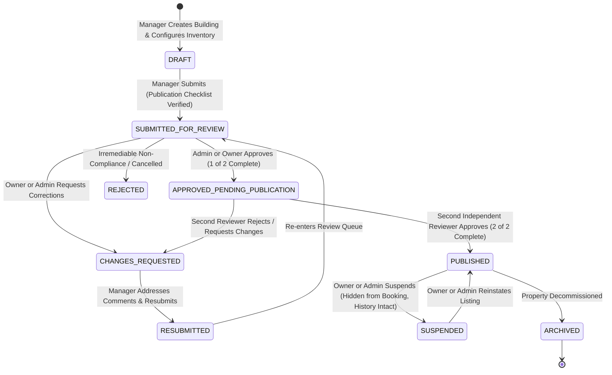

# BFA Apartments Management System
## Workspace A: Master Architectural Plan — Public Landing Page, Multi-Building Discovery, Property Content Governance, Publication Approval, Pricing & Booking

**Document Version:** 3.0.0 (Master Architectural Plan Revision)  
**Date:** October 29, 2026  
**Status:** PROPOSED — PENDING FORMAL OWNER REVIEW & AUTHORIZATION  
**Execution Mode:** PLANNING AND REPOSITORY INSPECTION ONLY (No Code Writes or DB Migrations)  
**Target Application:** BFA Serviced Residences (Akure, Ondo State)  
**Author:** Antigravity Senior Product Architect, UI/UX Engineer & Backend Integration Specialist (Workspace A)  

---

## 1. Executive Summary & Objectives

The **BFA Apartments Management System** operates a multi-building portfolio of luxury serviced residential properties in Akure, Ondo State: **Grand Horizon Tower** (Alagbaka GRA), **Azure Bay Residences** (Ijapo Estate), and **The Royal Palms Suites** (Oba-Ile). BFA is an apartment management and reservation enterprise, **not a hotel**. The platform showcases autonomous residential enclaves and the distinct, fully appointed serviced apartments within them.

This Master Architectural Specification consolidates all public discovery, content governance, media management, pricing, and booking requirements into a single, internally consistent, implementation-ready blueprint.

### 1.1 Core Mission
The primary objective of this revision is to transform the public landing page from a visually attractive yet cluttered interface into a **directive, self-explanatory, trustworthy, and effortless property discovery and booking engine**, while strictly preserving BFA's approved **midnight-blue-and-gold visual identity** (`#1e3a8a`, `#2563eb`, `#d97706`).

```
┌─────────────────────────────────────────────────────────────────────────────┐
│                          WORKSPACE A MASTER PILLARS                         │
├─────────────────────────────────────────────────────────────────────────────┤
│ 1. Obvious Visitor Journey: Discover BFA → Explore Buildings → Browse      │
│    Apartments → Understand Suite → Check Availability → Review Price → Book.│
│ 2. Dual-Control Governance: Independent Owner AND Admin publication review  │
│    with anti-collusion enforcement (owner_reviewer_id !== admin_reviewer_id).│
│ 3. 5-Tier Media Separation: Exterior, Grounds, Shared Facilities, Unit      │
│    Interiors, and Room-Specific Specs.                                      │
│ 4. Clutter Removal: Eliminate redundant bottom dock; remove staff-facing    │
│    links from public view; refine 8 shortcut tiles into directive actions.  │
│ 5. Loader Optimization: Cap synthetic presentation countdown to maximum 2s, │
│    with immediate dismissal the moment essential content is ready.          │
│ 6. Authoritative Pricing & Booking: Server-calculated signed quote tokens,  │
│    1-night stay rule, immutable price snapshots, and zero client price math.│
└─────────────────────────────────────────────────────────────────────────────┘
```

---

## 2. Scope & Non-Goals

### 2.1 In Scope
1. **Public Landing Page Experience:** Visual hierarchy refinement, directive CTAs, clean progressive disclosure, search bar improvement, shortcut tile audit and restructuring.
2. **Navigation Cleanup:** Removal of the floating bottom dock menu (`.bfa-edge-bottom-dock`); complete removal of staff-facing login links (`Portal Login →`, `Staff Portal →`) from public headers, hero banners, and footers.
3. **Loader Calibration:** Reducing the artificial 5-second countdown in `BfaLuxuryLoader.jsx` to a maximum 2-second presentation window, with immediate bypass when initial data is ready.
4. **Multi-Building Discovery Architecture:** Enabling seamless portfolio-wide browsing, property-to-apartment hierarchy, and dedicated building enclave views (`/property/:id`).
5. **Dual-Control Publication Governance:** Multi-status lifecycle (`DRAFT` $\to$ `PUBLISHED`), separate Owner and Admin approval records, contextual review comments (`OPEN` $\to$ `RESOLVED`), and version-aware zero-downtime updates.
6. **5-Tier Content Taxonomy:** Strict media categorization preventing mixing of building exterior photos with private apartment interiors; persistent representative-image disclaimers.
7. **Authoritative Dynamic Pricing & Booking:** Server-side quotation engine (`POST /api/v1/public/quote`), signed 15-minute quote tokens, itemized cost breakdowns (rent, caution deposit, fees, taxes), and low-friction booking accordion.
8. **Receipts & Verifications:** Cryptographic booking authentication, tamper-evident receipt retrieval, and multi-channel confirmation.
9. **Accessibility & Responsive Rigor:** WCAG 2.1 AA compliance across 375px mobile, 768px tablet, 1280px desktop, and 1440px widescreen.

### 2.2 Non-Goals & Strict Safety Boundaries
- **No Design Replacement:** No imposition of black-and-gold or generic hotel themes. The established midnight-blue-and-gold theme is preserved.
- **No Staff Portal Deletion:** Removing public links to `/login` does **not** delete or weaken the staff portal, internal dashboards, or server-side RBAC. Authorized staff retain unhindered access via direct bookmarkable URL (`/login`).
- **No Fabricated Data:** Zero simulated reviews, synthetic ratings, false occupancy numbers, or invented discounts.
- **No Database Writes in Planning:** No schema migrations, table alters, or test writes against `bfa_apartments_db`.
- **No Destructive Git Actions:** Working tree changes in `src/pages/index.js`, `src/pages/landing/index.js`, and `src/pages/portal/index.js` are preserved untouched.

---

## 3. Existing Architecture & Repository Findings

A comprehensive read-only code and database inspection was conducted across the active repository (`c:\xampp\htdocs\BFA`).

### 3.1 Frontend Topology & Key Components
- **Primary Public Route (`LandingPage.jsx`):** 2,295 lines. Handles the Edge-inspired backdrop, hero announcement banner, search input, 8 shortcut tiles, floating bottom dock, live inventory feed, and booking/verification forms.
- **Dedicated Building Page (`PropertyDetailPage.jsx`):** 922 lines. Renders property-level hero imagery, room-type categories, high-resolution photo gallery, availability check, and inline booking form.
- **Top Display Navigation (`PublicTopNav.jsx`):** 195 lines. Stationary transparent bar containing BFA brand mark, Akure weather widget, stay verification trigger, and "Portal Menu" flyout.
- **Preloader Component (`BfaLuxuryLoader.jsx`):** 86 lines. Contains hardcoded 5-second countdown timer (`const totalDuration = 5000;`).
- **Apartment Detail & Specs Modal (`ApartmentDetailModal.jsx`):** 1,029 lines. Houses `APARTMENTS_CATALOG`, room specs, and indoor/outdoor feature lists.

### 3.2 Backend Service & Controller Topology
- **Public Controller (`public.controller.js`):** 500 lines. Implements `getPublicProperties`, `getPublicPropertyDetail`, `getPublicRoomTypes`, `getPublicApartments`, `checkAvailability`, and `createPublicBooking`.
- **Reservation Engine (`reservations.service.js`):** 981 lines. Implements concurrency-safe `createReservation`, `validateOneNightStay`, row-level locking (`SELECT ... FOR UPDATE`), and cryptographic auth code generation.
- **Payment Processing (`payments.service.js`):** 517 lines. Handles idempotency, transaction recording, and subledger-to-general-ledger postings via `PostingBridgeService`.

### 3.3 Database Schema & Real Inventory Findings (`bfa_apartments_db`)
Inspection of live database records confirms:
- **`properties` Table:** 3 active buildings located in Akure, Ondo State:
  1. `Grand Horizon Tower` (`GHT`, id: 1) — Plot 14, Alagbaka GRA Extension (Status: `ACTIVE`, Operational: `OPERATIONAL`).
  2. `Azure Bay Residences` (`ABR`, id: 2) — Block 7, Ijapo Central Estate (Status: `ACTIVE`, Operational: `OPERATIONAL`).
  3. `The Royal Palms Suites` (`RPS`, id: 3) — Suite 24, Presidential Boulevard, Oba-Ile (Status: `ACTIVE`, Operational: `OPERATIONAL`).
- **`apartments` Table:** 8 active units across the 3 buildings:
  - GHT: Unit 101 (`Executive Penthouse`, ₦350k), Unit 102 (`1-Bedroom Deluxe`, ₦220k), Unit 103 (`Studio Premier`, ₦160k), Unit 104 (`2-Bedroom Executive`, ₦290k, status: `CLEANED`).
  - ABR: Unit 201 (`2-Bedroom Luxury`, ₦280k), Unit 202 (`Studio Standard`, ₦140k, status: `MAINTENANCE`), Unit 203 (`3-Bedroom Royal`, ₦450k, status: `OCCUPIED`).
  - RPS: Unit 301 (`1-Bedroom Deluxe`, ₦200k).
- **Critical Schema Gaps:**
  - `properties` table currently lacks a `publication_status` enum, version tracker, and review timestamp columns.
  - No `media_assets`, `property_publication_reviews`, or `publication_review_comments` tables currently exist. Public imagery currently relies on bundled static imports with disclaimers.

---

## 4. Current-State Landing-Page Audit

| Component / Element | Current Implementation | Usability & Clarity Assessment | Recommendation |
|---|---|---|---|
| **Loader (`BfaLuxuryLoader.jsx`)** | 5,000ms synthetic timer (`setInterval`) blocks UI rendering regardless of API response time. | Extremely frustrating for repeat visitors; artificially delays access to ready content. | **Reduce presentation window to max 2s; dismiss immediately when essential content is loaded.** |
| **Top Nav (`PublicTopNav.jsx`)** | Displays transparent bar, weather, verification button, and "Portal Menu" flyout linking to `/login`. | Flyout exposes staff login prominently to ordinary visitors; creates confusion between guest tasks and internal operations. | **Remove staff login from flyout; dedicate menu to guest concierge utilities.** |
| **Hero Announcement Banner** | Displays message with prominent badge: `STAFF NOTIFICATION`. | Label reads like an internal employee memo rather than a public customer service notice. | **Relabel badge to `RESIDENCE ADVISORY` or `OFFICIAL NOTICE`.** |
| **Search Input Bar** | Centered on purple line, transitions to top bar on scroll. | Visual transition is sleek, but lacks clear placeholder guidance and property type suggestions. | **Enhance placeholder: "Search apartments, buildings, or locations in Akure..."; add category chips.** |
| **8 Shortcut Tiles** | 3 tiles hardcode building IDs (`G. Horizon`, `Azure Bay`, `Royal Palms`); remaining 5 link to Showcase, Booking, Verify, Amenities, Contact. | Hardcoded building shortcuts break multi-property scalability; icons lack directive action verbs. | **Restructure into 6 directive action tiles based on visitor intent.** |
| **Bottom Floating Dock (`.bfa-edge-bottom-dock`)** | Floating pill at viewport bottom with 7 tabs duplicating page sections + wallpaper info. | Clutters mobile and desktop viewports; duplicates top navigation and feed tabs; competes with content. | **Completely remove bottom dock; relocate wallpaper credit unobtrusively to hero corner.** |
| **Feed Tabs & Staff Link** | Sub-navigation tabs (`Discover`, `Properties`, `Booking`, etc.) alongside `Portal Login →`. | Staff login link is visually prominent next to core guest filters; distracts from booking flow. | **Remove `Portal Login →` link; replace with guest CTA `Browse All Suites →`.** |
| **Building Cards Grid** | Dynamically renders all 3 buildings with starting rates, amenity chips, and 3 buttons per card. | Three competing buttons per card (`Explore Room Types ↓`, `View Property Page →`, `Quick Book →`) overwhelms visitor. | **Consolidate into 1 prominent Primary CTA (`Explore Available Suites →`) + 1 subtle secondary link.** |
| **Booking Form** | Single vertical form; displays availability result then unlocks guest inputs; uses `alert()`. | Native browser `alert()` breaks luxury feel; lack of itemized price breakdown creates payment anxiety. | **Upgrade to 5-step accessible accordion with sticky price summary and inline error banners.** |
| **Footer Navigation** | Standard links alongside prominent `Staff Portal →` link. | Exposes internal login on public footer. | **Remove prominent staff link; preserve `/login` as unlisted direct route for staff.** |

---

## 5. Design Preservation Requirements

All enhancements must strictly adhere to BFA’s established design tokens and layout conventions:

```css
/* Core Design Tokens — Preserved Verbatim from variables.css */
:root {
  --brand-primary: #1e3a8a;          /* Deep Executive Navy */
  --brand-accent: #2563eb;           /* Vibrant Cobalt Accent */
  --brand-hover: #1d4ed8;            /* Interactive Hover State */
  --brand-dark: #0b132b;             /* Atmospheric Midnight Base */
  --brand-dim: rgba(37, 99, 235, 0.08); /* Subtle Accent Tint */
  --brand-border: rgba(37, 99, 235, 0.25);
  
  --accent-gold: #d97706;            /* Warm Architectural Amber Gold */
  --accent-gold-dim: rgba(217, 119, 6, 0.1);
  
  --bg-primary: #f8fafc;             /* Primary Page Canvas */
  --bg-surface: #ffffff;             /* Card and Modal Elevation */
  --bg-glass: rgba(255, 255, 255, 0.94);
  
  --text-primary: #0f172a;           /* Crisp Charcoal Text */
  --text-secondary: #475569;         /* Readable Slate Body Text */
  --text-muted: #94a3b8;             /* Subtle Captions */
  
  --font-heading: 'Outfit', -apple-system, BlinkMacSystemFont, sans-serif;
  --font-body: 'Plus Jakarta Sans', -apple-system, BlinkMacSystemFont, sans-serif;
  
  --touch-target-min: 44px;          /* Accessible Touch Target */
  --radius-card: 12px;
  --radius-btn: 8px;
  --radius-pill: 9999px;
}
```

### Visual Polish Guardrails
- **Atmospheric Depth:** Maintain the rotating high-resolution architectural background slides with the subtle dark gradient overlay (`rgba(11, 19, 43, 0.72)`).
- **Subtle Motion:** Animations must be purposeful and capped at $\le 250\text{ms}$ with `cubic-bezier(0.16, 1, 0.3, 1)`. Avoid gratuitous bouncing or layout shifts.
- **Icons8 Uniformity:** All iconography must exclusively draw from BFA’s verified monochromatic Icons8 SVG/PNG asset library (`src/assets/icons8/`) in either `blue` or `white` variants.

---

## 6. Proposed Landing-Page Hierarchy & Interaction Specification

To ensure a first-time visitor immediately understands what BFA offers and what to do next, the landing page is structured into 6 progressive disclosure tiers:

```
┌─────────────────────────────────────────────────────────────────────────────┐
│ TIER 1: ATMOSPHERIC HERO & PRIMARY DIRECTIVE ACTION                         │
│ • Stationary PublicTopNav (Akure Weather, Verify Stay, Concierge)           │
│ • Official Advisory Notice (clean, non-alarmist pill)                       │
│ • Primary Search Bar: "Find your serviced apartment in Akure..."            │
│ • 6 Directive Action Shortcuts (Explore Buildings, Browse Suites, etc.)     │
│ • Discreet wallpaper location credit (bottom-right corner)                  │
└──────────────────────────────────────┬──────────────────────────────────────┘
                                       │ Scroll / Action Click
                                       ▼
┌─────────────────────────────────────────────────────────────────────────────┐
│ TIER 2: MULTI-BUILDING RESIDENTIAL PORTFOLIO SHOWCASE                        │
│ • Heading: "Executive Residential Enclaves across Akure"                    │
│ • Subtitle: "Serviced apartment buildings engineered for corporate stays"   │
│ • Responsive Grid of Published Buildings (GHT, ABR, RPS)                    │
│ • Single Primary CTA per card: "Explore Available Suites →"                 │
└──────────────────────────────────────┬──────────────────────────────────────┘
                                       │ Building Selection
                                       ▼
┌─────────────────────────────────────────────────────────────────────────────┐
│ TIER 3: LIVE RENTABLE SUITES & APARTMENTS FEED                              │
│ • Instant inventory feed: Available suites across Akure with verified rates │
│ • Filters: All Enclaves | Penthouses | 2-Bedroom | 1-Bedroom | Studios      │
│ • Directive Suite Cards: Capacity, specs, nightly rate, "Reserve Suite →"   │
└──────────────────────────────────────┬──────────────────────────────────────┘
                                       │ Suite Selection
                                       ▼
┌─────────────────────────────────────────────────────────────────────────────┐
│ TIER 4: LOW-FRICTION 5-STEP ACCORDION BOOKING ENGINE                        │
│ • Step 1: Dates & Suite Selection (1-night maximum stay validation)         │
│ • Step 2: Authoritative Itemized Quotation (Rent, Caution Deposit, Fees)    │
│ • Step 3: Guest Profile & Contact Details (Mobile-optimized inputs)         │
│ • Step 4: Transparent Payment Method (Pay Online vs. Pay at Front Desk)     │
│ • Step 5: Review & Cryptographic Reservation Commitment                     │
│ • Sticky Mobile Bottom Price Summary Drawer                                 │
└──────────────────────────────────────┬──────────────────────────────────────┘
                                       │ Booking Confirmation
                                       ▼
┌─────────────────────────────────────────────────────────────────────────────┐
│ TIER 5: CRYPTOGRAPHIC VERIFICATION & CONCIERGE ASSISTANCE                   │
│ • Instant confirmed booking card with reference code & WhatsApp link        │
│ • Authenticated stay verification input (Reference + Email/Auth Code)       │
└──────────────────────────────────────┬──────────────────────────────────────┘
                                       │
                                       ▼
┌─────────────────────────────────────────────────────────────────────────────┐
│ TIER 6: VERIFIED RESIDENCE STANDARDS & CLEAN GUEST FOOTER                    │
│ • 4 Core Standards: 24/7 Power, Enterprise Wi-Fi 6, Security, Housekeeping  │
│ • Clean Public Footer: Portfolio, Booking, Verification, Contact, Copyright │
│ • (Zero public staff portal links)                                          │
└─────────────────────────────────────────────────────────────────────────────┘
```

---

## 7. Public Navigation & Internal-Entry-Point Cleanup

### 7.1 Complete Removal of Bottom Menu Dock
- **Action:** Delete `.bfa-edge-bottom-dock` and its CSS rules (`.bfa-dock-container`, `.bfa-dock-tab`, `.bfa-dock-left`, `.bfa-dock-right`) from `LandingPage.jsx` and `LandingPage.css`.
- **Relocation of Wallpaper Credit:** The apartment wallpaper credit pill (e.g., *Grand Horizon Tower • Alagbaka GRA*) is relocated to an elegant, unobtrusive glass pill in the bottom-right corner of the hero section (`position: absolute; bottom: 1.5rem; right: 2rem;`), visible only on desktop/tablet.

### 7.2 Complete Removal of Staff-Facing Navigation Links
To eliminate visual clutter and present a purely guest-centric experience:
1. **`PublicTopNav.jsx`:**
   - Remove the `Staff Portal Login →` link and its card from the top-right flyout menu.
   - Refactor the top-right control into a pure **Guest Concierge Menu** with 4 options:
     - 🏢 *Residential Enclaves* (Scrolls to `#properties`)
     - 🔍 *Verify Confirmed Stay* (Opens verification modal)
     - 💬 *24/7 Contact & Concierge Desk* (Navigates to `/contact`)
     - ℹ️ *About BFA Residences* (Navigates to `/about`)
2. **`LandingPage.jsx`:**
   - Line 557: Change badge label from `STAFF NOTIFICATION` to `RESIDENCE ADVISORY`.
   - Line 943: Remove the `Portal Login →` button positioned adjacent to feed tabs. Replace with `Browse All Suites →`.
   - Line 1947: Remove `Staff Portal →` link from public footer.
3. **Staff Access Preservation:**
   - The dedicated staff route `/login` remains fully functional, secured by server-side JWT authentication and dynamic capabilities.
   - Staff members bookmark `http://localhost:5173/login` or access it directly. The staff application is preserved in its entirety.

---

## 8. Search & Shortcut Behaviour

### 8.1 In-Depth Audit & Restructuring of the 8 Shortcuts
The current 8 shortcut tiles suffer from hardcoding 3 building names and using ambiguous labels. They are restructured into **6 Directive Guest Action Tiles**:

```
Current Tile           Target Redesign             Directive Action & Destination
---------------------------------------------------------------------------------------------------------
1. G. Horizon    ──►   🏢 Explore Buildings       Scrolls directly to #properties with smooth animation.
2. Azure Bay     ──►   🚪 Browse Suites           Scrolls to #rentable-suites feed with filter preset.
3. Royal Palms   ──►   📅 Check Availability      Scrolls to #property-booking-section and focuses date.
4. Showcase      ──►   ⚡ 24/7 Standards          Scrolls to verified power, security & internet standards.
5. Booking       ──►   🛡️ Verify Stay             Opens cryptographic stay authentication modal.
6. Verify        ──►   💬 Contact Concierge       Navigates to /contact (WhatsApp & Phone desk).
7. Amenities     ──►   [Merged into Standards]    (Eliminated duplicate tile)
8. Contact       ──►   [Merged into Concierge]    (Eliminated duplicate tile)
```

Each of the 6 retained shortcuts features:
- A prominent Icons8 SVG icon (`size={24}`).
- A bold, self-explanatory 2-word label.
- A descriptive HTML `title` and `aria-label`.
- Predictable click execution without page reload.

### 8.2 Intelligent Search Bar Behaviour
The search bar positioned below the hero advisory banner will support:
- **Searchable Entities:** Building names (`Grand Horizon`, `Azure Bay`), neighborhood enclaves (`Alagbaka`, `Ijapo`, `Oba-Ile`), and apartment types (`Penthouse`, `2-Bedroom`, `Studio`).
- **Live Autocomplete Flyout:** Displays matching results grouped into *Buildings (Enclaves)* and *Suites (Apartments)* with instant starting rates.
- **No-Match Recovery:** If no matches are found, the flyout cleanly displays:
  > *"No matching suites found in Akure. Showing all available residences below."* with a one-click button to reset search.
- **Context Preservation:** Selected search criteria persist when moving between the landing page and property detail views via URL query parameter (`?q=Alagbaka`).

---

## 9. Multi-Building Discovery Architecture

### 9.1 The 8-Stage Visitor Journey

```
[ Stage 1: Landing Page Discovery ]
  • Visitor lands on atmospheric BFA homepage.
  • Understands immediately: Luxury serviced residences in Akure, Ondo State.
  • Primary CTA: "Explore Available Buildings ↓" or direct search input.

[ Stage 2: Multi-Building Portfolio Showcase ]
  • Displays all published buildings (Grand Horizon Tower, Azure Bay Residences, The Royal Palms Suites).
  • Card details: Verified street address, total rentable suites, starting rate per night in Naira, primary amenities.
  • Single Primary Action: "Explore Available Suites →" (navigates to /property/:id).

[ Stage 3: Property Enclave Detail Page (/property/:id) ]
  • High-resolution architectural facade banner with representative disclaimer.
  • Building overview, 24/7 solar hybrid power rating, check-in policies (14:00 check-in, 11:00 check-out).
  • Action buttons: "Explore Room Categories" & "View Architectural Gallery".

[ Stage 4: Apartment Category Discovery ]
  • Filterable room-type grid: Executive Penthouse, Deluxe Suites, Studio Premiers.
  • Distinguishing specs: Floor level, bedroom count, bathroom count, maximum guest capacity.

[ Stage 5: Apartment Interior & Spec Inspection ]
  • High-res interior photography: Master bedroom, executive salon, chef kitchen, ensuite bath.
  • Verified in-suite amenities: Fiber Wi-Fi 6, acoustic double-glazing, smart inverter AC.

[ Stage 6: Real-Time Availability Check ]
  • Date selector enforcing mandatory 1-night maximum stay policy.
  • Authoritative backend validation against blocked periods and active conflicting reservations.

[ Stage 7: Authoritative Quotation & Booking Accordion ]
  • Server returns signed 15-minute quoteToken.
  • Displays transparent itemized breakdown: Base Rent + Refundable Caution Deposit + Fees = Total Stay Cost.
  • Guest details input (name, email, phone) with mobile keyboard optimization.
  • Transparent payment selection: Pay Online vs. Pay at Front Desk.

[ Stage 8: Confirmation & Cryptographic Folio Retrieval ]
  • Instant confirmed booking card with unique reference (e.g. BFA-GHT-K92X-401).
  • One-click direct WhatsApp concierge confirmation link.
  • Tamper-evident lookup capability for retrieving booking folios.
```

---

## 10. Property and Apartment Detail Experiences

### 10.1 Dedicated Enclave Page (`PropertyDetailPage.jsx`)
- **Breadcrumb Navigation:** `BFA Residences / Properties / Grand Horizon Tower`.
- **Architectural Hero Section:** High-resolution exterior banner with status tags: `✦ GHT • Active Executive Residence • Akure, Ondo State`.
- **Quick Metrics Bar:** Starting rate, configured room categories, available suites count, and 100% 24/7 solar hybrid power guarantee.
- **Photo Gallery Section:** Filterable gallery tabs: *All Photos*, *Exterior Architecture*, *Grounds & Gardens*, *Shared Facilities*.
- **Integrated Booking Anchor:** Direct scroll target for instant availability check and suite reservation.

### 10.2 Apartment Detail & Specification Modal (`ApartmentDetailModal.jsx`)
- Accessible dialog (`role="dialog"`, `aria-modal="true"`) triggered from building cards or room-type lists.
- Two-column desktop layout:
  - Left Column: Interactive photo carousel with thumbnail selector and full-screen lightbox zoom.
  - Right Column: Suite specifications (Area $\text{m}^2$, Bed type, Bath type, Floor), verified amenities list, nightly rate display, and primary action: `Select Suite & Check Dates →`.

---

## 11. Photography Taxonomy & Management

### 11.1 Five-Tier Content Taxonomy
To prevent confusing general building facilities with private suites, all media assets are categorized into 5 distinct tiers:

```
┌─────────────────────────────────────────────────────────────────────────────┐
│ Category 1: EXTERIOR     │ Building facade, gated entrance, porte-cochère   │
├──────────────────────────┼──────────────────────────────────────────────────┤
│ Category 2: GROUNDS      │ Manicured palm gardens, walkways, ambient patios │
├──────────────────────────┼──────────────────────────────────────────────────┤
│ Category 3: FACILITIES   │ Infinity pool, subterranean parking, solar bank  │
├──────────────────────────┼──────────────────────────────────────────────────┤
│ Category 4: INTERIOR     │ Private salons, master bedrooms, chef kitchens   │
├──────────────────────────┼──────────────────────────────────────────────────┤
│ Category 5: AMENITY      │ In-suite fiber routers, spa showers, work desks  │
└──────────────────────────┴──────────────────────────────────────────────────┘
```

### 11.2 Curated Presentation & Representative Disclaimer
- **Curated Ordering:** Every media asset has a `display_order` integer. The primary featured photograph (`is_primary = TRUE`) is always presented first.
- **Representative Media Banner:** Wherever unverified illustrative assets are displayed, the following notice is permanently rendered:
  > *ℹ️ Representative images — actual apartment layout, furnishings, and view may vary.*

### 11.3 Staff Media Upload Pipeline
- **Storage Path:** Dedicated subdirectories outside the web root:
  `backend/uploads/properties/{property_id}/` and `backend/uploads/apartments/{apartment_id}/`.
- **Validation Pipeline:**
  1. Maximum file size: 5 MB.
  2. Whitelisted MIME types: `image/jpeg`, `image/png`, `image/webp`.
  3. Binary magic-byte verification (rejecting disguised executables or scripts).
  4. Cryptographically randomized file naming (`crypto.randomBytes(8).toString('hex')`).
- **Safe Deletion Contract:** Deleting a media asset deletes only the asset row and unlinks the file from disk. It **never** cascades to delete the associated property, apartment, or reservation history.

---

## 12. Publication States & Approval State Machine

### 12.1 Dual-Control Approval Business Rule
A property record created or materially modified by a Manager **cannot become publicly visible until BOTH the Owner and Admin have independently recorded approval**.



### 12.2 Anti-Collusion Enforcement
The backend governance service strictly enforces:
```javascript
if (parseInt(adminReview.reviewer_id, 10) === parseInt(ownerReview.reviewer_id, 10)) {
  throw new ForbiddenError(
    'Dual-Control Policy Violation: Owner and Admin approvals must be executed by distinct, independent individuals.'
  );
}
```

### 12.3 Contextual In-Line Review Comments
Reviewers can attach actionable comments directly to:
- A specific photograph (`target_type = 'PHOTOGRAPH'`, `target_id = media_asset_id`).
- A specific apartment unit (`target_type = 'APARTMENT'`, `target_id = apartment_id`).
- A specific property field (`target_type = 'FIELD'`, `field_name = 'check_in_time'`).
- The property overall (`target_type = 'PROPERTY'`).

Comments follow a strict lifecycle: `OPEN` $\to$ `RESOLVED`. All historical comments, reviewer names, and resolution timestamps are permanently preserved in `publication_review_comments`.

---

## 13. Version-Aware Publication & Rollback Strategy

### 13.1 Material vs. Non-Material Changes
- **Material Changes (Require Renewed Dual Approval):**
  - Replacing or altering a published photograph.
  - Modifying apartment capacity, bedroom count, or bathroom count.
  - Altering base nightly rates or dynamic pricing rules.
  - Changing property address, check-in time, or check-out time.
- **Non-Material Changes (Do Not Invalidate Publication):**
  - Correcting minor typographical spelling errors in description.
  - Adding an operational note for housekeeping.

### 13.2 Zero-Downtime Public Protection
When a Manager submits material changes for an already published property:
1. The property's `publication_version` increments (e.g., from v1 to v2).
2. The public discovery API **continues serving the approved v1 content and photographs** without disruption.
3. The v2 draft undergoes independent Admin and Owner review.
4. Once both approvals are recorded, the public pointer atomically switches to v2.
5. If an urgent compliance issue arises, an Owner or Admin can execute an immediate **Selective Take-Down**, suspending the listing or hiding an offending photograph while preserving existing reservations and financial ledgers.

---

## 14. Authoritative Pricing & Quotation Architecture

### 14.1 Centralized Backend Pricing Service
The public frontend will never perform client-side price math. All pricing calculations are executed by `pricing.service.js` via:
`POST /api/v1/public/quote`

```
┌─────────────────────────────────────────────────────────────────────────────┐
│ QUOTATION CALCULATION FLOW                                                  │
├─────────────────────────────────────────────────────────────────────────────┤
│ 1. Client sends: { propertyId, apartmentId, checkInDate }                   │
│ 2. Backend validates 1-night stay policy (checkInDate to checkInDate + 1)   │
│ 3. Pricing service resolves effective rate:                                 │
│    Specific Unit Override > Room-Type Seasonal Rule > Property Base Rate    │
│ 4. Computes itemized breakdown:                                             │
│    • Accommodation Base Rent                                                │
│    • Refundable Caution / Security Deposit (if configured)                  │
│    • Service Charges & VAT (if configured)                                  │
│    • Total Stay Cost                                                        │
│ 5. Generates signed, encrypted quoteToken (HMAC-SHA256, 15-minute expiry)   │
│ 6. Client renders authoritative itemized quote card                         │
└─────────────────────────────────────────────────────────────────────────────┘
```

### 14.2 Revalidation at Booking Submission
When the visitor submits the reservation (`POST /api/v1/public/booking`):
- The backend verifies that `quoteToken` is valid and has not expired.
- It re-verifies that the rate matches current inventory. If rates changed in the interim, the API returns `409 Conflict: PRICE_CHANGED` and prompts the user to review the updated quotation.
- Upon successful booking, the exact itemized quotation is permanently recorded in `reservations.price_snapshot` (JSON).

---

## 15. Booking Flow & Reservation Integrity

### 15.1 Low-Friction 5-Step Accordion Progression

```
[ Step 1: Dates & Suite Selection ]
  • Check-in date picker (today or future date).
  • Suite selection dropdown with capacity and rate display.
  • Button: "Check Suite Availability →" (executes availability check).
       │
       ▼
[ Step 2: Live Authoritative Cost Breakdown ]
  • Displays live itemized quotation card:
    - Accommodation Rate (1 Night):  ₦160,000.00
    - Refundable Caution Deposit:     ₦25,000.00
    - Service Fee / VAT:               ₦0.00
    ---------------------------------------------
    - Total Stay Valuation:          ₦185,000.00
  • Transparent note: Caution deposit is 100% refundable upon check-out inspection.
       │
       ▼
[ Step 3: Guest Contact Details ]
  • Guest Full Name (autocomplete="name").
  • Email Address (type="email", inputMode="email").
  • Phone / WhatsApp (type="tel", inputMode="tel").
  • Special Requests (optional).
       │
       ▼
[ Step 4: Transparent Payment Method Selection ]
  • Option A: Pay Online (Instant Card / Transfer confirmation).
  • Option B: Pay at Property (Front-desk check-in settlement).
  • Clear breakdown of Amount Due Now vs. Amount Due at Check-In.
       │
       ▼
[ Step 5: Review & Cryptographic Reservation Commitment ]
  • 1-Night maximum stay acknowledgement checkbox.
  • Primary Button: "Complete Reservation • ₦185,000"
  • Submission debouncing with client-generated idempotencyKey.
```

### 15.2 Reservation Integrity Safeguards
- **1-Night Maximum Stay Rule:** Strictly enforced in backend `ReservationsService.validateOneNightStay`.
- **Row-Level Concurrency Locking:** `ReservationsRepository.checkAvailabilityWithLock` uses `FOR UPDATE` to serialize concurrent booking attempts, preventing double-booking.
- **Idempotency Protection:** Double-clicking submit returns the canonical single reservation record without duplicate insertion.

---

## 16. Loader Implementation Requirements

### 16.1 Audit of Existing Loader
Inspection of `src/components/public/BfaLuxuryLoader.jsx` reveals:
- Line 9: `const totalDuration = 5000; // Exact 5 seconds`
- Line 13: `const timer = setInterval(...)` increments progress artificially by 1% every 50ms.
- Line 451 of `LandingPage.jsx`: `initialLoading` holds back the entire page rendering until the 5-second countdown completes, even when initial API calls resolve in 120ms.

### 16.2 Refactored Loading Architecture (Max 2s / Immediate Dismissal)
In the later authorized implementation phase, the loader will be refactored to follow these rules:
1. **Target Duration:** Change maximum presentation countdown from 5,000ms to **2,000ms**.
2. **Immediate Content Dismissal:** If `publicService.getProperties()` and `publicService.getApartments()` complete *before* the 2 seconds elapse, the loader initiates an immediate smooth fade-out (`opacity: 0; transition: opacity 200ms ease-out`), displaying the usable page immediately.
3. **No Duplicate Timers:** The countdown state remains strictly consolidated in `BfaLuxuryLoader.jsx` with an `isReady` prop passed from `LandingPage.jsx`.
4. **Error Recovery:** If initial data fetching fails, the loader transitions immediately to an inline error card with a *"Retry Connection"* button, preventing visitors from being trapped on a blank or broken loading screen.

---

## 17. Public/Staff Workspace Contracts & Dependencies

To ensure zero conflict between Workspace A (Public Experience) and Workspace B (Staff Operations):

| Functional Domain | Workspace A (Public Frontend) | Workspace B (Staff / Backend Workstream) | Shared Source of Truth |
|---|---|---|---|
| **Property Master Data** | Read-only consumption of published properties. | Property creation, metadata updates, manager assignment. | `properties` table |
| **Media Assets** | Consumes approved images (`review_status = 'APPROVED'`). | Uploads, categorizes, reorders, and deletes photos. | `media_assets` table; `uploads/` directory |
| **Publication Approval** | Queries `WHERE publication_status = 'PUBLISHED'`. | Review queue, contextual review comments, dual approval. | `property_publication_reviews` table |
| **Dynamic Pricing** | Consumes quote endpoint & displays breakdown. | Sets base rates, seasonal rules, and deposit policies. | `pricing.service.js` |
| **Reservation Processing** | Submits public guest bookings. | Accepts web bookings, checks in, checks out, inspects rooms. | `reservations` table |
| **Accounting Integration** | Displays receipt & payment status. | Generates double-entry ledger entries upon payment verification. | `PostingBridgeService.postPayment` |

---

## 18. Security, Authorization & Data Protection

1. **Zero Information Leakage:** Public endpoints (`/api/v1/public/*`) scrub all internal data:
   - No staff user IDs, internal notes, or reviewer comments.
   - No financial subledger IDs or occupancy metrics.
   - No unapproved, draft, or rejected media paths.
2. **Tamper-Evident Receipt Lookup:** `POST /api/v1/public/booking-lookup` requires both the reservation reference code **AND** the guest's verified email/phone or cryptographic `authCode`. Blind enumeration returns generic `404 Not Found`.
3. **MIME & Binary Validation:** Uploads are validated via binary magic numbers (`FF D8 FF` JPEG, `89 50 4E 47` PNG, `52 49 46 46` WebP), 5 MB size limit, and randomized filenames.
4. **Safe Cascades:** Deleting an image unlinks only its physical file and removes its `media_assets` row. It never alters or deletes the parent `properties` or `apartments` records.

---

## 19. Accessibility, Responsiveness & Performance

### 19.1 Multi-Device Responsive QA Matrix
- **375px Mobile:** Single-column card stacking, full-width touch buttons ($\ge 44\text{px}$), collapsible filters, **sticky bottom price summary drawer**, and zero horizontal overflow (`overflow-x: clip`).
- **768px Tablet:** 2-column property and suite cards, side-by-side room specs, touch-enabled photo gallery.
- **1280px / 1440px Desktop:** Spacious multi-column discovery layout, edge-aligned hero photography, stationary `PublicTopNav`, unobtrusive bottom-right wallpaper credit.

### 19.2 WCAG 2.1 AA Checklist
- **Contrast Ratio:** Text meets $\ge 4.5:1$ contrast against light canvas (`#f8fafc`) and dark midnight overlays (`#0b132b`).
- **Keyboard Reachability:** All buttons, pills, inputs, and lightbox controls are navigable via `Tab` and operable via `Enter`/`Space`.
- **Accessible Dialogs:** Modals implement `role="dialog"`, `aria-modal="true"`, focus trapping, and `Escape` key listeners.
- **Zero Browser Alerts:** 100% of feedback uses styled inline banners and accessible toast notifications.

---

## 20. Database and API Change Inventory

### 20.1 Proposed Additive Database Migration (`026_create_publication_governance_and_media.sql`)

```sql
-- Migration 026: Publication Governance, Media Assets, and Review Workflow
-- Target: MariaDB / MySQL (InnoDB)

-- 1. Add publication governance columns to properties table
ALTER TABLE `properties`
ADD COLUMN `publication_status` ENUM(
  'DRAFT', 
  'SUBMITTED_FOR_REVIEW', 
  'CHANGES_REQUESTED', 
  'RESUBMITTED', 
  'APPROVED_PENDING_PUBLICATION', 
  'PUBLISHED', 
  'REJECTED', 
  'ARCHIVED', 
  'SUSPENDED'
) NOT NULL DEFAULT 'DRAFT' AFTER `status`,
ADD COLUMN `publication_version` INT NOT NULL DEFAULT 1 AFTER `publication_status`,
ADD COLUMN `published_at` TIMESTAMP NULL AFTER `publication_version`,
ADD COLUMN `suspended_at` TIMESTAMP NULL AFTER `published_at`,
ADD COLUMN `suspension_reason` VARCHAR(255) NULL AFTER `suspended_at`;

-- 2. Create media_assets table supporting 5-category taxonomy
CREATE TABLE IF NOT EXISTS `media_assets` (
  `id` INT AUTO_INCREMENT PRIMARY KEY,
  `entity_type` ENUM('PROPERTY', 'APARTMENT') NOT NULL,
  `entity_id` INT NOT NULL,
  `category` ENUM('EXTERIOR', 'GROUNDS', 'FACILITIES', 'INTERIOR', 'AMENITY') NOT NULL DEFAULT 'INTERIOR',
  `file_path` VARCHAR(255) NOT NULL,
  `file_name` VARCHAR(150) NOT NULL,
  `mime_type` VARCHAR(50) NOT NULL,
  `file_size_bytes` INT NOT NULL,
  `caption` VARCHAR(200) NULL,
  `display_order` INT NOT NULL DEFAULT 0,
  `is_primary` BOOLEAN NOT NULL DEFAULT FALSE,
  `is_representative` BOOLEAN NOT NULL DEFAULT FALSE,
  `submission_version` INT NOT NULL DEFAULT 1,
  `review_status` ENUM('PENDING', 'APPROVED', 'CHANGES_REQUESTED', 'REJECTED') NOT NULL DEFAULT 'PENDING',
  `published_version_id` INT NULL COMMENT 'References previously approved asset for zero-downtime updates',
  `uploaded_by` INT NULL,
  `created_at` TIMESTAMP DEFAULT CURRENT_TIMESTAMP,
  `updated_at` TIMESTAMP DEFAULT CURRENT_TIMESTAMP ON UPDATE CURRENT_TIMESTAMP,
  INDEX `idx_media_lookup` (`entity_type`, `entity_id`, `category`, `review_status`),
  FOREIGN KEY (`uploaded_by`) REFERENCES `users`(`id`) ON DELETE SET NULL,
  FOREIGN KEY (`published_version_id`) REFERENCES `media_assets`(`id`) ON DELETE SET NULL
) ENGINE=InnoDB DEFAULT CHARSET=utf8mb4 COLLATE=utf8mb4_unicode_ci;

-- 3. Create property_publication_reviews table for separate Owner & Admin records
CREATE TABLE IF NOT EXISTS `property_publication_reviews` (
  `id` INT AUTO_INCREMENT PRIMARY KEY,
  `property_id` INT NOT NULL,
  `submission_version` INT NOT NULL,
  `reviewer_id` INT NOT NULL,
  `reviewer_role` ENUM('ADMIN', 'OWNER') NOT NULL,
  `decision` ENUM('APPROVED', 'CHANGES_REQUESTED', 'REJECTED') NOT NULL,
  `decision_notes` TEXT NULL,
  `reviewed_at` TIMESTAMP DEFAULT CURRENT_TIMESTAMP,
  UNIQUE KEY `uk_prop_version_role` (`property_id`, `submission_version`, `reviewer_role`),
  FOREIGN KEY (`property_id`) REFERENCES `properties`(`id`) ON DELETE CASCADE,
  FOREIGN KEY (`reviewer_id`) REFERENCES `users`(`id`) ON DELETE RESTRICT
) ENGINE=InnoDB DEFAULT CHARSET=utf8mb4 COLLATE=utf8mb4_unicode_ci;

-- 4. Create publication_review_comments table for contextual feedback
CREATE TABLE IF NOT EXISTS `publication_review_comments` (
  `id` INT AUTO_INCREMENT PRIMARY KEY,
  `property_id` INT NOT NULL,
  `submission_version` INT NOT NULL,
  `target_type` ENUM('PROPERTY', 'APARTMENT', 'FIELD', 'PHOTOGRAPH') NOT NULL,
  `target_id` INT NULL COMMENT 'apartment_id or media_asset_id if applicable',
  `field_name` VARCHAR(100) NULL COMMENT 'Specific property/unit field if applicable',
  `comment_text` TEXT NOT NULL,
  `author_id` INT NOT NULL,
  `author_role` ENUM('ADMIN', 'OWNER', 'MANAGER') NOT NULL,
  `status` ENUM('OPEN', 'RESOLVED', 'ACKNOWLEDGED') NOT NULL DEFAULT 'OPEN',
  `resolution_notes` TEXT NULL,
  `resolved_at` TIMESTAMP NULL,
  `created_at` TIMESTAMP DEFAULT CURRENT_TIMESTAMP,
  FOREIGN KEY (`property_id`) REFERENCES `properties`(`id`) ON DELETE CASCADE,
  FOREIGN KEY (`author_id`) REFERENCES `users`(`id`) ON DELETE RESTRICT
) ENGINE=InnoDB DEFAULT CHARSET=utf8mb4 COLLATE=utf8mb4_unicode_ci;
```

### 20.2 API Endpoint Inventory

| Endpoint | Method | Status | Purpose |
|---|---|---|---|
| `/api/v1/public/properties` | GET | **Existing** (Enhance) | Filter by `publication_status = 'PUBLISHED'`. |
| `/api/v1/public/properties/:id` | GET | **Existing** (Enhance) | Return verified publication details & room types. |
| `/api/v1/public/properties/:id/media` | GET | **Proposed New** | Return approved categorized photos. |
| `/api/v1/public/apartments` | GET | **Existing** (Suitable) | Return rentable units for property. |
| `/api/v1/public/quote` | POST | **Proposed New** | Authoritative calculation & signed `quoteToken`. |
| `/api/v1/public/check-availability` | POST | **Existing** (Suitable) | Revalidate dates and row lock. |
| `/api/v1/public/booking` | POST | **Existing** (Enhance) | Verify `quoteToken` & store `price_snapshot`. |
| `/api/v1/public/booking-lookup` | POST | **Existing** (Suitable) | Authenticated booking reference lookup. |

---

## 21. Implementation Phases & Dependency Order

```
Phase 1: Planning & Architecture (Current Milestone — Complete)
   ↓ (Upon Owner Approval)
Phase 2: Database Migration & Media Storage Setup
   • Apply migration 026 on verified bfa_apartments_test_db
   • Create uploads/properties & uploads/apartments directories
   ↓
Phase 3: Backend Governance & Quotation Endpoints
   • Implement POST /api/v1/public/quote with signed token
   • Register GET /api/v1/public/properties/:id/media
   • Update ReservationsService with price_snapshot
   ↓
Phase 4: Landing Page Cleanup & Navigation Overhaul
   • Remove .bfa-edge-bottom-dock
   • Remove staff portal links from PublicTopNav, hero, and footer
   • Restructure 8 shortcut tiles into 6 directive action tiles
   • Relocate wallpaper credit pill to bottom-right hero corner
   ↓
Phase 5: Loader Refactoring & Booking Accordion
   • Refactor BfaLuxuryLoader (max 2s presentation, immediate dismiss if ready)
   • Implement 5-step low-friction booking accordion
   • Sticky mobile bottom price summary drawer
   ↓
Phase 6: Multi-Device Acceptance Testing
   • Test across 375px, 768px, 1280px, 1440px
   • Run automated test suite against bfa_apartments_test_db
   • Verify 0 compilation defects via npm run build
```

---

## 22. Test and Acceptance Matrix

| Verification Domain | Test Method | Acceptance Standard |
|---|---|---|
| **Landing Page Clarity** | Manual & UI Inspection | First-time visitor understands BFA within 5s; every primary button has an explicit action verb; dead shortcuts removed. |
| **Navigation Cleanup** | DOM / Component Check | Bottom dock completely absent; zero links to `/login` in public header, hero, or footer; staff portal `/login` operates normally. |
| **Loader Performance** | Timer & Profiler Check | Maximum presentation delay $\le 2,000\text{ms}$; dismisses immediately when API calls complete; zero duplicated timers. |
| **Dual Approval Rule** | Backend Unit Test | Attempting to publish without both Owner and Admin approvals fails; single user attempting both reviews returns `403 Forbidden`. |
| **Contextual Comments** | API Integration Test | Comments link to specific image/field; status transitions from `OPEN` to `RESOLVED`; history preserved upon resubmission. |
| **Pricing Authority** | Backend Quote Test | Client receives signed `quoteToken`; expired token (>15m) rejected; modified price returns `409 Conflict`; no client price math. |
| **Booking Integrity** | Concurrency Test | Concurrent booking requests serialize cleanly; 1-night stay rule enforced; duplicate clicks return single reservation. |
| **Mobile Responsiveness** | Chrome DevTools Check | 375px viewport exhibits zero horizontal overflow; sticky price drawer functional; touch targets $\ge 44\text{px}$. |
| **Financial Safeguard** | DB Guard Check | Zero write operations executed against `bfa_apartments_db`; tests execute strictly against `bfa_apartments_test_db`. |

---

## 23. Risks & Mitigations

| Identified Risk | Severity | Mitigation Strategy |
|---|---|---|
| **Same Person Dual Approval** | Critical | Database constraint + service validation: `owner_reviewer_id !== admin_reviewer_id`. Reject with `403 Forbidden` if same user ID attempts both. |
| **Public Downtime During Re-Review** | High | Zero-Downtime pointer: published properties continue displaying current approved version until new version passes dual approval. |
| **Stale Price at Booking Submission** | High | 15-minute expiration on `quoteToken` + server price re-verification at submission. Returns `409 Conflict` if rate changed. |
| **Accidental Staff Lockout** | Medium | Staff routes (`/login`, `/dashboard`, etc.) and JWT authentication are untouched. Staff can access directly via URL bookmark. |
| **Mobile Form Abandonment** | Medium | 5-step accordion breaks form into bite-sized segments with inline validation; sticky mobile price drawer maintains cost clarity. |

---

## 24. Owner Decision Register

The following genuine business decisions require your confirmation before proceeding with Phase 2 implementation:

| # | Business Decision | Why It Matters | Options | Recommended Default | Consequence of Delay |
|---|---|---|---|---|---|
| **A** | **Initial Publication State for Existing 3 Properties** | Determines if Grand Horizon, Azure Bay, and Royal Palms remain live immediately after migration. | 1. Grandfather as `PUBLISHED` (version 1).<br>2. Set to `DRAFT` requiring fresh review. | **Option 1 (Grandfather as PUBLISHED v1)** | Avoids accidental public downtime for current live listings. |
| **B** | **Material Change Re-Review Policy** | Determines what changes trigger renewed Owner and Admin dual approval. | 1. Material (photos, capacity, rates).<br>2. All changes including minor text edits. | **Option 1 (Material changes only)** | Prevents administrative bottleneck for harmless typo corrections. |
| **C** | **Caution / Security Deposit Default** | Determines whether caution deposits (₦25,000) are mandatory across all suites or configured per room type. | 1. Universal mandatory deposit.<br>2. Configured per room type (starting at ₦0). | **Option 2 (Configured per room type)** | Offers pricing flexibility across different luxury suite tiers. |
| **D** | **Apartment Taxonomy Normalization** | Database currently contains both `Studio Premier` and `Studio Standard`, `2-Bedroom Executive` and `2-Bedroom Luxury`. | 1. Retain distinct descriptive names.<br>2. Normalize into strict standard tiers. | **Option 1 (Retain distinct suite names)** | Preserves marketing uniqueness of each building enclave. |
| **E** | **Representative Imagery Flagging** | Determines if current 8 bundled stock images should carry the disclaimer tag until authentic photos are uploaded. | 1. Display representative disclaimer.<br>2. Treat stock photos as authentic. | **Option 1 (Display representative disclaimer)** | Guarantees ethical transparency and customer trust. |
| **F** | **Payment Methods for Online Booking** | Determines whether Pay at Property remains active alongside Instant Prepayment. | 1. Keep both options active.<br>2. Require online prepayment only. | **Option 1 (Keep both options active)** | Maximizes guest booking conversion in the Nigerian market. |

---

## 25. Implementation Readiness Checklist

- [x] Read-only repository and database inspection completed.
- [x] Working tree changes in `src/pages/index.js`, `src/pages/landing/index.js`, and `src/pages/portal/index.js` preserved.
- [x] Architecture respects multi-building apartment management model (not hotel).
- [x] Midnight-blue-and-gold visual identity strictly preserved.
- [x] Directive landing-page hierarchy and 6 action shortcuts specified.
- [x] Removal of bottom dock and public staff login links specified.
- [x] Loader optimization (max 2s presentation / immediate dismiss if ready) specified.
- [x] Dual-control Owner and Admin approval state machine specified.
- [x] 5-tier media taxonomy and safe upload pipeline specified.
- [x] Authoritative pricing and signed quote token architecture specified.
- [x] Owner Decision Register compiled for explicit business sign-off.
- [ ] Owner authorization granted to begin Phase 2 implementation.

---

## Conclusion & Stop Gate

This Master Architectural Plan establishes an airtight, scalable, and audit-compliant blueprint for BFA's public discovery, content governance, and booking experience.

**Current Action:** In accordance with instructions, work has stopped at this milestone. Execution of Phase 2 will commence immediately upon your review and authorization.
