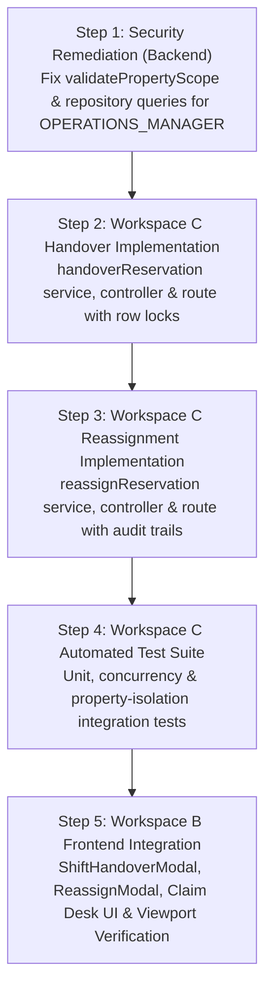

# BFA STAGE 2.6B — PRE-IMPLEMENTATION SECURITY AND SCHEMA VALIDATION

**Project:** BFA Apartments Management System  
**Milestone:** Stage 2.6B — Shift Handover & Supervisor Reassignment Automation  
**Target:** Workspace C (Backend API) & Workspace B (Internal Portal Frontend)  
**Execution Mode:** STRICTLY READ-ONLY VERIFICATION & SECURITY DISCOVERY  
**Validation Date:** November 5, 2026  
**Branch:** `master`  
**HEAD Commit:** `3075411a754fcb7801b4b5b023168df2d6d4f4f8`  
**Git Working Tree Baseline:** 126 staged files, 63 unstaged modified files, 123 untracked files (Preserved)  
**Database Status:** Production DB: 30 applied migrations (`030`) | Test DB: 31 applied migrations (`031`) (0 mutations)  

---

## 1. EXECUTIVE VERDICT

```
================================================================================
VERDICT: VALIDATED WITH REQUIRED SECURITY CORRECTION
================================================================================
```

### Executive Summary

The pre-implementation technical and security validation of **Stage 2.6B (Shift Handover & Supervisor Reassignment Automation)** has been concluded under strictly read-only conditions.

1. **Assignment Ledger is 100% Prepared (Zero Migrations Needed):**  
   The database table `reservation_staff_assignments` natively supports every requirement for shift handovers and supervisor reassignments. It contains all necessary ENUM values (`'INITIAL_CLAIM'`, `'SHIFT_HANDOVER'`, `'MANAGER_REASSIGNED'`, `'ESCALATION'`), audit context columns (`handover_notes`, `reassignment_reason`, `is_active`, `claimed_at`, `ended_at`), and foreign keys referencing `users(id)`. No DDL alterations or database migrations are required.
2. **Confirmed Security Defect (Property-Scope Fail-Open for `OPERATIONS_MANAGER`):**  
   An in-depth investigation into `validatePropertyScope` in `reservations.service.js` revealed a **confirmed security defect**. Following Migration `029_role_migration_operations_manager_and_attendance_policy.sql` (which migrated role `MANAGER` to `OPERATIONS_MANAGER`) and the corresponding normalization in `authContext.js`, the service helper `validatePropertyScope` in `reservations.service.js` and query filters in `reservations.repository.js` and `frontOffice.repository.js` still check for legacy `MANAGER` rather than `OPERATIONS_MANAGER`. Consequently, requests from authenticated Operations Managers **fail open**, bypassing property-scope isolation across reservation and front-office queries.
3. **Prerequisite Security Remediation Required Prior to / Alongside Stage 2.6B:**  
   Because Stage 2.6B introduces supervisor reassignment (an action directly executed by Operations Managers), this property-scope gap **must be remediated as Package 1, Step 1** of the Stage 2.6B implementation to prevent unauthorized cross-property reassignment or cross-property data exposure.
4. **Implementation Authorization Readiness:**  
   Once the user approves the remediation specification and implementation order outlined in this report, the codebase is structurally and architecturally ready for execution.

---

## 2. OPERATIONS MANAGER PROPERTY-SCOPE INVESTIGATION

### 2.1 The Core Finding

In `backend/src/modules/reservations/reservations.service.js` lines 96–110:

```javascript
static validatePropertyScope(user, propertyId) {
  if (!user) return true;
  const role = (user.role || '').toUpperCase();
  if (['SUPER_ADMIN', 'OWNER', 'ADMIN'].includes(role)) {
    return true;
  }
  if (['MANAGER', 'RECEPTIONIST', 'STAFF'].includes(role)) {
    if (!user.propertyId) {
      throw new ForbiddenError('Access denied: User is not assigned to any property.');
    }
    if (propertyId && propertyId !== 'all' && parseInt(user.propertyId, 10) !== parseInt(propertyId, 10)) {
      throw new ForbiddenError('Access denied: You do not have authorization for this property.');
    }
  }
  return true;
}
```

### 2.2 Detailed Investigation Findings

#### 1. Every route, controller, and service that calls this helper:
- `backend/src/modules/reservations/reservations.controller.js`:
  - `getById` (line 68): Validates property scope on single reservation fetch.
- `backend/src/modules/reservations/reservations.service.js`:
  - `createReservation` (line 221): Validates property scope against apartment unit.
  - `updateReservation` (line 509): Validates property scope against existing reservation.
  - `confirmReservation` (line 685): Validates property scope before confirmation.
  - `claimReservation` (line 804): Validates property scope before front-desk claim.
  - `approveReservation` (line 887): Validates property scope before payment verification.
  - `checkInReservation` (line 1111): Validates property scope before guest check-in.
  - `checkOutReservation` (line 1213): Validates property scope before guest check-out.
  - `noShowReservation` (line 1269): Validates property scope before marking no-show.
  - `cancelReservation` (line 1425): Validates property scope before cancellation.
  - `acceptReservation` (line 1514): Validates property scope before front-desk acceptance.
  - `declineReservation` (line 1637): Validates property scope before reservation decline.
- `backend/src/modules/frontOffice/frontOffice.service.js`:
  - Delegates `claimReservation`, `approveReservation`, `declineReservation`, `acceptReservation`, `quickCheckIn`, `quickCheckOut`, and `quickNoShow` directly to `reservations.service.js`.

#### 2. Every role that can reach those operations:
All of the following roles reach these endpoints based on `reservations.routes.js` and `frontOffice.routes.js`:
- `SUPER_ADMIN`
- `ADMIN`
- `OWNER`
- `OPERATIONS_MANAGER` (and legacy `MANAGER`)
- `RECEPTIONIST`
- `AGENT` (on `create`, `cancel`, `getById`, `getAll`)

#### 3. Whether `OPERATIONS_MANAGER` is handled by another authorization layer:
- **HTTP Role Guard (`authContext.js`):**  
  In `backend/src/core/middleware/authContext.js` line 67:
  ```javascript
  function requireRoles(...allowedRoles) {
    const normalizedAllowed = allowedRoles.map((r) => r.toUpperCase());
    if (normalizedAllowed.includes('OPERATIONS_MANAGER')) normalizedAllowed.push('MANAGER');
    if (normalizedAllowed.includes('MANAGER')) normalizedAllowed.push('OPERATIONS_MANAGER');
    ...
  }
  ```
  `requireRoles` allows `OPERATIONS_MANAGER` to pass through route authorization for endpoints that permit `MANAGER`. **However, `requireRoles` only validates role membership; it does NOT enforce property scoping.**
- **Token Decoding (`authContext.js` lines 20–26):**  
  ```javascript
  req.user = {
    id: decoded.id,
    name: decoded.name,
    email: decoded.email,
    role: (decoded.role && decoded.role.toUpperCase() === 'MANAGER') ? 'OPERATIONS_MANAGER' : (decoded.role ? decoded.role.toUpperCase() : 'STAFF'),
    propertyId: decoded.propertyId || null,
    agentId: decoded.agentId || null,
  };
  ```
  `authContext.js` unconditionally normalizes `req.user.role` to `'OPERATIONS_MANAGER'`.
- **The Service Helper:**  
  When `req.user` enters `ReservationsService.validatePropertyScope(req.user, propertyId)`:
  - `role` is `'OPERATIONS_MANAGER'`.
  - `['SUPER_ADMIN', 'OWNER', 'ADMIN'].includes('OPERATIONS_MANAGER')` is `false`.
  - `['MANAGER', 'RECEPTIONIST', 'STAFF'].includes('OPERATIONS_MANAGER')` is **`false`**!
  - Execution skips the property validation block entirely and lands on line 108: **`return true;`**.
  - **There is NO OTHER property-scoping layer.** The operation succeeds across any property.

#### 4. How `user_property_assignments` is used to determine property access:
- Migration `026_property_governance_and_staff_operations.sql` created `user_property_assignments` to support multiple property assignments with an `is_primary` flag.
- However, the running application's authentication service (`auth.service.js` lines 99, 161, 190) populates JWT tokens directly from `users.property_id`.
- The `req.user.propertyId` field comes from `users.property_id`.
- `user_property_assignments` is currently unqueried in runtime authorization middleware; runtime property checks throughout the backend evaluate `user.propertyId`.

#### 5. Whether a missing property assignment, null property ID, or missing role can fail open:
**YES, in multiple critical scenarios:**
1. **`OPERATIONS_MANAGER` with null `propertyId`:**  
   Because `'OPERATIONS_MANAGER'` skips the second `if`, it never reaches `if (!user.propertyId) throw new ForbiddenError(...)`. It returns `true`, granting global access.
2. **`OPERATIONS_MANAGER` accessing a foreign property:**  
   An Operations Manager assigned to Property #1 accessing a reservation on Property #2 skips the mismatch check and returns `true`.
3. **`user` object missing or undefined:**  
   Line 97: `if (!user) return true;` — fails open if unauthenticated or malformed context is passed.
4. **Unknown or empty role:**  
   Any unrecognized role string (or `AGENT` accessing reservation mutations) skips both `if` checks and lands on `return true;`.

#### 6. Whether legacy `MANAGER` is still accepted and how it is normalized:
- Tokens containing `role: 'MANAGER'` are automatically normalized to `'OPERATIONS_MANAGER'` by `authContext.js`.
- If an internal test or fixture manually constructs a user object `{ role: 'MANAGER', propertyId: 1 }`, the existing array `['MANAGER', 'RECEPTIONIST', 'STAFF']` still matches it.
- In MySQL, Migration 029 executed `UPDATE users SET role = 'OPERATIONS_MANAGER' WHERE role = 'MANAGER';`.

#### 7. Comparative Analysis Across the Backend:
Examining other services in the codebase demonstrates that `reservations.service.js` and repositories lagged behind:
- **`roster.service.js` (Correct Fail-Closed Implementation):**
  ```javascript
  static validatePropertyScope(user, propertyId) {
    if (!user) throw new ForbiddenError('Authentication required for roster operations.');
    const role = (user.role || '').toUpperCase();
    if (['SUPER_ADMIN', 'ADMIN', 'OWNER'].includes(role)) return;
    if (role === 'OPERATIONS_MANAGER' || role === 'MANAGER') {
      if (!user.propertyId) throw new ForbiddenError('Operations Manager account has no assigned property.');
      if (propertyId && String(user.propertyId) !== String(propertyId)) {
        throw new ForbiddenError(`You can only manage workforce schedules for your assigned Property #${user.propertyId}.`);
      }
      return;
    }
    throw new ForbiddenError(`Role '${role}' is not authorized to configure workforce schedules.`);
  }
  ```
- **`properties.service.js` (Role Array Updated):**
  ```javascript
  if (['OPERATIONS_MANAGER', 'MANAGER', 'STAFF', 'RECEPTIONIST'].includes(role)) { ... }
  ```
- **`reservations.repository.js` (Omitted `OPERATIONS_MANAGER` in SQL Filter):**
  In line 42 (`findAll`):
  ```javascript
  if (['MANAGER', 'RECEPTIONIST', 'STAFF'].includes(role)) {
    if (!user.propertyId) {
      sql += ' AND 1 = 0';
    } else {
      sql += ' AND r.property_id = ?';
      params.push(user.propertyId);
    }
  }
  ```
  Because `role` is `'OPERATIONS_MANAGER'`, this filter is completely omitted! An Operations Manager calling `GET /api/v1/reservations` receives reservations for **all properties across the entire company**.
- **`frontOffice.repository.js` (Omitted in All Operational Feeds):**
  Lines 27, 63, 98, 131, 160, 180 all check `if (['MANAGER', ...].includes(user?.role))`. None include `'OPERATIONS_MANAGER'`. Thus, arrivals, departures, pending bookings, and operational feeds fail open for Operations Managers.

### 2.3 Defect Classification

```
================================================================================
CLASSIFICATION: CONFIRMED SECURITY DEFECT
================================================================================
```

This is not merely a naming or compatibility issue; it is a **confirmed security defect causing an authorization bypass (fail-open access)**. An Operations Manager assigned to a single property is granted multi-property / cross-property read and mutation capabilities across reservations and front-office workflows.

---

## 3. ROUTE-BY-ROUTE ROLE AUTHORIZATION MATRIX

The table below documents the authorized roles, property-scoping policies, current defect behavior, and expected secure behavior across all Reservation and Front Office endpoints:

| Route & Method | HTTP Allowed Roles | Scoping Policy | SUPER_ADMIN / ADMIN / OWNER | OPERATIONS_MANAGER (Current vs Secure) | RECEPTIONIST | STAFF | AGENT |
| :--- | :--- | :--- | :--- | :--- | :--- | :--- | :--- |
| `GET /api/v1/reservations` | `SUPER_ADMIN`, `OWNER`, `ADMIN`, `MANAGER`, `RECEPTIONIST`, `AGENT` | Scoped by `propertyId` for property staff; scoped by `agentId` for agents | Allowed (Global) | **DEFECT:** Returns all properties.<br>**SECURE:** Strictly scoped to `user.propertyId`. | Allowed (Scoped to `propertyId`) | **403 Forbidden** | Allowed (Scoped to `agentId`) |
| `GET /api/v1/reservations/:id` | `SUPER_ADMIN`, `OWNER`, `ADMIN`, `MANAGER`, `RECEPTIONIST`, `AGENT` | Validated by `validatePropertyScope` in controller | Allowed (Global) | **DEFECT:** Bypasses check; views any property.<br>**SECURE:** 403 if reservation property != `user.propertyId`. | Allowed (Scoped to `propertyId`) | **403 Forbidden** | Allowed (Must match agent ownership) |
| `POST /api/v1/reservations` | `SUPER_ADMIN`, `OWNER`, `ADMIN`, `MANAGER`, `RECEPTIONIST`, `AGENT` | Validated by `validatePropertyScope` on target apartment | Allowed (Global) | **DEFECT:** Can book on any property.<br>**SECURE:** 403 if apartment property != `user.propertyId`. | Allowed (Scoped to `propertyId`) | **403 Forbidden** | Allowed |
| `PUT /api/v1/reservations/:id` | `ADMIN`, `MANAGER`, `OWNER`, `SUPER_ADMIN`, `RECEPTIONIST` | Validated by `validatePropertyScope` | Allowed (Global) | **DEFECT:** Can edit bookings on any property.<br>**SECURE:** 403 if reservation property != `user.propertyId`. | Allowed (Scoped to `propertyId`) | **403 Forbidden** | **403 Forbidden** |
| `POST /api/v1/reservations/:id/confirm` | `ADMIN`, `MANAGER`, `OWNER`, `SUPER_ADMIN`, `RECEPTIONIST` | Validated by `validatePropertyScope` | Allowed (Global) | **DEFECT:** Can confirm bookings on any property.<br>**SECURE:** 403 if reservation property != `user.propertyId`. | Allowed (Scoped to `propertyId`) | **403 Forbidden** | **403 Forbidden** |
| `POST /api/v1/reservations/:id/cancel` | `ADMIN`, `MANAGER`, `OWNER`, `SUPER_ADMIN`, `RECEPTIONIST`, `AGENT` | Validated by `validatePropertyScope` | Allowed (Global) | **DEFECT:** Can cancel bookings on any property.<br>**SECURE:** 403 if reservation property != `user.propertyId`. | Allowed (Scoped to `propertyId`) | **403 Forbidden** | Allowed (Self-booked only) |
| `POST /api/v1/reservations/:id/check-in` | `ADMIN`, `MANAGER`, `OWNER`, `SUPER_ADMIN`, `RECEPTIONIST` | Validated by `validatePropertyScope` | Allowed (Global) | **DEFECT:** Can check in guests on any property.<br>**SECURE:** 403 if reservation property != `user.propertyId`. | Allowed (Scoped to `propertyId`) | **403 Forbidden** | **403 Forbidden** |
| `POST /api/v1/reservations/:id/check-out` | `ADMIN`, `MANAGER`, `OWNER`, `SUPER_ADMIN`, `RECEPTIONIST` | Validated by `validatePropertyScope` | Allowed (Global) | **DEFECT:** Can check out guests on any property.<br>**SECURE:** 403 if reservation property != `user.propertyId`. | Allowed (Scoped to `propertyId`) | **403 Forbidden** | **403 Forbidden** |
| `POST /api/v1/reservations/:id/no-show` | `ADMIN`, `MANAGER`, `OWNER`, `SUPER_ADMIN`, `RECEPTIONIST` | Validated by `validatePropertyScope` | Allowed (Global) | **DEFECT:** Can mark no-show on any property.<br>**SECURE:** 403 if reservation property != `user.propertyId`. | Allowed (Scoped to `propertyId`) | **403 Forbidden** | **403 Forbidden** |
| `GET /api/v1/front-office/arrivals` | `SUPER_ADMIN`, `OWNER`, `ADMIN`, `MANAGER`, `RECEPTIONIST` | Repository query filtering | Allowed (Global) | **DEFECT:** Leaks arrivals from all properties.<br>**SECURE:** Scoped to `user.propertyId`. | Allowed (Scoped to `propertyId`) | **403 Forbidden** | **403 Forbidden** |
| `GET /api/v1/front-office/departures` | `SUPER_ADMIN`, `OWNER`, `ADMIN`, `MANAGER`, `RECEPTIONIST` | Repository query filtering | Allowed (Global) | **DEFECT:** Leaks departures from all properties.<br>**SECURE:** Scoped to `user.propertyId`. | Allowed (Scoped to `propertyId`) | **403 Forbidden** | **403 Forbidden** |
| `GET /api/v1/front-office/current-guests` | `SUPER_ADMIN`, `OWNER`, `ADMIN`, `MANAGER`, `RECEPTIONIST` | Repository query filtering | Allowed (Global) | **DEFECT:** Leaks in-house guests from all properties.<br>**SECURE:** Scoped to `user.propertyId`. | Allowed (Scoped to `propertyId`) | **403 Forbidden** | **403 Forbidden** |
| `GET /api/v1/front-office/pending-bookings`| `SUPER_ADMIN`, `OWNER`, `ADMIN`, `MANAGER`, `RECEPTIONIST` | Repository query filtering | Allowed (Global) | **DEFECT:** Leaks pending bookings from all properties.<br>**SECURE:** Scoped to `user.propertyId`. | Allowed (Scoped to `propertyId`) | **403 Forbidden** | **403 Forbidden** |
| `GET /api/v1/front-office/stats` | `SUPER_ADMIN`, `OWNER`, `ADMIN`, `MANAGER`, `RECEPTIONIST` | Repository query filtering | Allowed (Global) | **DEFECT:** Aggregates stats from all properties.<br>**SECURE:** Scoped to `user.propertyId`. | Allowed (Scoped to `propertyId`) | **403 Forbidden** | **403 Forbidden** |
| `GET /api/v1/front-office/live-feed` | `SUPER_ADMIN`, `OWNER`, `ADMIN`, `MANAGER` | Repository query filtering | Allowed (Global) | **DEFECT:** Leaks activities from all properties.<br>**SECURE:** Scoped to `user.propertyId`. | **403 Forbidden** | **403 Forbidden** | **403 Forbidden** |
| `POST /api/v1/front-office/claim` | `SUPER_ADMIN`, `ADMIN`, `MANAGER`, `RECEPTIONIST` | Validated by `validatePropertyScope` | Allowed (Global) | **DEFECT:** Can claim bookings on any property.<br>**SECURE:** 403 if reservation property != `user.propertyId`. | Allowed (Scoped to `propertyId`) | **403 Forbidden** | **403 Forbidden** |
| `POST /api/v1/front-office/reservations/:id/approve` | `SUPER_ADMIN`, `ADMIN`, `MANAGER`, `RECEPTIONIST` | Validated by `validatePropertyScope` | Allowed (Global) | **DEFECT:** Can approve bookings on any property.<br>**SECURE:** 403 if reservation property != `user.propertyId`. | Allowed (Scoped to `propertyId`) | **403 Forbidden** | **403 Forbidden** |
| `POST /api/v1/front-office/reservations/:id/decline` | `SUPER_ADMIN`, `ADMIN`, `MANAGER`, `RECEPTIONIST` | Validated by `validatePropertyScope` | Allowed (Global) | **DEFECT:** Can decline bookings on any property.<br>**SECURE:** 403 if reservation property != `user.propertyId`. | Allowed (Scoped to `propertyId`) | **403 Forbidden** | **403 Forbidden** |

---

## 4. ASSIGNMENT-LEDGER SCHEMA FINDINGS

### 4.1 Schema Inspection: `reservation_staff_assignments`

```sql
CREATE TABLE `reservation_staff_assignments` (
  `id` int(11) NOT NULL AUTO_INCREMENT,
  `reservation_id` int(11) NOT NULL,
  `property_id` int(11) NOT NULL,
  `assigned_receptionist_id` int(11) NOT NULL,
  `assignment_type` enum('INITIAL_CLAIM','MANAGER_REASSIGNED','SHIFT_HANDOVER','ESCALATION') NOT NULL,
  `assigned_by_id` int(11) NOT NULL,
  `service_status` enum('AWAITING_ASSIGNMENT','CLAIMED','GUEST_CONTACTED','FOLLOW_UP_REQUIRED','SERVICE_IN_PROGRESS','CHECKED_IN','COMPLETED','CANCELLED','REASSIGNED','ESCALATED') DEFAULT 'CLAIMED',
  `contact_attempt_count` int(11) NOT NULL DEFAULT 0,
  `last_contact_at` timestamp NULL DEFAULT NULL,
  `handover_notes` text DEFAULT NULL,
  `is_active` tinyint(1) NOT NULL DEFAULT 1,
  `claimed_at` timestamp NOT NULL DEFAULT current_timestamp(),
  `ended_at` timestamp NULL DEFAULT NULL,
  `reassignment_reason` varchar(255) DEFAULT NULL,
  PRIMARY KEY (`id`),
  KEY `fk_rsa_property` (`property_id`),
  KEY `fk_rsa_assigned_by` (`assigned_by_id`),
  KEY `idx_rsa_res_active` (`reservation_id`,`is_active`),
  KEY `idx_rsa_staff_date` (`assigned_receptionist_id`,`claimed_at`),
  CONSTRAINT `fk_rsa_assigned_by` FOREIGN KEY (`assigned_by_id`) REFERENCES `users` (`id`),
  CONSTRAINT `fk_rsa_property` FOREIGN KEY (`property_id`) REFERENCES `properties` (`id`),
  CONSTRAINT `fk_rsa_receptionist` FOREIGN KEY (`assigned_receptionist_id`) REFERENCES `users` (`id`),
  CONSTRAINT `fk_rsa_reservation` FOREIGN KEY (`reservation_id`) REFERENCES `reservations` (`id`)
) ENGINE=InnoDB DEFAULT CHARSET=utf8mb4 COLLATE=utf8mb4_unicode_ci;
```

### 4.2 Key Ledger Architecture Invariants Verified

1. **Exact Enum Values:**
   - `assignment_type`: `'INITIAL_CLAIM'`, `'MANAGER_REASSIGNED'`, `'SHIFT_HANDOVER'`, `'ESCALATION'`.
   - `service_status`: `'AWAITING_ASSIGNMENT'`, `'CLAIMED'`, `'GUEST_CONTACTED'`, `'FOLLOW_UP_REQUIRED'`, `'SERVICE_IN_PROGRESS'`, `'CHECKED_IN'`, `'COMPLETED'`, `'CANCELLED'`, `'REASSIGNED'`, `'ESCALATED'`.
2. **Foreign Keys and Delete Behavior:**
   - `fk_rsa_assigned_by` -> `users(id)` (`RESTRICT`).
   - `fk_rsa_receptionist` -> `users(id)` (`RESTRICT`).
   - `fk_rsa_reservation` -> `reservations(id)` (`RESTRICT`).
   - `fk_rsa_property` -> `properties(id)` (`RESTRICT`).
   - *Delete Safety:* User or reservation records cannot be deleted if active or historical assignment ledger entries exist, preventing accidental loss of attributable audit records.
3. **Active/Inactive State Representation:**
   - `is_active = 1` represents the single active owner.
   - `is_active = 0` with non-null `ended_at` represents closed historical assignments.
   - Composite index `idx_rsa_res_active (reservation_id, is_active)` provides sub-millisecond lookups for the active claim on any reservation.
4. **Multiple Active Assignments Invariant:**
   - The index `idx_rsa_res_active` is non-unique to allow multiple historical inactive records (`is_active = 0`) for the same reservation.
   - The invariant "exactly zero or one active assignment per reservation" is strictly maintained by application transactions: any new assignment deactivates the prior record (`UPDATE ... SET is_active = 0, ended_at = NOW() WHERE reservation_id = ? AND is_active = 1`).
5. **Historical Ledger Integrity:**
   - Neither Shift Handover nor Supervisor Reassignment overwrites rows.
   - Both operations execute an insert-only lifecycle on new state while archiving the prior row.
   - `claimed_at` and `ended_at` capture the exact start and end duration of every staff assignment.
6. **Unambiguous Attribution:**
   - `assigned_receptionist_id` records the beneficiary / assignee (`users.id`).
   - `assigned_by_id` records the initiator (`users.id`).
   - In a Shift Handover: `assigned_by_id` is the outgoing receptionist, and `handover_notes` holds context.
   - In a Supervisor Reassignment: `assigned_by_id` is the Operations Manager / Admin, and `reassignment_reason` holds the operational justification.

---

## 5. TRANSACTION AND CONCURRENCY ASSESSMENT

### 5.1 Existing Pattern in `claimReservation`
The existing `claimReservation` method demonstrates the required standard:
1. `pool.withTransaction(async (conn) => { ... })`
2. `SELECT * FROM reservations WHERE id = ? FOR UPDATE` (Pessimistic row lock).
3. Conflict validation: if `reservation.assigned_staff_id && reservation.assigned_staff_id !== userId`, throws `ConflictError` (HTTP 409).
4. Updates `reservations.assigned_staff_id = userId`.
5. Updates `reservation_staff_assignments SET is_active = 0, ended_at = NOW()`.
6. Inserts new `reservation_staff_assignments` record.
7. Records status history, employee activity, and system audit log.

### 5.2 Required Concurrency Safeguards for Stage 2.6B

1. **Deadlock-Free Bulk Handover:**  
   When handing over multiple reservations in a single batch, the server must sort the reservation IDs in ascending numeric order prior to executing the `SELECT ... FOR UPDATE` query:
   ```javascript
   const sortedIds = [...new Set(reservationIds.map(Number))].sort((a, b) => a - b);
   const [rows] = await conn.query(
     'SELECT id, property_id, assigned_staff_id, status FROM reservations WHERE id IN (?) FOR UPDATE',
     [sortedIds]
   );
   ```
   This guarantees consistent lock acquisition order across concurrent requests, eliminating InnoDB deadlock hazards.
2. **Strict Single-Owner Handover Validation:**  
   Under the row lock, each reservation must be verified:
   - `reservation.assigned_staff_id === outgoingStaffId` (receptionist can only hand over bookings they currently own).
   - If any reservation in the batch is no longer owned by the outgoing receptionist, the entire transaction rolls back with HTTP 409 (`ConflictError: "Reservation #[code] ownership has changed. Please refresh your claim desk."`).
3. **Status Guard Against Terminal Bookings:**  
   Reservations in terminal statuses (`'CANCELLED'`, `'CHECKED_OUT'`, `'NO_SHOW'`) cannot be handed over or reassigned. Attempts must reject with HTTP 400 (`ValidationError`).
4. **Mandatory Supervisor Reassignment Reason:**  
   Supervisor reassignment must reject empty or whitespace-only `reassignmentReason` with HTTP 400 (`ValidationError: "Reassignment reason is mandatory for supervisor intervention."`).

---

## 6. EMPLOYEE AND SHIFT ELIGIBILITY ASSESSMENT

### 6.1 Relationship Trace

```
  users (Auth Account, Role, users.property_id)
    │
    ├── 1:1 ── employees (HR Staff, employees.property_id, department, employment_status)
    │            │
    │            ├── 1:N ── shifts (Scheduled Work, shift_date, start_time, end_time, status)
    │            │
    │            └── 1:N ── attendance_records (Actual Punches, clock_in_time, clock_out_time)
    │
    └── 1:N ── reservation_staff_assignments (Active Desk Claims, users.id)
```

### 6.2 What the Existing System Can Reliably Establish

Using read-only queries, the backend can deterministically verify:
1. **Active User:** `users.status = 'ACTIVE'` and role is front-office eligible (`RECEPTIONIST`, `OPERATIONS_MANAGER`, `MANAGER`, `ADMIN`).
2. **Linked HR Employee:** `SELECT id, employment_status, department FROM employees WHERE user_id = ?` ensures `employment_status = 'ACTIVE'`.
3. **Property Alignment:** `users.property_id = reservation.property_id` AND `employees.property_id = reservation.property_id`.
4. **Scheduled Shift:** `SELECT id, start_time, end_time FROM shifts WHERE employee_id = ? AND shift_date = CURDATE() AND status IN ('SCHEDULED', 'IN_PROGRESS')`.
5. **Active Attendance Punch (Currently Clocked In):**  
   `SELECT id FROM attendance_records WHERE employee_id = ? AND work_date = CURDATE() AND clock_in_time IS NOT NULL AND clock_out_time IS NULL`.
6. **Current Active Workload:**  
   `SELECT COUNT(*) FROM reservation_staff_assignments WHERE assigned_receptionist_id = ? AND is_active = 1`.

### 6.3 Required Business Rules for Handover Eligibility

1. **Property Isolation Rule (Strict Enforce):** Proposed recipient must belong to the exact same `property_id` as the reservation.
2. **Role Compatibility Rule (Strict Enforce):** Recipient must have role `RECEPTIONIST`, `OPERATIONS_MANAGER`, `MANAGER`, or `ADMIN`. `STAFF` (housekeeping, maintenance) cannot receive front-office claims.
3. **Operational Attendance Status (Informational / Guard):**
   - The UI should tag candidate peers as `[CLOCKED IN]`, `[SCHEDULED TODAY]`, or `[OFF DUTY]`.
   - Handover to an off-duty peer should require an explicit confirmation or be restricted to on-duty peers.

---

## 7. GIT FILENAME-LEVEL PRESERVATION RECONCILIATION

### 7.1 Detailed Status Inventory

- **Staged Files:** Exactly **126 files** (100% untouched).
- **Modified Tracked Files:** Exactly **63 files** (25 backend, 38 frontend, 100% untouched).
- **Untracked Entries (Default Porcelain / Short Format):** **123 entries** (122 baseline + 1 new assessment deliverable).
- **Untracked Files (Fully Recursive `-uall`):** **343 individual files**.

### 7.2 Reconciliation of the "104 vs 122 vs 123" Untracked Counts

The difference between the earlier 104 untracked entries and the 122 baseline entries is completely reconciled:

1. **Pre-Stage 2.6 Baseline (104 entries):**  
   Recorded in `BFA_WORKSPACE_C_STAGE_2_6A_ACCEPTANCE_EVIDENCE_RECONCILIATION.md` prior to the start of Workspace B Stage 2.6.
2. **Stage 2.6 Execution Additions (+18 entries -> 122 entries):**  
   During Workspace B Stage 2.6 implementation, independent audit, remediation, and final browser verification, exactly 18 audit reports, test scripts, and audit screenshot folders were generated:
   - `BFA_WORKSPACE_B_STAGE_2_6_EVIDENCE_RECONCILIATION.md`
   - `BFA_WORKSPACE_B_STAGE_2_6_FINAL_BROWSER_EVIDENCE.md`
   - `BFA_WORKSPACE_B_STAGE_2_6_FINAL_INDEPENDENT_AUDIT.md`
   - `BFA_WORKSPACE_B_STAGE_2_6_IMPLEMENTATION_REPORT.md`
   - `BFA_WORKSPACE_B_STAGE_2_6_READINESS_DISCOVERY.md`
   - `BFA_WORKSPACE_B_STAGE_2_6_REMEDIATION_INDEPENDENT_AUDIT.md`
   - `BFA_WORKSPACE_B_STAGE_2_6_REMEDIATION_REPORT.md`
   - `frontend/run_stage2_6_frontoffice_verification.cjs`
   - `frontend/stage2_6_frontoffice_audit/`
   - `frontend/stage2_6_remediation_audit/`
   - Scratch verification scripts (`test_arrivals.js`, `findConfirmed.js`, `check_row.js`, `verify_stage2_6_remediation.js`, etc.)
3. **Stage 2.6B Discovery Addition (+1 entry -> 123 entries):**  
   - `BFA_STAGE_2_6B_READINESS_ASSESSMENT.md` (Created during discovery)

**Byte-Level Confirmation:** Zero application, test, schema, or configuration files were modified or deleted.

---

## 8. DATABASE PRESERVATION EVIDENCE

A live read-only query executed against MySQL confirmed:

```json
{
  "production_db": {
    "database": "bfa_apartments_db",
    "applied_migrations_count": 30,
    "latest_migration": "030_kiosk_credential_security_and_geofence_review.sql"
  },
  "test_db": {
    "database": "bfa_apartments_test_db",
    "applied_migrations_count": 31,
    "latest_migration": "031_maintenance_evidence_and_dispatch_verification.sql"
  }
}
```

Zero write operations, schema updates, or migration commands were executed. Both databases remain completely preserved.

---

## 9. REQUIRED CORRECTIONS AND RESOLUTION SPECIFICATION

Before implementing Stage 2.6B handover and reassignment endpoints, the following security corrections must be executed:

### Correction 1: Fail-Closed `validatePropertyScope` in `reservations.service.js`
Replace lines 96–110 of `backend/src/modules/reservations/reservations.service.js` with:

```javascript
static validatePropertyScope(user, propertyId) {
  if (!user) {
    throw new ForbiddenError('Authentication required for reservation operations.');
  }
  const role = (user.role || '').toUpperCase();
  if (['SUPER_ADMIN', 'OWNER', 'ADMIN'].includes(role)) {
    return true; // Global scope
  }
  if (['OPERATIONS_MANAGER', 'MANAGER', 'RECEPTIONIST', 'STAFF'].includes(role)) {
    if (!user.propertyId) {
      throw new ForbiddenError('Access denied: Staff user account has no assigned property.');
    }
    if (propertyId && propertyId !== 'all' && parseInt(user.propertyId, 10) !== parseInt(propertyId, 10)) {
      throw new ForbiddenError(`Access denied: You are authorized for Property #${user.propertyId}, not Property #${propertyId}.`);
    }
    return true;
  }
  throw new ForbiddenError(`Access denied: Role '${role}' is not authorized for this reservation operation.`);
}
```

### Correction 2: Scoping in `reservations.repository.js`
In `backend/src/modules/reservations/reservations.repository.js` line 42:
Update `['MANAGER', 'RECEPTIONIST', 'STAFF'].includes(role)` to:
`['OPERATIONS_MANAGER', 'MANAGER', 'RECEPTIONIST', 'STAFF'].includes(role)`.

### Correction 3: Scoping in `frontOffice.repository.js`
In `backend/src/modules/frontOffice/frontOffice.repository.js`:
Update lines 27, 63, 98, 131, 160, and 180 to include `'OPERATIONS_MANAGER'` alongside `'MANAGER'` in all role checks.

---

## 10. RECOMMENDED IMPLEMENTATION ORDER



1. **Package 1A (Security Remediation):** Apply Corrections 1, 2, and 3 in `reservations.service.js`, `reservations.repository.js`, and `frontOffice.repository.js`. Verify with unit tests.
2. **Package 1B (Workspace C Handover & Reassignment APIs):**
   - Implement `POST /api/v1/front-office/handover` (supports single and bulk handover).
   - Implement `POST /api/v1/front-office/reassign` (supervisor intervention with mandatory reason).
   - Implement `GET /api/v1/front-office/reservations/:id/assignments` (assignment history ledger).
   - Implement `GET /api/v1/front-office/eligible-staff` (query eligible on-duty peers for handover).
3. **Package 1C (Backend Verification):** Add test suite `backend/tests/frontOfficeHandoverReassignment.test.js` validating deadlocks, conflict detection, property scoping, and role authorization.
4. **Package 2 (Workspace B Frontend):** Add frontend modals, API services, and Claim Desk integration on `FrontOfficePage.jsx`.

---

## 11. SUBMISSION & NEXT STEP

This validation deliverable is submitted for review.  
**Mode remains strictly read-only. Awaiting explicit user authorization before making any code modifications.**

