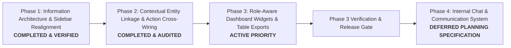
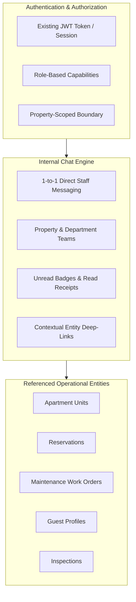
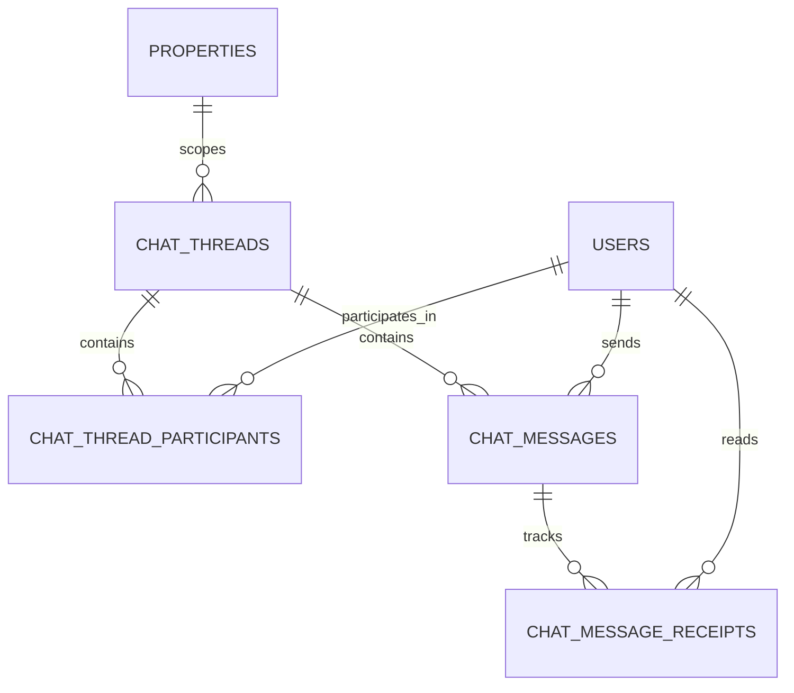

# BFA Structural Implementation Plan

**Author:** System Architecture & Implementation Planning  
**Date:** October 22, 2026  
**Status:** **READ-ONLY PLANNING SPECIFICATION — AWAITING USER APPROVAL**  
**Guiding Mandate:** Improve the organizational coherence, navigation, and cross-entity discoverability of the existing BFA Apartments Management System without altering its technology stack, authentication engine, existing roles, one-night stay rule, or database integrity.

---

## 1. Implementation Philosophy & Phasing Strategy

To achieve the organizational quality of Mojoomla without risking regression to BFA's 34 passing test suites and frozen Phase 12C Operations Assistant, this plan executes across a sequenced, risk-managed architectural roadmap:

- **Phase 1 (Low Risk / Completed & Verified):** Realigned navigation groups in `Sidebar.jsx`, updated routing declarations in `App.jsx`, and surfaced Properties as an explicit asset management view.
- **Phase 2 (Medium Risk / Completed & Audited):** Cross-linked related records (Apartment $\leftrightarrow$ Occupant $\leftrightarrow$ Maintenance $\leftrightarrow$ Inspections; Guest $\leftrightarrow$ Stay History). Added contextual action buttons to modal detail views and deep-linking query parameters.
- **Phase 3 (Medium Risk / Active Priority):** Deliver role-specific dashboard card presets (Receptionist Front Desk queue, Staff Maintenance queue, Owner Investment summary) and universal CSV datatable exports.
- **Phase 4 (High Impact / Deferred Future Phase):** Implement an **Internal Chat & Communication System** for authenticated staff members (1-to-1 messaging, property/team groups, unread counters, in-app notifications, and contextual links to properties, units, reservations, guests, and maintenance tickets).

---

## 2. Phase 1: Information Architecture & Navigation Realignment

### 2.1 Scope of Work
1. **Sidebar Navigation Restructuring (`Sidebar.jsx`):**
   - Unbundle the 7-item `operations` menu into:
     - **Properties & Units** (`/app/properties`, `/app/apartments`, `/app/calendar`).
     - **Front Office & Bookings** (`/app/front-office`, `/app/reservations`, `/app/guests`).
     - **Maintenance & Care** (`/app/maintenance`, `/app/inspection`).
   - Relocate `Team & RBAC` (`/app/team`) from `people` into `admin` (System Administration).
   - Consolidate `Analytics & Intelligence` (`/app/analytics`), `Reports & Exports` (`/app/reports`), and `Audit Trail` (`/app/audit`) into **Reports & Intelligence**.
2. **Dedicated Properties View / Route (`/app/properties`):**
   - Extract the Property management sub-view (building card overview, address, contacts, global amenities) from `ApartmentsPage.jsx` into a dedicated route `/app/properties` or shared asset container.
   - Retain full backward compatibility with `/app/apartments`.
3. **Route & Layout Synchronization (`App.jsx`):**
   - Register route `/app/properties` pointing to `PropertiesPage.jsx` (or enhanced `ApartmentsPage` with tabbed default).
   - Ensure role guard rules remain strictly enforced.

### 2.2 Affected Files
- `frontend/src/components/layout/Sidebar.jsx`
- `frontend/src/App.jsx`
- `frontend/src/pages/ApartmentsPage.jsx` (Refactored to cleanly link with Properties view)
- `frontend/src/pages/PropertiesPage.jsx` (New dedicated view leveraging existing `propertyService`)

### 2.3 Dependencies
- Existing `propertyService` in `frontend/src/services/api.js`.
- Existing `PropertyContext.jsx` for active property filtering.

### 2.4 Acceptance Criteria
1. The sidebar displays 8 logical business domains:
   - Dashboard
   - Properties & Units
   - Front Office & Bookings
   - Staff & Partners
   - Finance & Accounts
   - Maintenance & Care
   - Reports & Intelligence
   - System Administration
2. A user can directly click "Properties & Buildings" to view and edit buildings without navigating through the apartments table.
3. On mobile viewports, the sidebar collapses cleanly with zero overflow or hidden navigation groups.
4. Role-based item visibility continues to hide unauthorized links (e.g. `STAFF` cannot see `Finance` or `System Administration`).

### 2.5 Regression Tests
- Verify all existing frontend navigation tests and route guards pass.
- Verify active link styling (`.active`) highlights properly on all new routes.

---

## 3. Phase 2: Contextual Entity Linkage & Action Cross-Wiring

### 3.1 Scope of Work
1. **Apartment Detail Cross-Wiring (`ApartmentsPage.jsx`):**
   - In the Apartment Detail Modal (`isDetailModalOpen`), add 3 contextual tabs:
     - **Overview:** Physical specifications, floor, unit type, rate per night, amenities, notes.
     - **Current Occupancy:** Active in-house guest name, reservation code, check-in/out dates (queried via existing `reservationService`).
     - **Maintenance & History:** Active work orders and recent inspection ratings for this unit.
   - Add a direct action button: `Log Maintenance Issue` (opens maintenance modal pre-populated with this property and apartment).
2. **Reservation Detail Cross-Wiring (`ReservationsPage.jsx`):**
   - In the Reservation Detail Modal (`isDetailModalOpen`), add contextual actions:
     - `Record Payment` button (opens quick payment modal directly without navigating to Financial page).
     - `Report Maintenance Issue` button (opens work order ticket modal with unit and reservation ID attached).
     - `View Guest Profile` button (navigates or opens linked guest CRM record).
3. **Guest Profile Stay History (`GuestsPage.jsx`):**
   - In the Guest Detail Modal (`isDetailModalOpen`), add a "Stay & Booking History" tab displaying all reservations linked to this `guest_id`, total nights stayed, total amount spent, and outstanding balances.
4. **Backend Supporting Read Queries (Read-Only Extension):**
   - Ensure existing repository endpoints (`/api/v1/reservations?guestId=X`, `/api/v1/maintenance?apartmentId=Y`) support efficient query filtering.

### 3.2 Affected Files
- `frontend/src/pages/ApartmentsPage.jsx`
- `frontend/src/pages/ReservationsPage.jsx`
- `frontend/src/pages/GuestsPage.jsx`
- `backend/src/modules/guests/guests.repository.js` (Optional: include reservation summary in guest detail)
- `backend/src/modules/apartments/apartments.repository.js` (Optional: include active reservation in unit detail)

### 3.3 Dependencies
- Completion of Phase 1 navigation structure.
- Existing database foreign keys (`reservations.guest_id`, `reservations.apartment_id`, `maintenance_requests.apartment_id`).

### 3.4 Acceptance Criteria
1. Clicking an apartment allows viewing its current occupant and open repair tickets in one place.
2. Clicking a guest displays their complete stay history across all BFA properties.
3. From a reservation modal, a front desk clerk can record a cash or card payment with 1 click.
4. No data duplication or schema violations occur; all linkages use existing database IDs.

### 3.5 Regression Tests
- Run `backend/tests/apartments.test.js`
- Run `backend/tests/reservations.test.js`
- Run `backend/tests/guests.test.js`
- Run `backend/tests/maintenance.test.js`

---

## 4. Phase 3: Role-Aware Dashboards & Universal Table Exports

### 4.1 Scope of Work
1. **Modular Dashboard Widgets (`DashboardPage.jsx`):**
   - Refactor `DashboardPage.jsx` to render modular cards based on the logged-in user's role:
     - **Front Desk Queue Widget (`RECEPTIONIST`, `ADMIN`, `MANAGER`):** Today's Arrivals, In-House, Departures, and quick check-in actions.
     - **Work Orders Queue Widget (`STAFF`, `MANAGER`):** High/Critical maintenance issues, assigned technician, and dirty rooms requiring housekeeping turnover.
     - **Executive Financial Widget (`OWNER`, `ADMIN`, `MANAGER`):** Cash flow, monthly revenue, outstanding receivables aging, and ADR/RevPAR.
     - **Agent Performance Widget (`AGENT`):** My client bookings, pending check-ins, earned commissions.
     - **Platform Health Widget (`SUPER_ADMIN`):** Multi-property status, database latency, audit alerts, company settings.
2. **Universal CSV Export on Core Tables:**
   - Add a standardized "Export CSV" button to table toolbars on:
     - `ApartmentsPage.jsx` (Filtered units, status, rates).
     - `ReservationsPage.jsx` (Filtered bookings, guests, amounts, payment status).
     - `GuestsPage.jsx` (Filtered guest CRM directory).
     - `EmployeesPage.jsx` (Staff roster, departments, contact info).
   - Use a lightweight, client-side utility (`exportToCsv(filename, columns, data)`).

### 4.2 Affected Files
- `frontend/src/pages/DashboardPage.jsx`
- `frontend/src/components/dashboard/FrontDeskQueueWidget.jsx` (New)
- `frontend/src/components/dashboard/MaintenanceQueueWidget.jsx` (New)
- `frontend/src/components/dashboard/FinancialKpiWidget.jsx` (New)
- `frontend/src/utils/exportCsv.js` (New utility)
- `frontend/src/components/ui/Table.jsx` (Optional toolbar hook)

### 4.3 Dependencies
- Completion of Phase 1 and Phase 2.
- Existing role state from `useAuth()`.

### 4.4 Acceptance Criteria
1. When a Receptionist logs in, their dashboard prominently displays the daily arrival/departure queue rather than executive financial charts.
2. When a Staff technician logs in, their dashboard displays assigned work orders and dirty units.
3. When an Owner logs in, they see property yields, occupancy %, and asset summaries.
4. Clicking "Export CSV" on any operational table downloads a sanitized, properly formatted `.csv` file matching current filters.

### 4.5 Regression Tests
- Run `backend/tests/employees.test.js`
- Run `backend/tests/financial.test.js`
- Run `backend/tests/audit.test.js`
- Run `backend/tests/phase12_production_readiness.test.js`
- Validate frontend production build: `npm run build`

---

---

## 5. Phase 4: Internal Chat & Communication System (Deferred Planning Specification)

### 5.1 Strategic Objective & Placement Justification
The **Internal Chat & Communication System** introduces secure, contextual, low-latency messaging between authenticated BFA staff and team members. 

**Placement Justification:**
1. **Deferred Post-Phase 3:** Phase 3 delivers role-aware dashboards and core table exports. Chat is placed strictly after Phase 3 and its verification gate to ensure the application's underlying layout, role contexts, and record deep-links are fully stabilized before real-time communication is introduced.
2. **Staff-Only Scope for Initial Version (v1):** The initial version targets internal operations (front desk receptionists, property managers, housekeeping/maintenance staff, and administrators). Tenant- or guest-facing messaging introduces external authentication, spam exposure, and public SLA expectations, and is therefore explicitly deferred to a separate, later initiative.
3. **Planning-Only Status:** This section establishes architectural requirements, candidate entities, transport evaluations, and permissions. **No migrations, dependencies, or code changes are authorized or executed in this phase.**

### 5.2 Scope of Evaluated Capabilities

1. **Direct Messaging (1-to-1):**
   - Private, authenticated conversations between any two active BFA staff members (e.g. Receptionist $\leftrightarrow$ Maintenance Technician, Manager $\leftrightarrow$ Receptionist).
2. **Team & Property Channels:**
   - Dedicated group channels scoped to specific properties (e.g. `Grand Horizon - Operations`, `Victoria Heights - Maintenance`) and system-wide staff channels for administrators.
3. **Unread Tracking & In-App Alerts:**
   - Real-time unread counter badge in `Topbar.jsx` (adjacent to Announcements).
   - In-app toast alerts for direct mentions or incoming direct messages.
   - Message read status (sent, delivered, read) with precise timestamps.
4. **Contextual Entity Links:**
   - Ability to reference or attach operational records directly within a conversation:
     - Property / Unit (`/app/apartments?unitId=...`)
     - Reservation (`/app/reservations?search=...`)
     - Maintenance Work Order (`/app/maintenance?propertyId=...`)
     - Guest Profile (`/app/guests?guestId=...`)
     - Inspection Report (`/app/inspections?propertyId=...`)
   - Interactive preview cards inside chat messages allowing 1-click navigation to the authoritative record modal or drawer.
5. **Content Safety, Sanitization & Auditability:**
   - Server-side input sanitization (XSS mitigation, stripping executable tags).
   - Character limits, rate limiting (anti-flooding middleware), and structured error responses.
   - Audit logging of thread creation, participant additions, and message deletion.

---

### 5.3 Architectural Analysis & Real-Time Transport Evaluation

To integrate seamlessly with BFA's existing Express/Node.js backend, MariaDB database, and Nginx/Docker deployment topology, three transport approaches have been evaluated:

| Transport Option | Latency & UX | Server / Infrastructure Complexity | Docker & Nginx Reverse-Proxy Impact | Recommendation & Verdict |
|---|---|---|---|---|
| **Option A: WebSockets (`socket.io` or native `ws`)** | **Sub-second (Real-Time)**; bidirectional; native typing indicators and instant delivery. | Requires persistent connection state, connection heartbeat, socket authentication middleware, and Redis adapter if horizontally scaled. | Requires Nginx configuration updates (`Upgrade $http_upgrade`, `Connection "upgrade"`). Docker port forwarding already exists on port 5000. | **Strong Candidate for v1** (Provided Nginx configuration is updated and JWT handshake is enforced). |
| **Option B: Server-Sent Events (SSE) + HTTP POST** | **Near Real-Time (<1s)**; unidirectional server push; standard HTTP/1.1 or HTTP/2. | Simpler than WebSockets; relies on standard REST endpoints for sending messages and SSE stream for receiving updates. | Minimal proxy changes; supported natively by Nginx with `proxy_buffering off;`. | **Viable Alternative** if WebSocket persistent state or firewall traversal poses operational challenges. |
| **Option C: HTTP Short / Long Polling** | **High Latency (3–10s)**; periodic roundtrips increase database query overhead. | Trivial to implement; leverages existing REST endpoints. | Zero infrastructure or proxy changes needed. | **Fallback Only**; not recommended as primary transport due to database polling pressure under multi-property operations. |

*Technical Transport Decision:* The recommended transport is **WebSockets with HTTP REST fallback**, but the final protocol choice requires formal review of horizontal scaling requirements and Nginx WebSocket proxy configurations prior to implementation.

---

### 5.4 Candidate Data Entities (Planning Considerations Only)

*Note: The following entity definitions represent candidate models for architectural evaluation, NOT approved database migrations.*

1. **`chat_threads`:**
   - `id` (INT, PK, Auto Increment)
   - `thread_type` (ENUM: `'DIRECT'`, `'PROPERTY_GROUP'`, `'DEPARTMENT_GROUP'`, `'SYSTEM_ANNOUNCEMENT'`)
   - `property_id` (INT, FK $\rightarrow$ `properties.id`, Nullable — null for system-wide direct chats)
   - `title` (VARCHAR(150), Nullable — for group threads)
   - `created_by` (INT, FK $\rightarrow$ `users.id`)
   - `status` (ENUM: `'ACTIVE'`, `'ARCHIVED'`)
   - `created_at`, `updated_at` (TIMESTAMP)

2. **`chat_thread_participants`:**
   - `id` (INT, PK, Auto Increment)
   - `thread_id` (INT, FK $\rightarrow$ `chat_threads.id`)
   - `user_id` (INT, FK $\rightarrow$ `users.id`)
   - `role` (ENUM: `'ADMIN'`, `'MEMBER'`)
   - `last_read_message_id` (INT, Nullable)
   - `last_read_at` (TIMESTAMP, Nullable)
   - `is_muted` (BOOLEAN, Default: false)
   - `joined_at` (TIMESTAMP)

3. **`chat_messages`:**
   - `id` (INT, PK, Auto Increment)
   - `thread_id` (INT, FK $\rightarrow$ `chat_threads.id`)
   - `sender_id` (INT, FK $\rightarrow$ `users.id`)
   - `message_type` (ENUM: `'TEXT'`, `'SYSTEM_EVENT'`, `'CONTEXT_LINK'`)
   - `content` (TEXT, UTF-8mb4)
   - `context_entity_type` (VARCHAR(50), Nullable: `'PROPERTY'`, `'UNIT'`, `'RESERVATION'`, `'GUEST'`, `'MAINTENANCE'`, `'INSPECTION'`)
   - `context_entity_id` (INT, Nullable)
   - `context_metadata` (JSON, Nullable: summary snapshot, code, status)
   - `is_edited` (BOOLEAN, Default: false)
   - `edited_at` (TIMESTAMP, Nullable)
   - `is_deleted` (BOOLEAN, Default: false)
   - `created_at` (TIMESTAMP)

4. **`chat_message_receipts`:**
   - `id` (INT, PK, Auto Increment)
   - `message_id` (INT, FK $\rightarrow$ `chat_messages.id`)
   - `user_id` (INT, FK $\rightarrow$ `users.id`)
   - `status` (ENUM: `'DELIVERED'`, `'READ'`)
   - `updated_at` (TIMESTAMP)

---

### 5.5 Role-Based Access Control & Property Isolation

Access control must conform strictly to BFA's existing multi-property authorization architecture:

| Role | 1-to-1 Direct Messaging | Property Group Access | System-Wide Channels | Contextual Entity Reference Access |
|---|---|---|---|---|
| **SUPER_ADMIN** | Any user across all properties | All property channels; can create global channels | Full access; thread moderation | Can reference and open all entity types |
| **ADMIN** | Any user across all properties | All property channels; can create property channels | Full access | Can reference and open all entity types |
| **MANAGER** | Any staff member in assigned property or management team | Channels for assigned properties (`user.property_id`) | Read announcements; team channels | Can reference records in assigned properties |
| **RECEPTIONIST** | Front desk team, managers, assigned maintenance staff | Assigned property channels | Read announcements | Units, Reservations, Guests in assigned property |
| **STAFF** | Assigned managers, receptionists, fellow technicians | Assigned property maintenance channel | Read announcements | Units, Maintenance work orders in assigned property |
| **AGENT** | Assigned broker coordinator / management | Forbidden from internal property channels | Read broadcast announcements only | Client reservations referred by this agent |
| **OWNER** | Property manager / executive leadership | Executive investor channel (optional) | Read broadcast announcements | Portfolio overview entities |

**Property Isolation Rule:** Users assigned to Property A cannot be added to or read messages from Property B channels. Any message payload attempting to reference an entity from another property will be verified by the backend authorization layer prior to rendering or linking.

---

### 5.6 Version Scope Boundaries: v1 Required vs Future Enhancements

#### Required First-Version Scope (v1):
1. **Authenticated Internal Staff Messaging Only:** Strictly for registered BFA users (no anonymous or tenant portal access).
2. **1-to-1 Direct Conversations & Property Team Channels:** Thread list with recent snippets and active timestamps.
3. **Real-Time or Low-Latency Delivery:** Immediate message display with optimistic UI updates.
4. **Unread Badges & Read State:** Visual badge counter on `Topbar.jsx` and bold highlights in thread drawer.
5. **Contextual Entity Cards:** Clickable cards for units, reservations, work orders, and guests.
6. **Responsive Drawer / Panel Interface:** Slide-over communication drawer accessible globally from any page, collapsible to avoid interrupting primary workflow.
7. **Security & Input Sanitization:** XSS protection, rate limiting, and RBAC property isolation.

#### Optional Future Enhancements (v2+ Deferred):
- Image, document, and PDF attachments (requires virus scanning and media storage strategy).
- Live typing indicators ("Emmanuel is typing...").
- Rich text formatting / Markdown editor.
- Voice memos / audio snippets.
- Push notifications via Web Push API / Service Workers.
- Tenant / Short-Stay Guest Messaging Portal (requires guest authentication).
- Operations Assistant AI Chatbot integration directly into internal channels.

---

### 5.7 Dependencies & Technical Pre-Conditions

Before Phase 4 implementation can be scheduled, the following pre-conditions must be satisfied:
1. **Phase 3 Completion & Regression Verification:** Role-aware dashboards and universal table exports must be deployed, tested, and verified.
2. **User Presence & Directory Service:** A lightweight mechanism to determine active/online staff status without polling overload.
3. **Production Reverse Proxy Review:** `nginx/default.conf` and `docker-compose.yml` must be reviewed to verify WebSocket upgrade headers (`$http_upgrade`) without impacting API routing.
4. **Database Retention Policy:** A formal data retention and message archival policy must be defined (e.g. 90-day retention vs indefinite storage with soft deletes).

---

### 5.8 Open Architectural Decisions Requiring Approval

The following decisions remain open for user/architectural approval prior to Phase 4 kickoff:
1. **Transport Protocol Selection:** Authorize WebSockets (`socket.io`) or Server-Sent Events (SSE) based on server resource allocation.
2. **Attachment Strategy:** Determine whether v1 should support file uploads (e.g. maintenance damage photos) or remain strictly text and entity links.
3. **Data Retention Policy:** Approve whether internal operational messages are purged after a set timeframe (e.g. 180 days) or retained indefinitely in MariaDB.
4. **UI Presentation Paradigm:** Select between a global floating slide-over drawer (accessible from anywhere) or a dedicated full-page view (`/app/chat`).

---

## 6. Verification Gate & Rollback Strategy

At the completion of each phase, the following release gate must pass:
1. **Full Backend Test Suite:** All 34 test suites (384/384 tests) in `backend/tests/` must pass with zero failures.
2. **Strict Business Rule Checks:**
   - Verify `chk_one_night` constraint remains unbroken (`backend/tests/oneNightRule.test.js`).
   - Verify Phase 12C Operations Assistant remains intact (`backend/tests/assistant.test.js`, `backend/tests/automationEngine.test.js`).
3. **Frontend Production Build:** `npm run build` in `frontend/` must compile with 0 errors and 0 lint warnings.
4. **Rollback Plan:**
   - For frontend structural phases (Phases 1–3), changes can be rolled back cleanly via git commit revert without touching database migrations.
   - For Phase 4 (Chat), all database schema additions must feature backward-compatible migrations with corresponding down-scripts.

---

## 7. Current Status & Next Actions

- **Phase 1 (Navigation & Information Architecture):** **COMPLETED & VERIFIED** (See `BFA_PHASE_1_VERIFICATION_REPORT.md`).
- **Phase 2 (Contextual Views & Deep Links):** **COMPLETED & AUDITED** (See `BFA_PHASE_2_VERIFICATION_REPORT.md` — 2 minor pre-Phase 3 remediation items identified).
- **Phase 3 (Role-Aware Dashboards & Universal Table Exports):** **ACTIVE / AWAITING AUTHORIZATION**.
- **Phase 4 (Internal Chat & Communication System):** **PLANNING SPECIFICATION RECORDED — IMPLEMENTATION DEFERRED**.
- **Change Boundary Note:** No application code, database migrations, or server configurations were modified in Phase 4 planning.

