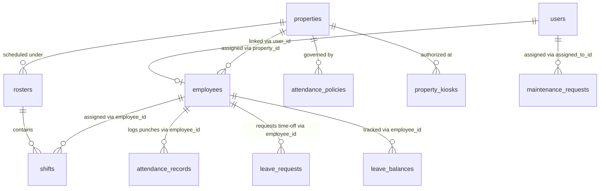
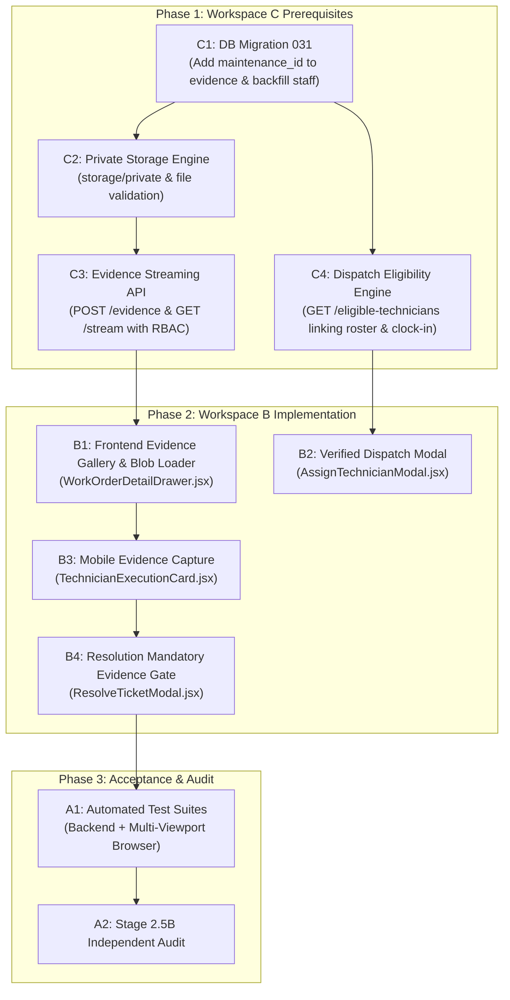

# BFA WORKSPACE B — STAGE 2.5B DISCOVERY AND IMPLEMENTATION-READINESS REPORT
## Advanced Technician Dispatch & Field Execution

**Milestone:** Workspace B — Stage 2.5B  
**Target Capabilities:** Verified Technician Dispatch & Secure Maintenance Repair Evidence  
**Assessment Type:** READ-ONLY DISCOVERY, ARCHITECTURE REVIEW & IMPLEMENTATION PLANNING  
**Current Readiness Verdict:** **CONDITIONALLY READY**  
**Audit Date:** 3 November 2026  
**Investigator:** Antigravity System Architecture & Security Engineering  
**Workspace Root:** `c:\xampp\htdocs\BFA`  
**Git Branch:** `master`  
**Git HEAD Commit:** `3075411a754fcb7801b4b5b023168df2d6d4f4f8`  

---

## 1. Executive Summary

This report delivers a rigorous, evidence-driven, read-only architectural discovery and implementation-readiness assessment for **Stage 2.5B: Advanced Technician Dispatch & Field Execution** within the **BFA Apartments Management System**.

Stage 2.5A (Core Property Maintenance & Unit Care Operations) was formally accepted and closed following comprehensive backend test verification (31/31 passed), clean production build (49.23s), and multi-viewport responsive audits across 8 viewports. Stage 2.5A established operational work order tracking, unit maintenance blocking, and housekeeping turnover handoff, while explicitly deferring technician dispatch verification and repair photo storage.

The primary objective of Stage 2.5B is to investigate two advanced operational capabilities:
1. **Verified Technician Dispatch:** Transitioning from static property-user selection to an authoritative dispatch mechanism that validates active employment, property assignment, published roster shift scheduling, verified clock-in attendance, absence/leave status, and concurrent workload thresholds.
2. **Secure Maintenance Repair Evidence:** Transitioning from deferred photo uploads to a confidential evidence subsystem supporting multiple pre- and post-repair photographs, private binary storage outside the public web root, authenticated streaming retrieval, property-level isolation, and supervisor verification.

### Core Architectural Conclusions:
- **Workforce Identity Disambiguation (`users.id` vs `employees.id`):** In `maintenance_requests`, `assigned_to_id` references `users.id`. However, in the workforce module (`shifts`, `attendance_records`, `leave_requests`), all relationships reference `employees.id`. Crucially, database inspection revealed that not all users have an employee record (e.g. `user_id = 8`, Tunde Bakare – Maintenance, has no row in `employees`), and `employees.user_id` does not match `employees.id`. Any direct join assuming `users.id === employees.id` causes severe data corruption.
- **Storage Boundary & Public Leakage Vulnerability:** Currently, all uploaded files in the application (`uploads/properties`, `uploads/employees`, `uploads/payment_proofs`) are stored under `c:\xampp\htdocs\BFA\backend\uploads\` and statically served to the internet via `app.use('/uploads', express.static(...))` without authentication. Reusing this mechanism for maintenance repair evidence would expose tenant apartment interiors, security defects, and repair photos publicly, violating BFA security standards.
- **Evidence Schema Gap:** The existing `operational_evidence_attachments` table contains `case_id`, `property_id`, `apartment_id`, and `reservation_id`, but **lacks a `maintenance_id` foreign key column**.
- **Readiness Verdict:** **CONDITIONALLY READY**. Workspace B frontend implementation cannot proceed cleanly or securely until Workspace C completes four distinct, prerequisite backend deliverables:
  1. Migration to add `maintenance_id` to `operational_evidence_attachments` (or provision a dedicated table).
  2. Private binary storage and authenticated streaming endpoints outside `express.static`.
  3. A dedicated dispatch eligibility service/endpoint (`GET /api/v1/maintenance/eligible-technicians`).
  4. Data backfill linking maintenance user accounts to active employee profiles.

---

## 2. Git Baseline and Working-Tree Status

```
Repository Root:     c:\xampp\htdocs\BFA
Branch:              master
HEAD Commit:         3075411a754fcb7801b4b5b023168df2d6d4f4f8
Working-Tree State:  Cleanly Preserved (Zero Destructive Operations)
Workspace Target:    Workspace B (Internal Portal)
```

### Working-Tree Inspection:
- Prior unstaged files and artifacts from accepted milestones (Stages 2.1, 2.2, 2.3, 2.4, and 2.5A) remain intact.
- No files were added, deleted, reset, stashed, or committed during this assessment.
- Workspace A (Landing/Public Portal) and Workspace C (Backend Modules & Migrations) remain 100% untouched.

---

## 3. Stage 2.5A Baseline Preservation Assessment

Stage 2.5A components were inspected to ensure they serve as a solid, unmodified foundation for Stage 2.5B:

| Component | Accepted Responsibility | Stage 2.5B Preservation Strategy |
| :--- | :--- | :--- |
| [`MaintenancePage.jsx`](file:///c:/xampp/htdocs/BFA/frontend/src/pages/portal/MaintenancePage.jsx) | Operations dashboard, 5 KPI metrics, filtering, dual Table/Card views. | Retain as primary dashboard; add technician-specific filter toggle and evidence badge counters. |
| [`CreateTicketModal.jsx`](file:///c:/xampp/htdocs/BFA/frontend/src/components/maintenance/CreateTicketModal.jsx) | Work order logging, category/priority mappings, occupancy warning, blocking toggle. | Retain intact; replace deferred upload notice with initial defect photo capture once Workspace C is ready. |
| [`AssignTechnicianModal.jsx`](file:///c:/xampp/htdocs/BFA/frontend/src/components/maintenance/AssignTechnicianModal.jsx) | Staff assignment, neutral designation, property scoping. | Upgrade from raw active user select to rich eligibility badges (On-Duty, Scheduled, Active Workload). |
| [`ResolveTicketModal.jsx`](file:///c:/xampp/htdocs/BFA/frontend/src/components/maintenance/ResolveTicketModal.jsx) | Resolution cost, resolution notes, housekeeping handoff. | Add post-repair photo upload requirement (`MAINTENANCE_AFTER`) before resolution submission. |
| [`CancelTicketModal.jsx`](file:///c:/xampp/htdocs/BFA/frontend/src/components/maintenance/CancelTicketModal.jsx) | Cancellation reason, unit restriction clearance. | Retain intact without modification. |
| [`WorkOrderDetailDrawer.jsx`](file:///c:/xampp/htdocs/BFA/frontend/src/components/maintenance/WorkOrderDetailDrawer.jsx) | 3-state matrix, full metadata display, operational links. | Embed repair evidence photo gallery with secure preview and supervisor verification controls. |
| [`TechnicianExecutionCard.jsx`](file:///c:/xampp/htdocs/BFA/frontend/src/components/maintenance/TechnicianExecutionCard.jsx) | Mobile-first execution card with quick Start and Resolve actions. | Add camera quick-launch icon for before/after evidence capture directly from the card. |

---

## 4. Existing Workforce Architecture

The workforce management architecture was established in Migrations 028, 029, and 030:



### Key Schema Tables & Modules:
1. **`employees` (`013_employees_and_performance.sql`):** Authoritative HR entity containing `employee_code`, `user_id`, `property_id`, `department` (e.g. `MAINTENANCE`, `HOUSEKEEPING`), `job_title`, and `employment_status` (`ACTIVE`, `ON_LEAVE`, `SUSPENDED`, `TERMINATED`).
2. **`shift_templates` & `rosters` (`028_workforce_roster_and_property_media.sql`):** Reusable shift definitions and roster headers (`DRAFT`, `PUBLISHED`, `ARCHIVED`).
3. **`shifts` (`028_workforce_roster_and_property_media.sql`):** Assigned scheduled shifts linking `roster_id`, `property_id`, `department`, `employee_id`, `shift_date`, `start_time`, `end_time`, and `status` (`SCHEDULED`, `IN_PROGRESS`, `COMPLETED`, `CANCELLED`).
4. **`attendance_records` (`028` & `030_kiosk_credential_security_and_geofence_review.sql`):** Punch ledger recording `employee_id`, `property_id`, `work_date`, `clock_in_time`, `clock_out_time`, `clock_in_method` (`WEB`, `MOBILE_LOCATION`, `KIOSK`, `MANUAL`), `is_verified`, `requires_review`, and `attendance_status` (`PRESENT`, `LATE`, `HALF_DAY`, `EARLY_DEPARTURE`, `ABSENT`, `ON_LEAVE`).
5. **`leave_requests` (`028_workforce_roster_and_property_media.sql`):** Time-off records with maker-checker status (`PENDING_MANAGER`, `PENDING_ADMIN`, `APPROVED`, `REJECTED`, `CANCELLED`).

---

## 5. Technician Identity and Foreign-Key Mapping

A forensic audit of live database records revealed a fundamental architectural divergence between user login accounts and workforce HR records:

### Current Live Mapping in `bfa_apartments_db`:

| User ID | User Name | Role | User Property | Linked Employee ID | Employee Code | Employee Job Title | Employment Status |
| :---: | :--- | :--- | :---: | :---: | :---: | :--- | :---: |
| **1** | BFA Super Admin | `SUPER_ADMIN` | *NULL* | *None* | — | — | — |
| **2** | Sarah Jenkins (Admin) | `ADMIN` | *NULL* | **1** | BFA-EMP-001 | Head Receptionist | `ACTIVE` |
| **3** | Marcus Vance (Manager) | `OPERATIONS_MANAGER` | *NULL* | **2** | BFA-EMP-002 | Senior Property Ops Mgr | `ACTIVE` |
| **4** | Elena Ramos (Reception) | `RECEPTIONIST` | 1 | **3** | BFA-EMP-003 | Chief Facilities Tech | `ACTIVE` |
| **5** | David Kalu (Staff) | `STAFF` | 1 | **4** | BFA-EMP-004 | Turnaround Coordinator | `ACTIVE` |
| **6** | Alexander Wright (Agent)| `AGENT` | *NULL* | *None* | — | — | — |
| **7** | Chief Emeka BFA (Owner) | `OWNER` | *NULL* | *None* | — | — | — |
| **8** | Tunde Bakare (Maintenance)| `STAFF` | 2 | **NONE (NULL)** | — | — | — |
| **9** | Amara Nwosu (Housekeeping)| `STAFF` | 1 | **NONE (NULL)** | — | — | — |
| *None* | Unlinked Employee | — | 1 | **6** | EMP-1006 | Head of Security | `ACTIVE` |

### Critical Foreign-Key Risks & Architectural Traps:
1. **`users.id != employees.id`:** For user Elena Ramos, `users.id = 4`, but `employees.id = 3`. David Kalu has `users.id = 5`, but `employees.id = 4`. Querying `shifts` or `attendance_records` using `users.id` directly queries the wrong person!
2. **Missing Employee Records for Dedicated Staff:** `user_id = 8` (`Tunde Bakare`, maintenance specialist at Property #2) has **zero corresponding row** in the `employees` table. Attempting to query `employees` via `WHERE user_id = 8` returns empty, meaning Tunde cannot currently be scheduled on rosters, clock in via workforce kiosk, or be verified via workforce services!
3. **Foreign Key in Maintenance Requests:** `maintenance_requests.assigned_to_id` has a foreign key constraint:
   `CONSTRAINT fk_maint_assigned_to FOREIGN KEY (assigned_to_id) REFERENCES users(id)`
   It references `users.id`, NOT `employees.id`.
4. **Resolution Requirement:** Any dispatch eligibility engine must perform a two-way resolution:
   $$\text{users.id} \underset{\text{employees.user\_id}}{\Longleftrightarrow} \text{employees.id}$$
   and Workspace C must execute a data backfill seeding `employees` records for all active staff user accounts.

---

## 6. Roster and Attendance Verification Architecture

Can the system independently establish the 7 dispatch conditions right now?

| Dispatch Condition | Current Backend Capability | Existing Source Reference | Missing Architectural Capability |
| :--- | :---: | :--- | :--- |
| **1. Active User Account** | **YES** | `users.status = 'ACTIVE'` in `maintenance.service.js:242` | None. |
| **2. Active Employee Record** | **NO** | `employees.employment_status = 'ACTIVE'` exists in DB, but is not queried by maintenance module. | Maintenance module does not resolve `employees.user_id` or verify employment status. |
| **3. Property Assignment** | **PARTIAL** | `users.property_id` checked in `maintenance.service.js:245`. | Corporate users have `property_id = NULL`; does not check `employees.property_id`. |
| **4. Applicable Roster Shift** | **NO** | `shifts` table exists with `shift_date`, `start_time`, `end_time`, `roster_id`. | No service checks if technician is on a published roster today (`rosters.status = 'PUBLISHED'`). |
| **5. Actually Clocked In** | **NO** | `WorkforceRepository.getTodayActiveAttendance(employeeId, date)` exists. | Maintenance service has zero integration with `attendance_records`. Does not check if `clock_out_time IS NULL`. |
| **6. Sufficient Attendance Verification** | **NO** | `attendance_records.is_verified` and `requires_review` exist. | No dispatch policy engine exists to enforce GPS geofence clearance or managerial review clearance. |
| **7. Workload / Concurrency Threshold** | **NO** | Active tickets queryable via `WHERE assigned_to_id = ? AND status IN ('OPEN', 'IN_PROGRESS')`. | No threshold logic, no max concurrent ticket setting per technician, no rejection guard. |

### Conclusion:
None of conditions 2, 4, 5, 6, or 7 are currently verified by the maintenance backend.

---

## 7. Dispatch API Assessment

### Existing Maintenance Endpoints (`maintenance.routes.js`):
- `GET /api/v1/maintenance` (Lists tickets)
- `GET /api/v1/maintenance/:id` (Ticket details)
- `GET /api/v1/maintenance/stats` (KPI stats)
- `POST /api/v1/maintenance` (Create ticket)
- `POST /api/v1/maintenance/:id/assign` (Assigns staff by `staffId`/`users.id`)
- `POST /api/v1/maintenance/:id/start` (Transitions `OPEN -> IN_PROGRESS`)
- `POST /api/v1/maintenance/:id/resolve` (Transitions to `RESOLVED` with cost/notes)
- `POST /api/v1/maintenance/:id/cancel` (Transitions to `CANCELLED`)

### Existing Workforce Endpoints (`workforce.routes.js`):
- `GET /api/v1/workforce/shifts` (Roster shifts)
- `GET /api/v1/workforce/attendance` (Attendance ledger)
- `POST /api/v1/workforce/attendance/clock-in` (Clock-in punch)
- `POST /api/v1/workforce/attendance/clock-out` (Clock-out punch)

### Gap Analysis:
1. **Missing Eligible Technicians Endpoint:** There is no endpoint returning dispatch-ready technicians for a property. The frontend is currently forced to query `userService.getAll({ propertyId, status: 'ACTIVE' })`, which exposes users who may be off-duty, on leave, or in non-maintenance departments.
2. **Missing Workload Calculation:** No endpoint aggregates active ticket counts alongside staff availability.
3. **Required Workspace C API:**
   `GET /api/v1/maintenance/eligible-technicians?propertyId=:propertyId`
   Returning:
   ```json
   {
     "success": true,
     "data": [
       {
         "userId": 5,
         "employeeId": 4,
         "name": "David Kalu",
         "department": "OPERATIONS",
         "jobTitle": "Turnaround Coordinator",
         "isClockedIn": true,
         "clockInTime": "2026-11-03T11:56:44Z",
         "clockInMethod": "WEB",
         "isAttendanceVerified": true,
         "requiresReview": false,
         "scheduledShift": {
           "shiftId": 12,
           "startTime": "08:00:00",
           "endTime": "16:00:00",
           "rosterStatus": "PUBLISHED"
         },
         "isOnLeave": false,
         "activeWorkOrdersCount": 1,
         "dispatchEligibility": "ELIGIBLE"
       }
     ]
   }
   ```

---

## 8. Private Evidence Storage Architecture

### Forensic Storage Audit of Current Application:
1. **Static Mount in `backend/src/app.js` (line 55):**
   ```javascript
   app.use('/uploads', express.static(path.resolve(__dirname, '../uploads')));
   ```
2. **Public Directory Tree:**
   ```
   backend/uploads/
   ├── properties/       (Public property gallery images)
   ├── employees/        (Employee ID card photos)
   └── payment_proofs/   (Publicly uploaded bank transfer slips)
   ```
3. **Public Vulnerability:** Any file written inside `backend/uploads/` is accessible to unauthenticated web users worldwide via direct URL `GET http://localhost:5000/uploads/...`.

### Private Evidence Architectural Requirements:
1. **Isolated Filesystem Directory:** Maintenance evidence must be stored outside `backend/uploads/` in a dedicated private directory:
   `c:\xampp\htdocs\BFA\backend\storage\private\maintenance\`
2. **No Static Route:** The `storage/private` directory must **never** be registered with `express.static`.
3. **File System Security:**
   - File names must be cryptographically hashed (e.g. `mnt_ev_<workOrderId>_<uuid>.<ext>`) to prevent directory traversal and enumeration.
   - Storage quotas must enforce a maximum of 10MB per image and 50MB per work order.
   - Permitted MIME types strictly restricted to: `image/jpeg`, `image/png`, `image/webp`.

---

## 9. Evidence Retrieval and Access-Control Assessment

Because maintenance photographs frequently capture tenant personal property, security fixtures, and private dwelling areas, retrieval must be strictly authenticated and property-scoped.

### Authenticated Streaming Design:
- **Streaming Endpoint:** `GET /api/v1/maintenance/:id/evidence/:evidenceId/stream`
- **Download Endpoint:** `GET /api/v1/maintenance/:id/evidence/:evidenceId/download`

### Server-Side Security Guard Pipeline:
1. `requireAuth`: Enforces valid JWT session.
2. `requireRoles('SUPER_ADMIN', 'OWNER', 'ADMIN', 'OPERATIONS_MANAGER', 'STAFF')`: Excludes `AGENT` (403 Forbidden).
3. **Property & Ticket Scoping:**
   - Verify that ticket `:id` belongs to user's assigned property (unless SuperAdmin/Owner).
   - If user is `STAFF`, verify that the work order is assigned to them, or belongs to their property maintenance pool.
   - Verify that `:evidenceId` is linked directly to work order `:id`.
4. **HTTP Response Security Headers:**
   - `Content-Type: image/jpeg` (matching validated MIME)
   - `Content-Disposition: inline; filename="evidence-..."`
   - `X-Content-Type-Options: nosniff`
   - `Cache-Control: private, no-cache, no-store, must-revalidate`
   - `Pragma: no-cache`
   - `Expires: 0`
   - `Content-Security-Policy: default-src 'none'`

---

## 10. Maintenance Lifecycle Extension Assessment

### Preserved State Machine:
$$\text{OPEN} \longrightarrow \text{IN\_PROGRESS} \longrightarrow \text{RESOLVED}$$
$$\text{OPEN / IN\_PROGRESS} \longrightarrow \text{CANCELLED}$$

### Evaluation of Potential Extensions:

| Proposed Extension | Backend Support Status | Implementation Recommendation for Stage 2.5B |
| :--- | :---: | :--- |
| **`ASSIGNED` State** | **UNSUPPORTED** | **REJECTED.** Preserves accepted state machine. When assigned, status remains `OPEN` while updating `assigned_to_id`. |
| **`ACKNOWLEDGED` State** | **UNSUPPORTED** | **REJECTED.** Technicians accept work by clicking "Start Work", transitioning ticket directly to `IN_PROGRESS`. |
| **`ON_HOLD` State** | **UNSUPPORTED** | **REJECTED.** Work order remains `IN_PROGRESS` with interim progress log entry. |
| **`VERIFIED` / `CLOSED` State** | **UNSUPPORTED** | **REJECTED.** Ticket reaches operational completion at `RESOLVED`. Supervisor verification is tracked at the **evidence level** (`operational_evidence_attachments.verification_status`), not by mutating ticket status. |
| **Reopening Work Orders** | **UNSUPPORTED** | **REJECTED.** Defective or recurrent issues must be logged as a new, linked work order. |

---

## 11. Role and Property Authorization Matrix

| Action | SUPER_ADMIN | OWNER | ADMIN | OPERATIONS_MANAGER | RECEPTIONIST | STAFF (Tech) | AGENT |
| :--- | :---: | :---: | :---: | :---: | :---: | :---: | :---: |
| **View Work Orders** | Global | Scoped | Scoped | Scoped | Scoped | Assigned/Pool | ❌ 403 |
| **Create Work Order** | ✅ Yes | ❌ No | ✅ Yes | ✅ Yes | ✅ Yes | ✅ Yes | ❌ 403 |
| **Dispatch / Assign Staff** | ✅ Yes | ❌ No | ✅ Yes | ✅ Yes | ❌ No | ❌ No | ❌ 403 |
| **Start Work (`IN_PROGRESS`)** | ✅ Yes | ❌ No | ✅ Yes | ✅ Yes | ❌ No | ✅ Assigned | ❌ 403 |
| **Upload Pre-Repair Evidence** | ✅ Yes | ❌ No | ✅ Yes | ✅ Yes | ❌ No | ✅ Assigned | ❌ 403 |
| **Upload Post-Repair Evidence**| ✅ Yes | ❌ No | ✅ Yes | ✅ Yes | ❌ No | ✅ Assigned | ❌ 403 |
| **View Repair Evidence** | Global | Scoped | Scoped | Scoped | ❌ No | Assigned | ❌ 403 |
| **Submit Resolution** | ✅ Yes | ❌ No | ✅ Yes | ✅ Yes | ❌ No | ✅ Assigned | ❌ 403 |
| **Verify Repair Evidence** | ✅ Yes | ❌ No | ✅ Yes | ✅ Yes | ❌ No | ❌ No | ❌ 403 |
| **Cancel Work Order** | ✅ Yes | ❌ No | ✅ Yes | ✅ Yes | ❌ No | ❌ No | ❌ 403 |
| **Post to Expense Ledger** | ❌ Segregated | ❌ No | ❌ Segregated| ❌ Segregated | ❌ No | ❌ 403 | ❌ 403 |

---

## 12. Unit Protection and Housekeeping Integration

The accepted unit-protection architecture from Stage 2.5A must remain completely invariant:
1. **Automatic Unit Blocking:** Logging any work order with `blocking_unit = true` (or `priority = 'CRITICAL'`) immediately executes `UPDATE apartments SET status = "MAINTENANCE" WHERE id = ?`.
2. **Multiple Blocking Tickets:** Before releasing a unit from `MAINTENANCE`, the backend executes:
   ```sql
   SELECT COUNT(*) as count FROM maintenance_requests 
   WHERE apartment_id = ? AND blocking_unit = 1 AND status IN ("OPEN", "IN_PROGRESS") AND id != ?
   ```
   If count > 0, the apartment status **remains `MAINTENANCE`**.
3. **No Direct Available Bypass:** Resolving the final blocking ticket transitions the apartment strictly to `CLEANING` (or `OCCUPIED` if an in-house guest reservation is active, or `BLOCKED` if an operational block is set). Under no circumstances can maintenance bypass cleaning directly to `AVAILABLE`.
4. **Reservation Engine Shield:** The reservation engine (`reservations.service.js:227`) checks `apartment.status`. Any booking attempt on a unit in `MAINTENANCE` or `CLEANING` throws transactional `ConflictError (409)`.

---

## 13. Database Changes Required (Workspace C)

To support Stage 2.5B, Workspace C must execute Migration `031_maintenance_evidence_and_dispatch_verification.sql`:

```sql
-- 1. Extend operational_evidence_attachments to link directly with maintenance work orders
ALTER TABLE `operational_evidence_attachments`
  ADD COLUMN `maintenance_id` INT NULL AFTER `case_id`,
  ADD CONSTRAINT `fk_oea_maintenance` FOREIGN KEY (`maintenance_id`) 
    REFERENCES `maintenance_requests`(`id`) ON DELETE CASCADE,
  ADD INDEX `idx_oea_maintenance` (`maintenance_id`, `evidence_category`);

-- 2. Add workload and evidence summary columns to maintenance_requests (Optional performance optimization)
ALTER TABLE `maintenance_requests`
  ADD COLUMN `evidence_count` INT NOT NULL DEFAULT 0 AFTER `blocking_unit`;

-- 3. Data backfill: Ensure all active maintenance staff have an employee record
INSERT INTO `employees` (employee_code, user_id, property_id, first_name, last_name, full_name, email, phone, department, job_title, employment_status, hire_date)
SELECT 
  CONCAT('EMP-AUTO-', u.id),
  u.id,
  u.property_id,
  SUBSTRING_INDEX(u.name, ' ', 1),
  SUBSTRING_INDEX(u.name, ' ', -1),
  u.name,
  u.email,
  '+234800000000',
  'MAINTENANCE',
  'Maintenance Technician',
  'ACTIVE',
  CURRENT_DATE()
FROM `users` u
LEFT JOIN `employees` e ON e.user_id = u.id
WHERE u.role = 'STAFF' AND e.id IS NULL;
```

---

## 14. API Changes Required (Workspace C)

The following backend endpoints must be provisioned in Workspace C:

1. **`GET /api/v1/maintenance/eligible-technicians`**
   - **Query Params:** `propertyId` (required), `category` (optional)
   - **Logic:** Queries users with role `STAFF`/`MANAGER` in the property, resolves `employees`, checks published shifts for today, queries `attendance_records` for active clock-in, inspects active work orders count, and returns verified status badges.
2. **`POST /api/v1/maintenance/:id/evidence`**
   - **Headers:** `Content-Type: multipart/form-data` or JSON with base64 payload.
   - **Payload:** `category` (`MAINTENANCE_BEFORE` or `MAINTENANCE_AFTER`), `caption`, `file`
   - **Storage:** Writes to `backend/storage/private/maintenance/`
   - **Record:** Inserts into `operational_evidence_attachments` with `maintenance_id = :id`.
3. **`GET /api/v1/maintenance/:id/evidence`**
   - **Response:** List of evidence attachment metadata for the work order.
4. **`GET /api/v1/maintenance/:id/evidence/:evidenceId/stream`**
   - **Response:** Authenticated binary image stream with security headers.
5. **`POST /api/v1/maintenance/:id/evidence/:evidenceId/verify`**
   - **Roles:** `ADMIN`, `OPERATIONS_MANAGER`, `SUPER_ADMIN`
   - **Payload:** `verification_status` (`ACCEPTED`, `REJECTED`, `REPLACEMENT_REQUIRED`), `verification_notes`

---

## 15. Frontend Changes Required (Workspace B)

Once Workspace C prerequisites are complete, Workspace B will introduce:

1. **`AssignTechnicianModal.jsx` Upgrade:**
   - Replace generic user select with a Dispatch Assessment Table displaying:
     - Technician Name & Department
     - Roster Shift Status (`Scheduled 08:00–16:00` vs `Unscheduled`)
     - Attendance Punch (`Clocked In (GPS Verified)` vs `Not On-Duty`)
     - Active Workload (`1 Active Work Order`)
     - Dispatch Eligibility Chip (`READY`, `OFF_DUTY`, `OVERLOADED`)
2. **`WorkOrderDetailDrawer.jsx` Evidence Gallery:**
   - Dual before/after visual comparison tabs (`Pre-Repair Damage` vs `Post-Repair Resolution`).
   - Image preview modal using authenticated blob URLs (`URL.createObjectURL(blob)` fetched via `api.js` with bearer token).
   - Managerial review controls (`Accept Evidence`, `Reject / Request Retake`).
3. **`TechnicianExecutionCard.jsx` Mobile Enhancements:**
   - Quick photo capture button accessing HTML5 camera input: `<input type="file" accept="image/*" capture="environment" />`.
   - Visual progress indicators showing evidence upload status before enabling the "Resolve Order" button.
4. **`ResolveTicketModal.jsx` Validation Enforcement:**
   - Disallow resolution submission if `priority === 'CRITICAL'` and zero `MAINTENANCE_AFTER` evidence photos have been uploaded.

---

## 16. Security Threats and Mitigations

| Threat Vector | Severity | Vulnerability Description | Enforced Mitigation |
| :--- | :---: | :--- | :--- |
| **Public Evidence Leakage** | **CRITICAL** | Storing maintenance photos under `/uploads/` allows unauthenticated public access. | Store in `backend/storage/private/maintenance/` outside static web root; stream via authenticated endpoint only. |
| **Ghost Dispatching** | **HIGH** | Assigning off-duty, absent, or terminated employees creates silent ticket abandonment. | Server-side dispatch validation requiring active employee status, published shift, and verified clock-in punch. |
| **Cross-Property Snooping** | **HIGH** | A manager at Property #1 inspecting repair photos of luxury apartments at Property #2. | Property-scoping middleware validates `ticket.property_id === user.property_id`. |
| **Agent Role Boundary Bypass** | **MEDIUM** | Real estate agents attempting to inspect property repair defects or cost expenditures. | RBAC middleware strictly enforces `requireRoles` excluding `AGENT` with `403 Forbidden`. |
| **Malicious File Upload** | **HIGH** | Uploading executable scripts disguised as repair photos (`.php`, `.exe`, `.svg`). | Binary magic-byte header validation restricting uploads strictly to JPEG, PNG, and WebP. |
| **Premature Unit Unblocking** | **HIGH** | Releasing an apartment to `AVAILABLE` while other critical maintenance tickets remain open. | Multi-ticket SQL count guard and strict handoff to `CLEANING` status only. |

---

## 17. Testing and Regression Plan

### Isolated Test Environment:
- **Test Database:** `bfa_apartments_test_db` (strictly isolated from development and production `bfa_apartments_db`).
- **Zero Live Mutations:** Test execution utilizes transaction rollbacks and automated fixtures.

### Proposed Test Suites:
1. **`technicianDispatchVerification.test.js` (Workspace C):**
   - Rejects assignment to user without linked `employees` record.
   - Rejects assignment to suspended employee (`employment_status != 'ACTIVE'`).
   - Flags warning if technician has no scheduled shift today.
   - Rejects or warns if technician has not clocked in today.
   - Rejects cross-property assignment.
   - Enforces max concurrent workload threshold.
2. **`privateMaintenanceEvidence.test.js` (Workspace C):**
   - Verifies upload writes to private storage directory, not `/uploads/`.
   - Rejects unauthenticated GET requests to evidence streaming endpoint (401).
   - Rejects `AGENT` role access to evidence (403).
   - Rejects cross-property evidence retrieval (403).
   - Validates file MIME type and size limits.
   - Verifies evidence deletion removes physical file and audit logs action.
3. **`stage2_5b_field_execution.cjs` (Workspace B Puppeteer Suite):**
   - Tests dispatch modal with live roster/attendance indicators.
   - Tests mobile technician card view with camera upload widget.
   - Tests authenticated image preview blob rendering.
   - Multi-viewport responsive audit across 8 viewports (320px to 1440px) asserting zero DEF-B14 regression.

---

## 18. Dependencies and Implementation Sequence



---

## 19. Workspace B versus Workspace C Responsibility Matrix

| Feature / Deliverable | Workspace B Responsibility | Workspace C Responsibility |
| :--- | :--- | :--- |
| **Technician Dispatch Eligibility** | UI presentation of on-duty chips, attendance badges, and workload counts in `AssignTechnicianModal.jsx`. | SQL joins linking `users`, `employees`, `shifts`, and `attendance_records`; `/eligible-technicians` API. |
| **Private Evidence Storage** | None (client only submits multipart or base64 form data). | Physical storage directory creation, path sanitization, quota enforcement, deletion lifecycle. |
| **Evidence Retrieval Security** | Fetching private stream via Axios with JWT Authorization header; rendering blob URLs. | Route authentication, property scoping, security response headers (`nosniff`, `CSP`), binary streaming. |
| **Database Migrations** | None. | Migration 031 (`maintenance_id` foreign key and staff backfill). |
| **Field Execution UX** | Mobile camera input, touch-friendly execution cards, progress notes display. | Progress notes logging API and audit trail recording. |
| **Housekeeping Integration** | Explanatory UI banners and state matrix display in detail drawer. | Server-side transaction updating `apartments.status = 'CLEANING'` upon final ticket resolution. |

---

## 20. Defect and Prerequisite Register with Severity

| Identifier | Domain | Severity | Description | Remediation Prerequisite |
| :--- | :---: | :---: | :--- | :--- |
| **PRQ-2.5B-01** | Backend / DB | **CRITICAL** | `operational_evidence_attachments` lacks `maintenance_id` column. Maintenance photos cannot be linked to work orders. | Workspace C Migration 031 adding `maintenance_id` foreign key. |
| **PRQ-2.5B-02** | Security | **CRITICAL** | All existing file uploads write to public `/uploads` served by `express.static`, exposing repair photos to unauthenticated scraping. | Workspace C private storage engine outside web root with authenticated streaming route. |
| **PRQ-2.5B-03** | Architecture | **HIGH** | Dedicated maintenance staff user accounts (e.g. `user_id = 8`) lack rows in `employees` table, preventing roster and clock-in checks. | Workspace C data backfill linking all staff users to active employee profiles. |
| **PRQ-2.5B-04** | API | **HIGH** | Absence of `/api/v1/maintenance/eligible-technicians` endpoint forces frontend to use unverified user lists. | Workspace C implementation of dispatch verification endpoint. |
| **PRQ-2.5B-05** | Governance | **MEDIUM** | No workload threshold configuration exists to prevent technician ticket overloading. | Workspace C policy check enforcing configurable max active work orders per technician. |

---

## 21. Implementation-Readiness Verdict

### Formal Decision: **CONDITIONALLY READY**

### Justification:
The conceptual design and operational workflow for Stage 2.5B are thoroughly understood and architecturally sound. However, **Workspace B cannot implement Stage 2.5B in isolation without violating critical security rules and system boundaries**.

Specifically:
1. Implementing photo uploads in Workspace B today would require writing to the public `/uploads` directory, which is strictly prohibited for private maintenance evidence.
2. Implementing verified dispatch in Workspace B today would require complex, fragile client-side queries across unrelated endpoints, failing completely for staff members lacking employee records.

### Implementation Recommendation:
1. **Step 1 (Immediate Next Step):** Authorize and execute **Workspace C Stage 2.5B Backend Prerequisites** (Migration 031, private storage engine, authenticated streaming endpoint, and dispatch eligibility API).
2. **Step 2:** Following Workspace C completion and verification, authorize **Workspace B Stage 2.5B Frontend Implementation** to connect the verified APIs to the mobile technician execution interface.

---

# STAGE 2.5B READ-ONLY DISCOVERY AND IMPLEMENTATION-READINESS ASSESSMENT COMPLETE
