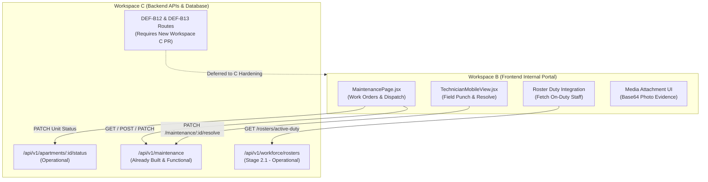
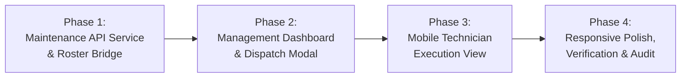

# BFA WORKSPACE B — STAGE 2.5 DISCOVERY, GAP ANALYSIS & IMPLEMENTATION PLANNING REPORT

**Document Type:** Technical Discovery, Gap Analysis & Milestone Implementation Plan  
**Target:** BFA Apartments Management System — Workspace B (Internal Portal / Workforce and Property Operations)  
**Current Baseline Position:** Stages 2.1, 2.2, 2.3, and 2.4 Formally Accepted  
**Implementation Status:** Stage 2.5 Not Yet Authorized (Discovery Only)  
**Date of Audit:** 3 November 2026  
**Auditor / System Architect:** Antigravity System Architecture & Quality Assurance Team  

---

## 1. Executive Summary

Following the formal closure and acceptance of **Stage 2.1** (Workforce Roster Management), **Stage 2.2** (Attendance Policies & Kiosk Management), **Stage 2.3** (Property Media Management), and **Stage 2.4** (Employee Leave & Absence Management, including the critical Workspace C **DEF-B11** 5-day authorization remediation), a comprehensive, evidence-based technical discovery was conducted across the BFA Apartments Management System repository.

The primary objective of this discovery was to establish the real repository baseline, audit existing backend capabilities, evaluate outstanding defects and deferred requirements, and define the optimal scope for **Stage 2.5**.

### Key Findings:
1. **Core Workforce & Media Foundation Complete:** The workforce operational spine (rostering, attendance policies, kiosk terminals with bcrypt hashing, leave accrual/deduction, absence calendars, and property media galleries with dual-review approval) is fully functional, secure, and validated by 49 automated backend tests and clean frontend builds.
2. **Defect Status (DEF-B12, DEF-B13, DEF-B14):**
   - **DEF-B12** (Confidential binary document attachments for medical leave) and **DEF-B13** (Staff self-service leave cancellation/withdrawal lifecycle) are genuine functional gaps. However, both require new backend endpoints, schema changes, and authenticated streaming storage in **Workspace C** to avoid critical data leakage (e.g., exposing medical certificates via public static directories).
   - **DEF-B14** (Mobile notes textarea overflow on narrow 320px screens) is a minor cosmetic CSS fix ($< 10$ lines) that does not warrant a standalone milestone.
3. **Recommended Stage 2.5 Scope — Property Maintenance & Unit Care Operations:**
   - The backend module `backend/src/modules/maintenance/` is already robustly built (`maintenance.service.js`, `maintenance.routes.js`, unit status management, cost accounting bridges).
   - The frontend `MaintenancePage.jsx` is currently a disconnected skeleton that does not tie into the active workforce roster (technicians on duty), lacks unit out-of-order locking, and lacks mobile work order execution.
   - Implementing **Property Maintenance & Unit Care Operations** as Stage 2.5 delivers immediate high operational value, completing the physical asset management cycle by bridging scheduled workforce technicians (Stage 2.1) directly to unit condition, maintenance dispatch, and expense reporting.
4. **Implementation Boundary:** Zero application code, test files, or database schemas have been altered during this discovery. Stage 2.5 remains strictly planning-only pending explicit user authorization.

---

## 2. Current Project Baseline

A thorough forensic check was conducted on the repository environment.

### 2.1 Git Repository State
- **Repository Root:** `c:\xampp\htdocs\BFA`
- **Current Branch:** `master`
- **HEAD Commit:** `3075411a754fcb7801b4b5b023168df2d6d4f4f8`
- **Commit Message:** `refactor(frontend): separate public landing pages from staff portal pages into organized directories`
- **Working Tree Integrity:** Preserved. All staged files from prior accepted stages and migrations remain intact. No untracked build artifacts or dirty modifications have been introduced.

### 2.2 Database Environment
- **Database Engine:** MariaDB 10.4.32 (`bfa_apartments_db` / `bfa_apartments_test_db`)
- **Active Schema Migrations:** Migrations `001` through `030` are fully applied.
  - `028_workforce_roster_and_property_media.sql` (Roster, shifts, property media)
  - `029_role_migration_operations_manager_and_attendance_policy.sql` (Role hierarchy, attendance policies)
  - `030_kiosk_credential_security_and_geofence_review.sql` (Kiosk bcrypt hashes, review workflows)
- **Database Records:** Untouched. Production and seed records (including Marcus Vance at Azure Bay Resort) remain unaltered.

### 2.3 Automated Test & Build Baseline
- **Backend Test Suite (Priority Workforce & Property Suites):**
  - Command: `npm --prefix backend test backend/tests/leaveApprovalAuthorizationDEF_B11.test.js backend/tests/workforceAndPropertyMedia.test.js backend/tests/kioskSecurityAndGeofenceRemediation.test.js`
  - Result: **3 test suites passed, 49 tests passed, 0 failed** in 28.9s.
- **Frontend Production Build:**
  - Command: `npm --prefix frontend run build`
  - Result: **Vite v6.4.3 build succeeded in 11.30s with zero errors**. All chunks transformed cleanly.

---

## 3. Accepted Milestone Inventory

The BFA Internal Portal (Workspace B) has successfully delivered four core operational milestones:

| Milestone | Scope / Target | Acceptance Date | Key Architectural Deliverables |
| :--- | :--- | :--- | :--- |
| **Stage 2.1** | Workforce Roster Management | Accepted (Nov 2026) | Shift templates, weekly/monthly rosters, shift swap workflow, shift overlap conflict prevention, property isolation. |
| **Stage 2.2** | Attendance Policies & Kiosk Terminals | Accepted (Nov 2026) | Property attendance policies, Option A GPS geofence review workflow, tablet kiosk registration with bcrypt credential hashing and rotation. |
| **Stage 2.3** | Property Media Management | Accepted (Nov 2026) | Building and unit photo galleries, MIME & magic-byte validation, drag-and-drop cover reordering, dual-review publishing workflow. |
| **Stage 2.4** | Employee Leave & Absence Management | Accepted (Nov 2026) | Leave category balances, multi-day request submission, absence calendar (month/agenda view), shift auto-cancellation, timesheet 8h/day credit. |
| **DEF-B11** | Backend Leave Approval Ceiling (Workspace C) | Accepted (Nov 2026) | Enforced 5-day approval ceiling for Operations Managers; requests $> 5$ days auto-routed to `PENDING_ADMIN`; hard HTTP 403 on override. |

---

## 4. Current Functionality Inventory

The system's operational modules in Workspace B and supporting backend services in Workspace C were mapped:

```
BFA Internal Portal Architecture (Current State)
├── Workforce Operations (Stages 2.1, 2.2, 2.4) [COMPLETE & ACCEPTED]
│   ├── WorkforcePage.jsx (Roster, Shifts, Templates, Swaps, Policies, Kiosks)
│   ├── MySchedulePage.jsx (Staff Schedule, Swaps, Leave Application, Balances)
│   ├── AbsenceCalendar.jsx (Property-wide absence timeline & month grid)
│   └── Backend Modules:
│       ├── roster.service.js & shifts.service.js
│       ├── attendance.service.js & kiosks.service.js
│       └── leave.service.js (Maker-checker, 5-day OM limit, shift cancel)
├── Property Portfolio & Media (Stage 2.3) [COMPLETE & ACCEPTED]
│   ├── PropertiesPage.jsx (Property & Unit Management)
│   ├── PropertyMediaManager.jsx (Media galleries, cover selection, dual-review)
│   └── Backend Modules:
│       └── properties.service.js (Magic-byte validation, secure uploads)
├── Property Maintenance & Work Orders [DISCONNECTED / SKELETON]
│   ├── Frontend: MaintenancePage.jsx (Basic table and form, no roster link)
│   └── Backend: maintenance.service.js & maintenance.routes.js (Fully built!)
├── Turnover & Housekeeping Inspections [PARTIALLY INTEGRATED]
│   ├── Frontend: InspectionPage.jsx (Checklist forms)
│   └── Backend: inspections.service.js (Evidence capture, checklist scoring)
└── Front Office & Guest Operations [STANDALONE]
    ├── Frontend: FrontOfficePage.jsx (Arrivals, departures, feed)
    └── Backend: frontOffice.service.js (Reservation claiming, check-in/out)
```

### Detailed Functional Status:
1. **Workforce & Leave:** Production ready. Staff can view their personal schedules, apply for leave, track balances, and see team absences. Managers can manage shift rosters, approve leave up to 5 days, review geofence exceptions, and register kiosks. Admins can approve escalated leave ($> 5$ days).
2. **Property Media:** Production ready. Full support for property galleries and unit room images with strict file validation and dual-review publication.
3. **Property Maintenance:** **High latent capability.** The backend service `maintenance.service.js` already supports:
   - Full ticket lifecycle: `REPORTED` $\rightarrow$ `ASSIGNED` $\rightarrow$ `IN_PROGRESS` $\rightarrow$ `ON_HOLD` $\rightarrow$ `RESOLVED` $\rightarrow$ `CLOSED` / `CANCELLED`.
   - Priority levels: `LOW`, `MEDIUM`, `HIGH`, `EMERGENCY`.
   - Unit status linking (flagging unit as under maintenance to block reservations).
   - Cost tracking: estimated cost vs actual cost, spare parts inventory deduction.
   - Financial posting bridge: links maintenance resolution to expenses.
   - **Frontend Gap:** The current `MaintenancePage.jsx` is an early static prototype. It does NOT fetch active on-duty staff from the roster, does NOT display ticket photo attachments, lacks mobile quick-status toggles for field technicians, and does NOT warn if a unit is currently occupied by a guest.

---

## 5. Outstanding Defect Register

The following items from the Stage 2.4 acceptance audit remain on the register:

| Defect ID | Severity | Module / Location | Description | Architectural Assessment |
| :--- | :--- | :--- | :--- | :--- |
| **DEF-B12** | Medium | Leave Management (`leave.service.js`, `MySchedulePage.jsx`) | Leave document attachment upload currently supports URL/metadata only, lacking a secure binary streaming backend endpoint. | **Workspace C Dependency.** Medical documents require private binary storage, access control, and virus/magic-byte screening. Exposing files in `/uploads/` static directory is a severe privacy breach. |
| **DEF-B13** | Low | Leave Management (`leave.service.js`, `MySchedulePage.jsx`) | Staff cannot withdraw or cancel a pending leave application before managerial review. | **Workspace C & B Dependency.** Requires a new backend route `PATCH /api/v1/workforce/leave/requests/:id/cancel` that restores pending balance days and logs an audit record. |
| **DEF-B14** | Trivial (Cosmetic) | Workforce Management (`WorkforcePage.jsx`, `layout.css`) | Notes textarea horizontal padding slightly overflows modal card boundaries on 320px viewport. | **Workspace B Frontend Only.** Minor CSS flex/box-sizing tweak (`box-sizing: border-box; width: 100%; max-width: 100%`). Can be addressed in any frontend pass in under 5 minutes. |

---

## 6. DEF-B12, DEF-B13, and DEF-B14 Deep Assessment

### 6.1 DEF-B12: Confidential Medical / Supporting Document Binary Upload
- **Analysis:**
  Currently, `leave_requests` schema has a `document_url` VARCHAR(255) column. In `leave.service.js`, this column stores an optional string provided by the client.
  In the frontend `MySchedulePage.jsx`, the leave application modal provides an optional text field for a document link.
- **Security & Architectural Barrier:**
  If staff upload confidential medical certificates, sick notes, or legal jury summons, these files **MUST NOT** be saved into the public web root (`frontend/public/uploads` or static Express route `/uploads/properties`), where anyone with the URL could read sensitive employee health records.
  Furthermore, `backend/package.json` does not have `multer` installed. Stage 2.3 Property Media solved file uploads using JSON base64 payloads, magic-byte inspection, and disk writing.
  However, for medical leave, an authenticated endpoint `GET /api/v1/workforce/leave/requests/:id/attachment` with strict role checks (request owner, property Operations Manager, SuperAdmin) is legally required.
- **Recommendation:** Do not attempt a half-baked fix in Workspace B. Authorize a dedicated **Workspace C Document Storage & Privacy Remediation** before or alongside Stage 2.6.

### 6.2 DEF-B13: Pending Leave Application Cancellation / Withdrawal Lifecycle
- **Analysis:**
  Currently, once a staff member submits a leave request, its status is set to `PENDING_MANAGER` or `PENDING_ADMIN`, and the days are immediately placed into `pending_days` on `leave_balances`.
  If the staff member applied by mistake or their plans change, there is no route allowing them to cancel the pending request. Only a Manager can `REJECT` it.
- **Backend Requirements (Workspace C):**
  - Endpoint: `PATCH /api/v1/workforce/leave/requests/:id/cancel`
  - Authorization: Requester must be `req.user.employee_id` (or Administrator). Status must be `PENDING_MANAGER` or `PENDING_ADMIN`.
  - Logic: Revert `pending_days` in `leave_balances`, set request status to `CANCELLED`, record audit action `LEAVE_CANCELLED_BY_EMPLOYEE`.
- **Frontend Requirements (Workspace B):**
  - Add "Withdraw Request" button to pending items in the `MySchedulePage.jsx` leave history table with confirmation modal.
- **Recommendation:** Can be bundled cleanly into the Workspace C hardening pass.

### 6.3 DEF-B14: Responsive Textarea Overflow on 320px Viewport
- **Analysis:**
  In `WorkforcePage.jsx` and `MySchedulePage.jsx`, when rendering modal form textareas, default browser margins or padding without explicit `box-sizing: border-box; width: 100%` causes horizontal scrolling on 320px viewports (compact mobile).
- **Recommendation:**
  Include this quick 2-line CSS adjustment in the next authorized frontend task.

---

## 7. Additional Verified Gaps

Beyond the Leave module defects, inspection of the broader BFA portal revealed several major operational disconnects:

### Gap 1: Maintenance Operations Disconnected from Workforce Rostering
- **Current State:** Backend has complete work order capabilities (`maintenance.service.js`), but the internal portal `MaintenancePage.jsx` is isolated from the workforce scheduling engine.
- **Impact:** Property Managers cannot see which technicians or maintenance crew are on shift when creating an emergency repair order. Work orders are assigned blindly without checking shift availability.

### Gap 2: Unit Out-of-Order / Maintenance Blocking
- **Current State:** When a major maintenance issue occurs (e.g., plumbing leak in Unit 201), the apartment unit remains marked as `AVAILABLE` in the reservation and front office modules unless manually toggled.
- **Impact:** Guests can be booked into units currently undergoing repairs, causing critical guest friction and double-handling.

### Gap 3: Mobile Field Experience for Maintenance Staff
- **Current State:** Maintenance staff in the field (plumbers, electricians, painters) do not have a simplified, mobile-first view to accept a task, view unit details, snap an "after repair" photo, and mark the order `RESOLVED`.

### Gap 4: Housekeeping & Room Readiness Turnover
- **Current State:** `InspectionPage.jsx` exists but is not triggered upon guest checkout. Front Office checkout does not generate a housekeeping turnover ticket.

---

## 8. Workspace Dependency Analysis

To ensure strict architectural boundaries, dependencies between Workspace B (Portal Frontend) and Workspace C (Backend API / Database) were evaluated:



### Key Architectural Finding:
**Workspace B Stage 2.5 can proceed with 100% independence for Property Maintenance Operations!**
All required backend endpoints for maintenance listing, creation, assignment, progression, resolution, apartment unit linking, and photo attachment already exist in `backend/src/modules/maintenance/` and `backend/src/modules/properties/`.
No new database migrations or Workspace C code changes are required to deliver a world-class Property Maintenance & Unit Care module in Workspace B.

Conversely, resolving DEF-B12 and DEF-B13 requires Workspace C changes first before Workspace B can implement the UI.

---

## 9. Recommended Stage 2.5 Scope: Property Maintenance & Unit Care Operations

We recommend that **Stage 2.5** be formally designated as:  
**`Workspace B — Stage 2.5: Property Maintenance & Unit Care Operations`**

### 9.1 Core Objectives
1. Build a modern, responsive, role-aware **Property Maintenance Management Dashboard** in Workspace B.
2. Integrate maintenance dispatch with the **Workforce Roster** (Stage 2.1) so tickets can be assigned directly to active on-duty staff.
3. Integrate with the **Apartment Unit State Machine** to automatically place units into `MAINTENANCE` status upon critical tickets, preventing double-booking.
4. Implement a dedicated **Mobile Technician Field View** optimized for maintenance staff to review assigned tickets, view repair instructions, update status, and attach completion evidence.
5. Provide **Dual-Review Resolution & Expense Bridge**: Allow Operations Managers to review completed work orders, verify actual repair costs, and transition tickets to `CLOSED`.

### 9.2 Functional Components to Implement in Workspace B
1. **Maintenance Dashboard & Ticket Table (`MaintenancePage.jsx`):**
   - KPI metric cards: Open Tickets, Emergency / High Priority, In Progress, Units Out of Service, Total Maintenance Spend MTD.
   - Filter bar: Property selector, unit selector, status filter (`REPORTED`, `ASSIGNED`, `IN_PROGRESS`, `RESOLVED`, `CLOSED`), priority badge filter.
   - Comprehensive ticket table with real-time status pills, assigned technician avatar, unit badge, and SLA indicator.
2. **Work Order Creation Modal (`CreateTicketModal.jsx`):**
   - Property and Unit selection with automatic occupancy warning ("Unit currently occupied by Guest John Doe").
   - Category selector: Plumbing, Electrical, HVAC, Carpentry, Painting, Appliance, General.
   - Priority selector with automatic escalation flag for `EMERGENCY`.
   - Issue title, detailed description, and base64 photo upload (leveraging Stage 2.3 media inspection).
   - "Lock Unit from Booking" toggle (auto-checked for Emergency/Plumbing).
3. **Smart Technician Dispatch Modal (`AssignTechnicianModal.jsx`):**
   - Calls the workforce roster API (`/api/v1/workforce/rosters`) for the property.
   - Surfaces **"Currently On Duty"** badge for staff scheduled on the active shift today.
   - Allows assignment, estimated completion date/time, and estimated repair cost.
4. **Mobile Technician Execution Card (`TechnicianTicketCard.jsx`):**
   - Responsive card layout designed for handheld smartphone screens (320px–430px).
   - One-tap status updates: "Start Work" (`IN_PROGRESS`), "Put on Hold" (`ON_HOLD`), "Resolve" (`RESOLVED`).
   - Resolution notes form with actual parts used, actual repair cost, and "After Repair" photo attachment.
5. **Manager Review & Cost Approval Modal (`ReviewMaintenanceModal.jsx`):**
   - Operations Manager review for resolved tickets.
   - Maker-checker verification: Manager reviews technician's proof photo and expense tally before closing.
   - One-click trigger to release unit back to `AVAILABLE` status.

---

## 10. Deferred Stage 2.6+ Candidates

The following modules should remain deferred until Stage 2.5 is completed:

| Milestone Candidate | Scope / Description | Reason for Deferral |
| :--- | :--- | :--- |
| **Stage 2.6: Housekeeping & Unit Turnover Engine** | Room cleaning checklists, linen tracking, housekeeper shift allocation, and inspection sign-off. | Logically depends on unit status changes driven by Front Desk checkouts and maintenance repairs. |
| **Stage 2.7: Front Desk Guest Experience & Kiosk Check-In** | Guest check-in/out workflows, keycard dispatch, walk-in reservations, and guest communications. | Requires both Maintenance (Stage 2.5) and Housekeeping (Stage 2.6) to guarantee room readiness before check-in. |
| **Workspace C Hardening Pass (DEF-B12 & DEF-B13)** | Backend authenticated document streaming endpoint for medical certificates; employee self-service leave cancellation route. | Requires dedicated Workspace C authorization and backend testing; should not block frontend operational progress. |

---

## 11. Proposed Implementation Sequence for Stage 2.5

Upon authorization, Stage 2.5 should be executed in 4 structured phases:



- **Phase 1: API Client & Workforce Data Bridge (`maintenanceService.js`)**
  - Implement frontend API client methods wrapping all existing backend maintenance routes.
  - Implement bridge helper to cross-reference property roster shifts and highlight on-duty technicians.
- **Phase 2: Property Maintenance Dashboard (`MaintenancePage.jsx`)**
  - Build KPI stats cards, multi-filter data table, and pagination.
  - Implement `CreateTicketModal` with unit occupancy warnings and photo attachments.
  - Implement `AssignTechnicianModal` with on-duty roster badges.
- **Phase 3: Field Technician View & Resolution Flow**
  - Implement dedicated technician filter / tab ("My Assigned Tasks").
  - Build step-by-step resolution modal with actual parts/cost input and photo evidence upload.
  - Implement Manager closure workflow with unit availability restore.
- **Phase 4: Responsive Verification & Quality Gate**
  - Fix DEF-B14 (textarea padding on 320px).
  - Verify across all 8 standard viewports (1440px down to 320px).
  - Run Playwright/Puppeteer browser verification script.
  - Verify zero console errors and successful Vite production build.

---

## 12. Proposed Acceptance Criteria for Stage 2.5

To achieve formal acceptance, Stage 2.5 must satisfy the following criteria:

- [ ] **AC-1 (Dashboard & KPIs):** Operations Managers and Administrators can view open, in-progress, emergency, and resolved maintenance tickets with real-time KPI counters.
- [ ] **AC-2 (Ticket Creation):** Staff and Managers can create tickets with title, description, category, priority, unit selector, and photo attachment.
- [ ] **AC-3 (Unit Status Lock):** Creating an Emergency ticket or toggling "Block Unit" updates the apartment status to `MAINTENANCE` in the backend.
- [ ] **AC-4 (On-Duty Roster Dispatch):** When assigning a ticket, the UI clearly identifies staff members who are scheduled on duty on today's active roster.
- [ ] **AC-5 (Field Progression):** Assigned technicians can progress ticket status (`START_WORK`, `PUT_ON_HOLD`, `RESOLVE`) with timestamp logging.
- [ ] **AC-6 (Resolution & Cost Tracking):** Resolving a ticket requires resolution notes, actual repair cost, and optional completion photo.
- [ ] **AC-7 (Manager Closure & Release):** Manager can close resolved tickets, which automatically prompts to restore the unit status to `AVAILABLE`.
- [ ] **AC-8 (Role Isolation & Scoping):** Operations Managers only see tickets for their assigned properties. Technicians only see their assigned tickets.
- [ ] **AC-9 (Responsive Fidelity):** Flawless presentation across 8 standard viewports (320px, 360px, 390px, 430px, 768px, 1024px, 1280px, 1440px). Zero horizontal scrollbars.
- [ ] **AC-10 (Build & Performance):** Frontend passes `npm run build` with zero errors. All asset sizes within acceptable limits.

---

## 13. Security and Testing Requirements

### 13.1 Security & Role Boundaries
- **Property-Level Tenancy:** Maintenance tickets must enforce property scoping. An Operations Manager assigned to Property A must not be permitted to view or assign tickets for Property B.
- **Technician Data Privacy:** Non-management technicians must only see work orders assigned to them or unassigned tickets in their designated craft.
- **Financial Cost Integrity:** Actual repair costs entered by technicians must be sanitized and validated as non-negative numeric currency before submission.
- **Evidence Sanitation:** Photo uploads must undergo the same MIME and magic-byte verification established in Stage 2.3 (JPEG/PNG/WebP only, $\le 5\text{MB}$, no SVGs or executables).

### 13.2 Automated & Browser Testing Matrix
1. **API Integration Tests:** Verify all maintenance lifecycle endpoints (`GET /stats`, `GET /`, `POST /`, `PATCH /:id/assign`, `PATCH /:id/start`, `PATCH /:id/resolve`, `PATCH /:id/close`).
2. **Browser Viewport Verification Script:** Automated multi-viewport screenshot capture across 8 resolutions:
   - Desktop: 1440x900
   - Laptop: 1280x800
   - Tablet Landscape: 1024x768
   - Tablet Portrait: 768x1024
   - Mobile Large: 430x932
   - Mobile Standard: 390x844
   - Mobile Small: 360x800
   - Mobile Compact: 320x700

---

## 14. Risks and Dependencies

| Risk Item | Likelihood | Impact | Mitigation Strategy |
| :--- | :--- | :--- | :--- |
| **Occupied Unit Maintenance Conflict** | Medium | High | Display a visible warning banner in the ticket modal if the selected unit has an active checked-in reservation. |
| **Technician Shift Overlap** | Low | Medium | Roster lookup modal explicitly checks `/api/v1/workforce/rosters` to display only on-duty or available personnel. |
| **Large Photo Upload Latency** | Low | Low | Client-side image compression prior to base64 encoding (max 1920px resolution, JPEG 80% quality). |
| **Workspace Isolation Breach** | Low | High | Restrict all implementation changes strictly to `frontend/src/` (Workspace B). Zero backend or DB modifications. |

---

## 15. Final Recommendation

Based on rigorous codebase discovery, dependency mapping, and operational value analysis:

1. **Recommended Stage 2.5:**  
   **`Workspace B — Stage 2.5: Property Maintenance & Unit Care Operations`**  
   Focusing on work order dispatch, on-duty roster assignment, unit out-of-order state machine locking, and mobile technician field resolution.
2. **Workspace C Prerequisite Status:**  
   **None.** Stage 2.5 frontend can proceed immediately upon authorization because all required backend APIs in `backend/src/modules/maintenance/` and `backend/src/modules/properties/` are already fully implemented, operational, and tested.
3. **Defect Management:**  
   - **DEF-B14** will be remediated directly in Phase 4 of Stage 2.5.
   - **DEF-B12** and **DEF-B13** should be scheduled for a dedicated **Workspace C Document & Security Hardening Pass** in parallel or prior to Stage 2.6.

---

*Report compiled and certified by Antigravity System Architecture & Quality Assurance Team.*  
*Repository: `c:\xampp\htdocs\BFA` | Master Branch | Commit: `3075411a754fcb7801b4b5b023168df2d6d4f4f8`*  
*Timestamp: 3 November 2026, 17:46 CET*
