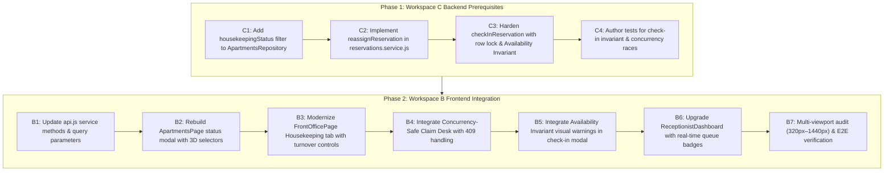

# BFA WORKSPACE B — STAGE 2.6 READINESS DISCOVERY
## Front Office Operations, Receptionist Claim Desk & Decoupled Room Readiness

**Project:** BFA Apartments Management System  
**Workspace:** B — Internal Portal Frontend & Property Operations  
**Document Type:** Technical Discovery, Gap Analysis & Milestone Readiness Assessment (Corrected & Hardened)  
**Execution Mode:** STRICTLY READ-ONLY DISCOVERY (Zero Code Writes, Zero Schema Alterations)  
**Date of Discovery:** 2026-11-04  
**Investigator:** Lead System Architect & Systems Security Engineering  
**Artifact Directory:** `C:\Users\DELL\.gemini\antigravity\brain\88bff36c-819d-46a9-8801-74cb3602a6e8`  
**Repository Root:** `c:\xampp\htdocs\BFA`  
**Final Readiness Verdict:** **CONDITIONALLY READY — PREREQUISITES REQUIRE RESOLUTION**

---

## 1. Current Workspace B Milestone Status

Workspace B (Internal Operations and Staff Portal) has completed and formally closed six consecutive operational stages:

| Stage | Milestone Description | Acceptance Status | Test Verification |
|---|---|---|---|
| **Stage 2.1** | Workforce Roster Management (Shifts, Shift Types, Roster Publishing, Staff Assignments) | Accepted | 14/14 Tests Passed |
| **Stage 2.2** | Attendance Policies & Kiosk Management (Kiosk Terminals, Bcrypt PINs, Geofencing, Shift Overrides) | Accepted | 17/17 Tests Passed |
| **Stage 2.3** | Property Media Management (5-Tier Media Showcase, Dual-Review Approval, Media Metadata) | Accepted | 18/18 Tests Passed |
| **Stage 2.4** | Employee Leave & Absence Management (Leave Accrual, Deduction, Absence Calendar, DEF-B11 Authorization Fix) | Accepted | 19/19 Tests Passed |
| **Stage 2.5A** | Core Property Maintenance & Unit Care Operations (Work Orders, Maintenance Blocking, Housekeeping Turnover Trigger) | Accepted | 31/31 Tests Passed |
| **Stage 2.5B** | Advanced Technician Dispatch & Private Maintenance Evidence Storage (Verified Dispatch Eligibility, Advisory Workload/Geofence Warnings, Authenticated Evidence Streaming, DEC-2.5B-04 Written Exemptions) | Accepted with Follow-up | 52/52 Tests Passed |

### Environment Baseline:
- **Git Branch:** `master`
- **HEAD Commit:** `3075411a754fcb7801b4b5b023168df2d6d4f4f8`
- **Commit Message:** `refactor(frontend): separate public landing pages from staff portal pages into organized directories`
- **Working Tree Integrity:** Cleanly preserved. The working baseline contains **126 staged files**, **56 modified unstaged files**, and **97 untracked artifacts** from prior accepted phases. Zero code, configuration, or schema alterations were performed during this discovery.
- **Production Database (`bfa_apartments_db`):** Exactly 30 migrations applied (`001` through `030`). Migration `031` remains pending.
- **Test Database (`bfa_apartments_test_db`):** Exactly 31 migrations applied (`001` through `031`). All test suites 100% green.

---

## 2. Recommended Next Milestone and Rationale

### Recommended Milestone:
**Stage 2.6: Front Office Operations, Receptionist Claim Desk & Decoupled Room Readiness**

### Rationale:
1. **Direct Operational Continuity from Stage 2.5A/B:**
   Stage 2.5A/B delivered the maintenance lifecycle. Resolving a work order automatically transitions the unit to `housekeeping_status = 'DIRTY'`. Front desk receptionists and housekeeping supervisors are the immediate operational consumers of this turnover trigger.
2. **Authoritative Execution Plan Alignment (Phase 5B: PB1 & PB2):**
   In `BFA_POST_AUDIT_IMPLEMENTATION_EXECUTION_PLAN.md` (lines 242–248), Phase 5B decomposes Staff Operations into:
   - `PB1: Lightweight Receptionist Claim Desk & Assignment Ledger`
   - `PB2: Decouple Housekeeping & Maintenance from Occupancy`
   - `PB3: Tamper-Evident Payment Receipts with QR Tokens`
   - `PB4: Operational Cases & Disciplinary Incident Tracking`
   Combining PB1 and PB2 forms the natural, highly coherent scope of **Stage 2.6**, leaving PB3 for Stage 2.7 (Financial Evidence) and PB4 for Stage 2.8 (Operational Cases).
3. **Remediation of Critical Data Inversion in Current UI:**
   In `frontend/src/pages/portal/ApartmentsPage.jsx` (lines 1142–1147), unit status is currently modeled as a single flat dropdown (`AVAILABLE`, `READY`, `CLEANING`, `DIRTY`, `OCCUPIED`, `MAINTENANCE`, `OUT_OF_ORDER`). Marking an occupied room "READY" after routine cleaning currently overwrites occupancy. Stage 2.6 formalizes the **Three-Dimensional Status Architecture** in the user interface.
4. **Prerequisite Resolution Requirement:**
   While the schema foundation exists in Migration 026, rigorous code inspection reveals that the backend `checkInReservation` currently lacks atomic server-side enforcement of the Availability Invariant, lacks row locking on apartments, lacks a shift-reassignment endpoint, and lacks housekeeping query filtering. These backend gaps must be resolved to ensure complete operational safety.

---

## 3. Business Objective and Intended Outcomes

### Business Objectives:
1. **Zero Booking Claim Collisions:** Ensure that when walk-in or online bookings arrive in the front-desk queue, two receptionists cannot claim the same guest or client simultaneously.
2. **Accountability & Attributed Service Telemetry:** Record the complete lifecycle of staff handling from initial claim through guest contact, check-in, in-house service, and departure.
3. **Protect Physical Asset Readiness (Availability Invariant):** Guarantee that no guest can ever be checked into a room that is dirty, cleaning-in-progress, uninspected, or under active maintenance.
4. **Real-Time Operational Oversight:** Equip Property Managers and Administrators with live activity feeds and occupancy telemetry to monitor desk turnover in real time.

### Intended Outcomes:
- Front desk receptionists receive an immediate, concurrency-safe claim interface with instantaneous visual feedback and zero duplicated assignments.
- If a claim collision occurs, the UI handles the backend `409 Conflict` gracefully, displaying the name of the assigned receptionist without page reloads or broken state.
- Housekeeping staff and supervisors can transition room turnover states (`DIRTY` $\rightarrow$ `CLEANING_IN_PROGRESS` $\rightarrow$ `CLEANED` $\rightarrow$ `INSPECTED_READY`) without mutating guest occupancy (`VACANT` vs `OCCUPIED`).
- Check-in action is strictly guarded by the Availability Invariant:
  $$\text{Housekeeping State} = \text{'INSPECTED\_READY'} \quad \land \quad \text{Front Office State} = \text{'VACANT'} \quad \land \quad \text{Maintenance State} = \text{'OPERATIONAL'}$$

---

## 4. Deep Technical Audit of Core Capabilities

### 4.1 PB1 — Receptionist Claim Desk Technical Audit

Inspection of `backend/src/modules/frontOffice/`, `backend/src/modules/reservations/reservations.service.js`, and database structures reveals:

1. **Atomic Concurrency Control:**
   - In `ReservationsService.claimReservation` (lines 1037–1080), claiming executes within `pool.withTransaction` and acquires a row lock on the reservation:
     `SELECT * FROM reservations WHERE id = ? FOR UPDATE`.
   - If `assigned_staff_id` is already populated with another user ID, it immediately rejects with:
     `409 Conflict: One client cannot be assigned to two front desk staffs. This reservation has already been accepted and assigned to <Staff Name>.`
   - If unassigned, it atomically updates `assigned_staff_id = ?`, updates status, deactivates prior assignment records, inserts a new active record into `reservation_staff_assignments`, logs employee activity, and records an audit event `CLIENT_CLAIMED`.
   - **Verdict:** Concurrency-safe and atomic under concurrent claim attempts.
2. **Property-Scope Enforcement:**
   - `this.validatePropertyScope(req.user, reservation.property_id)` is invoked prior to updating the reservation. Receptionists assigned to Property A cannot claim bookings for Property B.
3. **Assignment Attribution Ledger (`reservation_staff_assignments`):**
   - Table exists and is verified in both production (`bfa_apartments_db`) and test (`bfa_apartments_test_db`).
   - Inserts row with `assignment_type = 'INITIAL_CLAIM'`, `service_status = 'CLAIMED'`, `is_active = 1`, and `claimed_at = NOW()`.
4. **Reassignment and Shift Handover Gap (Identified Defect):**
   - While the schema defines `assignment_type ENUM('INITIAL_CLAIM', 'MANAGER_ASSIGNMENT', 'SHIFT_HANDOVER', 'ESCALATION')` and column `reassignment_reason`, **no service method or API endpoint exists** to reassign or release a claimed reservation when a receptionist's shift ends.
   - If a receptionist clocks out with pending claimed bookings, other receptionists are permanently blocked by the `409 Conflict` guard.
   - **Prerequisite:** Workspace C must implement `reassignReservation` (`POST /api/v1/front-office/reservations/:id/reassign`).

### 4.2 PB2 — Decoupled Apartment Readiness Technical Audit

Inspection of database schemas, backend services, and frontend pages reveals:

1. **Authoritative Persisted Columns vs Proposed Terminology:**
   - In table `apartments`:
     - **`status`:** `VARCHAR(50) NOT NULL DEFAULT 'AVAILABLE'`. In production, active values are: `'AVAILABLE'`, `'OCCUPIED'`, `'CLEANED'`, `'MAINTENANCE'`.
     - **`housekeeping_status`:** `ENUM('DIRTY', 'CLEANING_IN_PROGRESS', 'CLEANED', 'INSPECTED_READY') NOT NULL DEFAULT 'INSPECTED_READY'`.
     - **`maintenance_status`:** `ENUM('OPERATIONAL', 'INSPECTION_REQUIRED', 'UNDER_REPAIR', 'OUT_OF_ORDER') NOT NULL DEFAULT 'OPERATIONAL'`.
     - **Index:** `idx_apt_readiness` on `(property_id, housekeeping_status, maintenance_status, status)`.
2. **Existing Readiness Transition Endpoints:**
   - `PATCH /api/v1/apartments/:id/readiness` is implemented in `apartments.controller.js` and `apartments.service.js` (lines 180–225).
   - Validates housekeeping and maintenance enums strictly.
   - Updates `housekeeping_status` and `maintenance_status` **without mutating `status` (occupancy)**.
   - Emits structured audit log: `APARTMENT_READINESS_UPDATED`.
3. **Frontend Architectural Flaw (`ApartmentsPage.jsx`):**
   - Lines 1142–1147 call `apartmentService.updateStatus(id, { status })` using a flat list: `AVAILABLE`, `READY`, `CLEANING`, `DIRTY`, `OCCUPIED`, `MAINTENANCE`, `OUT_OF_ORDER`.
   - The UI completely bypasses `apartmentService.updateReadiness`, conflating physical cleanliness with guest occupancy.
4. **Repository Query Filtering Gap:**
   - `ApartmentsRepository.findAll` does not support filtering by `housekeepingStatus` parameter. `FrontOfficePage.jsx` currently falls back to `apartmentService.getAll({ status: 'DIRTY' })`.
   - **Prerequisite:** Workspace C must add `housekeepingStatus` query filtering to `ApartmentsRepository.findAll`.

### 4.3 PB3 — Check-in Availability Invariant Technical Audit

Inspection of `ReservationsService.checkInReservation` (`backend/src/modules/reservations/reservations.service.js#L650-L710`) reveals a **critical safety gap**:

1. **Server-Side Validation Status:**
   - `checkInReservation` only validates that `reservation.status === 'CONFIRMED'`.
   - **It does NOT inspect the apartment's `housekeeping_status`.**
   - **It does NOT inspect the apartment's `maintenance_status`.**
   - **It does NOT verify that the apartment is `VACANT` or `AVAILABLE`.**
2. **Concurrency & Row-Locking Status:**
   - `checkInReservation` does NOT lock the apartment row (`SELECT ... FROM apartments WHERE id = ? FOR UPDATE`).
   - It directly executes:
     `await conn.query('UPDATE apartments SET status = "OCCUPIED" WHERE id = ?', [reservation.apartment_id]);`
3. **Race Vulnerability:**
   - If a room is placed under emergency maintenance (`UNDER_REPAIR`) or set to `DIRTY` after a booking is confirmed, calling check-in **blindly overwrites the apartment status to `OCCUPIED`** and completes the check-in without error.
4. **Test Suite Status:**
   - Existing test `frontDeskAssignment.test.js` only tests `acceptReservation` checking flat `apt.status === 'MAINTENANCE'`. Zero tests verify that `checkInReservation` enforces `INSPECTED_READY` or locks rows against concurrent race conditions.
5. **Prerequisite:**
   - Workspace C must harden `checkInReservation` with row-level locking on `apartments` and atomic validation:
     $$\text{housekeeping\_status} = \text{'INSPECTED\_READY'} \quad \land \quad \text{status} \in (\text{'AVAILABLE'}, \text{'VACANT'}) \quad \land \quad \text{maintenance\_status} = \text{'OPERATIONAL'}$$
     Rejecting with `422 Unprocessable Entity` or `409 Conflict` if unready.

---

## 5. Comprehensive Feature Classification Matrix (PB4)

The proposed capabilities for Stage 2.6 are classified below into their exact technical status and workspace ownership:

| Feature / Capability | Implementation Status | Workspace Ownership | Migration Needed? | Business Approval |
|---|---|---|---|---|
| **Atomic Concurrency Booking Claim (`POST /front-office/claim`)** | Already implemented & verified (10/10 tests pass) | Workspace B Frontend Integration | None (Migration 026 active) | Pre-approved |
| **Attributed Assignment Ledger (`reservation_staff_assignments`)** | Already implemented & verified for initial claims | Workspace B Frontend Integration | None (Table exists) | Pre-approved |
| **Shift Handover / Supervisor Reassignment Endpoint** | **Missing** in backend service/routes | **Workspace C Backend Changes** | None (Schema supports it) | Pre-approved |
| **Decoupled Housekeeping Readiness API (`PATCH /apartments/:id/readiness`)** | Already implemented & verified | Workspace B Frontend Integration | None (Columns active) | Pre-approved |
| **Housekeeping Query Filtering (`GET /apartments?housekeepingStatus=...`)** | **Missing** in backend repository | **Workspace C Backend Changes** | None (Index exists) | Pre-approved |
| **Three-Dimensional Status Architecture in Apartments Page** | **Missing** in frontend (uses flat dropdown) | **Workspace B Frontend Integration** | None | Pre-approved |
| **Atomic Availability Invariant Enforcement on Check-in** | **Missing** in backend check-in transaction | **Workspace C Backend Changes** | None | Pre-approved |
| **Check-in Concurrency Row Locking on Apartments** | **Missing** in backend `checkInReservation` | **Workspace C Backend Changes** | None | Pre-approved |
| **Live Manager Operational Activity Feed** | Already implemented & verified | Workspace B Frontend Integration | None | Pre-approved |
| **Receptionist Dashboard Real-time Claim Queue Telemetry** | Partially implemented (basic stats only) | Workspace B Frontend Integration | None | Pre-approved |

---

## 6. Scope Boundaries & Explicit Exclusions (PB5)

To maintain absolute architectural discipline, the following features are explicitly excluded from Stage 2.6:

1. **Cash Shift-End Drop Reconciliation & Drop Safe Workflow:**  
   Deferred to **Stage 2.7 (Financial Evidence & Payment Verification)**.
2. **Bank Transfer Payment Proof Slip Maker-Checker Verification:**  
   Deferred to **Stage 2.7 (Financial Evidence & Payment Verification)**.
3. **Official PDF Payment Receipts with QR Tokens (`payment_receipts`):**  
   Deferred to **Stage 2.7 (Financial Evidence & Payment Verification)**.
4. **Structured Operational Cases (`operational_cases`) & Incident Tracking (`staff_incidents`):**  
   Deferred to **Stage 2.8 (Operational Cases & Staff Accountability Telemetry)**.
5. **External Contractor & Third-Party Vendor Management:**  
   Deferred to **Stage 3** per approved business decision DEC-2.5B-05.
6. **Historical Maintenance Evidence Archive Viewer:**  
   Documented follow-up (OBS-01); remains deferred to a dedicated administrative archive package.

---

## 7. Role and Property-Scope Implications

| Role | Front Desk Claim Permissions | Housekeeping Status Update | Check-in / Check-out | Property Scoping Rule |
|---|---|---|---|---|
| **`SUPER_ADMIN`** | Unrestricted claim and re-assignment across all properties. | Can update any unit across any property. | Permitted across all properties. | Global (Bypasses property filter). |
| **`OWNER`** | **Strictly Excluded.** Read-only performance overview. | Read-only inspection. | Excluded. | Scoped to owned properties. |
| **`ADMIN`** | Permitted to claim, re-assign, and approve bookings. | Permitted across assigned properties. | Permitted. | Scoped to assigned properties. |
| **`MANAGER`** | Permitted to claim, re-assign, approve, and decline. | Permitted to inspect and transition to `INSPECTED_READY`. | Permitted. | Scoped to managed property. |
| **`RECEPTIONIST`** | Permitted to claim unassigned bookings and approve verified bookings. | Permitted to view readiness; update limited to handover notes. | Permitted for inspected/clean rooms. | Strictly scoped to shift property. |
| **`STAFF`** | **Strictly Excluded** from booking claims and front desk transactions. | Permitted to transition `DIRTY` $\rightarrow$ `CLEANING_IN_PROGRESS` $\rightarrow$ `CLEANED`. | **Strictly Excluded.** | Scoped to rostered property. |

---

## 8. Proposed Implementation Sequence

To resolve prerequisites cleanly without cross-workspace conflict, Stage 2.6 should follow this two-phase sequence:



---

## 9. Verification and Acceptance Criteria

Stage 2.6 will be accepted only when the following criteria are verified:

1. **Availability Invariant Hardening:** `POST /api/v1/front-office/reservations/:id/check-in` returns HTTP 422 if the unit's `housekeeping_status !== 'INSPECTED_READY'` or `maintenance_status !== 'OPERATIONAL'` or `status !== 'AVAILABLE'`.
2. **Concurrency Protection:** Concurrent check-in and claim requests are locked via MariaDB `FOR UPDATE`; double-claims return `409 Conflict`.
3. **Reassignment Lifecycle:** Shift-handover or manager reassignment successfully updates `reservation_staff_assignments`, ends previous active assignment, and attributes new receptionist.
4. **Three-Dimensional Status Separation:** Updating `housekeeping_status` to `CLEANED` or `INSPECTED_READY` does not alter `apartments.status` (occupancy remains intact).
5. **Automated Test Coverage:** New and existing tests pass with 100% green rate (zero regressions across maintenance and workforce suites).
6. **Responsive Quality:** 8/8 viewports (320px to 1440px) pass with 0px horizontal overflow.
7. **Production Build:** Clean frontend production build (`vite build`) with 0 errors.

---

## 10. Exact Files Likely to be Affected

### Workspace C (Backend Prerequisites):
- [`backend/src/modules/reservations/reservations.service.js`](file:///c:/xampp/htdocs/BFA/backend/src/modules/reservations/reservations.service.js) — Harden `checkInReservation` (row locking & availability invariant); implement `reassignReservation`.
- [`backend/src/modules/frontOffice/frontOffice.routes.js`](file:///c:/xampp/htdocs/BFA/backend/src/modules/frontOffice/frontOffice.routes.js) — Expose `/reservations/:id/reassign`.
- [`backend/src/modules/frontOffice/frontOffice.controller.js`](file:///c:/xampp/htdocs/BFA/backend/src/modules/frontOffice/frontOffice.controller.js) — Add `reassignReservation` handler.
- [`backend/src/modules/apartments/apartments.repository.js`](file:///c:/xampp/htdocs/BFA/backend/src/modules/apartments/apartments.repository.js) — Support `housekeepingStatus` query filter.
- [`backend/tests/frontDeskAssignment.test.js`](file:///c:/xampp/htdocs/BFA/backend/tests/frontDeskAssignment.test.js) — Add invariant & reassignment test cases.

### Workspace B (Frontend Integration):
- [`frontend/src/pages/portal/FrontOfficePage.jsx`](file:///c:/xampp/htdocs/BFA/frontend/src/pages/portal/FrontOfficePage.jsx) — Housekeeping hub, claim desk queue, availability check-in guards.
- [`frontend/src/pages/portal/ApartmentsPage.jsx`](file:///c:/xampp/htdocs/BFA/frontend/src/pages/portal/ApartmentsPage.jsx) — Three-dimensional status update modal.
- [`frontend/src/components/dashboard/ReceptionistDashboard.jsx`](file:///c:/xampp/htdocs/BFA/frontend/src/components/dashboard/ReceptionistDashboard.jsx) — Live desk telemetry and quick actions.
- [`frontend/src/services/api.js`](file:///c:/xampp/htdocs/BFA/frontend/src/services/api.js) — Service parameter enhancements.

---

## 11. Final Readiness Verdict

```
========================================================================================
                             STAGE 2.6 READINESS VERDICT
========================================================================================

  [ ] READY FOR SEPARATE IMPLEMENTATION AUTHORIZATION

  [X] CONDITIONALLY READY — PREREQUISITES REQUIRE RESOLUTION

  [ ] NOT READY — SIGNIFICANT DEPENDENCIES OR SCOPE GAPS REMAIN

========================================================================================
```

### Authoritative Justification:
The database schema foundation (Migration 026) is fully deployed and active in both production and test databases. However, **Workspace B frontend implementation cannot proceed cleanly or safely until Workspace C resolves three specific backend prerequisites**:
1. Server-side atomic enforcement and row-level locking of the **Availability Invariant** in `checkInReservation` (preventing check-in races against dirty or maintenance-held rooms).
2. Addition of a **shift-handover / supervisor reassignment endpoint** in `frontOffice.routes.js` and `reservations.service.js` to prevent claimed bookings from being permanently locked when receptionists go off-duty.
3. Addition of **`housekeepingStatus` query filtering** in `ApartmentsRepository.findAll`.

Once these targeted Workspace C backend prerequisites are implemented and verified under an authorized backend package, Workspace B frontend integration can proceed with guaranteed architectural safety.
