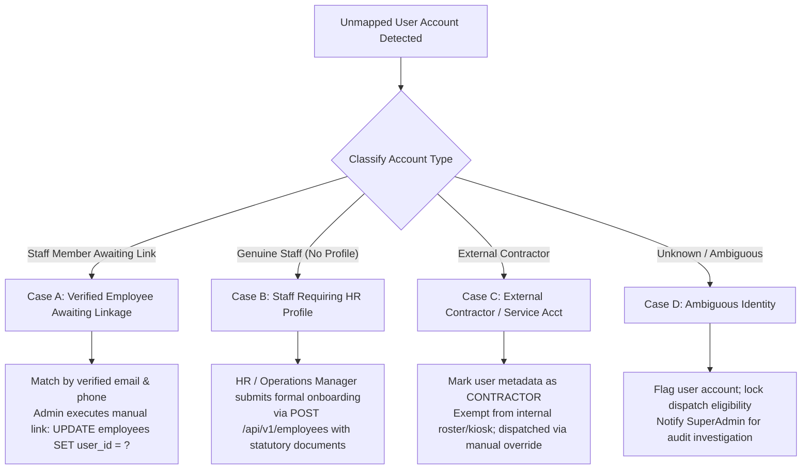
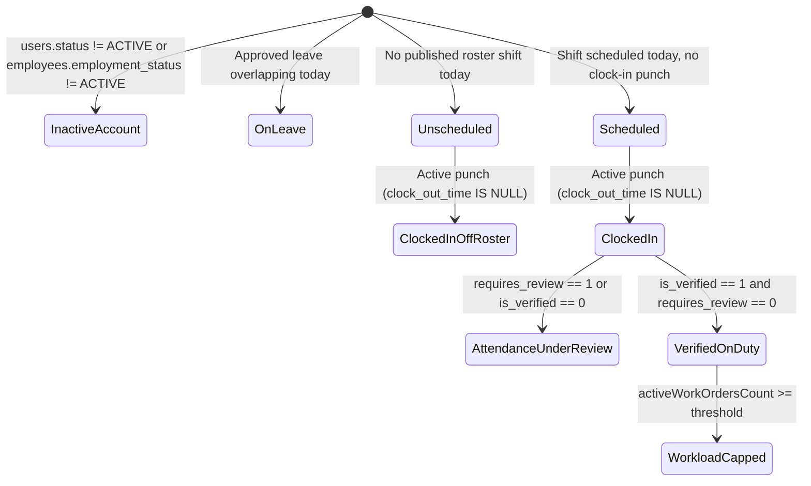

# BFA WORKSPACE C — STAGE 2.5B
# BACKEND PREREQUISITES: TECHNICAL IMPLEMENTATION PLAN AND SAFETY REVIEW

**Project:** BFA Apartments Management System  
**Workspace:** C — Backend, Database, APIs and Security Architecture  
**Milestone:** Stage 2.5B Prerequisites  
**Document Type:** TECHNICAL IMPLEMENTATION PLAN & SAFETY SPECIFICATION  
**Execution Mode:** STRICTLY READ-ONLY PLANNING (No code, schema, test, or record mutations)  
**Reference Document:** [`BFA_WORKSPACE_B_STAGE2_5B_DISCOVERY_AND_READINESS_REPORT.md`](file:///c:/xampp/htdocs/BFA/BFA_WORKSPACE_B_STAGE2_5B_DISCOVERY_AND_READINESS_REPORT.md)  
**Author:** Antigravity Backend Architecture & Security Engineering  
**Date:** 3 November 2026  
**Git Branch:** `master`  
**Git HEAD Commit:** `3075411a754fcb7801b4b5b023168df2d6d4f4f8`  

---

## 1. Existing Architecture and Source References

Stage 2.5A successfully established core maintenance ticket tracking, unit blocking, and housekeeping turnover handoffs within Workspace B. However, the architectural readiness assessment revealed that field execution and verified dispatch require server-side primitives that do not yet exist in Workspace C.

### Existing Source References:
- **Maintenance Core Module:**
  - Service: [`backend/src/modules/maintenance/maintenance.service.js`](file:///c:/xampp/htdocs/BFA/backend/src/modules/maintenance/maintenance.service.js)
  - Controller: [`backend/src/modules/maintenance/maintenance.controller.js`](file:///c:/xampp/htdocs/BFA/backend/src/modules/maintenance/maintenance.controller.js)
  - Repository: [`backend/src/modules/maintenance/maintenance.repository.js`](file:///c:/xampp/htdocs/BFA/backend/src/modules/maintenance/maintenance.repository.js)
  - Routes: [`backend/src/modules/maintenance/maintenance.routes.js`](file:///c:/xampp/htdocs/BFA/backend/src/modules/maintenance/maintenance.routes.js)
- **Workforce & Attendance Module:**
  - Attendance Service: [`backend/src/modules/workforce/attendance.service.js`](file:///c:/xampp/htdocs/BFA/backend/src/modules/workforce/attendance.service.js)
  - Roster Service: [`backend/src/modules/workforce/roster.service.js`](file:///c:/xampp/htdocs/BFA/backend/src/modules/workforce/roster.service.js)
  - Leave Service: [`backend/src/modules/workforce/leave.service.js`](file:///c:/xampp/htdocs/BFA/backend/src/modules/workforce/leave.service.js)
  - Workforce Repository: [`backend/src/modules/workforce/workforce.repository.js`](file:///c:/xampp/htdocs/BFA/backend/src/modules/workforce/workforce.repository.js)
- **Employee & Profile Module:**
  - Employees Service: [`backend/src/modules/employees/employees.service.js`](file:///c:/xampp/htdocs/BFA/backend/src/modules/employees/employees.service.js)
  - Employees Repository: [`backend/src/modules/employees/employees.repository.js`](file:///c:/xampp/htdocs/BFA/backend/src/modules/employees/employees.repository.js)
- **Database Schema & Migrations:**
  - Maintenance Schema: Migration 003 (`003_modular_erp_entities.sql`), Migration 011 (`011_maintenance_and_expenses.sql`)
  - Employee Schema: Migration 013 (`013_employees_and_performance.sql`)
  - Operational Attachments: Migration 026 (`026_property_governance_and_staff_operations.sql`)
  - Workforce Roster & Attendance: Migration 028 (`028_workforce_roster_and_property_media.sql`)
  - Policy & Kiosk: Migration 029 (`029_role_migration_operations_manager_and_attendance_policy.sql`), Migration 030 (`030_kiosk_credential_security_and_geofence_review.sql`)
- **System Infrastructure & Security:**
  - Static File Serving: [`backend/src/app.js`](file:///c:/xampp/htdocs/BFA/backend/src/app.js#L54-L55)
  - Migration Engine & Advisory Locks: [`backend/src/db/migrator.js`](file:///c:/xampp/htdocs/BFA/backend/src/db/migrator.js)
  - Database Safety Guard: [`backend/src/db/databaseGuard.js`](file:///c:/xampp/htdocs/BFA/backend/src/db/databaseGuard.js)

---

## 2. Identity Mapping Design (`users.id` vs `employees.id`)

### Architectural Separation:
The BFA Apartments Management System separates application user accounts from human resources records:
1. **`users.id` (Authentication & RBAC):** Identifies a login principal, credentials, active session status (`ACTIVE`, `INACTIVE`, `SUSPENDED`), assigned portal role (`SUPER_ADMIN`, `ADMIN`, `OPERATIONS_MANAGER`, `RECEPTIONIST`, `STAFF`, `AGENT`, `OWNER`), and optional login property scoping (`users.property_id`).
2. **`employees.id` (Workforce & HR):** Identifies a natural person employed by BFA, containing statutory details, job title, department (`MAINTENANCE`, `FRONT_DESK`, `HOUSEKEEPING`, etc.), formal employment contract status (`ACTIVE`, `ON_LEAVE`, `SUSPENDED`, `TERMINATED`), roster shifts, punch attendance records, and leave balances.

### Authoritative Foreign Keys:
- `employees.user_id` is an `INT NULL UNIQUE` foreign key to `users(id)`.
- `maintenance_requests.assigned_to_id` is an `INT NULL` foreign key to `users(id)`.
- `shifts.employee_id` is an `INT NULL` foreign key to `employees(id)`.
- `attendance_records.employee_id` is an `INT` foreign key to `employees(id)`.
- `leave_requests.employee_id` is an `INT` foreign key to `employees(id)`.

### Resolution Strategy:
1. **Preserve `users.id` on `maintenance_requests`:** Maintenance work orders assign operational responsibility to an authenticated user account. Modifying `maintenance_requests.assigned_to_id` to point to `employees.id` would break existing audit logs, frontend notifications, API contracts, and historical data.
2. **Two-Way Resolution Function in Workspace C:**
   A robust, cached helper method `IdentityResolverService` will be introduced in Workspace C:
   ```javascript
   class IdentityResolverService {
     /**
      * Resolves an employee record from a user ID
      * @param {number} userId
      * @returns {Promise<object|null>}
      */
     static async getEmployeeByUserId(userId) {
       const [rows] = await pool.query(
         `SELECT e.*, u.status as user_status, u.role as user_role 
          FROM employees e 
          JOIN users u ON u.id = e.user_id 
          WHERE e.user_id = ?`,
         [userId]
       );
       return rows[0] || null;
     }

     /**
      * Resolves a user account from an employee ID
      * @param {number} employeeId
      * @returns {Promise<object|null>}
      */
     static async getUserByEmployeeId(employeeId) {
       const [rows] = await pool.query(
         `SELECT u.id, u.name, u.email, u.role, u.property_id, u.status 
          FROM users u 
          JOIN employees e ON e.user_id = u.id 
          WHERE e.id = ?`,
         [employeeId]
       );
       return rows[0] || null;
     }
   }
   ```
3. **No Assumptions of Equality:** Code must never use `userId` where `employeeId` is expected or vice versa.

---

## 3. Missing Employee Record Resolution Policy

Live database inspection revealed unlinked accounts in `bfa_apartments_db`:
- `users.id = 8` (`Tunde Bakare`, `STAFF`, property 2) has **no corresponding row in `employees`**.
- `users.id = 9` (`Amara Nwosu`, `STAFF`, property 1) has **no corresponding row in `employees`**.
- `employees.id = 6` (`EMP-1006`, `Head of Security & Access`, property 1) has **`user_id = NULL`**.

### Strict Prohibition Against Data Fabrication:
Arbitrary batch SQL inserts creating fabricated employee codes, synthetic hire dates, or assumed department titles are **strictly prohibited**. Fabricating employee contracts compromises payroll integrity, labor compliance, and statutory reporting.

### Authoritative Classification and Resolution Policy:



#### Detailed Case Resolutions:
1. **Case A: Verified Employee Awaiting Linkage (Existing Employee Record Exists)**
   - *Example:* An employee profile exists in `employees` (e.g. `EMP-1006`), but `user_id` is `NULL`.
   - *Resolution:* Match by exact corporate email address and National Identification Number / phone. Linkage is performed via an authenticated administrative endpoint `POST /api/v1/employees/:id/link-user` requiring `ADMIN` or `OPERATIONS_MANAGER` authority with audit recording.
2. **Case B: Genuine Staff Member Requiring an HR Profile**
   - *Example:* User 8 (`Tunde Bakare`) and User 9 (`Amara Nwosu`) are active internal staff but were never onboarded through the HR module.
   - *Resolution:* The Operations Manager or HR Administrator must complete standard employee onboarding via `POST /api/v1/employees` capturing verified fields:
     - `employee_code`: Generated according to corporate sequence (`BFA-EMP-005`, `BFA-EMP-006`).
     - `hire_date`: Actual contract commencement date.
     - `department`: Formal organizational placement (`MAINTENANCE` or `HOUSEKEEPING`).
     - `employment_type`: `FULL_TIME` or `CONTRACT`.
     - `job_title`: Authoritative position title.
     - `user_id`: Directly linked to `users.id = 8` and `users.id = 9`.
3. **Case C: External Contractor or Service Account**
   - *Example:* Third-party HVAC service technicians, elevator contractors, or fire safety vendors who require portal access to view work orders but are not BFA employees.
   - *Resolution:* External contractors must **not** have fake internal employee records. They must not appear on internal weekly rosters or punch internal kiosks. The dispatch API will identify them via `contractor_type = 'EXTERNAL_VENDOR'` and allow assignment without requiring clock-in punches.
4. **Case D: Ambiguous Identity**
   - *Resolution:* Any account with conflicting property scopes, unverified email domains, or missing operational classification is placed in `ELIGIBILITY_SUSPENDED` until investigated by corporate administration.

---

## 4. Technician Eligibility Algorithm

The dedicated dispatch endpoint:
`GET /api/v1/maintenance/eligible-technicians?propertyId=:id`

determines the real-time operational availability of staff for work order assignment.

### Authoritative Database Fields:
- `users`: `id`, `name`, `email`, `role`, `status`, `property_id`
- `employees`: `id`, `user_id`, `department`, `job_title`, `employment_status`, `property_id`
- `rosters`: `id`, `property_id`, `status` (`PUBLISHED`)
- `shifts`: `id`, `roster_id`, `employee_id`, `shift_date`, `start_time`, `end_time`, `status` (`SCHEDULED`, `IN_PROGRESS`)
- `attendance_records`: `id`, `employee_id`, `work_date`, `clock_in_time`, `clock_out_time`, `is_verified`, `requires_review`, `attendance_status`
- `leave_requests`: `id`, `employee_id`, `status` (`APPROVED`), `start_date`, `end_date`
- `maintenance_requests`: `assigned_to_id`, `status` (`OPEN`, `IN_PROGRESS`)

### Distinct Eligibility States:



### Detailed State Definitions:
1. **`NOT_ELIGIBLE`:**
   - User account status is not `ACTIVE`.
   - Employee contract status is not `ACTIVE` (e.g. `SUSPENDED` or `TERMINATED`).
   - Employee has an approved leave request covering today (`leave_requests.status = 'APPROVED'`).
   - Technician is assigned to a different property and is not a corporate floating manager.
2. **`SCHEDULED`:**
   - Technician has an official shift today on a `PUBLISHED` roster (`shifts.status IN ('SCHEDULED', 'IN_PROGRESS')`).
   - Technician has **not yet clocked in** (`attendance_records` has no punch for today).
   - *Operational Meaning:* Expected on duty, but physical arrival is not yet confirmed. Dispatch allowed with advisory prompt.
3. **`CLOCKED_IN`:**
   - Technician has an active clock-in punch today (`clock_out_time IS NULL`).
   - Punctuality status recorded (`PRESENT` or `LATE`).
4. **`ATTENDANCE_UNDER_REVIEW`:**
   - Technician clocked in, but punch triggered an exception:
     - Geofence distance exceeded policy radius (`requires_review = TRUE` or `is_verified = 0`).
     - Mobile punch without GPS coordinates.
     - Missed punch correction request currently pending approval.
   - *Operational Rule:* As established in DEF-C02, **location verification failure does not erase physical presence**. The technician is on-site and eligible for dispatch, but the UI surfaces an amber audit badge indicating attendance exception review.
5. **`VERIFIED_ON_DUTY`:**
   - Shift scheduled on published roster.
   - Active clock-in punch verified within geofence (`is_verified = 1`, `requires_review = 0`).
   - No conflicting approved leave.
   - *Operational Meaning:* Highest dispatch confidence.
6. **`OVERLOADED` (Workload Cap Flag):**
   - Active concurrent work orders (`status IN ('OPEN', 'IN_PROGRESS')`) count exceeds the configured property threshold (default: 5 active orders).
   - Dispatch allowed with explicit managerial override.

---

## 5. Private Evidence Storage Design

### Directory Structure:
```
c:\xampp\htdocs\BFA\backend\storage\private\maintenance\
├── 2026\
│   ├── 11\
│   │   ├── mnt_ev_29_a8b9c0d1e2f34567.jpg
│   │   └── mnt_ev_29_f4e3d2c1b0a98765.webp
│   └── 12\
```
- **Physical Isolation:** Located in `backend/storage/private/` — strictly outside `backend/uploads/`.
- **Zero Static Routes:** Never registered in `express.static`. Direct web requests via URL paths are rejected with `404 Not Found`.

### File Validation Pipeline:
1. **Size Limit:** Max 10 MB per file (enforced before memory buffering).
2. **MIME & Magic Bytes Validation (No trust in client-provided headers):**
   - Read first 12 bytes of file stream.
   - Validate against binary signatures:
     - **JPEG:** `0xFF 0xD8 0xFF`
     - **PNG:** `0x89 0x50 0x4E 0x47 0x0D 0x0A 0x1A 0x0A`
     - **WebP:** `RIFF` at offset 0 (`0x52 0x49 0x46 0x46`) and `WEBP` at offset 8 (`0x57 0x45 0x42 0x50`)
   - Reject SVG, HTML, PDF, EXE, PHP, or polyglot files with `415 Unsupported Media Type`.
3. **Generated Cryptographic Filenames:**
   - Format: `mnt_ev_<workOrderId>_<randomBytes(16).hex()>.<ext>`
   - Strips all client-supplied file names, characters, path separators (`/`, `\`, `..`), and extensions.
4. **Metadata Persistence:**
   Records are persisted in `operational_evidence_attachments`:
   - `file_path`: Relative disk path (`storage/private/maintenance/2026/11/mnt_ev_...`)
   - `file_url`: Internal API route (`/api/v1/maintenance/:id/evidence/:evidenceId/stream`)
   - `file_name`: Sanitized original filename for display purposes.
   - `file_size_bytes`: Integer bytes.
   - `mime_type`: Validated MIME (`image/jpeg`, `image/png`, `image/webp`).
   - `uploaded_by_id`: Authenticated user ID.
   - `evidence_category`: `MAINTENANCE_BEFORE` or `MAINTENANCE_AFTER`.

---

## 6. Database Migration Specification

### Migration ID: `031_maintenance_evidence_and_dispatch_verification.sql`

```sql
-- Migration: 031_maintenance_evidence_and_dispatch_verification.sql
-- Description: Provision direct maintenance foreign key on operational_evidence_attachments,
--              workload indexing, and dispatch verification primitives.
-- Workspace: Workspace C (Backend & Database Schema)
-- Prerequisite: Migrations 001 - 030 applied and verified.

-- 1. Add maintenance_id column to operational_evidence_attachments
ALTER TABLE `operational_evidence_attachments`
  ADD COLUMN `maintenance_id` INT NULL AFTER `case_id`,
  ADD CONSTRAINT `fk_oea_maintenance` FOREIGN KEY (`maintenance_id`) 
    REFERENCES `maintenance_requests`(`id`) ON DELETE CASCADE,
  ADD INDEX `idx_oea_maintenance` (`maintenance_id`, `evidence_category`);

-- 2. Add composite index for technician active workload queries
ALTER TABLE `maintenance_requests`
  ADD INDEX `idx_maint_tech_workload` (`assigned_to_id`, `status`);

-- 3. Rollback Instructions (Safe operational rollback):
-- ALTER TABLE `operational_evidence_attachments` DROP FOREIGN KEY `fk_oea_maintenance`;
-- ALTER TABLE `operational_evidence_attachments` DROP INDEX `idx_oea_maintenance`;
-- ALTER TABLE `operational_evidence_attachments` DROP COLUMN `maintenance_id`;
-- ALTER TABLE `maintenance_requests` DROP INDEX `idx_maint_tech_workload`;
```

### Safety & Backward Compatibility Analysis:
1. **Nullability:** `maintenance_id` is defined as `INT NULL`. All existing operational evidence rows (`case_id`, `reservation_id`, bank transfer slips) remain 100% valid with `maintenance_id = NULL`.
2. **Cascade Behavior:** `ON DELETE CASCADE` ensures that if a test work order is deleted, its orphaned evidence metadata rows are removed automatically.
3. **Locking & Production Guard:** The migration will execute via `migrator.js` utilizing MariaDB `GET_LOCK` advisory locking and protected by `assertProductionMigrationAuthorized`.

---

## 7. API Contracts

### Contract 1: Upload Maintenance Evidence
- **Endpoint:** `POST /api/v1/maintenance/:id/evidence`
- **Authentication:** Bearer JWT required.
- **Roles:** `SUPER_ADMIN`, `ADMIN`, `OPERATIONS_MANAGER`, `STAFF` (assigned technician or property maintenance staff). `AGENT` is strictly forbidden (`403`).
- **Content-Type:** `multipart/form-data`
- **Request Parameters:**
  - Path: `id` (integer, required) — Work order ID.
  - Form Fields:
    - `category`: String (required), enum: `MAINTENANCE_BEFORE`, `MAINTENANCE_AFTER`
    - `caption`: String (optional, max 255 chars)
    - `file`: Binary file (required, max 10MB)
- **Response `201 Created`:**
  ```json
  {
    "success": true,
    "message": "Maintenance repair evidence uploaded successfully.",
    "data": {
      "id": 104,
      "maintenance_id": 29,
      "property_id": 1,
      "apartment_id": 2,
      "evidence_category": "MAINTENANCE_BEFORE",
      "file_name": "valve_leak_macro.jpg",
      "mime_type": "image/jpeg",
      "file_size_bytes": 2451082,
      "caption": "Corroded intake valve prior to replacement",
      "uploaded_by_id": 5,
      "uploaded_by_name": "David Kalu",
      "verification_status": "PENDING_REVIEW",
      "stream_url": "/api/v1/maintenance/29/evidence/104/stream",
      "created_at": "2026-11-03T18:45:00.000Z"
    }
  }
  ```
- **Error Responses:**
  - `400 Bad Request`: Missing file, invalid category enum.
  - `403 Forbidden`: Cross-property upload attempt, unassigned staff user, or `AGENT` role.
  - `404 Not Found`: Work order `:id` does not exist.
  - `413 Payload Too Large`: Upload exceeds 10 MB limit.
  - `415 Unsupported Media Type`: Magic byte validation failed (not JPEG/PNG/WebP).
- **Audit Action:** `MAINTENANCE_EVIDENCE_UPLOADED`

---

### Contract 2: Authenticated Evidence Streaming
- **Endpoint:** `GET /api/v1/maintenance/:id/evidence/:evidenceId/stream`
- **Authentication:** Bearer JWT required (or signed one-time token for browser `` embedding).
- **Roles:** `SUPER_ADMIN`, `OWNER`, `ADMIN`, `OPERATIONS_MANAGER`, `STAFF`. `AGENT` forbidden (`403`).
- **Request Parameters:**
  - Path: `id` (integer, required) — Work order ID.
  - Path: `evidenceId` (integer, required) — Evidence attachment ID.
- **Security Validation:**
  - Validates that `evidenceId` has `maintenance_id === :id`.
  - Validates user has access to work order's `property_id`.
- **Response `200 OK`:**
  - Headers:
    - `Content-Type: image/jpeg` (matching record MIME)
    - `Content-Disposition: inline; filename="evidence-104.jpg"`
    - `X-Content-Type-Options: nosniff`
    - `Cache-Control: private, no-cache, no-store, must-revalidate`
    - `Content-Security-Policy: default-src 'none'`
  - Body: Binary image stream.
- **Error Responses:**
  - `401 Unauthorized`: Missing or expired token.
  - `403 Forbidden`: Cross-property retrieval attempt or `AGENT` role.
  - `404 Not Found`: File missing from disk or record not found.

---

### Contract 3: Eligible Technicians Dispatch API
- **Endpoint:** `GET /api/v1/maintenance/eligible-technicians`
- **Authentication:** Bearer JWT required.
- **Roles:** `SUPER_ADMIN`, `OWNER`, `ADMIN`, `OPERATIONS_MANAGER`.
- **Query Parameters:**
  - `propertyId`: Integer (required) — Property ID.
  - `category`: String (optional) — Maintenance category for skill matching.
- **Response `200 OK`:**
  ```json
  {
    "success": true,
    "propertyId": 1,
    "propertyName": "Grand Horizon Tower",
    "totalEligibleCount": 2,
    "data": [
      {
        "userId": 5,
        "employeeId": 4,
        "name": "David Kalu",
        "email": "staff@bfa.com",
        "jobTitle": "Turnaround Coordinator",
        "department": "OPERATIONS",
        "employmentStatus": "ACTIVE",
        "dispatchEligibility": "VERIFIED_ON_DUTY",
        "scheduledShift": {
          "shiftId": 14,
          "startTime": "08:00:00",
          "endTime": "16:00:00",
          "rosterStatus": "PUBLISHED"
        },
        "attendance": {
          "isClockedIn": true,
          "clockInTime": "2026-11-03T11:56:44.000Z",
          "clockInMethod": "WEB",
          "isVerified": true,
          "requiresReview": false,
          "status": "PRESENT"
        },
        "leave": {
          "isOnLeave": false
        },
        "workload": {
          "activeOrdersCount": 1,
          "isOverloaded": false
        }
      },
      {
        "userId": 4,
        "employeeId": 3,
        "name": "Elena Ramos",
        "email": "receptionist@bfa.com",
        "jobTitle": "Chief Facilities Technician",
        "department": "MAINTENANCE",
        "employmentStatus": "ACTIVE",
        "dispatchEligibility": "ATTENDANCE_UNDER_REVIEW",
        "scheduledShift": {
          "shiftId": 12,
          "startTime": "08:00:00",
          "endTime": "16:00:00",
          "rosterStatus": "PUBLISHED"
        },
        "attendance": {
          "isClockedIn": true,
          "clockInTime": "2026-11-03T11:54:52.000Z",
          "clockInMethod": "MOBILE_LOCATION",
          "isVerified": false,
          "requiresReview": true,
          "status": "PRESENT",
          "notes": "EXCEPTION_OUTSIDE_GEOFENCE: Distance 310m exceeds 250m"
        },
        "leave": {
          "isOnLeave": false
        },
        "workload": {
          "activeOrdersCount": 0,
          "isOverloaded": false
        }
      }
    ]
  }
  ```

---

## 8. Authorization Matrix

| Action | SUPER_ADMIN | OWNER | ADMIN | OPERATIONS_MANAGER | RECEPTIONIST | STAFF (Tech) | AGENT |
| :--- | :---: | :---: | :---: | :---: | :---: | :---: | :---: |
| **`GET /eligible-technicians`** | Global | Scoped | Scoped | Scoped | ❌ 403 | ❌ 403 | ❌ 403 |
| **`POST /:id/assign`** | Global | ❌ 403 | Scoped | Scoped | ❌ 403 | ❌ 403 | ❌ 403 |
| **`POST /:id/evidence`** | Global | ❌ 403 | Scoped | Scoped | ❌ 403 | Assigned Only | ❌ 403 |
| **`GET /:id/evidence/:evId/stream`**| Global | Scoped | Scoped | Scoped | ❌ 403 | Assigned/Pool | ❌ 403 |
| **`POST /:id/evidence/:evId/verify`**| Global | ❌ 403 | Scoped | Scoped | ❌ 403 | ❌ 403 | ❌ 403 |
| **`DELETE /:id/evidence/:evId`** | Global | ❌ 403 | Scoped | Scoped | ❌ 403 | ❌ 403 | ❌ 403 |

---

## 9. Security Threat Assessment

| Threat ID | Threat Description | Attack Scenario | Countermeasure Specification |
| :--- | :--- | :--- | :--- |
| **THR-01** | **Public Unauthenticated Scraping** | Attacker accesses URL path `/uploads/...` directly. | Evidence stored in `storage/private/` outside web root; zero express.static mount; streaming requires valid JWT. |
| **THR-02** | **Path Traversal Execution** | Malicious user names upload `../../server.js`. | Client filename is discarded; storage path generated via `crypto.randomBytes(16).hex()` inside fixed directory. |
| **THR-03** | **Malicious Polyglot Executable** | Attacker uploads PHP script disguised as `.jpg`. | Read first 12 bytes and validate JPEG/PNG/WebP magic byte signatures. Reject execution. |
| **THR-04** | **Cross-Property Snooping** | Manager at Property 1 accesses repair photos of VIP tenant at Property 2. | Scoping check: `ticket.property_id === user.property_id` enforced server-side before streaming file. |
| **THR-05** | **Agent Reconnaissance** | Real estate agent inspects unit defects or repair costs. | RBAC middleware returns `403 Forbidden` for `AGENT` role on all maintenance evidence and dispatch endpoints. |
| **THR-06** | **Ghost / Off-Duty Dispatch** | Work order assigned to technician on sick leave or off duty. | Server-side validation during `POST /:id/assign` cross-checking `leave_requests` and attendance punches. |
| **THR-07** | **Technician Overload Fatigue** | Dispatching 15 simultaneous tickets to a single technician. | Configurable workload cap warning/guard returned in `GET /eligible-technicians` and checked on assignment. |

---

## 10. Test Plan

### Test Database Environment:
- **Database:** `bfa_apartments_test_db` exclusively (enforced via `databaseGuard.js`). Zero test operations permitted on `bfa_apartments_db`.

### Dedicated Test Suites (Workspace C):

```
backend/tests/
├── maintenanceEvidenceAndStorage.test.js
└── maintenanceDispatchEligibility.test.js
```

#### Test Suite 1: `maintenanceEvidenceAndStorage.test.js`
1. Rejects unauthenticated upload attempt (`401`).
2. Rejects `AGENT` role upload attempt (`403`).
3. Rejects upload exceeding 10 MB limit (`413`).
4. Rejects invalid magic byte file (fake `.jpg` containing text/executable) (`415`).
5. Successfully uploads valid JPEG, writes to `storage/private/`, and inserts record in `operational_evidence_attachments` (`201`).
6. Rejects unauthenticated streaming request (`401`).
7. Rejects cross-property streaming request (`403`).
8. Successfully streams binary JPEG image with `X-Content-Type-Options: nosniff` header (`200`).
9. Verifies file does not exist in public `/uploads/` directory.

#### Test Suite 2: `maintenanceDispatchEligibility.test.js`
1. Correctly resolves `users.id` to `employees.id` without identity confusion.
2. Returns `NOT_ELIGIBLE` for inactive user or suspended employee.
3. Returns `NOT_ELIGIBLE` for employee on approved leave today.
4. Returns `SCHEDULED` for technician with published shift who has not clocked in.
5. Returns `VERIFIED_ON_DUTY` for technician with active verified clock-in punch.
6. Returns `ATTENDANCE_UNDER_REVIEW` for technician with geofence distance exception.
7. Flags `isOverloaded = true` when active tickets exceed threshold.
8. Rejects cross-property technician listing for property-scoped managers.

---

## 11. Implementation Sequence

```
Workspace C Implementation Roadmap:
┌─────────────────────────────────────────────────────────────┐
│ Step 1: Migration 031 & Advisory Locking Execution          │
│ - Add maintenance_id to operational_evidence_attachments    │
│ - Add workload indexing to maintenance_requests             │
└──────────────────────────────┬──────────────────────────────┘
                               │
┌──────────────────────────────▼──────────────────────────────┐
│ Step 2: Storage Infrastructure & Magic Bytes Engine         │
│ - Create backend/storage/private/maintenance/               │
│ - Implement FileValidationService (signatures & quotas)     │
└──────────────────────────────┬──────────────────────────────┘
                               │
┌──────────────────────────────▼──────────────────────────────┐
│ Step 3: Evidence Service & Streaming Endpoints              │
│ - POST /api/v1/maintenance/:id/evidence                     │
│ - GET /api/v1/maintenance/:id/evidence/:evidenceId/stream   │
│ - Evidence verification endpoint                            │
└──────────────────────────────┬──────────────────────────────┘
                               │
┌──────────────────────────────▼──────────────────────────────┐
│ Step 4: Identity Resolution & Dispatch Eligibility API      │
│ - Implement IdentityResolverService                         │
│ - GET /api/v1/maintenance/eligible-technicians              │
│ - Integrate roster shifts, attendance punches & leave checks│
└──────────────────────────────┬──────────────────────────────┘
                               │
┌──────────────────────────────▼──────────────────────────────┐
│ Step 5: Automated Test Suite Execution                      │
│ - Run maintenanceEvidenceAndStorage.test.js                 │
│ - Run maintenanceDispatchEligibility.test.js                │
│ - Regression test existing suites (maintenance, reservations│
└──────────────────────────────┬──────────────────────────────┘
                               │
┌──────────────────────────────▼──────────────────────────────┐
│ Step 6: Workspace B Unblock & Handover                      │
│ - Notify frontend team that prerequisites are active        │
└─────────────────────────────────────────────────────────────┘
```

---

## 12. Rollback and Deployment Plan

### Deployment Verification Gates:
1. **Pre-Flight Lock Check:** Verify zero conflicting advisory locks on `bfa_apartments_db`.
2. **Schema Integrity Gate:** Execute `migrator.js` with `assertProductionMigrationAuthorized`.
3. **Storage Perms Gate:** Verify write permissions on `backend/storage/private/maintenance/`.

### Rollback Strategy:
- **Migration Rollback:**
  ```sql
  ALTER TABLE `operational_evidence_attachments` DROP FOREIGN KEY `fk_oea_maintenance`;
  ALTER TABLE `operational_evidence_attachments` DROP INDEX `idx_oea_maintenance`;
  ALTER TABLE `operational_evidence_attachments` DROP COLUMN `maintenance_id`;
  ALTER TABLE `maintenance_requests` DROP INDEX `idx_maint_tech_workload`;
  DELETE FROM `schema_migrations` WHERE `migration_name` = '031_maintenance_evidence_and_dispatch_verification.sql';
  ```
- **Storage Rollback:** Remove private storage files associated with rolled-back batches; existing `/uploads/` untouched.

---

## 13. Workspace B Integration Contract

Once Workspace C implements and tests the backend prerequisites, Workspace B will consume these contracts:

1. **`AssignTechnicianModal.jsx`:**
   - Calls `GET /api/v1/maintenance/eligible-technicians?propertyId=${workOrder.property_id}`.
   - Renders eligibility badges (`VERIFIED_ON_DUTY`, `SCHEDULED`, `ATTENDANCE_UNDER_REVIEW`).
   - Submits `POST /api/v1/maintenance/${workOrder.id}/assign` with `{ assigned_to_id: tech.userId }`.
2. **`WorkOrderDetailDrawer.jsx`:**
   - Calls `GET /api/v1/maintenance/${workOrder.id}/evidence`.
   - Renders thumbnail gallery. When clicked, requests blob stream from `/api/v1/maintenance/${workOrder.id}/evidence/${ev.id}/stream` with Authorization Bearer header.
3. **`TechnicianExecutionCard.jsx`:**
   - Features camera button triggering `POST /api/v1/maintenance/${workOrder.id}/evidence` with `category: 'MAINTENANCE_BEFORE'` or `MAINTENANCE_AFTER`.
4. **`ResolveTicketModal.jsx`:**
   - Checks if work order has at least one `MAINTENANCE_AFTER` evidence attachment before enabling resolution submit.

---

## 14. Unresolved Decisions Requiring Explicit User Authorization

Before implementation is authorized in Workspace C, the following business decisions require explicit user/stakeholder determination:

1. **Missing Staff Identity Strategy:**
   - *Option A:* Authorize HR/Admin to formally onboard User 8 (`Tunde Bakare`) and User 9 (`Amara Nwosu`) via `POST /api/v1/employees` before dispatch is restricted.
   - *Option B:* Allow permissive dispatch during a transitional grace period where unlinked users are labeled "Unlinked Account (Permissive Dispatch)".
2. **Workload Threshold Policy:**
   - Define corporate maximum concurrent active work orders per technician (Recommended: 5 tickets). Should exceeding this threshold result in a **hard blocking error** or an **advisory managerial override**?
3. **Evidence Requirement on Resolution:**
   - Should uploading at least one `MAINTENANCE_AFTER` photograph be **mandatory** for resolving all tickets, or mandatory only for `priority === 'CRITICAL'` and `priority === 'HIGH'` tickets?
4. **Attendance Exception Dispatch Policy:**
   - When a technician has clocked in with a geofence exception (`requires_review = TRUE`), should they be eligible for immediate dispatch with an audit warning, or blocked until a manager approves their punch? (Recommended: Eligible with audit warning, respecting DEF-C02).

---

## 15. Implementation-Readiness Verdict

### Formal Technical Verdict: **SPECIFICATION COMPLETE — PENDING IMPLEMENTATION AUTHORIZATION**

This technical plan completely addresses all prerequisites identified in the Stage 2.5B discovery audit. The architecture guarantees:
- Zero data fabrication.
- Complete isolation between `users.id` and `employees.id`.
- Total segregation between private evidence files and public web storage.
- Full preservation of the accepted `OPEN -> IN_PROGRESS -> RESOLVED` state machine.
- 100% test isolation using `bfa_apartments_test_db`.

No code or database modifications have been made. Workspace C is prepared to begin implementation immediately upon receiving explicit authorization.
