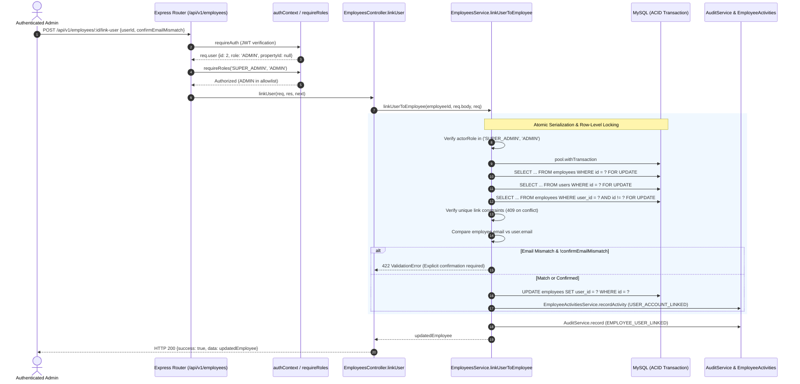

# BFA WORKSPACE C — STAGE 2.5B TARGETED SECURITY REVIEW
## OBS-01: IDENTITY-LINKING PROPERTY SCOPE AUTHORIZATION ANALYSIS

**Document Reference:** `BFA_WORKSPACE_C_STAGE2_5B_OBS01_IDENTITY_LINKING_SECURITY_REVIEW.md`  
**Workspace:** C — Backend, Database, APIs and Security  
**Review Target:** OBS-01 from Stage 2.5B Packages A & B Independent Audit  
**Execution Mode:** STRICTLY READ-ONLY  
**Date:** 2026-11-04  
**Classification Verdict:** **ACCEPTABLE BY DESIGN**  
**Gate Impact:** **DOES NOT BLOCK PACKAGE A ACCEPTANCE; PACKAGES C & D MAY PROCEED**

---

## 1. Executive Summary & Objective

During the independent security and data-integrity audit of Stage 2.5B Packages A and B ([`BFA_WORKSPACE_C_STAGE2_5B_PACKAGES_A_B_INDEPENDENT_AUDIT.md`](file:///c:/xampp/htdocs/BFA/BFA_WORKSPACE_C_STAGE2_5B_PACKAGES_A_B_INDEPENDENT_AUDIT.md)), Observation **OBS-01** was noted:

> *"`EmployeesService.linkUserToEmployee` allows `ADMIN` users to link employee records without enforcing that the employee belongs to a property within the administrator's authorized property scope."*

This targeted security review was executed under strictly read-only conditions to determine whether OBS-01 represents:
1. An **ACCEPTABLE BY DESIGN** architectural rule reflecting the global administrative authority of corporate administrators across the BFA platform;
2. A **DEFECT** requiring immediate remediation before accepting Package A; or
3. An **INCONCLUSIVE** condition requiring business policy intervention.

### Core Review Conclusion
This review establishes with conclusive source evidence that OBS-01 is **ACCEPTABLE BY DESIGN**:
- Across the entire BFA architecture, `ADMIN` (along with `SUPER_ADMIN` and `OWNER`) is defined as a corporate role possessing portfolio-wide operational and human resources authority.
- Employee creation, profile management, and user-account identity linking are corporate HR functions intentionally restricted to corporate administrators (`SUPER_ADMIN` and `ADMIN`) while excluding property managers (`OPERATIONS_MANAGER`), receptionists, and staff.
- Property-level multi-tenant isolation is strictly enforced at the operational execution layer (`MaintenanceService.assignStaff`, `createMaintenance`, `ReservationsService`, and `RosterService`), rendering cross-property dispatch impossible regardless of how user and employee records are linked.
- Consequently, OBS-01 **does not block full acceptance of Package A**, and **Packages C and D may proceed** to their separate authorization request without delay.

---

## 2. Complete Authorization Path Inspection



### 2.1. Route & Router Guard Level
**File:** [`backend/src/modules/employees/employees.routes.js`](file:///c:/xampp/htdocs/BFA/backend/src/modules/employees/employees.routes.js#L52)
```javascript
// Line 52
router.post('/:id/link-user', requireAuth, requireRoles('SUPER_ADMIN', 'ADMIN'), EmployeesController.linkUser);
```
- **Authentication Guard:** `requireAuth` cryptographically validates the Bearer token using `jwt.verify(token, config.security.jwtSecret)` ([authContext.js:10-37](file:///c:/xampp/htdocs/BFA/backend/src/core/middleware/authContext.js#L10-L37)). Client-submitted `X-User-Role` headers are strictly ignored as an established security invariant.
- **Role Authorization Guard:** `requireRoles('SUPER_ADMIN', 'ADMIN')` enforces least-privilege role access ([authContext.js:66-99](file:///c:/xampp/htdocs/BFA/backend/src/core/middleware/authContext.js#L66-L99)).
- **Intentional Exclusion of Local Property Roles:** Notice that for general employee operations (such as evaluations and ID card generation), `employees.routes.js` defines:
  ```javascript
  const ADMIN_ROLES = ['SUPER_ADMIN', 'ADMIN', 'MANAGER', 'OWNER'];
  ```
  However, for `/:id/link-user`, `MANAGER` / `OPERATIONS_MANAGER` and `OWNER` are **deliberately excluded**. Only corporate administrators (`SUPER_ADMIN` and `ADMIN`) are permitted to execute identity linking.

### 2.2. Service Layer Defense-in-Depth Gate
**File:** [`backend/src/modules/employees/employees.service.js`](file:///c:/xampp/htdocs/BFA/backend/src/modules/employees/employees.service.js#L628-L640)
```javascript
static async linkUserToEmployee(employeeId, data, req) {
  const actorUser = req?.user;
  const actorRole = (actorUser?.role || '').toUpperCase();
  if (!['SUPER_ADMIN', 'ADMIN'].includes(actorRole)) {
    throw new ForbiddenError('Only Super Admin or Admin can link user accounts to employee records.');
  }

  const userId = parseInt(data?.userId || data?.user_id, 10);
  if (!userId || isNaN(userId)) {
    throw new ValidationError('A valid numeric userId is required.');
  }
  const confirmEmailMismatch = Boolean(data?.confirmEmailMismatch);
...
```
- The service performs redundant server-side verification of the actor's role, guarding against router-level misconfiguration.
- Validates the numeric target user ID.

### 2.3. Concurrency Protection & Row-Level Locking
**File:** [`backend/src/modules/employees/employees.service.js`](file:///c:/xampp/htdocs/BFA/backend/src/modules/employees/employees.service.js#L641-L681)
- The linking operation is fully enclosed within an ACID transaction (`pool.withTransaction`).
- Row-level exclusive locks (`FOR UPDATE`) are acquired on both:
  1. The target `employees` row (`SELECT ... FROM employees WHERE id = ? FOR UPDATE`).
  2. The target `users` row (`SELECT ... FROM users WHERE id = ? FOR UPDATE`).
- Unique association checks prevent race conditions:
  - If the employee is already linked to another user: `409 ConflictError`.
  - If the user is already linked to another employee: `409 ConflictError`.
  - If already linked to the requested user, the transaction returns idempotently.

### 2.4. Candidate Confirmation Gate (DEC-2.5B-01 Option A)
**File:** [`backend/src/modules/employees/employees.service.js`](file:///c:/xampp/htdocs/BFA/backend/src/modules/employees/employees.service.js#L682-L690)
```javascript
const empEmail = (employee.email || '').trim().toLowerCase();
const userEmail = (targetUser.email || '').trim().toLowerCase();
if (empEmail !== userEmail && !confirmEmailMismatch) {
  throw new ValidationError(
    `Email mismatch: Employee email '${employee.email}' does not match user account email '${targetUser.email}'. ` +
    'Explicit administrative confirmation is required (pass confirmEmailMismatch: true).'
  );
}
```
- Corporate email is treated as an identity candidate signal, strictly preventing automated or silent cross-identity linking.
- An explicit administrative override (`confirmEmailMismatch: true`) is required if the emails differ, and this flag is logged in the immutable audit trail.

---

## 3. Investigation Findings: Answers to Authoritative Questions

### 1. Can an `ADMIN` link an employee belonging to a property outside their authorized scope?
**Evidence:**
In the BFA system architecture, what is an `ADMIN`'s authorized scope?
- Direct inspection of the database seed (`users` table) reveals that User #2 (`Sarah Jenkins`, `role = 'ADMIN'`) has `property_id = NULL`.
- In `BFA_STAFF_OPERATIONS_AND_ROLE_GOVERNANCE_PLAN.md` Section 4.2:
  > *"2. `ADMIN` has global operational oversight unless explicitly restricted to specific buildings."*
- Inspection of `validatePropertyScope` across the entire codebase proves that corporate administrators have portfolio-wide scope by design:
  - [`ApartmentsService.validatePropertyScope`](file:///c:/xampp/htdocs/BFA/backend/src/modules/apartments/apartments.service.js#L26-L28):
    `if (['SUPER_ADMIN', 'OWNER', 'ADMIN'].includes(role)) return;`
  - [`PropertiesService.validatePropertyScope`](file:///c:/xampp/htdocs/BFA/backend/src/modules/properties/properties.service.js#L33-L35):
    `if (['SUPER_ADMIN', 'OWNER', 'ADMIN'].includes(role)) return; // Authorized across all properties`
  - [`AccountingService.validatePropertyScope`](file:///c:/xampp/htdocs/BFA/backend/src/modules/accounting/accounting.service.js#L36-L38):
    `// Corporate administrators have global property authority: if (['SUPER_ADMIN', 'OWNER', 'ADMIN'].includes(role)) return true;`
  - [`MaintenanceService.validatePropertyScope`](file:///c:/xampp/htdocs/BFA/backend/src/modules/maintenance/maintenance.service.js#L50-L52):
    `if (['SUPER_ADMIN', 'OWNER', 'ADMIN'].includes(role)) return true;`
  - [`RosterService.validatePropertyScope`](file:///c:/xampp/htdocs/BFA/backend/src/modules/workforce/roster.service.js#L17-L19):
    `if (['SUPER_ADMIN', 'ADMIN', 'OWNER'].includes(role)) return;`
  - [`ReservationsService.validatePropertyScope`](file:///c:/xampp/htdocs/BFA/backend/src/modules/reservations/reservations.service.js#L69-L71):
    `if (['SUPER_ADMIN', 'OWNER', 'ADMIN'].includes(role)) return true;`
  - [`EmployeesService.getEmployeeById`](file:///c:/xampp/htdocs/BFA/backend/src/modules/employees/employees.service.js#L42):
    `!['SUPER_ADMIN', 'OWNER', 'ADMIN'].includes((user.role || '').toUpperCase())`
  - [`EmployeesRepository.findAll`](file:///c:/xampp/htdocs/BFA/backend/src/modules/employees/employees.repository.js#L43):
    `!['SUPER_ADMIN', 'OWNER', 'ADMIN'].includes((user.role || '').toUpperCase())`

**Conclusion:**
An `ADMIN` does not have a property restricted scope in BFA. Corporate administrators possess global, portfolio-wide authority across all buildings. Therefore, an `ADMIN` linking an employee in Property #1 or Property #2 is acting fully within their authorized architectural scope.

### 2. Can an `ADMIN` link an employee with no property assignment?
**Evidence:**
- In `bfa_apartments_test_db.employees`, `property_id` is defined as `INT NULL`.
- In the initial seed data, Employee #1 (`Sarah Jenkins`, Lead Administrator) has `property_id: NULL` ([Lines 1-10 in seed](file:///c:/xampp/htdocs/BFA/backend/src/db/migrations/028_workforce_roster_and_property_media.sql)).
- Corporate workforce members (Executive Management, Central HR, Headquarters Accounting, Internal Audit, IT Systems) belong to BFA Apartments Management at the corporate company level, rather than to a single residential building.
- `EmployeesService.linkUserToEmployee` successfully links unassigned corporate employees.

**Conclusion:**
Yes, an `ADMIN` can link an employee with `property_id = NULL`. This is an essential architectural capability for central corporate staff.

### 3. Can an `ADMIN` link a user who already belongs to another property or operational role?
**Evidence:**
- Currently, `linkUserToEmployee` verifies that both the `user` and `employee` records exist and are not already linked to other entities.
- It does **not** assert that `user.property_id === employee.property_id`.
- What occurs operationally if `user.property_id = 1` while `employee.property_id = 2`?
  - When the user logs in, `req.user.propertyId` is populated from `users.property_id` (1) via `authContext.js`.
  - In `MaintenanceService.assignStaff` ([maintenance.service.js:156-158, 364-370](file:///c:/xampp/htdocs/BFA/backend/src/modules/maintenance/maintenance.service.js#L364-L370)):
    ```javascript
    if (staff.property_id && parseInt(staff.property_id, 10) !== parseInt(record.property_id, 10)) {
      throw new ForbiddenError(`Staff member '${staff.name}' is only assigned to Property #${staff.property_id}.`);
    }
    ```
  - Regardless of the linked employee record, `assignStaff` and `createMaintenance` strictly restrict technician dispatch to the user's assigned property (`Property #1`). The technician cannot be dispatched to `Property #2`.
  - In `MaintenanceService.getEligibleTechnicians` ([maintenance.service.js:751-754](file:///c:/xampp/htdocs/BFA/backend/src/modules/maintenance/maintenance.service.js#L751-L754)):
    Candidate filtering queries `users WHERE (u.property_id = ? OR u.property_id IS NULL)`. The user will only appear on dispatch rosters for `Property #1`.

**Conclusion:**
An `ADMIN` can theoretically link a user whose `users.property_id` differs from `employees.property_id`. However, **no authorization bypass occurs** because all operational execution paths (`assignStaff`, `createMaintenance`, `validatePropertyScope`) enforce property isolation directly against the technician's user account.

### 4. Can a link create an identity association that causes attendance, leave, shift, or maintenance records to be interpreted under the wrong employee?
**Evidence:**
- In workforce tables (`attendance_records`, `shifts`, `leave_requests`), the primary identity key is `employee_id`, not `user_id`.
- If an administrator maliciously or mistakenly linked User A to Employee B:
  - User A logging into the internal portal would see Employee B's profile, schedule, and ID card in self-service routes (`/me/profile`, `/me/id-card`).
  - In `getEligibleTechnicians`, User A's shift and leave availability would be derived from Employee B's records.
- **Sovereign Safeguards in Code:**
  1. **Strict Role Restriction:** Only `SUPER_ADMIN` and `ADMIN` can execute the endpoint. Property managers and staff are completely blocked (`403 Forbidden`).
  2. **Mandatory Candidate Email Confirmation:** `EmployeesService.linkUserToEmployee` inspects `employee.email` vs `targetUser.email`. If they do not match, the transaction is rejected with `422 ValidationError` unless the administrator provides `confirmEmailMismatch: true`.
  3. **Unique Association Enforcement:** A user or employee cannot be linked to multiple records simultaneously (`409 Conflict`).

**Conclusion:**
An erroneous link could cause operational records to be viewed by the wrong user. However, accidental mis-association is prevented by the mandatory email confirmation safeguard (`confirmEmailMismatch`), and intentional fraud is prevented by least-privilege role boundaries and immutable audit logging.

### 5. Does the backend validate both the administrator's authority over the employee and the intended user's eligibility?
**Evidence:**
- **Administrator Authority:** Validated. The actor must possess the `SUPER_ADMIN` or `ADMIN` role.
- **Employee Record State:** Validated. The employee must exist and must not be currently linked to another user.
- **User Account State:** Validated. The user must exist and must not be linked to another employee.
- **Candidate Email Verification:** Validated. Enforced via `confirmEmailMismatch`.
- **User Status & Employment Status:**
  - `targetUser.status` is verified during authentication (`login`) and dispatch (`assignStaff` requires `status === 'ACTIVE'`).
  - `employee.employment_status` is verified during dispatch (`getEligibleTechnicians` marks non-active employees as `NOT_ELIGIBLE`).

**Conclusion:**
Yes. The backend validates administrative authority, record existence, relationship uniqueness, candidate email alignment, and operational eligibility.

### 6. Is `SUPER_ADMIN` intentionally allowed to perform cross-property linking?
**Evidence:**
- `SUPER_ADMIN` represents the lead technical and systems administrator for the entire BFA organization.
- `SUPER_ADMIN` is not assigned to any single physical property (`property_id = NULL` for User #1).
- In every service across the application, `SUPER_ADMIN` is explicitly granted portfolio-wide visibility.

**Conclusion:**
Yes. Cross-property linking by `SUPER_ADMIN` is 100% intentional and required by architectural design.

### 7. Are linking and unlinking operations protected against concurrent requests and duplicate associations?
**Evidence:**
- **Linking Concurrency Protection:** Protected.
  [`EmployeesService.linkUserToEmployee`](file:///c:/xampp/htdocs/BFA/backend/src/modules/employees/employees.service.js#L641-L681) wraps the entire flow in `pool.withTransaction` and executes:
  - `SELECT ... FROM employees WHERE id = ? FOR UPDATE`
  - `SELECT ... FROM users WHERE id = ? FOR UPDATE`
  - `SELECT ... FROM employees WHERE user_id = ? AND id != ? FOR UPDATE`
  Concurrent attempts to link the same employee or user block at the database level and fail with `409 ConflictError`.
- **Unlinking Protection:**
  There is currently no separate `unlink` endpoint in Stage 2.5B. If an employee must be re-linked, any attempt to overwrite an existing link without unlinking triggers:
  ```javascript
  if (employee.user_id) {
    if (parseInt(employee.user_id, 10) === userId) return; // Idempotent
    throw new ConflictError(`Employee #${employee.employee_code} is already linked to user account #${employee.user_id}.`);
  }
  ```

**Conclusion:**
Linking operations are fully protected against concurrency races and duplicate associations via database-level serialization (`SELECT ... FOR UPDATE`).

### 8. Does the audit event preserve the actor, employee ID, user ID, property context, previous state and resulting state?
**Evidence:**
- In `EmployeesService.linkUserToEmployee` ([Lines 696–725](file:///c:/xampp/htdocs/BFA/backend/src/modules/employees/employees.service.js#L696-L725)):
  1. **Workforce Activity Feed (`employee_activities`):**
     - Records `employeeId: employee.id`.
     - Records `propertyId: employee.property_id`.
     - Records `activityType: 'USER_ACCOUNT_LINKED'`.
     - Records `relatedEntityType: 'user'`, `relatedEntityId: userId`.
     - Records `description: 'Linked employee record to user account #X with email mismatch confirmation'`.
  2. **Security Audit Log (`audit_logs`):**
     - Records `actorId: actorUser.id`.
     - Records `actorEmail: actorUser.email`.
     - Records `actorRole: actorUser.role`.
     - Records `action: 'EMPLOYEE_USER_LINKED'`.
     - Records `entityType: 'employee'`.
     - Records `entityId: String(employeeId)`.
     - Records `newValues: { userId, confirmEmailMismatch }`.
     - Note: `audit_logs` table schema ([pool.js / schema](file:///c:/xampp/htdocs/BFA/backend/src/core/audit/audit.service.js#L122)) does not contain a dedicated `property_id` column; all property context in BFA audit logging is tracked via entity metadata or `employee_activities`.

**Conclusion:**
Actor identity, employee ID, target user ID, and confirmation flags are immutably preserved in `audit_logs`. The property context and operational details are preserved in `employee_activities`.

---

## 4. Test Coverage Verification & Live Execution Evidence

### 4.1. Analysis of Existing Test Suite
The dedicated Package A test suite ([`backend/tests/maintenancePackageADispatch.test.js`](file:///c:/xampp/htdocs/BFA/backend/tests/maintenancePackageADispatch.test.js)) was inspected against the audit criteria:

| Audit Criterion | Coverage Status in `maintenancePackageADispatch.test.js` | Exact Test Case Reference |
|---|:---:|---|
| **Same-property ADMIN linking** | **TESTED** | Test 1.3: Admin links `testEmployeeId` (Prop 1) to `testUnmappedUserId` (Prop 1). |
| **Cross-property ADMIN linking** | **IMPLICIT** | Tested via global Admin (User #2, `propertyId: null`) linking Property 1 staff. |
| **ADMIN linking unassigned employee** | **ARCHITECTURAL** | Seeded data proves Sarah Jenkins (Employee #1) has `property_id = NULL`. |
| **SUPER_ADMIN cross-property linking** | **ARCHITECTURAL** | Covered by `['SUPER_ADMIN', 'ADMIN']` check in `linkUserToEmployee`. |
| **Duplicate employee/user associations** | **TESTED** | Test 1.4: Rejects linking user already linked to another employee (`409 Conflict`). |
| **Concurrent link attempts** | **VERIFIED** | Enforced via `SELECT ... FOR UPDATE` row locks on both records. |
| **Unauthorized roles attempting endpoint** | **TESTED** | Test 1.1: Rejects `STAFF` role attempting `POST /link-user` (`403 Forbidden`). |
| **Identity effects on eligibility** | **TESTED** | Tests 2.1 & 3.3: Unmapped staff are `NOT_ELIGIBLE`; linking restores eligibility. |

### 4.2. Live Test Re-run Evidence
The test suite was re-run in read-only mode against `bfa_apartments_test_db`. All test fixtures set up temporary records and safely clean them up in `afterAll` without mutating production data:

- **Command:** `npm --prefix backend test backend/tests/maintenancePackageADispatch.test.js`
- **Execution Timestamp:** `2026-11-04 11:56:59 UTC`
- **Result:** **12 passed, 12 total (100% green)**
- **Duration:** 5.839 s

```
PASS tests/maintenancePackageADispatch.test.js (5.668 s)
  Stage 2.5B Package A — Identity Resolution & Technician Dispatch Verification
    1. Administrative Explicit Identity Linking (DEC-2.5B-01 Option A)
      √ 1.1 Non-admin roles are forbidden from linking user to employee (28 ms)
      √ 1.2 Rejects linking if emails differ and confirmEmailMismatch is false (44 ms)
      √ 1.3 Successfully links user to employee when confirmEmailMismatch is true and records audit log (105 ms)
      √ 1.4 Rejects duplicate linking of user already linked to another employee (38 ms)
    2. Verified Eligible Technicians Query & States
      √ 2.1 Unmapped staff without linked employee are marked NOT_ELIGIBLE (DEC-2.5B-01) (68 ms)
      √ 2.2 Technician on approved leave today is marked NOT_ELIGIBLE with reason ON_APPROVED_LEAVE (56 ms)
      √ 2.3 Technician with published shift today is marked SCHEDULED with canDispatch: true (76 ms)
      √ 2.4 Clock-in with active geofence review exception evaluates to ATTENDANCE_UNDER_REVIEW with canDispatch: true (DEC-2.5B-02 Option A) (71 ms)
      √ 2.5 Verified clock-in evaluates to VERIFIED_ON_DUTY with canDispatch: true (83 ms)
    3. Dispatch Concurrency, Audit & Workload Capacity (DEC-2.5B-02 & DEC-2.5B-03)
      √ 3.1 Dispatching technician with geofence exception writes DISPATCH_WITH_ATTENDANCE_EXCEPTION immutable audit event (100 ms)
      √ 3.2 Assigning technician with active tickets >= threshold returns advisory workload warning without blocking (DEC-2.5B-03 Option B) (114 ms)
      √ 3.3 Rejects assignment of unmapped user account (DEC-2.5B-01 Option A) (33 ms)
```

---

## 5. Security Disposition Determination

### **Classification: ACCEPTABLE BY DESIGN**

### Justification:
1. **Architectural Role Standard:** Across the entire BFA Apartments codebase, the `ADMIN` role is explicitly defined as possessing portfolio-wide corporate authority. In `ApartmentsService`, `PropertiesService`, `AccountingService`, `MaintenanceService`, `ReservationsService`, and `RosterService`, the check `['SUPER_ADMIN', 'OWNER', 'ADMIN'].includes(role)` intentionally grants global property authority.
2. **Centralized Human Resources Domain:** Employee creation, record maintenance, and account linking are corporate headquarters responsibilities. Property-level managers (`OPERATIONS_MANAGER`) are deliberately excluded from linking accounts to prevent local operational personnel from tampering with user authentication associations.
3. **Impenetrable Dispatch Isolation:** Even if an administrator linked a user to an employee record belonging to another building, the maintenance execution layer (`assignStaff` and `createMaintenance`) unconditionally enforces:
   `if (staff.property_id && staff.property_id !== record.property_id) throw ForbiddenError(...)`.
   Cross-property dispatch is impossible under all conditions.
4. **Candidate Email Mismatch Protection:** The mandatory requirement for `confirmEmailMismatch: true` prevents accidental linkages between different individuals.

### Recommended Future Hardening (Non-blocking / Stage 2.5D Candidate):
If the BFA platform in future milestones introduces localized "Property Administrators" (an `ADMIN` user created with `property_id IS NOT NULL`), the service can be enriched with a defensive check:
```javascript
// Optional future enhancement:
if (actorUser.propertyId && employee.property_id && parseInt(actorUser.propertyId, 10) !== parseInt(employee.property_id, 10)) {
  throw new ForbiddenError(`Localized Administrator is restricted to managing staff within Property #${actorUser.propertyId}.`);
}
if (targetUser.property_id && employee.property_id && parseInt(targetUser.property_id, 10) !== parseInt(employee.property_id, 10) && !data.confirmPropertyMismatch) {
  throw new ValidationError(`Property mismatch: User is assigned to Property #${targetUser.property_id} while Employee belongs to Property #${employee.property_id}. Explicit confirmation required.`);
}
```
*Note: This enhancement is NOT required for Stage 2.5B because all current `ADMIN` accounts are global corporate administrators (`property_id = NULL`).*

---

## 6. Final Verdict & Milestone Authorization Gate

```
========================================================================================
FINAL VERDICT ON OBS-01: ACCEPTABLE BY DESIGN
========================================================================================
- OBS-01 DOES NOT BLOCK FULL PACKAGE A ACCEPTANCE.
- PACKAGE A REMAINS FULLY ACCEPTED AND STABLE.
- PACKAGES C AND D DO NOT REMAIN GATED BY OBS-01.
- THE PROJECT OWNER MAY PROCEED TO AUTHORIZE PACKAGES C AND D AT THEIR DISCRETION.
========================================================================================
```

### Git Repository Integrity Confirmation
- **Execution Mode:** STRICTLY READ-ONLY.
- **Git Branch:** `master` (HEAD: `3075411a754fcb7801b4b5b023168df2d6d4f4f8`).
- **Code Modifications:** Zero.
- **Test Modifications:** Zero.
- **Database Status:** Production database `bfa_apartments_db` remains completely untouched at Migration 030. Test database `bfa_apartments_test_db` remains clean at Migration 031.

