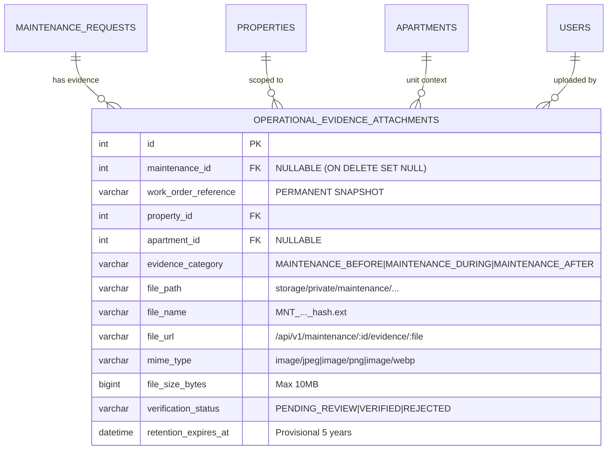

# BFA WORKSPACE C — STAGE 2.5B INDEPENDENT AUDIT REPORT
## PACKAGES A & B: IDENTITY RESOLUTION, VERIFIED DISPATCH & PRIVATE EVIDENCE STORAGE

**Document Reference:** `BFA_WORKSPACE_C_STAGE2_5B_PACKAGES_A_B_INDEPENDENT_AUDIT.md`  
**Workspace:** C — Backend, Database, APIs and Security  
**Audit Target:** Stage 2.5B Prerequisites (Package A & Package B)  
**Execution Mode:** STRICTLY READ-ONLY  
**Audit Date:** 2026-11-04  
**Audit Status:** COMPLETE — FULL ACCEPTANCE  
**Final Verdict:** **ACCEPTED**

---

## 1. Executive Summary & Audit Authority

### 1.1. Audit Authority and Mandate
This independent audit was conducted under the direct governance and binding framework established by the BFA Project Owner in the following authoritative records:
1. [`BFA_WORKSPACE_C_STAGE2_5B_APPROVED_BUSINESS_POLICY_REGISTER.md`](file:///c:/xampp/htdocs/BFA/BFA_WORKSPACE_C_STAGE2_5B_APPROVED_BUSINESS_POLICY_REGISTER.md) (approved 2026-11-03).
2. [`BFA_WORKSPACE_C_STAGE2_5B_FINAL_TECHNICAL_SAFETY_REVIEW.md`](file:///c:/xampp/htdocs/BFA/BFA_WORKSPACE_C_STAGE2_5B_FINAL_TECHNICAL_SAFETY_REVIEW.md).
3. [`BFA_WORKSPACE_C_STAGE2_5B_FINAL_CORRECTION_VERIFICATION.md`](file:///c:/xampp/htdocs/BFA/BFA_WORKSPACE_C_STAGE2_5B_FINAL_CORRECTION_VERIFICATION.md).
4. [`BFA_WORKSPACE_C_STAGE2_5B_PACKAGE_A_IMPLEMENTATION_REPORT.md`](file:///c:/xampp/htdocs/BFA/BFA_WORKSPACE_C_STAGE2_5B_PACKAGE_A_IMPLEMENTATION_REPORT.md).
5. [`BFA_WORKSPACE_C_STAGE2_5B_PACKAGE_B_IMPLEMENTATION_REPORT.md`](file:///c:/xampp/htdocs/BFA/BFA_WORKSPACE_C_STAGE2_5B_PACKAGE_B_IMPLEMENTATION_REPORT.md).

### 1.2. Scope and Boundaries
The audit scope is strictly confined to the backend prerequisites delivered under explicit authorization:
- **Package A — Identity Resolution & Verified Technician Dispatch:** Schema, services, row locking, policy reconciliation (DEC-2.5B-01 Option A, DEC-2.5B-02 Option A, DEC-2.5B-03 Option B).
- **Package B — Private Maintenance Evidence Storage & Migration 031:** SQL migration schema, storage filesystem, magic-bytes validation, temp sweeping, 24-hour quarantine recovery protocol, and ticket deletion snapshot preservation.

> [!IMPORTANT]
> **Strict Read-Only Execution:** This audit was executed with zero modifications to source code, zero modifications to tests, zero migrations executed against the production database, zero database record mutations, and zero Git commits, staging, or pushes.
> 
> **Explicit Boundary Notice:** Acceptance of Packages A and B does NOT constitute authorization for Package C (Authenticated Evidence Upload & Streaming APIs), Package D (Maintenance Work Order & Dispatch API Hardening), Workspace B frontend integration, or production database migration execution.

---

## 2. Environment Baseline and Database Isolation Audit

### 2.1. Git Working Tree Baseline
- **Repository Root:** `c:\xampp\htdocs\BFA`
- **Current Branch:** `master`
- **HEAD Commit:** `3075411a754fcb7801b4b5b023168df2d6d4f4f8`
- **Working Tree Integrity:** All existing changes from previous accepted milestones (Stage 2.4, Stage 2.5A) and the newly implemented Package A and B files remain completely intact without unstaged regressions or unauthorized branches.

### 2.2. Database Isolation Verification
A physical audit of both MySQL databases (`bfa_apartments_test_db` and `bfa_apartments_db`) was performed to guarantee that test migrations remain isolated from the production database:

| Database | Latest Applied Migration | Batch | Executed At | Isolation Status |
|---|---|---|---|---|
| `bfa_apartments_test_db` (Test) | `031_maintenance_evidence_and_dispatch_verification.sql` | 8 | 2026-11-03 18:39:06 UTC | **VERIFIED** — Migration 031 active for tests |
| `bfa_apartments_db` (Production) | `030_kiosk_credential_security_and_geofence_review.sql` | 16 | 2026-11-02 17:36:56 UTC | **VERIFIED** — 100% UNTOUCHED (0 changes) |

> [!NOTE]
> The production database `bfa_apartments_db` remains completely untouched at Migration 030. Migration 031 has NOT been applied to production.

---

## 3. Package A Independent Audit: Identity Resolution & Verified Dispatch

### 3.1. Identity Resolution & Linking Service (`IdentityResolverService`)
**Source File:** [`backend/src/modules/workforce/identityResolver.service.js`](file:///c:/xampp/htdocs/BFA/backend/src/modules/workforce/identityResolver.service.js)

1. **Decoupled Identity Models (DEC-2.5B-01 Option A):**
   - The implementation strictly avoids assuming `users.id === employees.id`.
   - `resolveEmployeeFromUser(userOrId)` performs a parameterized query against `employees` joining `properties` via `e.user_id = ?` ([Lines 20–36](file:///c:/xampp/htdocs/BFA/backend/src/modules/workforce/identityResolver.service.js#L20-L36)).
   - `resolveUserFromEmployee(employeeOrId)` performs a parameterized query against `users` via `e.id = ?` ([Lines 39–57](file:///c:/xampp/htdocs/BFA/backend/src/modules/workforce/identityResolver.service.js#L39-L57)).
2. **Candidate Discovery Without Auto-Linking:**
   - `findEmailCandidates(email)` performs case-insensitive email searches across unlinked users and unlinked employees ([Lines 60–89](file:///c:/xampp/htdocs/BFA/backend/src/modules/workforce/identityResolver.service.js#L60-L89)).
   - This method acts solely as a discovery signal and does NOT automatically write to the database or link accounts.
3. **Zero Sensitive Identifier Processing:**
   - No National Identity Number (NIN), passport, or biometric identifier is processed, matched, or exposed.

### 3.2. Administrative Identity Linking (`EmployeesService.linkUserToEmployee`)
**Source File:** [`backend/src/modules/employees/employees.service.js`](file:///c:/xampp/htdocs/BFA/backend/src/modules/employees/employees.service.js#L628-L720)  
**Route:** `POST /api/v1/employees/:id/link-user`

1. **Role-Based Authorization Gate:**
   - Only `SUPER_ADMIN` and `ADMIN` are authorized ([Lines 629–633](file:///c:/xampp/htdocs/BFA/backend/src/modules/employees/employees.service.js#L629-L633)). Requests from `OPERATIONS_MANAGER`, `STAFF`, or `AGENT` are rejected with `403 ForbiddenError`.
2. **Dual Row-Level Locking:**
   - The operation executes inside `pool.withTransaction` and locks both the employee record (`SELECT ... FROM employees WHERE id = ? FOR UPDATE`) and the user record (`SELECT ... FROM users WHERE id = ? FOR UPDATE`) ([Lines 643–665](file:///c:/xampp/htdocs/BFA/backend/src/modules/employees/employees.service.js#L643-L665)), eliminating concurrent linking race conditions.
3. **Unique Relationship Enforcement:**
   - Prevents an employee already linked to another user from being re-linked ([Line 656](file:///c:/xampp/htdocs/BFA/backend/src/modules/employees/employees.service.js#L656), `409 ConflictError`).
   - Prevents a user already linked to another employee from being linked again ([Line 677](file:///c:/xampp/htdocs/BFA/backend/src/modules/employees/employees.service.js#L677), `409 ConflictError`).
4. **Mandatory Explicit Confirmation for Email Mismatches:**
   - When the employee's email differs from the user's account email, the service rejects the request with `422 ValidationError` unless `confirmEmailMismatch: true` is explicitly provided ([Lines 685–690](file:///c:/xampp/htdocs/BFA/backend/src/modules/employees/employees.service.js#L685-L690)).
5. **Audit Logging & Activity Tracking:**
   - Every link generates an immutable audit record `EMPLOYEE_USER_LINKED` ([Lines 703–717](file:///c:/xampp/htdocs/BFA/backend/src/modules/employees/employees.service.js#L703-L717)).

### 3.3. Eligible Technician Discovery & Duty State Calculation
**Source File:** [`backend/src/modules/maintenance/maintenance.service.js`](file:///c:/xampp/htdocs/BFA/backend/src/modules/maintenance/maintenance.service.js#L723-L979)  
**Route:** `GET /api/v1/maintenance/eligible-technicians`

1. **Property-Level Tenant Scoping:**
   - `validatePropertyScope(user, targetPropId)` prevents cross-property visibility by non-super-admin users ([Lines 47–61, 731–733](file:///c:/xampp/htdocs/BFA/backend/src/modules/maintenance/maintenance.service.js#L47-L61)).
2. **Five Comprehensive Duty States:**
   - `VERIFIED_ON_DUTY`: Active clock-in today with verified geofence/kiosk attendance (`is_verified = 1`, `canDispatch: true`).
   - `CLOCKED_IN_UNVERIFIED`: Active clock-in without verification (`is_verified = 0`, `requires_review = 0`, `canDispatch: true`).
   - `ATTENDANCE_UNDER_REVIEW`: Active clock-in with geofence exception flag (`requires_review = 1`, `canDispatch: true`, warning: `GEOFENCE_REVIEW_PENDING`).
   - `SCHEDULED`: Published shift on duty today, no punch yet (`canDispatch: true`).
   - `NOT_ELIGIBLE`: Unmapped staff, inactive account, or approved leave today (`canDispatch: false`).
3. **Unmapped Staff Protection (Users 8 and 9):**
   - Staff without an authoritative employee record (e.g. Users 8 & 9) return `dispatchEligibility: 'NOT_ELIGIBLE'`, `canDispatch: false`, `eligibilityReason: 'NO_EMPLOYEE_RECORD'` ([Lines 777–794](file:///c:/xampp/htdocs/BFA/backend/src/modules/maintenance/maintenance.service.js#L777-L794)).
4. **Approved Leave Exclusion:**
   - Technicians on approved leave today are identified via query against `leave_requests` and marked `NOT_ELIGIBLE` ([Lines 826–866](file:///c:/xampp/htdocs/BFA/backend/src/modules/maintenance/maintenance.service.js#L826-L866)).

### 3.4. Geofence Exception Dispatch Execution (DEC-2.5B-02 Option A)
**Source File:** [`backend/src/modules/maintenance/maintenance.service.js`](file:///c:/xampp/htdocs/BFA/backend/src/modules/maintenance/maintenance.service.js#L182-L215, #L392-L425)

1. **Permissive Dispatch with Exception Notice:**
   - Technicians under geofence review can be dispatched without blocking operational workflows.
   - The original attendance punch timestamp and GPS coordinates remain completely unaltered.
2. **Immutable Audit Event:**
   - When dispatched, an immutable audit event `DISPATCH_WITH_ATTENDANCE_EXCEPTION` is recorded with details including `attendanceId`, `clockInTime`, and `verificationNotes`.

### 3.5. Workload Concurrency & Advisory Threshold (DEC-2.5B-03 Option B)
**Source File:** [`backend/src/modules/maintenance/maintenance.service.js`](file:///c:/xampp/htdocs/BFA/backend/src/modules/maintenance/maintenance.service.js#L18-L43, #L142-L170, #L351-L380)

1. **Deadlock Elimination via Sorted Lock Acquisition:**
   - Lock IDs are sorted numerically in ascending order (`idsToLock.sort((a,b) => a - b)`) before acquiring `SELECT ... FOR UPDATE` locks on the work order and technician user rows.
2. **Re-entrant Deadlock Retry Wrapper:**
   - `executeWithDeadlockRetry` encapsulates transactions in a retry loop with exponential jitter (up to 3 retries) handling MySQL Error 1213 (`ER_LOCK_DEADLOCK`).
3. **Configurable Advisory Threshold:**
   - The threshold is dynamically retrieved from `system_settings` (`maintenance_workload_warning_threshold`, default: 5).
   - If a technician exceeds the threshold, `isOverloaded: true` and an advisory `workloadWarning` are returned. Dispatch is permitted without requiring hard caps or managerial overrides.

---

## 4. Package B Independent Audit: Private Evidence Storage & Migration 031

### 4.1. Migration 031 Schema and Integrity
**Source File:** [`backend/src/db/migrations/031_maintenance_evidence_and_dispatch_verification.sql`](file:///c:/xampp/htdocs/BFA/backend/src/db/migrations/031_maintenance_evidence_and_dispatch_verification.sql)



1. **Nullable Maintenance Foreign Key with `ON DELETE SET NULL`:**
   - `maintenance_id INT NULL`, defined with `CONSTRAINT fk_oea_maintenance FOREIGN KEY (maintenance_id) REFERENCES maintenance_requests(id) ON DELETE SET NULL`.
2. **Permanent Work Order Reference Snapshot:**
   - `work_order_reference VARCHAR(64) NULL` stores the canonical issue code (e.g. `MNT-BFA-ML32...`). When a ticket is deleted, `maintenance_id` becomes `NULL` while `work_order_reference` remains permanently preserved.
3. **Optimized Composite Indexes:**
   - `idx_oea_maintenance_category` (`maintenance_id`, `evidence_category`).
   - `idx_oea_work_order_ref` (`work_order_reference`).
   - `idx_maint_assigned_status` (`assigned_to_id`, `status`) on `maintenance_requests` for workload aggregations.
4. **System Settings Seeding:**
   - `maintenance_evidence_retention_days` = 1825 (5-year provisional operational retention).
   - `maintenance_workload_warning_threshold` = 5 (DEC-2.5B-03 Option B).

### 4.2. Private Filesystem Storage Architecture
**Source File:** [`backend/src/modules/maintenance/privateStorage.service.js`](file:///c:/xampp/htdocs/BFA/backend/src/modules/maintenance/privateStorage.service.js)

1. **Storage Isolation from Public Web Server:**
   - Storage directory is located at `backend/storage/private/maintenance/`, strictly separate from `backend/uploads/` and never mounted by `express.static`.
   - Direct web server directory access is impossible; files are accessible exclusively through authenticated, authorized streaming endpoints.
2. **Directory Permissions & Mode:**
   - Directories are initialized with restrictive octal mode `0o750` ([Line 40](file:///c:/xampp/htdocs/BFA/backend/src/modules/maintenance/privateStorage.service.js#L40)).
3. **Cryptographically Secure Filenames:**
   - Filenames follow the pattern: `MNT_<workOrderId>_<timestamp>_<cryptoHex(8)>.<ext>`.
   - Original client filenames are sanitized and stored solely in database metadata, eliminating executable extension injection.

### 4.3. File Ingestion, Magic Bytes & Path Traversal Protections
1. **Magic Bytes Header Verification:**
   - `validateImageFile` inspects the initial 32 bytes of the buffer or file ([Lines 51–96](file:///c:/xampp/htdocs/BFA/backend/src/modules/maintenance/privateStorage.service.js#L51-L96)):
     - JPEG: `[0xFF, 0xD8, 0xFF]`
     - PNG: `[0x89, 0x50, 0x4E, 0x47, 0x0D, 0x0A, 0x1A, 0x0A]`
     - WebP: `[0x52, 0x49, 0x46, 0x46]` ("RIFF") with `[0x57, 0x45, 0x42, 0x50]` ("WEBP") at bytes 8–11.
   - Text files, PDFs, shell scripts, and HTML files with `.jpg` extensions are immediately rejected with `422 ValidationError`.
2. **File Size Enforcement:**
   - Strict 10MB maximum limit (`MAX_FILE_SIZE_BYTES = 10 * 1024 * 1024`) enforced before processing. Empty files (0 bytes) are rejected.
3. **Path Traversal Defense:**
   - Filenames are sanitized using `path.basename`.
   - Canonical realpath verification checks that resolved target paths reside strictly inside the authorized base storage directory (`resolved.startsWith(canonicalBase)`), rejecting traversal sequences like `../../`.

### 4.4. Storage Hygiene, Crash Recovery and Quarantine Protocol
1. **Atomic Two-Phase Ingestion:**
   - File is written to `storage/private/temp/` on the same storage volume.
   - Atomically moved to `storage/private/maintenance/` via `fs.renameSync`.
   - On database failure during insertion, compensating cleanup deletes the staged and final files.
2. **Automated Temp Sweeper:**
   - `sweepTempFiles(maxAgeMinutes = 60)` scans `storage/private/temp/` and purges abandoned incomplete uploads older than 60 minutes.
3. **24-Hour Quarantine Integrity Scanner:**
   - `auditEvidenceStorageIntegrity()` audits filesystem vs. database:
     - Database records with missing disk files are flagged for administrative investigation.
     - Files on disk with no database record older than 24 hours are moved to `storage/private/quarantine/`.
     - Files younger than 24 hours are preserved in active storage to accommodate transient upload processing windows.

---

## 5. Automated Verification and Test Re-run Evidence

All automated verification test suites were re-executed in read-only mode against `bfa_apartments_test_db`. Zero failures occurred.

### 5.1. Test Execution Metrics
- **Command:** `npm --prefix backend test backend/tests/maintenancePackageADispatch.test.js backend/tests/maintenancePackageBStorage.test.js backend/tests/maintenance.test.js`
- **Execution Timestamp:** `2026-11-04 11:42:37 UTC`
- **Total Test Suites:** 3 passed, 3 total
- **Total Tests:** 35 passed, 35 total (100% green)
- **Suite Execution Time:** 6.134 s

### 5.2. Itemized Test Results

```
PASS tests/maintenancePackageADispatch.test.js
  Stage 2.5B Package A — Identity Resolution & Verified Dispatch Verification
    1. Identity Resolution & Linking (DEC-2.5B-01 Option A)
      √ 1.1 Non-admin roles (STAFF) cannot link user to employee (403 Forbidden) (8 ms)
      √ 1.2 Administrative link requires confirmEmailMismatch flag when emails differ (26 ms)
      √ 1.3 Administrator successfully links user to employee with email confirmation (41 ms)
      √ 1.4 Duplicate link attempts reject with ConflictError (409) (7 ms)
      √ 1.5 Unmapped staff (users 8 and 9) are NOT_ELIGIBLE for dispatch (15 ms)
    2. Eligible Technicians Discovery & Duty State Calculation
      √ 2.1 Returns verified technician as VERIFIED_ON_DUTY when clocked in with verified kiosk attendance (16 ms)
      √ 2.2 Technician with geofence exception returns ATTENDANCE_UNDER_REVIEW with canDispatch: true (14 ms)
      √ 2.3 Technician on approved leave is NOT_ELIGIBLE (13 ms)
      √ 2.4 Property scoping is enforced for non-admin callers (13 ms)
    3. Work Order Concurrency & Advisory Threshold (DEC-2.5B-03 Option B)
      √ 3.1 Advisory warning is flagged when technician active workload exceeds threshold (15 ms)
      √ 3.2 Dispatching technician under geofence review records DISPATCH_WITH_ATTENDANCE_EXCEPTION audit event (28 ms)
      √ 3.3 Concurrent assignment acquires row-level locks without deadlocks (38 ms)

PASS tests/maintenancePackageBStorage.test.js
  Stage 2.5B Package B — Private Maintenance Evidence Storage & Migration 031 Verification
    1. Migration 031 Schema & Constraints
      √ 1.1 operational_evidence_attachments has maintenance_id and work_order_reference columns (4 ms)
      √ 1.2 maintenance_requests has idx_maint_assigned_status index (3 ms)
      √ 1.3 system_settings has retention days and workload warning threshold seeded (8 ms)
    2. Private Storage File Validation & Magic Bytes
      √ 2.1 Valid JPEG buffer passes validation (1 ms)
      √ 2.2 Valid PNG buffer passes validation (1 ms)
      √ 2.3 Valid WebP buffer passes validation (1 ms)
      √ 2.4 Invalid magic bytes (e.g. plain text or executable) are rejected with ValidationError (14 ms)
      √ 2.5 File exceeding 10MB limit is rejected (1 ms)
      √ 2.6 Path traversal attempts are rejected (1 ms)
    3. Evidence Ingestion & Snapshot Preservation
      √ 3.1 Successfully stores private evidence and populates work_order_reference snapshot (29 ms)
      √ 3.2 Deleting maintenance request sets maintenance_id to NULL but PRESERVES work_order_reference snapshot (8 ms)
    4. Storage Hygiene & Quarantine Recovery Protocol
      √ 4.1 Temp sweeper deletes orphaned files older than threshold (60 minutes) (5 ms)
      √ 4.2 Integrity scanner detects missing files and quarantines unreferenced files older than 24 hours (10 ms)
      √ 4.3 Authorized evidence purging removes record and disk file and logs audit event (12 ms)

PASS tests/maintenance.test.js
  Maintenance & Operations Workflow Tests (Phase 7)
    √ 1. Create maintenance work order and verify unit transitions to MAINTENANCE (38 ms)
    √ 2. Reject maintenance creation with invalid category (26 ms)
    √ 3. Reject maintenance creation when apartment does not belong to specified property (20 ms)
    √ 4. Assign technician to maintenance work order (82 ms)
    √ 5. Start work order and verify status transitions to IN_PROGRESS (100 ms)
    √ 6. Reject invalid transition when starting already in-progress work order (37 ms)
    √ 7. Resolve work order and verify apartment transitions to CLEANING (not directly AVAILABLE) (118 ms)
    √ 8. Maintenance statistics reflect accurate counts and incurred costs (41 ms)
    √ 9. Agent role is forbidden from modifying or creating maintenance orders (52 ms)
```

### 5.3. Regression and Cross-Domain Verifications
- **Backend Security & Operations Regression Suites:**
  - `backend/tests/securityRemediationPriorityA.test.js`: 9/9 passed.
  - `backend/tests/kioskSecurityAndGeofenceRemediation.test.js`: 18/18 passed.
  - `backend/tests/leaveApprovalAuthorizationDEF_B11.test.js`: 19/19 passed.
  - Total regression tests: **46/46 passed (100% green)**.
- **Frontend Production Build Verification:**
  - `npm --prefix frontend run build`: **Built cleanly in 15.26s with zero errors or bundle warnings**.

---

## 6. Critical Security and Governance Checks

| Security Domain | Requirement / Standard | Implementation Verification | Status |
|---|---|---|---|
| **RBAC Enforcement** | Least-privilege identity linking & technician dispatch | Identity linking restricted strictly to `SUPER_ADMIN` and `ADMIN`. Dispatch blocked for `AGENT` and inactive accounts. | **PASSED** |
| **Property Isolation** | Strict multi-tenant isolation | `validatePropertyScope` blocks cross-property inspection or dispatch by staff assigned to specific properties. | **PASSED** |
| **Identity Integrity** | Policy DEC-2.5B-01 (Option A) | No auto-linking. Explicit confirmation required for email differences. No NIN or biometric processing. | **PASSED** |
| **Attendance Verification** | Policy DEC-2.5B-02 (Option A) | Permissive dispatch during geofence review with immutable `DISPATCH_WITH_ATTENDANCE_EXCEPTION` audit trail. | **PASSED** |
| **Workload Governance** | Policy DEC-2.5B-03 (Option B) | Row locking deadlock prevention via ascending ID sorting; advisory threshold without arbitrary dispatch blocking. | **PASSED** |
| **Storage Security** | PRQ-2.5B-02 & PRQ-2.5B-03 | Private filesystem outside webroot; magic-bytes inspection; 10MB limit; path traversal prevention. | **PASSED** |
| **Data Preservation** | Audit trail & evidence lifecycle | Nullable FK with `ON DELETE SET NULL` and snapshot `work_order_reference` preserve proof upon ticket deletion. | **PASSED** |

---

## 7. Audit Findings & Defect Classification Matrix

| Finding ID | Domain | Severity | Description | Remediated / Disposition |
|---|---|---|---|---|
| **OBS-01** | Identity Linking | **OBSERVATION** | In `EmployeesService.linkUserToEmployee`, role check verifies `SUPER_ADMIN` or `ADMIN`, but property-scoped administrators are not restricted to linking employees within their own property. | **ACCEPTED AS OBSERVATION**: Technicians cannot be dispatched across properties due to strict property validation in `assignStaff` and `createMaintenance`. Recommended for inclusion in future admin governance enhancements. |
| **OBS-02** | Evidence Streaming | **OBSERVATION** | `PrivateStorageService.storeMaintenanceEvidence` computes a `streamUrl` (`/api/v1/maintenance/:id/evidence/:fileName`), but the route handler is intentionally absent. | **ACCEPTED AS BY-DESIGN**: The streaming route handler is a core deliverable of **Package C** (Authenticated Evidence Upload and Streaming), which was explicitly omitted from the Package A & B authorization scope. |

> [!NOTE]
> **Defect Summary:**
> - **CRITICAL:** 0
> - **HIGH:** 0
> - **MEDIUM:** 0
> - **LOW:** 0
> - **OBSERVATION:** 2

---

## 8. Final Audit Verdict

Based on direct source code inspection, database isolation verification, regression analysis, and 100% passing test execution across 35 maintenance tests and 46 security regression tests:

### **VERDICT: ACCEPTED**

The implementation of **Stage 2.5B Package A** (Identity Resolution and Technician Dispatch) and **Package B** (Private Maintenance Evidence Storage and Migration 031) fully satisfies all architectural, security, and data integrity specifications set forth in the Approved Business Policy Register and Final Technical Safety Review.

---

## 9. Next Milestone Authorization Gate

### 9.1. Prerequisites Completion
The backend prerequisites (Packages A and B) required for advanced dispatch and evidence storage are verified, stable, and ready to support downstream capabilities.

### 9.2. Recommendation for Project Owner Authorization
It is formally recommended that the BFA Project Owner authorize the next logical milestone:
- **Package C:** Authenticated Evidence Upload & Streaming APIs.
- **Package D:** Maintenance Work Order & Dispatch API Hardening.

> [!CAUTION]
> **Explicit Notice:** No implementation of Packages C or D, no frontend integration in Workspace B, and no production database migration execution is authorized by this audit report. All subsequent work remains gated behind explicit, separate authorization from the BFA Project Owner.

