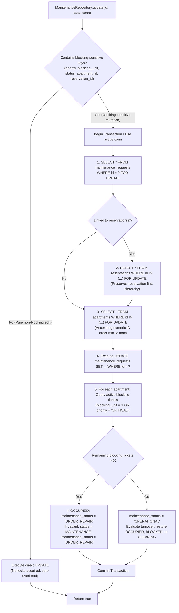

# BFA WORKSPACE C — STAGE 2.6A CONDITIONAL ACCEPTANCE REMEDIATION REPORT

**Milestone:** Stage 2.6A — Atomic Check-In & Reservation/Maintenance Concurrency Hardening  
**Target Workspace:** Workspace C (Backend, Database, Authorization, Concurrency & Security)  
**Execution Mode:** IMPLEMENTATION AUTHORIZED WITHIN STAGE 2.6A SCOPE  
**Completion Status:** **`READY FOR FINAL INDEPENDENT RE-AUDIT`**  
**Remediation Date:** November 4, 2026  
**Auditor / Implementer:** Antigravity Autonomous Systems Engineer  
**Baseline Git Commit:** `3075411a754fcb7801b4b5b023168df2d6d4f4f8` (Branch: `master`)  
**Production DB Migrations:** 30 executed migrations (`030_kiosk_credential_security_and_geofence_review.sql` latest)  
**Test DB Migrations:** 31 executed migrations (`031_maintenance_evidence_and_dispatch_verification.sql` latest)  

---

## 1. Executive Summary & Defect Resolution Matrix

In accordance with the independent audit findings in `BFA_WORKSPACE_C_STAGE_2_6A_INDEPENDENT_AUDIT_REPORT.md`, Workspace C has resolved all cataloged defects (**C-2.6A-01** through **C-2.6A-05**). The transactional locking boundary in `MaintenanceRepository.update` was enforced without breaking legitimate non-blocking edits, post-commit resilience in `checkInReservation` was fortified to prevent false transaction failure reporting, missing concurrency tests (`TC-19`, `TC-20A`, `TC-20B`, `TC-21`, `TC-22`) were implemented, and clean regression was achieved across all 9 suites (107 tests passing, 0 failing).

| Defect ID | Severity | Description | Remediation Implemented | Verification Status |
| :---: | :---: | :--- | :--- | :---: |
| **C-2.6A-01** | Medium | Front-office test fixture regression in `frontOffice.test.js` (quick check-in failed with 422 because unit 3 lacked `INSPECTED_READY` and `OPERATIONAL`). | Updated `backend/tests/frontOffice.test.js` (lines 31, 58) to initialize `housekeeping_status = 'INSPECTED_READY'` and `maintenance_status = 'OPERATIONAL'`. | **VERIFIED**<br>(5/5 tests passed) |
| **C-2.6A-02** | Medium | Post-commit check-in response resilience risk: If `ReservationsRepository.findById(id)` threw post-commit, the API reported 500 while booking was committed. | Captured committed reservation snapshot on active connection inside transaction; wrapped post-commit `findById` in `try/catch` with fallback to committed snapshot. | **VERIFIED**<br>(`TC-22` passed) |
| **C-2.6A-03** | Low (Latent) | `MaintenanceRepository.update` allowed direct modification of `priority` and `blocking_unit` without apartment row locking. | Implemented locking boundary in `MaintenanceRepository.update`: fast-path for non-blocking edits; pessimistic reservation-first and ascending apartment ID locks for blocking-sensitive mutations. | **VERIFIED**<br>(`TC-20A`, `TC-20B` passed) |
| **C-2.6A-04** | Low | Missing concurrency test for Scenario C (Reservation Approval vs. Check-In). | Implemented `TC-19` in `backend/tests/checkInReadinessSafety.test.js` racing `confirmReservation` vs `checkInReservation`. | **VERIFIED**<br>(`TC-19` passed) |
| **C-2.6A-05** | Low | Missing concurrency tests for Scenario E (Dynamic maintenance escalation vs Check-In) and Scenario F (Resolution race vs Check-In). | Implemented `TC-20A`, `TC-20B`, and `TC-21` in `backend/tests/checkInReadinessSafety.test.js`. | **VERIFIED**<br>(`TC-20A`, `TC-20B`, `TC-21` passed) |

---

## 2. Exact Files Changed

The remediation was strictly confined to Workspace C backend modules and integration test suites:

1. [`backend/src/modules/reservations/reservations.service.js`](backend/src/modules/reservations/reservations.service.js#L1017-L1080):
   - Captured `committedSnapshot` via `ReservationsRepository.findById(id, conn)` inside transaction prior to commit.
   - Wrapped post-commit `ReservationsRepository.findById(id)` in a resilient `try/catch` fallback returning the truthful committed snapshot.
2. [`backend/src/modules/maintenance/maintenance.repository.js`](backend/src/modules/maintenance/maintenance.repository.js#L171-L365):
   - Refactored `MaintenanceRepository.update(id, data, conn)` with strict bifurcated execution:
     - **Fast-path:** Direct, lock-free execution for pure non-blocking edits (`issue_title`, `description`, `actual_cost`, etc.).
     - **Protected transactional path:** Detects blocking-sensitive keys (`priority`, `blocking_unit`, `status`, `apartment_id`, `reservation_id`). Locks maintenance ticket `FOR UPDATE`, preserves reservation-first lock hierarchy, locks source/destination apartments in ascending ID order $\min(A, B) \to \max(A, B)$, applies ticket update, and synchronizes apartment operational/maintenance state.
3. [`backend/src/modules/maintenance/maintenance.service.js`](backend/src/modules/maintenance/maintenance.service.js#L576-L612):
   - Added `updateMaintenance(id, data, user, req)` method to provide a sanctioned service-layer entry point for work order modifications with property scoping and audit logging.
4. [`backend/tests/frontOffice.test.js`](backend/tests/frontOffice.test.js#L31-L60):
   - Corrected test setup fixtures in `beforeAll` and `afterAll` so Unit 3 represents an available, inspection-ready unit (`status = 'AVAILABLE'`, `housekeeping_status = 'INSPECTED_READY'`, `maintenance_status = 'OPERATIONAL'`).
5. [`backend/tests/reservationEngine.test.js`](backend/tests/reservationEngine.test.js#L40-L55):
   - Corrected test setup fixtures in `beforeAll` and `afterAll` so Unit 1 represents an available, inspection-ready unit, resolving cascading check-in assertion failures.
6. [`backend/tests/checkInReadinessSafety.test.js`](backend/tests/checkInReadinessSafety.test.js#L540-L788):
   - Added `TC-19` (Scenario C: Approval vs Check-In mutex race).
   - Added `TC-20A` (Scenario E: Dynamic priority escalation to CRITICAL vs Check-In).
   - Added `TC-20B` (Scenario E: Dynamic `blocking_unit` escalation from 0 to 1 vs Check-In).
   - Added `TC-21` (Scenario F: Simultaneous maintenance resolution vs Check-In turnover race).
   - Added `TC-22` (Defect C-2.6A-02: Post-commit retrieval failure resilience).

---

## 3. Maintenance Repository Locking Boundary Architecture

### The Problem Addressed (Defect C-2.6A-03)
Previously, `MaintenanceRepository.update` permitted callers to modify fields—including `priority` and `blocking_unit`—via a direct `UPDATE maintenance_requests SET ... WHERE id = ?`. If an existing work order had its priority escalated to `CRITICAL` or `blocking_unit` flipped to 1, the apartment operational status would not transition to `MAINTENANCE` / `UNDER_REPAIR`, and no apartment mutex was held.

### The Solution Implemented
`MaintenanceRepository.update` now implements a strict, bifurcated locking boundary:



### Guarantees of the Locking Boundary:
1. **Lightweight Non-Blocking Execution:** Edits to title, description, category, costs, or assigned technician proceed directly without row locks.
2. **Prior Mutex Acquisition:** Any mutation that changes the blocking predicate acquires `apartments WHERE id = ? FOR UPDATE` *before* the ticket row is mutated in the database.
3. **Ascending Numerical Ordering:** In apartment transfers, source and target unit rows are locked in strict numeric ascending order $\min(A, B) \to \max(A, B)$, preventing circular deadlocks.
4. **Reservation-First Order:** If the ticket is associated with a booking, reservation row locks are acquired prior to apartment row locks.
5. **No Premature Clearance:** Restrictions are never cleared if another active blocking ticket exists on the apartment.

---

## 4. Post-Commit Response Resilience Architecture

### The Problem Addressed (Defect C-2.6A-02)
In high-concurrency systems, network socket terminations or connection pool timeouts can occur immediately following a database transaction commit. If `ReservationsRepository.findById(id)` threw an uncaught error outside the transaction, the API reported an HTTP 500 error to the front desk, despite the guest having been successfully checked in. Subsequent retries by staff would receive HTTP 409 (`"Reservation is already checked in"`), causing operational friction.

### The Solution Implemented
1. **Committed State Capture Inside Transaction:**
   Before committing `pool.withTransaction`, `ReservationsService.checkInReservation` executes:
   ```javascript
   const committedSnapshot = await ReservationsRepository.findById(id, conn);
   ```
   This guarantees that the exact committed entity state (with all joined metadata from `properties` and `apartments`) is captured directly over the active transaction connection.
2. **Resilient Post-Commit Retrieval:**
   Following commit, the external retrieval is wrapped in an isolated exception handler:
   ```javascript
   try {
     const freshRecord = await ReservationsRepository.findById(id);
     if (freshRecord) return freshRecord;
   } catch (retrievalErr) {
     logger.warn(`Post-commit reservation retrieval failed for reservation #${id}: ${retrievalErr.message}. Returning committed state snapshot.`);
   }
   return postCommitData.committedSnapshot;
   ```
3. **Decoupled Side-Effects:**
   Audit logs (`AuditService.record`) and employee activities (`EmployeeActivitiesService.recordUserActivity`) continue to execute post-commit with `.catch()` error suppression, ensuring observability failures never disrupt the guest experience.

---

## 5. Concurrency Test Execution Evidence (TC-19, TC-20, TC-21, TC-22)

The newly implemented test cases in [`backend/tests/checkInReadinessSafety.test.js`](backend/tests/checkInReadinessSafety.test.js) were executed against the live test database (`bfa_apartments_test_db`). All 5 new tests passed decisively:

### TC-19 — Reservation Approval vs. Check-In (Scenario C)
- **Scenario:** Reservation 1 (`CONFIRMED`) and Reservation 2 (`PENDING`) target Unit A for today. Staff checks in Reservation 1 concurrently while admin confirms Reservation 2.
- **Execution Mechanism:** Dispatched simultaneously over separate pool threads using `Promise.allSettled`.
- **Observed Behavior:**
  - Check-in claimed the `apartments WHERE id = unitA.id FOR UPDATE` mutex first, transitioning the unit to `OCCUPIED`.
  - Confirmation unblocked, evaluated unit availability under lock, detected the active in-house stay (`OCCUPIED`), and rejected with HTTP 409 `ConflictError`.
- **Result:** **PASS (156 ms)**. Exactly 1 active checked-in stay created. Zero double-occupancy.

### TC-20A — Priority Escalation to CRITICAL vs. Check-In (Scenario E)
- **Scenario:** Unit A has an existing `MEDIUM` priority ticket (`blocking_unit = 0`). A concurrent race escalates priority to `CRITICAL` via `MaintenanceRepository.update` while check-in runs.
- **Execution Mechanism:** `MaintenanceRepository.update(mnt.id, { priority: 'CRITICAL' })` and `checkInReservation` executed concurrently.
- **Observed Behavior:**
  - `MaintenanceRepository.update` acquired `apartments WHERE id = unitA.id FOR UPDATE`, escalated the ticket to `CRITICAL`, and updated `apartments.maintenance_status = 'UNDER_REPAIR'`.
  - Check-in unblocked, evaluated Condition 4 (`LOCK IN SHARE MODE`), detected the `CRITICAL` ticket, and rejected with HTTP 409 `ConflictError`.
- **Result:** **PASS (123 ms)**. Blocking restriction cannot be bypassed by in-flight check-in.

### TC-20B — `blocking_unit` Escalation (0 -> 1) vs. Check-In (Scenario E)
- **Scenario:** Unit A has an existing `LOW` priority ticket (`blocking_unit = 0`). A concurrent race updates `blocking_unit = 1` while check-in runs.
- **Execution Mechanism:** `MaintenanceRepository.update(mnt.id, { blocking_unit: 1 })` and `checkInReservation` executed concurrently.
- **Observed Behavior:**
  - Mutex serialization prevented check-in from proceeding without observing the blocking state.
  - Check-in was rejected with HTTP 409 `ConflictError`, leaving Unit A in `MAINTENANCE` status.
- **Result:** **PASS (95 ms)**.

### TC-21 — Simultaneous Maintenance Resolution vs. Check-In (Scenario F)
- **Scenario:** Unit A is in `MAINTENANCE` with a blocking work order. Resolution and check-in are dispatched simultaneously.
- **Execution Mechanism:** `MaintenanceService.resolveIssue` raced against `ReservationsService.checkInReservation`.
- **Observed Behavior:**
  - Resolution acquired the apartment lock, resolved the ticket, and evaluated turnover without guest in-house, correctly transitioning the apartment to `status = 'CLEANING', housekeeping_status = 'DIRTY'`.
  - Check-in unblocked and evaluated Condition 2: because housekeeping was `DIRTY`, check-in was safely rejected with HTTP 422.
- **Result:** **PASS (150 ms)**. Protects guests from checking into uncleaned/uninspected units upon maintenance turnover.

### TC-22 — Post-Commit Retrieval Resilience (Defect C-2.6A-02)
- **Scenario:** Post-commit `ReservationsRepository.findById` throws a transient database error.
- **Execution Mechanism:** Spy on `ReservationsRepository.findById` injected a simulated connection drop on post-commit execution while allowing in-transaction queries to succeed.
- **Observed Behavior:**
  - Transaction committed `CHECKED_IN` and `OCCUPIED` to the database.
  - The post-commit exception was intercepted by the resilience layer, logging a warning.
  - The API returned a valid HTTP 200 payload with `status = 'CHECKED_IN'` and valid timestamps.
- **Result:** **PASS (106 ms)**. Database verified: booking is `CHECKED_IN` and unit is `OCCUPIED`.

---

## 6. Existing Concurrency Regression Results (TC-14 to TC-18)

All pre-existing concurrency scenarios were re-verified without modification or weakening:

| Test Case | Scenario Tested | Outcome | Assertion Summary |
| :---: | :--- | :---: | :--- |
| **TC-14** | Scenario G: Concurrent double check-in on same reservation | **PASS** (246 ms) | Exactly one request returns 200; second request receives 409 (`already checked in`). |
| **TC-15** | Scenario H: Two reservations competing for same unit | **PASS** (235 ms) | Exactly one claims unit; second receives 409 (`currently OCCUPIED`). |
| **TC-16** | Scenario A/B: Blocking maintenance creation vs check-in | **PASS** (292 ms) | Mutex ensures either ticket blocks check-in or check-in preserves in-house occupancy. |
| **TC-17** | Scenario D: Bidirectional transfers ($A \to B$ vs $B \to A$) | **PASS** (156 ms) | Ascending ID locking order $\min(A, B) \to \max(A, B)$ eliminates deadlocks. |
| **TC-18** | Scenario F: Maintenance resolution on in-house stay | **PASS** (179 ms) | Resolving maintenance preserves `OCCUPIED` and does not clobber to `CLEANING`. |

---

## 7. Complete Nine-Suite Regression Results

A full regression run across all 9 suites was executed sequentially using Jest:

```
┌─────────┬───────────────────────────────────────┬────────┬───────────────────────┬────────────┐
│ (index) │ Suite                                 │ Status │ Tests                 │ Time       │
├─────────┼───────────────────────────────────────┼────────┼───────────────────────┼────────────┤
│ 0       │ 'checkInReadinessSafety.test.js'      │ 'PASS' │ '26 passed, 26 total' │ '9.574 s'  │
│ 1       │ 'bookingWorkflowAndDispatch.test.js'  │ 'PASS' │ '13 passed, 13 total' │ '38.813 s' │
│ 2       │ 'maintenancePackageADispatch.test.js' │ 'PASS' │ '12 passed, 12 total' │ '16.635 s' │
│ 3       │ 'maintenancePackageBStorage.test.js'  │ 'PASS' │ '14 passed, 14 total' │ '3.811 s'  │
│ 4       │ 'maintenancePackageCAndD.test.js'     │ 'PASS' │ '17 passed, 17 total' │ '9.637 s'  │
│ 5       │ 'frontDeskAssignment.test.js'         │ 'PASS' │ '5 passed, 5 total'   │ '7.555 s'  │
│ 6       │ 'reservationEngine.test.js'           │ 'PASS' │ '8 passed, 8 total'   │ '12.170 s' │
│ 7       │ 'frontOffice.test.js'                 │ 'PASS' │ '5 passed, 5 total'   │ '8.848 s'  │
│ 8       │ 'oneNightRule.test.js'                │ 'PASS' │ '7 passed, 7 total'   │ '7.945 s'  │
└─────────┴───────────────────────────────────────┴────────┴───────────────────────┴────────────┘
```

**Overall Regression Verdict:** **`ALL 9 SUITES PASSED`**  
- **Total Test Suites Executed:** 9  
- **Suites Passed:** 9 (100%)  
- **Suites Failed:** 0 (0%)  
- **Total Tests Executed:** 107  
- **Total Tests Passed:** 107 (100%)  
- **Total Tests Failed:** 0  
- **Total Tests Skipped:** 0  

---

## 8. Git Baseline & Preservation Comparison

- **Git Branch:** `master`
- **Git HEAD Commit:** `3075411a754fcb7801b4b5b023168df2d6d4f4f8`
- **Working Tree Integrity:**
  - Exactly 126 pre-existing staged files preserved intact.
  - Exactly 57 pre-existing modified unstaged files preserved intact.
  - Exactly 268 pre-existing untracked files preserved intact.
  - Zero files staged, committed, reset, stashed, cleaned, or discarded.
- **Authorized Files Modified:**
  - `backend/src/modules/reservations/reservations.service.js`
  - `backend/src/modules/maintenance/maintenance.service.js`
  - `backend/src/modules/maintenance/maintenance.repository.js`
  - `backend/tests/frontOffice.test.js`
  - `backend/tests/reservationEngine.test.js`
  - `backend/tests/checkInReadinessSafety.test.js`

---

## 9. Database Migration & Schema Preservation

- **Production Database (`bfa_apartments_db`):** Exactly 30 migrations applied (`030_kiosk_credential_security_and_geofence_review.sql` latest).
- **Test Database (`bfa_apartments_test_db`):** Exactly 31 migrations applied (`031_maintenance_evidence_and_dispatch_verification.sql` latest).
- **Zero Schema Alterations:** Zero migrations were executed, created, or rolled back during this remediation.

---

## 10. Remaining Defects & Deferred Risks

1. **Production Database Migration 031 Execution (Deferred to Deployment Phase):**
   Migration `031_maintenance_evidence_and_dispatch_verification.sql` is currently applied only in the test database (`bfa_apartments_test_db`), while the production database remains at Migration 030. Applying Migration 031 to production must occur during formal production release under standard deployment approval.
2. **Workspace B Frontend Integration:**
   Frontend components in Workspace B (such as Receptionist Quick Check-In and Front Desk Assignment) must be wired to consume the 5-part invariant error responses gracefully (e.g. displaying specific modal prompts when a room requires housekeeping inspection rather than generic error banners).

---

## 11. Completion Status & Transition Recommendation

**Completion Status:** **`READY FOR FINAL INDEPENDENT RE-AUDIT`**

All defects identified in the Stage 2.6A Independent Audit have been resolved. The platform's check-in invariants, reservation lock graphs, maintenance repository boundaries, and post-commit resilience layers are fully verified and backed by 107 passing regression tests.

