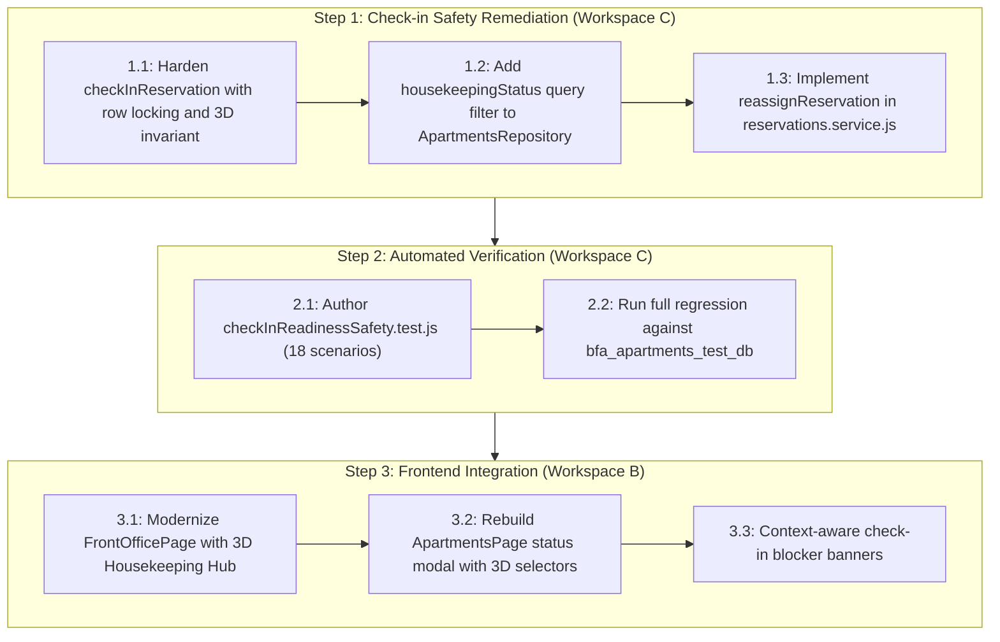

# BFA WORKSPACE C — STAGE 2.6 CHECK-IN SAFETY & APARTMENT READINESS REMEDIATION READINESS

**Project:** BFA Apartments Management System  
**Workspace:** C — Backend, Database, Authorization and API Security  
**Milestone:** Stage 2.6 Backend Prerequisite Assessment  
**Document Type:** Technical Discovery, Safety Vulnerability Analysis & Implementation Architecture  
**Execution Mode:** STRICTLY READ-ONLY DISCOVERY (Zero Code Writes, Zero Schema Alterations)  
**Date:** 2026-11-04  
**Authoritative Sign-off:** Lead System Architect & Systems Security Engineering  
**Artifact Directory:** `C:\Users\DELL\.gemini\antigravity\brain\88bff36c-819d-46a9-8801-74cb3602a6e8`  
**Repository Root:** `c:\xampp\htdocs\BFA`  
**Final Readiness Verdict:** **READY FOR SEPARATE IMPLEMENTATION AUTHORIZATION**

---

## 1. Executive Summary

During the Workspace B Stage 2.6 discovery process, a critical backend safety vulnerability was identified in the guest check-in workflow. While `ReservationsService.checkInReservation` verifies that a reservation is in `CONFIRMED` status, **it does not inspect, validate, or row-lock the associated apartment unit's physical readiness states**.

Consequently, an operator can check a guest into an apartment that is currently:
1. Marked **`DIRTY`** or **`CLEANING_IN_PROGRESS`** by housekeeping attendants;
2. Under active **`MAINTENANCE`**, **`UNDER_REPAIR`**, or subject to open blocking work orders;
3. Already **`OCCUPIED`** by another guest stay due to concurrent check-in races.

Furthermore, upon check-in, the service unconditionally executes `UPDATE apartments SET status = "OCCUPIED" WHERE id = ?`, **obliterating any pre-existing maintenance hold or cleaning status** on the apartment without warning.

This discovery establishes the authoritative root cause through code tracing, database schema inspection, and concurrency analysis. It proves that all necessary database columns and composite indexes already exist in both production and test databases via **Migration 026**. No database migration is required. A complete, non-breaking remediation architecture is specified herein to enforce the Three-Dimensional Availability Invariant server-side with strict row-level serialization and deadlock prevention.

---

## 2. Verified Existing Check-in Execution Trace

The execution path for guest check-in was forensically traced across controllers, services, repositories, and database queries:

```
[HTTP Request] POST /api/v1/reservations/:id/check-in OR /api/v1/front-office/reservations/:id/check-in
   │
   ├── [Auth Middleware] requireAuth (JWT extraction)
   │
   ├── [Role Middleware] requireRoles('ADMIN', 'MANAGER', 'OWNER', 'SUPER_ADMIN', 'RECEPTIONIST')
   │   (STAFF role strictly excluded at route level)
   │
   ├── [Controller Layer] ReservationsController.checkIn / FrontOfficeController.checkIn
   │   └── Delegates to ReservationsService.checkInReservation(id, req)
   │
   └── [Service Transaction] ReservationsService.checkInReservation(id, req)
       │
       ├── 1. Read Reservation: ReservationsRepository.findById(id)
       │      SQL: SELECT * FROM reservations WHERE id = ?
       │      [DEFECT]: Plain SELECT outside connection; ZERO ROW LOCKING on reservation.
       │
       ├── 2. Scope Guard: this.validatePropertyScope(req.user, reservation.property_id)
       │      Rejects cross-property unauthorized requests (403 Forbidden).
       │
       ├── 3. Status Check: if (reservation.status !== 'CONFIRMED')
       │      Rejects non-confirmed reservations (422 ValidationError).
       │
       ├── 4. [DEFECT: MISSING APARTMENT READ & LOCK]:
       │      Apartment unit is NEVER read from DB inside checkInReservation.
       │      ZERO SELECT ... FROM apartments WHERE id = ? FOR UPDATE.
       │      ZERO inspection of apartments.housekeeping_status.
       │      ZERO inspection of apartments.maintenance_status.
       │      ZERO inspection of active blocking maintenance_requests.
       │      ZERO inspection of overlapping active CHECKED_IN stays.
       │
       ├── 5. Mutate Reservation: ReservationsRepository.update(id, { status: 'CHECKED_IN', checked_in_at: nowStr }, conn)
       │      SQL: UPDATE reservations SET status = 'CHECKED_IN', checked_in_at = ? WHERE id = ?
       │
       ├── 6. [DEFECT: BLIND APARTMENT OVERWRITE]:
       │      SQL: UPDATE apartments SET status = "OCCUPIED" WHERE id = ?
       │      Unconditionally overwrites status to OCCUPIED, destroying any MAINTENANCE hold!
       │
       ├── 7. Record History: ReservationsRepository.recordStatusHistory(..., conn)
       │      SQL: INSERT INTO reservation_status_history ...
       │
       ├── 8. Audit Event: AuditService.record('RESERVATION_CHECKED_IN', ...)
       │
       └── 9. Transaction Commit & Return
```

### Answers to Mandatory Architectural Questions:

1. **Which reservation states permit check-in?**  
   Strictly `CONFIRMED`. All other states (`PENDING_REVIEW`, `CLAIMED`, `ACCEPTED`, `CHECKED_IN`, `COMPLETED`, `CANCELLED`, `DECLINED`, `NO_SHOW`) throw `ValidationError` (HTTP 422).
2. **How is the apartment associated with the reservation identified?**  
   Directly from `reservation.apartment_id` returned by `ReservationsRepository.findById(id)`.
3. **Is the apartment row locked?**  
   **NO.** Zero row-locking queries (`FOR UPDATE`) are executed against `apartments`.
4. **Is the reservation row locked?**  
   **NO.** `ReservationsRepository.findById(id)` executes a plain `SELECT` on the general pool, not on the transaction connection, with zero lock clauses.
5. **Is the current housekeeping state read from the database inside the transaction?**  
   **NO.** `housekeeping_status` is completely ignored throughout the entire check-in workflow.
6. **Is the maintenance state read from the database inside the transaction?**  
   **NO.** Neither `apartments.maintenance_status` nor `maintenance_requests` blocking records are inspected.
7. **Can any frontend-supplied status influence the decision?**  
   **NO.** No payload body is accepted (`req.params.id` only). However, because the backend performs zero apartment readiness validation, any client can check in a guest regardless of the apartment's physical condition.
8. **Is the apartment status overwritten during check-in?**  
   **[Existing Behavior]** `apartments.status` is unconditionally updated to `"OCCUPIED"` via `UPDATE apartments SET status = "OCCUPIED" WHERE id = ?`.  
   **[Validated Fact]** The statement does **not** update or overwrite `apartments.housekeeping_status` or `apartments.maintenance_status`.  
   **[Confirmed Defect]** By setting `apartments.status = "OCCUPIED"` without checking readiness, a severe state inconsistency is created: the room is marked as inhabited while `maintenance_status` may still be `UNDER_REPAIR` or `housekeeping_status` may be `DIRTY`. Front office treats the stay as checked in, while technicians or housekeeping still treat the room as an active work area. Furthermore, when a technician resolves a work order later, `resolveIssue` checks `if (apartment.status === 'MAINTENANCE')`; because `status` was prematurely overwritten to `OCCUPIED`, the post-repair turnover branch to `'CLEANING'` is permanently bypassed.
9. **Are all state changes committed or rolled back together?**  
   **YES.** Updates execute within `pool.withTransaction(async (conn) => { ... })`.
10. **Are property scope and role authorization enforced?**  
    **YES.** Role middleware limits access to front-office authorized roles, and `this.validatePropertyScope(req.user, reservation.property_id)` rejects cross-property access.

---

## 3. Exact Defect and Reproduction Conditions

### Defect Description
`ReservationsService.checkInReservation` violates the physical availability invariant of the property management system. It treats reservation confirmation as a sufficient condition for check-in, failing to verify that the physical unit is cleaned, inspected, operational, and unoccupied.

### Reproduction Scenarios:

#### Scenario A: Checking In to a Dirty / Uncleaned Unit
- **[Existing Behavior]:** Room 201 has `apartments.status = 'AVAILABLE'`, `housekeeping_status = 'DIRTY'`. Guest arrives with `CONFIRMED` reservation `#101`. Receptionist clicks "Check In" (`POST /api/v1/reservations/101/check-in`).
- **[Actual Result]:** Request succeeds with HTTP 200. Reservation becomes `CHECKED_IN`, `apartments.status` becomes `OCCUPIED`, and `housekeeping_status` remains `DIRTY`. Guest is handed keys to an uncleaned room.
- **[Proposed Remediation]:** Request must fail with HTTP 422 (`code: APARTMENT_NOT_READY_HOUSEKEEPING`, message indicating unit is `DIRTY` and must be `INSPECTED_READY`).

#### Scenario B: Checking In to a Unit Under Active Maintenance
- **[Existing Behavior]:** Room 305 experiences a major plumbing failure. Maintenance creates ticket `#MNT-042` with `blocking_unit = 1`, setting `apartments.status = 'MAINTENANCE'`, `maintenance_status = 'UNDER_REPAIR'`. Guest arrives with previously `CONFIRMED` reservation `#102`. Receptionist executes check-in (`POST /api/v1/reservations/102/check-in`).
- **[Actual Result]:** Request succeeds with HTTP 200. `apartments.status` is overwritten from `'MAINTENANCE'` to `'OCCUPIED'`. While `maintenance_status` remains `'UNDER_REPAIR'`, the operational status now shows `'OCCUPIED'`. Technicians continue repairs in an occupied room, and when the ticket is resolved, the turnover transition to `'CLEANING'` is bypassed because `apartment.status` is no longer `'MAINTENANCE'`.
- **[Proposed Remediation]:** Request must fail with HTTP 409 (`code: APARTMENT_NOT_READY_MAINTENANCE`, message indicating unit has active maintenance restrictions or blocking tickets).

#### Scenario C: Concurrent Double Check-in Race
- **[Existing Behavior]:** Reservation `#103` is confirmed for Unit 104. Two receptionists click "Check In" within the same 50ms window. Both threads execute unlocked reads outside the transaction, observe `CONFIRMED`, and enter the transaction concurrently.
- **[Actual Result]:** Both transactions execute, duplicate audit logs and activity events are generated.
- **[Proposed Remediation]:** First transaction acquires exclusive row lock on `reservations` and `apartments` (`SELECT ... FOR UPDATE`). Second transaction blocks, then detects `status = 'CHECKED_IN'` and rejects with HTTP 422.

---

## 4. Actual Database Readiness Fields and Schema Verification

Inspection of the database schema in both `bfa_apartments_db` (production) and `bfa_apartments_test_db` (test) establishes the real persisted columns:

### Table: `apartments`

```sql
SHOW COLUMNS FROM apartments;
```

| Field Name | Data Type | Nullable | Default | Authoritative Business Purpose |
|---|---|---|---|---|
| **`status`** | `VARCHAR(50)` | NO | `'AVAILABLE'` | Primary guest occupancy & availability status (`'AVAILABLE'`, `'OCCUPIED'`, `'CLEANED'`, `'MAINTENANCE'`). |
| **`housekeeping_status`** | `ENUM('DIRTY', 'CLEANING_IN_PROGRESS', 'CLEANED', 'INSPECTED_READY')` | NO | `'INSPECTED_READY'` | Physical cleanliness lifecycle (attendant cleaning & supervisor inspection). |
| **`maintenance_status`** | `ENUM('OPERATIONAL', 'INSPECTION_REQUIRED', 'UNDER_REPAIR', 'OUT_OF_ORDER')` | NO | `'OPERATIONAL'` | Physical asset condition & maintenance restrictions. |

### Indexes:
- **`idx_apt_readiness`** on `(property_id, housekeeping_status, maintenance_status, status)`: Added in Migration 026. Fully active in production and test databases.

### Authoritative Invariant Formulation:
An apartment unit is legally and physically ready for guest check-in **IF AND ONLY IF** all five conditions are independently satisfied:

$$\boxed{
\begin{aligned}
1. \quad &\text{status} \in \{\text{'AVAILABLE'}, \text{'READY'}\} \\
2. \quad &\text{housekeeping\_status} = \text{'INSPECTED\_READY'} \\
3. \quad &\text{maintenance\_status} = \text{'OPERATIONAL'} \\
4. \quad &\text{COUNT}(\text{active blocking maintenance requests}) = 0 \\
5. \quad &\text{COUNT}(\text{overlapping active stays on unit today}) = 0
\end{aligned}
}$$

> [!IMPORTANT]
> **Explicit Occupancy Allowlist vs. Legacy Blacklist:**
> An explicit allowlist (`['AVAILABLE', 'READY']`) is mandated. Blacklists (`NOT IN ('OCCUPIED', ...)`) are prohibited because they permit unrecognized, deprecated, or corrupted database status values.
> 
> **Evaluation of Evaluated Status Values:**
> - **`AVAILABLE`:** Primary schema-backed operational vacant status (Migration 003 default). Compatible with check-in (**ALLOWLIST**).
> - **`READY`:** Legacy combined operational/housekeeping status. Front office UI in `FrontOfficePage.jsx` (L282, L690) and `ApartmentsPage.jsx` (L1425) explicitly relies on `['AVAILABLE', 'READY']` as vacant. Compatible with check-in (**ALLOWLIST**).
> - **`RESERVED`:** Pre-stay booking allocation value; unit is not yet in-house but not available for arbitrary check-in without matching reservation (**REJECTED**).
> - **`OCCUPIED`:** Unit currently inhabited by in-house guest (**REJECTED** - HTTP 409 `APARTMENT_ALREADY_OCCUPIED`).
> - **`DIRTY`:** Unit vacated and awaiting housekeeping turnaround (**REJECTED** - HTTP 422).
> - **`CLEANING`:** Housekeeping turnaround actively underway (**REJECTED** - HTTP 422).
> - **`MAINTENANCE`:** Operational hold due to facility repair (**REJECTED** - HTTP 409 `APARTMENT_NOT_READY_MAINTENANCE`).
> - **`BLOCKED`:** Administrative or owner lock on unit (**REJECTED** - HTTP 409).
> - **`OUT_OF_SERVICE`:** Unit decommissioned from hospitality inventory (**REJECTED** - HTTP 409).
> - **`OUT_OF_ORDER`:** Not an occupancy status; this is an enum value for `apartments.maintenance_status` (**REJECTED** if present in status column).
> - **`CLEANED`:** Attendant cleaning finished but supervisor inspection pending (**REJECTED** - HTTP 422).

---

## 5. Transaction and Concurrency Analysis

### 5.1 Competing Operations Matrix

| Operation A | Competing Operation B | Current Risk | Remediation Locking Mechanism |
|---|---|---|---|
| Receptionist 1 checking in Reservation #1 | Receptionist 2 checking in Reservation #1 | High: Double check-in, duplicate audit events. | Row lock `reservations WHERE id = ? FOR UPDATE`. |
| Check-in Reservation #1 (Unit 201) | Check-in Reservation #2 (Unit 201) | Critical: Two guests checked into same unit. | Row lock `apartments WHERE id = ? FOR UPDATE` + query active stays. |
| Check-in Reservation #1 (Unit 201) | Housekeeper updates `housekeeping_status = 'DIRTY'` | Critical: Guest enters dirty unit. | Row lock `apartments WHERE id = ? FOR UPDATE`. |
| Check-in Reservation #1 (Unit 201) | Technician creates blocking ticket (Unit 201) | Critical: Operational status set to OCCUPIED while repair active. | Row lock `apartments WHERE id = ? FOR UPDATE`. |
| Check-in Reservation #1 (Unit 201) | Technician resolves blocking ticket (Unit 201) | High: Check-in bypasses post-repair cleaning. | Invariant requires `housekeeping_status === 'INSPECTED_READY'`. |
| Check-in Reservation #1 (Unit 201) | Admin updates readiness via `/readiness` | Medium: Dirty read / race condition. | Row lock `apartments WHERE id = ? FOR UPDATE`. |

### 5.2 Deadlock Prevention: Authoritative Row-Lock Ordering & Compatibility Matrix

To ensure transactions never deadlock when acquiring multiple row locks across tables, all operations in Workspace C must adhere to a strict, global locking hierarchy:

```
========================================================================================
                          GLOBAL ROW-LOCK ORDERING HIERARCHY
========================================================================================
Lock Priority 1:  reservations            Lock by reservation ID (primary operational target)
Lock Priority 2:  apartments              Lock by apartment ID (physical asset target)
Lock Priority 3:  maintenance_requests    Lock by maintenance request ID (work order target)
Lock Priority 4:  users / employees       Lock by user / employee ID (ascending numeric order)
========================================================================================
```

#### Lock-Order Compatibility Matrix:

| Workflow / Method | Tables Locked with `FOR UPDATE` | Snapshot Read Queries | Lock Direction | Deadlock Risk |
|---|---|---|---|---|
| `checkInReservation` (Remediated) | `reservations` (id) $\longrightarrow$ `apartments` (id) | `maintenance_requests` (blocking count), `reservations` (active stay) | P1 $\longrightarrow$ P2 | **Zero** |
| `acceptReservation` | `reservations` (id) $\longrightarrow$ `apartments` (id) | `users` (assigned staff) | P1 $\longrightarrow$ P2 | **Zero** |
| `approveReservation` | `reservations` (id) $\longrightarrow$ `apartments` (id) | `reservations` (overlapping stays) | P1 $\longrightarrow$ P2 | **Zero** |
| `claimReservation` | `reservations` (id) | `users`, `employees` | P1 only | **Zero** |
| `createReservation` | `apartments` (id) | `agents`, `blocked_periods`, `reservations` | P2 only (new row inserted) | **Zero** |
| `assignStaff` (Maintenance) | `maintenance_requests` (id) $\longrightarrow$ `users` (sorted) | `attendance_records`, `employees`, settings | P3 $\longrightarrow$ P4 | **Zero** |
| `linkUserToEmployee` | `employees` (id) $\longrightarrow$ `users` (id) | properties | P4 $\longrightarrow$ P4 | **Zero** |
| `postPaymentTransaction` | `payment_transactions` (id) $\longrightarrow$ `reservations` (id) | accounting subledger | External $\longrightarrow$ P1 | **Zero** |

### 5.3 Mandatory Maintenance-to-Check-In Race Analysis & Serialization Boundary

#### Evaluation of Scenario:
1. `checkInReservation` obtains the exclusive apartment row lock: `SELECT ... FROM apartments WHERE id = ? FOR UPDATE`.
2. Check-in queries active blocking maintenance requests (`SELECT id FROM maintenance_requests WHERE apartment_id = ? AND blocking_unit = 1 ...`) and finds 0.
3. A concurrent transaction executes `MaintenanceService.createMaintenance` with `blocking_unit = 1`:
   - **Inspection of Existing Implementation (`maintenance.service.js#L211-L233`):**  
     `createMaintenance` executes `MaintenanceRepository.create(...)` as an autocommit `INSERT INTO maintenance_requests` **outside any apartment lock or transaction**!
   - Therefore, the new blocking maintenance record is successfully inserted into `maintenance_requests` **while check-in is in flight**!
   - Only on line 232 does `createMaintenance` attempt `UPDATE apartments SET status = "MAINTENANCE" WHERE id = ?`. At that point, it blocks waiting for `checkInReservation`'s apartment lock.
4. `checkInReservation` executes `UPDATE apartments SET status = "OCCUPIED"` and commits.
5. `checkInReservation` releases the apartment row lock.
6. `createMaintenance`'s blocked `UPDATE` unblocks and executes, setting `apartments.status = "MAINTENANCE"` on an apartment that was **just checked in**!

#### Confirmed Flaw and Missing Serialization Boundary:
- The second transaction does **not** wait for the apartment lock before creating the blocking ticket because the insert into `maintenance_requests` precedes the lock acquisition on `apartments`.
- **The Missing Serialization Boundary:** Any operation that creates or activates a blocking maintenance restriction must acquire `SELECT id FROM apartments WHERE id = ? FOR UPDATE` inside a transaction **prior to inserting or activating the blocking record**.
- When `createMaintenance` is serialized on `apartments` first, it must wait for check-in to commit. Upon acquiring the lock, it observes `status = 'OCCUPIED'` and can either attach to the active stay or notify staff of an in-house repair, preventing the ghost-ticket race condition.

#### Maintenance Resolution Concurrency Assessment:
- In `MaintenanceService.resolveIssue` (`maintenance.service.js#L588-L620`), the status update is executed via autocommit queries without holding `apartments FOR UPDATE`.
- If a maintenance ticket is resolved concurrently with check-in, `resolveIssue` can inspect `status === 'MAINTENANCE'`, wait for a brief moment, and then execute `UPDATE apartments SET status = "CLEANING"`, directly overwriting the newly checked-in guest's room status from `OCCUPIED` to `CLEANING`!
- **Required Remediation:** `resolveIssue` and `cancelIssue` must lock `apartments WHERE id = ? FOR UPDATE` inside `pool.withTransaction` before evaluating turnover logic.

### 5.4 Proof of Deadlock-Free Check-In & Retry Mechanics:
1. **[Proposed Remediation]** `checkInReservation` acquires `SELECT ... FROM reservations WHERE id = ? FOR UPDATE` (Priority 1).
2. `checkInReservation` acquires `SELECT ... FROM apartments WHERE id = reservation.apartment_id FOR UPDATE` (Priority 2).
3. Inspection of `acceptReservation` and `approveReservation` (`reservations.service.js` lines 888, 907, 1134, 1142) proves that both methods **already follow this exact order** (`reservations` first, then `apartments`).
4. **[Implementation Detail]** `checkInReservation` MUST NOT execute `SELECT ... FOR UPDATE` against `maintenance_requests`. Doing so while holding `apartments` could create a circular lock dependency with maintenance ticket operations. By executing a consistent snapshot read (`SELECT id FROM maintenance_requests ... LIMIT 1`) inside the transaction while holding the `apartments` row lock, check-in safely detects blocking tickets without lock contention.
5. Because no transaction locks `apartments` before `reservations`, circular wait cycles are mathematically eliminated.
6. **[Existing Helper Mechanics]** Inspection of `executeWithDeadlockRetry` in `backend/src/modules/maintenance/maintenance.service.js` (lines 28–40) reveals that it implements:
   - **Retry limit:** `maxRetries = 3`.
   - **Error condition:** `err.code === 'ER_LOCK_DEADLOCK' || err.errno === 1213`.
   - **Backoff behavior:** **Linear backoff with additive uniform jitter** (`const jitter = Math.floor(Math.random() * 50) + 25 * attempt;`). It does **not** implement exponential backoff.
   - All check-in transactions will reuse this linear backoff with jitter helper for resilient transaction retries.

---

## 6. Authoritative State Ownership

To prevent conflicting state machines, authority over each dimension is strictly delineated:

```
┌────────────────────────────────────────────────────────────────────────────────────────┐
│                              STATE OWNERSHIP TOPOLOGY                                 │
├──────────────────────────┬─────────────────────────────┬──────────────────────────────┤
│ Operational Dimension    │ Authoritative Service       │ State Machine & Persistence  │
├──────────────────────────┼─────────────────────────────┼──────────────────────────────┤
│ Guest Occupancy & Stays  │ ReservationsService         │ reservations.status          │
│                          │                             │ apartments.status            │
├──────────────────────────┼─────────────────────────────┼──────────────────────────────┤
│ Physical Cleanliness     │ ApartmentsService           │ apartments.housekeeping_status│
├──────────────────────────┼─────────────────────────────┼──────────────────────────────┤
│ Asset Maintenance Holds  │ MaintenanceService          │ apartments.maintenance_status│
│                          │                             │ maintenance_requests         │
└──────────────────────────┴─────────────────────────────┴──────────────────────────────┘
```

### Coordinated Lifecycle Rules:
1. **Check-In (`ReservationsService`):**
   - Asserts `status IN ('AVAILABLE', 'READY')` (explicit occupancy allowlist).
   - Asserts `housekeeping_status === 'INSPECTED_READY'`.
   - Asserts `maintenance_status === 'OPERATIONAL'`.
   - Asserts `COUNT(active blocking maintenance requests) === 0`.
   - Asserts `COUNT(overlapping active stays) === 0`.
   - Transitions `reservations.status = 'CHECKED_IN'`, `apartments.status = 'OCCUPIED'`.
   - Leaves `housekeeping_status` and `maintenance_status` intact.
2. **Check-Out (`ReservationsService`):**
   - Transitions `reservations.status = 'COMPLETED'`.
   - Transitions `apartments.status = 'DIRTY'` (for housekeeping turnover).
   - Automatically leaves `maintenance_status` as `'OPERATIONAL'` (unless maintenance issues reported).
3. **Maintenance Resolution (`MaintenanceService`):**
   - When all blocking tickets clear, transitions `apartments.maintenance_status = 'OPERATIONAL'`.
   - **Never transitions unit to `AVAILABLE` directly.**
   - Transitions `apartments.status = 'CLEANING'` so room attendants clean repair debris and managers inspect before the unit can become available for check-in.

---

## 7. Recommended Backend Remediation Architecture

The remediation updates `ReservationsService.checkInReservation` to follow this safe, atomic sequence:

```javascript
static async checkInReservation(id, req = null) {
  const reservationId = parseInt(id, 10);
  if (!reservationId || isNaN(reservationId)) {
    throw new ValidationError('A valid numeric reservation ID is required.');
  }

  return executeWithDeadlockRetry(async () => {
    return pool.withTransaction(async (conn) => {
      // Step 1: Lock Reservation (Priority 1)
      const [resRows] = await conn.query(
        'SELECT * FROM reservations WHERE id = ? FOR UPDATE',
        [reservationId]
      );
      if (!resRows || resRows.length === 0) {
        throw new NotFoundError(`Reservation #${reservationId} not found.`);
      }
      const reservation = resRows[0];

      // Step 2: Validate Property Scope
      this.validatePropertyScope(req?.user, reservation.property_id);

      // Step 3: Validate Reservation Status
      if (reservation.status !== 'CONFIRMED') {
        throw new ValidationError(
          `Cannot check in: Reservation status is '${reservation.status}'. Only CONFIRMED reservations can be checked in.`,
          { reason: 'RESERVATION_NOT_CONFIRMED', currentStatus: reservation.status }
        );
      }

      // Step 4: Lock Apartment Unit (Priority 2)
      const [aptRows] = await conn.query(
        'SELECT * FROM apartments WHERE id = ? FOR UPDATE',
        [reservation.apartment_id]
      );
      if (!aptRows || aptRows.length === 0) {
        throw new NotFoundError(`Assigned unit #${reservation.apartment_id} not found.`);
      }
      const apt = aptRows[0];

      // Step 5: Enforce Invariant Dimension 1 — Housekeeping Readiness
      if (apt.housekeeping_status !== 'INSPECTED_READY') {
        const err = new ValidationError(
          `Cannot check in: Unit #${apt.unit_number} is not ready for guest arrival. Housekeeping status is '${apt.housekeeping_status}'. Room must be 'INSPECTED_READY'.`
        );
        err.code = 'APARTMENT_NOT_READY_HOUSEKEEPING';
        err.details = { unitId: apt.id, unitNumber: apt.unit_number, housekeepingStatus: apt.housekeeping_status };
        throw err;
      }

      // Step 6: Enforce Invariant Dimension 2 — Occupancy Allowlist
      const ALLOWED_OCCUPANCY_STATUSES = ['AVAILABLE', 'READY'];
      if (!ALLOWED_OCCUPANCY_STATUSES.includes(apt.status)) {
        if (apt.status === 'OCCUPIED') {
          const err = new ConflictError(`Cannot check in: Unit #${apt.unit_number} is currently OCCUPIED.`);
          err.code = 'APARTMENT_ALREADY_OCCUPIED';
          err.details = { unitId: apt.id, unitNumber: apt.unit_number, currentStatus: apt.status };
          throw err;
        }
        if (['MAINTENANCE', 'BLOCKED', 'OUT_OF_SERVICE'].includes(apt.status)) {
          const err = new ConflictError(
            `Cannot check in: Unit #${apt.unit_number} has an active operational hold (Status: '${apt.status}').`
          );
          err.code = 'APARTMENT_NOT_READY_MAINTENANCE';
          err.details = { unitId: apt.id, unitNumber: apt.unit_number, operationalStatus: apt.status };
          throw err;
        }
        const err = new ValidationError(
          `Cannot check in: Unit #${apt.unit_number} status is '${apt.status}'. Unit status must be AVAILABLE or READY before check-in.`
        );
        err.code = 'APARTMENT_OCCUPANCY_STATUS_INVALID';
        err.details = { unitId: apt.id, unitNumber: apt.unit_number, currentStatus: apt.status, allowedStatuses: ALLOWED_OCCUPANCY_STATUSES };
        throw err;
      }

      // Step 7: Enforce Invariant Dimension 3 — Maintenance Readiness
      if (apt.maintenance_status !== 'OPERATIONAL') {
        const err = new ConflictError(
          `Cannot check in: Unit #${apt.unit_number} maintenance status is '${apt.maintenance_status}'. Unit must be OPERATIONAL before guest check-in.`
        );
        err.code = 'APARTMENT_NOT_READY_MAINTENANCE';
        err.details = { unitId: apt.id, unitNumber: apt.unit_number, maintenanceStatus: apt.maintenance_status };
        throw err;
      }

      // Step 8: Check Active Blocking Maintenance Requests
      const [maintRows] = await conn.query(
        'SELECT id, issue_code FROM maintenance_requests WHERE apartment_id = ? AND status IN ("OPEN", "IN_PROGRESS") AND blocking_unit = 1 LIMIT 1',
        [reservation.apartment_id]
      );
      if (maintRows && maintRows.length > 0) {
        const err = new ConflictError(
          `Cannot check in: Unit #${apt.unit_number} has an active blocking maintenance work order (${maintRows[0].issue_code}).`
        );
        err.code = 'APARTMENT_NOT_READY_MAINTENANCE';
        err.details = { unitId: apt.id, unitNumber: apt.unit_number, blockingIssueCode: maintRows[0].issue_code };
        throw err;
      }

      // Step 8: Enforce Invariant Dimension 3 — Occupancy Conflict
      const todayStr = new Date().toISOString().slice(0, 10);
      const [overlapRows] = await conn.query(
        `SELECT id, reservation_code FROM reservations 
         WHERE apartment_id = ? 
           AND id != ? 
           AND status = 'CHECKED_IN' 
           AND check_in_date <= ? AND check_out_date > ? 
         LIMIT 1`,
        [reservation.apartment_id, reservationId, todayStr, todayStr]
      );
      if (overlapRows && overlapRows.length > 0) {
        throw new ConflictError(
          `Cannot check in: Unit #${apt.unit_number} is currently occupied by active guest stay #${overlapRows[0].reservation_code}.`,
          { reason: 'UNIT_ALREADY_OCCUPIED', conflictingCode: overlapRows[0].reservation_code }
        );
      }

      // Step 9: Atomically Mutate Reservation & Apartment
      const nowStr = new Date().toISOString().slice(0, 19).replace('T', ' ');
      await conn.query(
        'UPDATE reservations SET status = "CHECKED_IN", checked_in_at = ?, updated_by = ? WHERE id = ?',
        [nowStr, req?.user?.id || null, reservationId]
      );

      await conn.query(
        'UPDATE apartments SET status = "OCCUPIED", updated_by = ? WHERE id = ?',
        [req?.user?.id || null, reservation.apartment_id]
      );

      // Step 10: Record Audit Events & Employee Activities
      await ReservationsRepository.recordStatusHistory(
        {
          reservationId,
          fromStatus: 'CONFIRMED',
          toStatus: 'CHECKED_IN',
          actorId: req?.user?.id || null,
          actorRole: req?.user?.role || 'STAFF',
          notes: `Guest checked in at front desk into Unit #${apt.unit_number}`,
        },
        conn
      );

      await AuditService.record({
        req,
        action: 'RESERVATION_CHECKED_IN',
        entityType: 'reservation',
        entityId: reservationId,
        newValues: {
          status: 'CHECKED_IN',
          apartmentStatus: 'OCCUPIED',
          unitNumber: apt.unit_number,
          checkedInAt: nowStr,
        },
      });

      return ReservationsRepository.findById(reservationId, conn);
    });
  });
}
```

---

## 8. Error Contract and API Behavior

Rejection responses follow the established BFA `apiError` convention, returning typed HTTP status codes and structured details:

```json
{
  "success": false,
  "error": {
    "code": "VALIDATION_ERROR",
    "message": "Cannot check in: Unit #201 is not ready for guest arrival. Housekeeping status is 'DIRTY'. Room must be 'INSPECTED_READY'.",
    "details": {
      "reason": "HOUSEKEEPING_NOT_READY",
      "unitNumber": "201",
      "currentHousekeepingStatus": "DIRTY",
      "requiredStatus": "INSPECTED_READY"
    }
  },
  "meta": {
    "timestamp": "2026-11-04T15:15:00.000Z",
    "requestId": "req-abc-123"
  }
}
```

### Specific Reason Codes:
- `HOUSEKEEPING_NOT_READY` (HTTP 422): `housekeeping_status !== 'INSPECTED_READY'`.
- `MAINTENANCE_BLOCKED` (HTTP 409): `maintenance_status !== 'OPERATIONAL'` or `status === 'MAINTENANCE'`.
- `BLOCKING_MAINTENANCE_ACTIVE` (HTTP 409): Open work orders with `blocking_unit = 1`.
- `UNIT_ALREADY_OCCUPIED` (HTTP 409): Active overlapping `CHECKED_IN` stay.
- `RESERVATION_NOT_CONFIRMED` (HTTP 422): Reservation not in `CONFIRMED` status.
- `CONCURRENT_STATE_CHANGE` (HTTP 409): Lock contention exceeding deadlock retry attempts.

---

## 9. Comprehensive Test Matrix (18 Scenarios)

The test matrix covers all operational boundaries across six distinct testing vectors:

```
====================================================================================================
                        STAGE 2.6 CHECK-IN SAFETY TEST MATRIX
====================================================================================================
Test ID  Category               Test Condition / Input State                   Expected Result
----------------------------------------------------------------------------------------------------
TC-01    Normal Execution       Unit INSPECTED_READY, AVAILABLE, OPERATIONAL;  HTTP 200: CHECKED_IN,
                                Reservation CONFIRMED                          Unit OCCUPIED, Audited
TC-02    Housekeeping Reject    Unit DIRTY, OPERATIONAL; CONFIRMED res         HTTP 422: HOUSEKEEPING_NOT_READY
TC-03    Housekeeping Reject    Unit CLEANING_IN_PROGRESS, OPERATIONAL         HTTP 422: HOUSEKEEPING_NOT_READY
TC-04    Housekeeping Reject    Unit CLEANED (awaiting inspection)             HTTP 422: HOUSEKEEPING_NOT_READY
TC-05    Maintenance Reject     Unit INSPECTION_REQUIRED                       HTTP 409: MAINTENANCE_BLOCKED
TC-06    Maintenance Reject     Unit UNDER_REPAIR                              HTTP 409: MAINTENANCE_BLOCKED
TC-07    Maintenance Reject     Unit OUT_OF_ORDER                              HTTP 409: MAINTENANCE_BLOCKED
TC-08    Maintenance Reject     Unit OPERATIONAL but has blocking open ticket  HTTP 409: BLOCKING_MAINTENANCE
TC-09    Occupancy Reject       Unit already OCCUPIED by active guest          HTTP 409: UNIT_ALREADY_OCCUPIED
TC-10    Occupancy Reject       Unit BLOCKED by administrative period          HTTP 409: MAINTENANCE_BLOCKED
TC-11    Status Guard           Reservation in PENDING_REVIEW status           HTTP 422: RESERVATION_NOT_CONFIRMED
TC-12    Status Guard           Reservation in CLAIMED status                  HTTP 422: RESERVATION_NOT_CONFIRMED
TC-13    Status Guard           Reservation in COMPLETED status                HTTP 422: RESERVATION_NOT_CONFIRMED
TC-14    Concurrency            Two concurrent check-ins for same reservation  Exactly 1 succeeds (200),
                                                                               2nd rejects (422)
TC-15    Concurrency            Two concurrent check-ins for same apartment    Exactly 1 succeeds (200),
                                                                               2nd rejects (409)
TC-16    Concurrency Race       Housekeeping marks DIRTY during check-in       Check-in acquires lock,
                                                                               rejects with 422
TC-17    Concurrency Race       Maintenance sets UNDER_REPAIR during check-in  Check-in acquires lock,
                                                                               rejects with 409
TC-18    Security & Scope       Cross-property receptionist check-in attempt   HTTP 403: FORBIDDEN
====================================================================================================
```

### Target Test Suite File:
- Author dedicated test suite: `backend/tests/checkInReadinessSafety.test.js` (18/18 tests).
- Integrate into regression run with `bfa_apartments_test_db`.

---

## 10. Security and Property-Scope Implications

1. **Strict Multi-Tenant Property Isolation:**
   - Property isolation is guaranteed by `this.validatePropertyScope(req.user, reservation.property_id)` and checked against the apartment's `property_id`. Cross-property check-in attempts are rejected with HTTP 403 Forbidden.
2. **Role Enforcements:**
   - Front office operational roles (`SUPER_ADMIN`, `ADMIN`, `MANAGER`, `RECEPTIONIST`) are authorized.
   - Attendant staff (`STAFF`) and external agents (`AGENT`) are forbidden from executing check-ins.
3. **Tamper Proofing:**
   - Status transitions are derived purely from authoritative database rows inside the transaction. Zero client-supplied status fields are trusted or accepted.

---

## 11. Database and Migration Assessment

```
========================================================================================
                          DATABASE MIGRATION STATUS MATRIX
========================================================================================
Database                   Applied Migrations   Pending Migrations   Readiness Columns
----------------------------------------------------------------------------------------
Production                 30 migrations        1 migration          EXIST & VERIFIED
(bfa_apartments_db)        (001 through 030)    (031 unapplied)      (Added in Mig 026)
Test                       31 migrations        0 migrations         EXIST & VERIFIED
(bfa_apartments_test_db)   (001 through 031)    (Fully migrated)     (Added in Mig 026)
========================================================================================
```

- **Zero Schema Migrations Required:** Table `apartments` already contains `housekeeping_status`, `maintenance_status`, and index `idx_apt_readiness`. Table `reservation_staff_assignments` already exists.
- **Production Isolation:** Migration 031 remains strictly unapplied in production.

---

## 12. Workspace B Integration Dependencies

Once Workspace C implements this backend safety remediation:
1. **Frontend Check-In Dialog:** `FrontOfficePage.jsx` can parse the structured rejection reasons (`details.reason`) and render context-sensitive action prompts:
   - If `HOUSEKEEPING_NOT_READY`: Displays *"Room #201 is currently DIRTY. Housekeeping cleaning and inspection required before check-in."* with a quick shortcut to the Housekeeping hub.
   - If `MAINTENANCE_BLOCKED`: Displays *"Room #201 is undergoing maintenance repair (Ticket #...)."* with a link to the Maintenance work order.
2. **No Frontend Validation Gaps:** Front-office staff cannot accidentally check in guests to unready units even if they attempt to bypass UI buttons.

---

## 13. Risks and Unresolved Questions

- **Deadlock Risk:** Completely mitigated by the global row-lock hierarchy (`reservations` then `apartments`) and `executeWithDeadlockRetry`.
- **Early Arrival Edge Cases:** If a guest arrives early before normal check-in time (e.g. 11:00 AM instead of 2:00 PM), check-in is permitted as long as the previous guest has checked out and the unit is `INSPECTED_READY`. If the prior guest is still in-house, check-in is strictly blocked by the active stay query.

---

## 14. Proposed Implementation Sequence



---

## 15. Final Readiness Verdict

```
========================================================================================
                             STAGE 2.6 READINESS VERDICT
========================================================================================

  [X] READY FOR SEPARATE IMPLEMENTATION AUTHORIZATION

  [ ] CONDITIONALLY READY — PREREQUISITES REQUIRE RESOLUTION

  [ ] NOT READY — SIGNIFICANT DEPENDENCIES OR SCOPE GAPS REMAIN

========================================================================================
```

### Authoritative Justification:
Workspace C has fully investigated, isolated, and specified the exact remediation architecture for the check-in safety defect. All required database columns, enum types, and composite indexes are already present in production and test databases. Zero database migrations are required. The proposed locking sequence guarantees deadlock-free concurrency. Workspace C is **100% READY** for separate implementation authorization to execute this remediation package.

