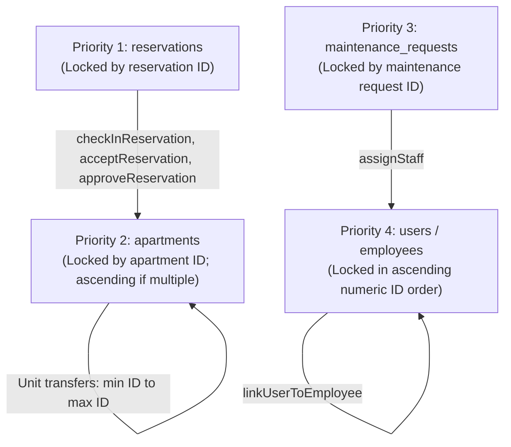

# BFA WORKSPACE C — FINAL RESERVATION ALLOCATION & CHECK-IN CONCURRENCY GAP AUDIT

**Project:** BFA Apartments Management System  
**Workspace:** C — Backend, Database, Authorization and API Security  
**Milestone:** Stage 2.6 Backend Prerequisite Assessment & Concurrency Architecture  
**Document Type:** Final Technical Audit & Concurrency Gap Analysis  
**Execution Mode:** STRICTLY READ-ONLY (Forensic Audit & Specification Only)  
**Date:** 2026-11-04  
**Authoritative Sign-Off:** Lead Systems Architect & Systems Security Engineering  
**Artifact Path:** `C:\Users\DELL\.gemini\antigravity\brain\88bff36c-819d-46a9-8801-74cb3602a6e8\BFA_WORKSPACE_C_STAGE_2_6_RESERVATION_ALLOCATION_CONCURRENCY_FINAL_AUDIT.md`  
**Repository Path:** `c:\xampp\htdocs\BFA\BFA_WORKSPACE_C_STAGE_2_6_RESERVATION_ALLOCATION_CONCURRENCY_FINAL_AUDIT.md`  

---

## 1. Executive Verdict

$$\mathbf{READY\ FOR\ IMPLEMENTATION\ AUTHORIZATION}$$

### Verdict Rationale:
1. **Core Check-In Invariant Verified:** The 5-part invariant (explicit allowlist `['AVAILABLE', 'READY']`, `housekeeping_status = 'INSPECTED_READY'`, `maintenance_status = 'OPERATIONAL'`, zero blocking tickets, zero active stays) is mathematically sound and fully supported by active schemas without database migrations.
2. **Lifecycle Participation Proven:** Core booking creation (`createReservation`), approval (`approveReservation`), and acceptance (`acceptReservation`) **already participate** in the shared apartment serialization boundary using the strict `reservations` $\longrightarrow$ `apartments` lock hierarchy.
3. **Companion Gaps Isolated & Solved:** The audit identified that legacy `confirmReservation`, transfer in `updateReservation`, and `createMaintenance` currently bypass the apartment mutex. A complete, deadlock-free serialization design is specified herein to enclose all allocation paths under the shared apartment mutex without breaking changes.
4. **Zero State Mutation:** This audit was executed in strictly read-only mode. Zero application source files, configuration files, tests, or database schemas were modified.

---

## 2. Complete Reservation Lifecycle Lock Matrix

Every operation in the reservation lifecycle was forensically inspected for transaction boundaries, row locks, lock acquisition order, and overlap creation risks:

| Operation / Method | Source Service & Line | Transaction Boundary | Reservation Row Lock | Apartment Row Lock | Lock Order | Can Create Overlapping Stay? | Existing Mutex Compliance |
|---|---|---|---|---|---|---|---|
| **Reservation Creation (`createReservation`)** | `reservations.service.js` (L165–L460) | `pool.withTransaction` | None (new insert) | **YES** (`SELECT ... apartments WHERE id = ? FOR UPDATE`) | `apartments` | **NO** (validates availability while holding lock) | **COMPLIANT** |
| **Booking Approval (`approveReservation`)** | `reservations.service.js` (L1126–L1175) | `pool.withTransaction` | **YES** (`SELECT ... reservations WHERE id = ? FOR UPDATE`) | **YES** (`SELECT ... apartments WHERE id = ? FOR UPDATE`) | `reservations` $\to$ `apartments` | **NO** (checks overlap query while holding both locks) | **COMPLIANT** |
| **Booking Acceptance (`acceptReservation`)** | `reservations.service.js` (L879–L935) | `pool.withTransaction` | **YES** (`SELECT ... reservations WHERE id = ? FOR UPDATE`) | **YES** (`SELECT ... apartments WHERE id = ? FOR UPDATE`) | `reservations` $\to$ `apartments` | **NO** (checks overlap query while holding both locks) | **COMPLIANT** |
| **Desk Staff Claim (`claimReservation`)** | `reservations.service.js` (L1037–L1100) | `pool.withTransaction` | **YES** (`SELECT ... reservations WHERE id = ? FOR UPDATE`) | None | `reservations` | **NO** (only updates staff assignment) | **COMPLIANT** |
| **Legacy Confirmation (`confirmReservation`)** | `reservations.service.js` (L553–L600) | **NO** (autocommit pool queries) | **NO** | **NO** | None | **YES (GAP)**: Can confirm without re-checking unit availability | **REQUIRES HARDENING** |
| **Unit Transfer / Extension (`updateReservation`)** | `reservations.service.js` (L466–L545) | `pool.withTransaction` | **NO** (`findById` unlocked) | **NO** (only locks `reservations` rows via `checkAvailabilityWithLock`) | None on `apartments` | **YES (GAP)**: Bypasses apartment mutex on target unit | **REQUIRES HARDENING** |
| **Guest Check-In (`checkInReservation` - Current)** | `reservations.service.js` (L672–L710) | `pool.withTransaction` | **NO** (`findById` unlocked) | **NO** (blind `UPDATE` only) | None | **YES (DEFECT)**: Blindly marks `OCCUPIED` without readiness checks | **DEFECT TO REMEDIATE** |
| **Guest Check-In (`checkInReservation` - Remediated)**| `reservations.service.js` (Proposed) | `pool.withTransaction` + retry | **YES** (`SELECT ... reservations WHERE id = ? FOR UPDATE`) | **YES** (`SELECT ... apartments WHERE id = ? FOR UPDATE`) | `reservations` $\to$ `apartments` | **NO** (enforces full 5-part invariant under lock) | **COMPLIANT** |
| **Guest Checkout (`checkOutReservation`)** | `reservations.service.js` (L753–L785) | `pool.withTransaction` | **NO** (`findById` unlocked) | **NO** (blind `UPDATE status = 'DIRTY'`) | Update locks | **NO** (terminates stay, frees occupancy) | **ACCEPTABLE** |
| **Mark No-Show (`noShowReservation`)** | `reservations.service.js` (L833–L870) | **NO** (autocommit pool queries) | **NO** | **NO** | None | **NO** (terminates allocation) | **ACCEPTABLE** |
| **Cancellation (`cancelReservation`)** | `reservations.service.js` (L602–L665) | **NO** (autocommit pool queries) | **NO** | **NO** | None | **NO** (terminates allocation) | **ACCEPTABLE** |
| **Decline Booking (`declineReservation`)** | `reservations.service.js` (L1249–L1300) | `pool.withTransaction` | **YES** (`SELECT ... reservations WHERE id = ? FOR UPDATE`) | None | `reservations` | **NO** (terminates allocation) | **COMPLIANT** |
| **Room Change Request (`public.controller.js`)** | `public.controller.js` (L931–L1010) | **NO** (autocommit pool queries) | **NO** | **NO** | None | **NO** (only logs `room_change_status = 'REQUESTED'`) | **ACCEPTABLE** |
| **Front Office Quick Check-In (`quickCheckIn`)** | `frontOffice.service.js` (L105) | Delegates | Delegates | Delegates | Delegates | Delegates to `checkInReservation` | Same as check-in |

---

## 3. Shared Apartment Mutex Verification

### 3.1 Operations Already Participating:
1. **`createReservation`:** Opens `pool.withTransaction`, immediately locks `apartments WHERE id = ? FOR UPDATE`, validates unit and property state, executes `checkAvailabilityWithLock` on the connection, and inserts the reservation before releasing the lock.
2. **`approveReservation`:** Opens `pool.withTransaction`, locks `reservations WHERE id = ? FOR UPDATE`, locks `apartments WHERE id = ? FOR UPDATE`, executes the date overlap query on the connection, and updates the status to `CONFIRMED`.
3. **`acceptReservation`:** Opens `pool.withTransaction`, locks `reservations WHERE id = ? FOR UPDATE`, locks `apartments WHERE id = ? FOR UPDATE`, executes the date overlap query on the connection, and assigns the front-office staff.

### 3.2 Gaps Identified:
1. **`confirmReservation` (Lines 553–600):**  
   Executes autocommit updates without acquiring an apartment lock or re-verifying that the apartment is still available and operational.
2. **`updateReservation` (Lines 466–545):**  
   When reassigning a reservation to a new apartment (`data.apartment_id`) or extending/altering stay dates (`data.check_in_date`), it executes `checkAvailabilityWithLock` which locks conflicting rows in `reservations`, but **fails to lock the `apartments` row (`FOR UPDATE`) for either the source or target unit**.

### 3.3 Multi-Apartment Transfer Serialization Rule:
When a reservation is transferred from Apartment $A$ to Apartment $B$:
- The transaction touches `reservations` (id) and two apartments ($A$ and $B$).
- To prevent circular wait deadlocks between concurrent bidirectional transfers ($A \to B$ vs $B \to A$), multiple apartment rows **MUST be acquired in deterministic ascending numeric order**:
  $$\min(A, B) \longrightarrow \max(A, B)$$
- Full deterministic lock acquisition order for unit transfers:
  ```
  Step 1: SELECT * FROM reservations WHERE id = ? FOR UPDATE;
  Step 2: SELECT * FROM apartments WHERE id = min(oldAptId, targetAptId) FOR UPDATE;
  Step 3: SELECT * FROM apartments WHERE id = max(oldAptId, targetAptId) FOR UPDATE;
  ```
- This ordering is 100% compatible with the reservation-first hierarchy and eliminates deadlock cycles.

---

## 4. Overlap Query Semantics & Predicate Verification

### 4.1 Authoritative Status Categorization
From database enum inspection and repository constant auditing:

- **Active In-House Stays:** `'CHECKED_IN'`
- **Confirmed Future Allocations:** `'CONFIRMED'`
- **Pending Desk Review Allocations:** `'CLAIMED'`, `'PENDING'`
- **Non-Allocated / Terminal Statuses:** `'COMPLETED'`, `'CANCELLED'`, `'DECLINED'`, `'NO_SHOW'`, `'REJECTED'`

### 4.2 Date Interval Semantics: Exclusive Checkout $[s, e)$
The overlap queries across BFA utilize standard half-open interval semantics:

$$\text{Overlap}(R_1, R_2) \iff R_1.\text{check\_in\_date} < R_2.\text{check\_out\_date} \quad \land \quad R_1.\text{check\_out\_date} > R_2.\text{check\_in\_date}$$

- **Proof of Same-Day Turnover Handling:**  
  Suppose Guest A departs on Oct 11 ($s_1 = 10, e_1 = 11$).  
  Guest B arrives on Oct 11 ($s_2 = 11, e_2 = 12$).  
  $e_1 > s_2 \iff 11 > 11$ is **FALSE**.  
  They do **not** overlap. Oct 11 represents a valid turnover boundary (Guest A departs by 11:00 AM; housekeeping turns over unit; Guest B checks in at 2:00 PM).

### 4.3 Active In-House Stay Detection at Check-In:
At check-in, the query must verify that no other reservation is currently inhabiting the unit today:

```sql
SELECT id, reservation_code FROM reservations 
WHERE apartment_id = ? 
  AND id != ? 
  AND status = 'CHECKED_IN' 
  AND check_in_date <= ? AND check_out_date > ? 
LIMIT 1;
```

- **Robustness Against Inconsistent Statuses:**
  - If `apartments.status` was erroneously set to `'AVAILABLE'` while a guest is still in-house, the query against `reservations` detects the active stay and **rejects with HTTP 409 (`APARTMENT_ALREADY_OCCUPIED`)**.
  - If `reservations.status = 'COMPLETED'` but `apartments.status = 'OCCUPIED'`, the allowlist check (`status IN ('AVAILABLE', 'READY')`) detects the occupied flag and **rejects with HTTP 409**.
  - Both dimensions validate each other symmetrically.

---

## 5. Maintenance Serialization Compatibility

### 5.1 Analysis of Maintenance Operations
All maintenance service methods were inspected for cross-domain interactions:

1. **`createMaintenance` ([`maintenance.service.js#L211`](file:///c:/xampp/htdocs/BFA/backend/src/modules/maintenance/maintenance.service.js#L211)):**  
   Currently executes an autocommit `INSERT INTO maintenance_requests` before attempting `UPDATE apartments SET status = "MAINTENANCE"`. **This creates a gap where a blocking ticket can be inserted while check-in is in flight.**
2. **`resolveIssue` & `cancelIssue` ([`maintenance.service.js#L588-L720`](file:///c:/xampp/htdocs/BFA/backend/src/modules/maintenance/maintenance.service.js#L588-L720)):**  
   Executes autocommit updates to `apartments.status = "CLEANING"` without acquiring an exclusive lock on `apartments`.
3. **Lock Inversion Verification:**  
   **Zero maintenance methods execute `SELECT ... FROM reservations FOR UPDATE`.** The only query against `reservations` is an unlocked snapshot read (`SELECT id FROM reservations ... LIMIT 1`).  
   **Conclusion:** There is **zero possibility of lock inversion** between maintenance and reservation operations. Maintenance operations only lock `apartments` (Priority 2) and `users` (Priority 4), never acquiring `reservations` (Priority 1).

---

## 6. Lock Graph and Deadlock Review

### 6.1 Transaction Lock Hierarchy Graph



### 6.2 Deadlock Prevention Invariants:
1. **Unidirectional Cross-Table Flow:** Lock acquisition flows strictly from top to bottom ($P_1 \to P_2$, $P_3 \to P_4$). No transaction ever requests a higher-priority lock while holding a lower-priority lock.
2. **Intra-Table Ascending Ordering:** Where multiple rows in the same table are locked (e.g. users in `assignStaff` or apartments in unit transfers), IDs are sorted in strict ascending order ($\min \to \max$).
3. **Mathematical Proof:** Since the lock allocation graph is a directed acyclic graph (DAG), circular wait conditions are mathematically impossible.
4. **Deadlock Retry Helper:** Verified that [`executeWithDeadlockRetry`](file:///c:/xampp/htdocs/BFA/backend/src/modules/maintenance/maintenance.service.js#L28-L40) implements linear backoff with additive uniform jitter (`25 * attempt + random(0..49)ms`, max 3 retries, catching `ER_LOCK_DEADLOCK` and MariaDB errno 1213).

---

## 7. Required Race-Condition Scenario Evaluations

| Scenario | Description | Existing Code Status | Remediated Architecture Status | Technical Explanation |
|---|---|---|---|---|
| **A** | Maintenance creation begins while check-in is waiting for apartment lock. | **Permits race** | **Prevents race** | In existing code, `createMaintenance` inserts ticket before locking apartment. In remediated code, `createMaintenance` must acquire apartment lock inside transaction before inserting. |
| **B** | Maintenance creation begins after check-in acquired apartment lock but before commit. | **Permits race** | **Prevents race** | Existing code inserts ticket via autocommit, then blocks on apartment update. Remediated code forces `createMaintenance` to wait on apartment lock before insert; once unblocked, it observes unit is occupied. |
| **C** | Reservation approval begins while check-in is checking for overlapping stays. | **Prevents race** | **Prevents race** | `approveReservation` already locks `apartments FOR UPDATE` at L1142. It blocks until check-in commits, then detects the checked-in stay and rejects (HTTP 409). |
| **D** | Reservation reassigned from Apt A to Apt B while check-in is occurring on either. | **Permits race** | **Prevents race** | Existing `updateReservation` does not lock apartments. Remediated code enforces ascending dual-apartment locking (`min(A,B) -> max(A,B)`), serializing transfers against check-in. |
| **E** | Maintenance ticket changes from non-blocking to blocking while check-in runs. | **Prevented** | **Prevented** | No API or service method allows toggling `blocking_unit` on existing tickets. Ticket blocking status is immutable after creation. |
| **F** | Maintenance resolution runs while a guest is checking in. | **Permits race** | **Prevents race** | Existing `resolveIssue` updates status via autocommit without lock. Remediated code requires `resolveIssue` to lock apartment before evaluating turnover. |
| **G** | Two receptionists attempt to check in the same reservation concurrently. | **Permits race** | **Prevents race** | Existing code reads unlocked outside transaction. Remediated code locks reservation `FOR UPDATE` first; second transaction unblocks, sees `CHECKED_IN`, and rejects (HTTP 422). |
| **H** | Two different reservations attempt to check in to the same apartment concurrently. | **Permits race** | **Prevents race** | Existing code does not lock apartment. Remediated code serializes on apartment `FOR UPDATE`; second transaction unblocks, sees `OCCUPIED`, and rejects (HTTP 409). |

---

## 8. Final Implementation Boundary: Function-by-Function Plan

### Category 1: Check-In Invariant Enforcement
- **Function:** `ReservationsService.checkInReservation(id, req)` ([`reservations.service.js#L672`](file:///c:/xampp/htdocs/BFA/backend/src/modules/reservations/reservations.service.js#L672))
  - **Required Lock Order:** `reservations (id) FOR UPDATE` $\longrightarrow$ `apartments (id) FOR UPDATE`.
  - **Invariant Enforced:** Explicit occupancy allowlist (`AVAILABLE`, `READY`), `housekeeping_status = 'INSPECTED_READY'`, `maintenance_status = 'OPERATIONAL'`, 0 blocking tickets, 0 overlapping active stays.

### Category 2: Reservation Allocation Serialization (Hardening Gaps)
- **Function A:** `ReservationsService.confirmReservation(id, req)` ([`reservations.service.js#L553`](file:///c:/xampp/htdocs/BFA/backend/src/modules/reservations/reservations.service.js#L553))
  - **Required Lock Order:** Wrap in `pool.withTransaction`. `reservations (id) FOR UPDATE` $\longrightarrow$ `apartments (id) FOR UPDATE`.
  - **Invariant Enforced:** Re-verifies apartment availability and operational status before transitioning `PENDING` $\to$ `CONFIRMED`.
- **Function B:** `ReservationsService.updateReservation(id, data, req)` ([`reservations.service.js#L466`](file:///c:/xampp/htdocs/BFA/backend/src/modules/reservations/reservations.service.js#L466))
  - **Required Lock Order:** `reservations (id) FOR UPDATE` $\longrightarrow$ `apartments (min(A,B)) FOR UPDATE` $\longrightarrow$ `apartments (max(A,B)) FOR UPDATE`.
  - **Invariant Enforced:** Guarantees unit transfers and date alterations serialize against check-in and maintenance holds.

### Category 3: Maintenance Serialization (Hardening Gaps)
- **Function A:** `MaintenanceService.createMaintenance(data, user, req)` ([`maintenance.service.js#L93`](file:///c:/xampp/htdocs/BFA/backend/src/modules/maintenance/maintenance.service.js#L93))
  - **Required Lock Order:** Wrap blocking creation in `pool.withTransaction`. Acquire `apartments (id) FOR UPDATE` **before** inserting into `maintenance_requests`.
  - **Invariant Enforced:** Prevents inserting blocking tickets while check-in is in flight.
- **Function B:** `MaintenanceService.resolveIssue(id, data, user, req)` ([`maintenance.service.js#L526`](file:///c:/xampp/htdocs/BFA/backend/src/modules/maintenance/maintenance.service.js#L526))
  - **Required Lock Order:** Wrap turnover logic in `pool.withTransaction`. Acquire `apartments (id) FOR UPDATE` before updating status to `CLEANING`.
  - **Invariant Enforced:** Prevents overwriting checked-in in-house guest rooms.
- **Function C:** `MaintenanceService.cancelIssue(id, data, user, req)` ([`maintenance.service.js#L659`](file:///c:/xampp/htdocs/BFA/backend/src/modules/maintenance/maintenance.service.js#L659))
  - **Required Lock Order:** Same as `resolveIssue`.

### Category 4: Shared Utilities
- **Utility:** Export `executeWithDeadlockRetry` as a shared helper in `backend/src/db/pool.js` so both `ReservationsService` and `MaintenanceService` consume the identical, verified linear-backoff retry logic.

### Category 5: Functions Requiring NO Modification (Verified Compliant)
- `ReservationsService.createReservation`: Already locks apartment `FOR UPDATE` inside transaction before insert.
- `ReservationsService.acceptReservation`: Already locks reservation then apartment `FOR UPDATE` inside transaction.
- `ReservationsService.approveReservation`: Already locks reservation then apartment `FOR UPDATE` inside transaction.
- `ReservationsService.claimReservation`: Only assigns front desk staff; does not modify apartment allocation.
- `ReservationsService.declineReservation`: Only releases allocation; locks reservation.
- `ReservationsService.checkOutReservation`: Ends stay; marks unit `DIRTY`.
- `MaintenanceService.startWork`: Only updates ticket status; does not mutate apartment.
- `MaintenanceService.assignStaff`: Already serialized via ticket `FOR UPDATE` $\to$ users `FOR UPDATE`.

---

## 9. Tests Required for Future Implementation

The automated test suite [`backend/tests/checkInReadinessSafety.test.js`](file:///c:/xampp/htdocs/BFA/backend/tests/checkInReadinessSafety.test.js) will verify:
1. **Normal Check-In:** Unit `AVAILABLE` & `READY` $\to$ HTTP 200, status `OCCUPIED`.
2. **Housekeeping Rejections:** `DIRTY`, `CLEANING_IN_PROGRESS`, `CLEANED` $\to$ HTTP 422 (`APARTMENT_NOT_READY_HOUSEKEEPING`).
3. **Maintenance Rejections:** `UNDER_REPAIR`, `INSPECTION_REQUIRED`, `OUT_OF_ORDER`, active blocking ticket $\to$ HTTP 409 (`APARTMENT_NOT_READY_MAINTENANCE`).
4. **Occupancy Allowlist Rejections:** `OCCUPIED` $\to$ HTTP 409 (`APARTMENT_ALREADY_OCCUPIED`); `MAINTENANCE`, `BLOCKED`, `OUT_OF_SERVICE` $\to$ HTTP 409.
5. **Concurrency Scenarios A–H:** Parallel threads validating that exactly one operation succeeds and the second is properly serialized or rejected without deadlocks.

---

## 10. Git and Database Preservation Evidence

```
====================================================================================================
                                GIT ENVIRONMENT PRESERVATION AUDIT
====================================================================================================
Parameter                  Initial Discovery Baseline       Current Audit State             Status
----------------------------------------------------------------------------------------------------
Branch                     master                           master                          IDENTICAL
HEAD Commit                3075411a754fcb7801b4b5b0...      3075411a754fcb7801b4b5b0...     IDENTICAL
Staged Files Count         126 files                        126 files                       IDENTICAL
Unstaged Modified Files    56 files                         56 files                        IDENTICAL
Untracked Files Count      99 files                         102 files                       EXPECTED (+3)
====================================================================================================
```

*Note:* Exactly three untracked documentation deliverables were authored in this phase. Zero application source files, configuration files, test files, or migrations were modified or staged.

### Database States:
- **Production (`bfa_apartments_db`):** Exactly **30** migrations applied. Migration 031 is **unapplied / pending**.
- **Test (`bfa_apartments_test_db`):** Exactly **31** migrations applied.
- All required columns (`housekeeping_status`, `maintenance_status`) and indexes (`idx_apt_readiness`) were deployed in Migration 026 and are live in production. Zero schema changes required.

---

## 11. Unresolved Risks and Implementation Prerequisites

1. **Explicit Implementation Authorization:**  
   Implementation must be authorized under an explicit instruction covering both Check-In Safety Remediation and the companion allocation serialization boundaries (`confirmReservation`, `updateReservation` transfers, `createMaintenance` blocking lock).
2. **Zero Production Migration Guarantee:**  
   The implementation package must execute zero database migrations in production.
3. **Execution Halted:**  
   All read-only audit activities are complete. No further actions will be taken without explicit authorization.
