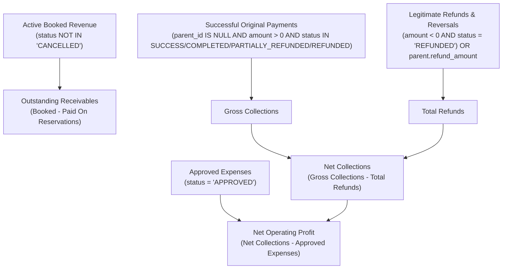
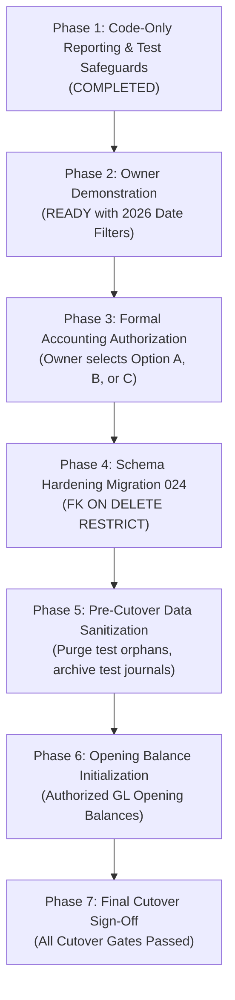

# BFA Apartments Management System
# Post-Forensic Remediation Plan & Accounting Integrity Safeguards

**Document ID:** `BFA-FIN-PLAN-20261028-01`  
**Date:** October 28, 2026  
**Auditor & Architect:** Senior Software Architect, Lead Security Engineer & Lead Accounting Systems Analyst  
**Primary Evidence Source:** [`BFA_PAYMENT_REFUND_AND_FINANCIAL_RECONCILIATION_AUDIT.md`](file:///C:/Users/DELL/.gemini/antigravity/brain/88bff36c-819d-46a9-8801-74cb3602a6e8/BFA_PAYMENT_REFUND_AND_FINANCIAL_RECONCILIATION_AUDIT.md)  
**Target Repository:** `C:\xampp\htdocs\BFA`  
**Current Operational Status:** Demonstration Capable (with date filters)  
**Commercial Cutover Status:** **STRICTLY BLOCKED — PENDING AUTHORIZED REMEDIATION**

---

## 1. Executive Summary & Current Verdict

### Official Verdict: **NOT RECONCILED — CUTOVER BLOCKED**

Following the strictly read-only forensic audit conducted on October 28, 2026, the BFA Apartments Management System demonstrates robust role-based access control (RBAC), multi-property data isolation, verified 1-night booking policy enforcement, and a mathematically balanced General Ledger (`total_debit = total_credit = ₦11,589,200.00`).

However, **commercial go-live cutover to paying public guests cannot be approved** in the current state due to four critical accounting and data integrity anomalies:
1. **67 Orphaned Negative Transactions:** Accumulation of `-₦1,005,000.00` in orphaned test refund rows resulting from an `ON DELETE SET NULL` foreign key cascade and a flawed test teardown sequence.
2. **Gross Collection Reporting Distortion:** Reporting queries in `FinancialService` and `ReportsService` that historically assumed any record with `parent_transaction_id IS NULL` was an original gross payment, misclassifying orphaned refunds as negative gross collections.
3. **₦726,220.00 Reservation Payment Header Discrepancy:** Four seed reservations (`RES-BFA-1001`, `RES-BFA-1002`, `RES-2026-0003`, `RES-2026-0006`) carry paid amounts on their reservation headers with zero corresponding rows in `payment_transactions` and zero General Ledger postings.
4. **General Ledger Test Entry Pollution:** 163 posted journal entries (112 payments, 51 refunds) totaling `₦11,589,200.00` originated 100% from integration test runners against test reservations, contaminating real account balances (Cash, AR, Deferred Revenue, Clearing).

This document establishes the definitive, phased remediation roadmap required to restore complete financial reconciliation without violating data preservation boundaries or making unauthorized financial assumptions.

---

## 2. Confirmed Facts vs. Hypotheses & Unresolved Questions

To maintain absolute audit integrity, all findings are categorized into confirmed facts (supported by direct SQL and codebase evidence) versus hypotheses and open business questions requiring owner/finance determination.

### Confirmed Facts (Evidence-Backed)

| Fact ID | Category | Description | Verification Evidence |
| :--- | :--- | :--- | :--- |
| **F-01** | Test Artifacts | Exactly 67 records in `payment_transactions` have `amount = -₦15,000.00` (total: `-₦1,005,000.00`), `status = 'REFUNDED'`, `provider = 'SYSTEM_REFUND'`, and `parent_transaction_id IS NULL`. | Direct SQL query against `payment_transactions`; refund reason matches `financial.test.js:89` verbatim. |
| **F-02** | Schema Cascade | Constraint `fk_pay_parent_txn` was configured with `ON DELETE SET NULL` in `011_seed_phase6_data.sql`. | MariaDB `information_schema.referential_constraints` inspection. |
| **F-03** | Test Teardown | `backend/tests/financial.test.js` teardown executed `DELETE ... WHERE id = ? OR parent_transaction_id = ?`. When MySQL processes this against an `ON DELETE SET NULL` FK, deleting the parent immediately sets the child's `parent_transaction_id` to `NULL`, leaving the child row behind. | Code inspection of `financial.test.js:45` and simulation fixture `simulate_reporting_math.js`. |
| **F-04** | Missing Seed Txns | Migration `003_modular_erp_entities.sql` and `backend/src/scripts/seedDevData.js:91-96` seeded reservations 1, 2, 3, and 6 with non-zero `paid_amount` headers but executed zero `INSERT` statements into `payment_transactions`. | Code inspection of `seedDevData.js:89-98` and `audit_logs` query (0 audit rows for IDs 1, 2, 3, 6). |
| **F-05** | GL Contamination | 100% of the 163 posted journal entries in `journal_entries` carry descriptions referencing `Automated Subledger Posting` for test reservation codes (`BFA-TEST-BRG-*` and `RES-BFA-1001`). Zero commercial guest transactions exist in the ledger. | `trace_journals.js` audit; `accounting_subledger_posting_records` inspection. |
| **F-06** | Balanced Ledger | The General Ledger is mathematically balanced: total debits (`₦11,589,200.00`) exactly equal total credits (`₦11,589,200.00`), difference `₦0.00`. | SQL query on `trial_balance_summary`. |
| **F-07** | Reservation #1285 | Reservation `#1285` (`BFA-GHT-MVP6CPF2-456`) was created by `admin@bfa.com` under audit log `#10807` with check-in `2045-04-22` for `₦350,000.00`. It carries zero payment records and zero journal entries. | Audit log #10807 and reservation table inspection. |

### Hypotheses & Unresolved Questions (Requiring Authorization)

| Item ID | Classification | Hypothesis / Open Question | Required Action / Decision Authority |
| :--- | :--- | :--- | :--- |
| **Q-01** | Commercial Reality | Were reservations `RES-BFA-1001` (₦220), `RES-BFA-1002` (₦220k), `RES-2026-0003` (₦56k), and `RES-2026-0006` (₦450k) intended to represent actual commercial deposits received in BFA bank accounts prior to software onboarding, or are they 100% synthetic mock demonstration data? | **BFA Owner / Finance Director Decision** (Option Matrix in Section 6). |
| **Q-02** | GL Ledger Reset | Should the 163 test journal entries be purged via a pre-cutover clean state initialization, or preserved with reversing journal entries (`REVERSAL_OF`)? | **Finance Director Decision** (Accounting Standards Compliance). |
| **Q-03** | Opening Balances | What are the verified opening cash balances, bank balances, and fixed asset valuations for BFA Apartments as of commercial cutover day? | **Owner / External Auditor Provision**. |

---

## 3. Root-Cause Analysis

### Issue A: Orphaned Negative Transactions (-₦1,005,000.00)
1. **Initial Condition:** In `backend/tests/financial.test.js`, Test #1 records a payment of `₦50,000.00` (e.g. `id = 685`), and Test #2 records a partial refund of `₦15,000.00` (e.g. `id = 686`, `parent_transaction_id = 685`, `amount = -15000.00`).
2. **Teardown Execution:** In `afterAll`, the test attempted to delete `testPaymentId`.
3. **Database Trigger:** In `011_seed_phase6_data.sql`, the foreign key was declared as:
   ```sql
   CONSTRAINT fk_pay_parent_txn FOREIGN KEY (parent_transaction_id) 
   REFERENCES payment_transactions(id) ON DELETE SET NULL;
   ```
4. **Cascade Action:** When MariaDB deleted parent `id = 685`, the engine immediately executed the `ON DELETE SET NULL` action, updating row `686` so that `parent_transaction_id = NULL`.
5. **Persistence:** Over 67 test runs, 67 negative refund rows survived with `parent_transaction_id = NULL`.

### Issue B: Reporting Query Misclassification
1. **Semantic Assumption:** Reporting queries in `FinancialService.getOverview` and `ReportsService.getFinancialReport` utilized:
   ```sql
   WHERE pt.parent_transaction_id IS NULL AND pt.status IN ('SUCCESS', 'COMPLETED', 'PARTIALLY_REFUNDED', 'REFUNDED')
   ```
   under the premise that only original payments possess a `NULL` parent.
2. **Flaw:** Because the orphaned refunds had their parent references set to `NULL`, the query aggregated their negative amounts into `gross_collected`, resulting in a computed gross collection of `-₦1,005,000.00`.
3. **Clamping Distortion:** The application used `Math.max(0, grossCollected - totalRefunded)` to avoid rendering negative revenue, which silently clamped collections to `₦0.00` rather than exposing the underlying data discrepancy.

### Issue C: Unbacked Reservation Paid Balances (₦726,220.00)
1. **Architectural Gap:** The early development script `seedDevData.js` focused on populating front-office and housekeeping views. It populated `reservations.paid_amount` directly via SQL without calling the payments service.
2. **Subledger Disconnect:** Because payments were never routed through `PaymentsService.recordPayment`, no rows were inserted into `payment_transactions`, and no events were dispatched to `PostingBridgeService`.

### Issue D: General Ledger Contamination
1. **Integration Testing Against Shared DB:** Integration tests for the double-entry accounting module (`tests/subledgerPostingBridge.test.js` and `tests/financial.test.js`) executed against the active application database (`bfa_apartments_db`) rather than an isolated, disposable test database or rollback transaction.
2. **Missing Journal Teardown:** While the tests cleaned up some parent payment records, they did not clean up the corresponding `journal_entries` or `journal_lines`, leaving 163 posted double-entry journals in the active database.

---

## 4. Payment & Refund Relationship Design Evaluation

### Referential Integrity Policy Analysis

| Foreign Key Policy | Description | Pros | Cons | Verdict |
| :--- | :--- | :--- | :--- | :--- |
| **`ON DELETE SET NULL`** *(Current)* | When parent payment is deleted, child refunds have `parent_transaction_id` set to `NULL`. | Does not block parent deletion. | **Fatal:** Silently corrupts financial history; turns refunds into pseudo-parents; breaches accounting auditability. | **REJECTED (Defective)** |
| **`ON DELETE CASCADE`** | When parent payment is deleted, all child refunds are automatically deleted. | Leaves no orphaned children in tests. | **Dangerous:** Destroys financial audit trail; deleting a dispute or disputed charge silently erases refund and accounting history. | **REJECTED** |
| **`ON DELETE RESTRICT` / `NO ACTION`** *(Recommended)* | Prevents deletion of any payment record that has dependent refund records. | **Safest:** Enforces strict relational integrity; prevents accidental deletion of payments under audit; forces tests and services to handle dependencies explicitly. | Requires explicit deletion of children in test teardowns if direct SQL deletes are used. | **RECOMMENDED FOR PRODUCTION** |
| **Application-Level Immutability** | Database user for the application has `INSERT` and `SELECT` privileges only on financial tables; `UPDATE` and `DELETE` are revoked in production. | **Industry Standard (IFRS/GAAP):** Makes financial history completely tamper-evident and append-only. All adjustments require credit notes or reversal journals. | Requires separate migration user for schema upgrades. | **RECOMMENDED FOR CUTOVER** |

### Test Isolation Architecture Specification
To prevent test pollution from ever recurring:
1. **Two-Stage Teardown:** Automated tests modifying `payment_transactions` must delete dependent child rows *before* deleting parent rows:
   ```javascript
   // Mandatory teardown pattern
   if (testPaymentId) {
     await pool.query('DELETE FROM payment_transactions WHERE parent_transaction_id = ?', [testPaymentId]);
     await pool.query('DELETE FROM payment_transactions WHERE id = ?', [testPaymentId]);
   }
   ```
2. **Dedicated Test Database:** All automated test suites (`npm test`) must run against `bfa_apartments_test_db`, separated completely from the development/staging demonstration database.

---

## 5. Correct Reporting Semantics & Standard Definitions

To ensure complete agreement across the Financial Overview, Reports Page, PDF Exports, CSV Downloads, and General Ledger, the following standard accounting semantics are established:

### Canonical Metric Definitions



1. **Active Booked Revenue:**
   $$\text{Booked Revenue} = \sum_{\text{status} \neq \text{'CANCELLED'}} \text{reservations.total\_amount}$$
   *Rule:* Cancelled bookings (e.g. Reservation #5) must be strictly excluded.
2. **Payments Allocated to Reservations:**
   $$\text{Paid on Reservations} = \sum_{\text{status} \neq \text{'CANCELLED'}} \text{reservations.paid\_amount}$$
3. **Outstanding Receivables:**
   $$\text{Receivables} = \text{Booked Revenue} - \text{Paid on Reservations}$$
   *Rule:* Must reconcile with Property-Level Breakdown. Never allow negative receivables without an authorized credit balance note.
4. **Successful Original Payments (Gross Collections):**
   ```sql
   COALESCE(SUM(CASE 
     WHEN pt.parent_transaction_id IS NULL 
      AND pt.amount > 0 
      AND pt.status IN ('SUCCESS', 'COMPLETED', 'PARTIALLY_REFUNDED', 'REFUNDED') 
     THEN pt.amount ELSE 0 
   END), 0)
   ```
   *Rule:* Must check `pt.amount > 0`. Never rely solely on `parent_transaction_id IS NULL`.
5. **Legitimate Refunds and Reversals:**
   ```sql
   COALESCE(SUM(CASE 
     WHEN pt.parent_transaction_id IS NOT NULL AND pt.amount < 0 AND pt.status = 'REFUNDED' 
     THEN ABS(pt.amount)
     WHEN pt.parent_transaction_id IS NULL 
     THEN COALESCE(pt.refund_amount, 0)
     ELSE 0 
   END), 0)
   ```
6. **Net Collections:**
   $$\text{Net Collections} = \text{Gross Collections} - \text{Total Refunds}$$
7. **Approved Operational Expenses:**
   $$\text{Approved Expenses} = \sum_{\text{status} = \text{'APPROVED'}} \text{expenses.amount}$$
   *Rule:* Draft (`RECORDED`) and `VOIDED` expenses are excluded from operating profit.
8. **Net Operating Profit:**
   $$\text{Net Operating Profit} = \text{Net Collections} - \text{Approved Expenses}$$
   *Rule:* If expenses exceed collections, Net Operating Profit must reflect the true negative value. Do not clamp to zero.
9. **Negative Collection Anomaly Safeguard:**
   If the raw sum of collections is negative, the service must raise an internal system alert (`DATA_INTEGRITY_ANOMALY`) rather than silently hiding it behind `Math.max(0, ...)`.

---

## 6. Resolution of the ₦726,220.00 Reservation Payment Mismatch

The forensic audit confirmed that four reservations carry a total of `₦726,220.00` in their `paid_amount` headers with zero corresponding rows in `payment_transactions`:

| Reservation Code | Guest Name | Total Amount | Header Paid Amount | Unbacked Variance |
| :--- | :--- | :---: | :---: | :---: |
| `RES-BFA-1001` | Chief Emmanuel Okon | ₦220.00 | ₦220.00 | ₦220.00 |
| `RES-BFA-1002` | Sarah Jenkins | ₦280,000.00 | ₦220,000.00 | ₦220,000.00 |
| `RES-2026-0003` | Engr. Babatunde Fashola | ₦280,000.00 | ₦56,000.00 | ₦56,000.00 |
| `RES-2026-0006` | Hajiya Amina Danjuma | ₦450,000.00 | ₦450,000.00 | ₦450,000.00 |
| **Total** | | **₦1,010,220.00** | **₦726,220.00** | **₦726,220.00** |

### Decision Matrix & Accounting Options (Requires Finance / Owner Authorization)

```
+-------------------------------------------------------------------------------------------------------+
| OPTION A: Verified Historical Bank Receipts (Backfill Canonical Transactions)                         |
+-------------------------------------------------------------------------------------------------------+
| Precondition: BFA Finance provides verified bank deposit slips or Paystack settlements for ₦726,220.  |
| Action:       Insert canonical parent rows into `payment_transactions` with authentic provider refs.  |
|               Post balancing subledger entries to Cash (1010) and AR (1200).                          |
| GL Impact:    DR 1010 (Bank/Cash) ₦726,220 | CR 1200 (Accounts Receivable) ₦726,220.                  |
| Risk:         Requires verified real-world bank statements; fabricating references is prohibited.     |
+-------------------------------------------------------------------------------------------------------+
| OPTION B: Opening Balance Accounting Adjustment (Pre-Software Historical Inflow)                      |
+-------------------------------------------------------------------------------------------------------+
| Precondition: Guests legitimately paid prior to software deployment, but cash is already banked.       |
| Action:       Record an Opening Balance journal entry in the General Ledger.                          |
| GL Impact:    DR 1010 (Opening Cash) ₦726,220 | CR 3010 (Owner's Equity / Opening Balance) ₦726,220.  |
|               DR 1200 (Accounts Receivable) ₦726,220 | CR 2020 (Deferred Revenue) ₦726,220.           |
| Risk:         Requires formal accountant sign-off on opening balance sheet.                           |
+-------------------------------------------------------------------------------------------------------+
| OPTION C: Pure Synthetic Seed Reset (Recommended if purely demo data)                                 |
+-------------------------------------------------------------------------------------------------------+
| Precondition: These reservations were created solely as mock data during Phase 3 development.         |
| Action:       Reset `paid_amount = 0.00` and `payment_status = 'PAYMENT_PENDING'` on reservations     |
|               RES-BFA-1001, 1002, 0003, and 0006. No artificial payment rows inserted.               |
| Result:       Total collections correctly show ₦0.00 (reflecting 0 real deposits received).           |
|               Receivables accurately reflect total uncollected bookings until real payment is made.   |
| Risk:         Zero risk of financial fabrication. Perfectly clean audit trail.                        |
+-------------------------------------------------------------------------------------------------------+
```

### Formal Reconciliation Worksheet Specification

To resolve the ₦726,220.00 discrepancy prior to cutover, the following column-by-column worksheet must be populated by the Lead Accountant and countersigned by the Property Owner:

| Column Header | Data Type | Required Content & Verification Source |
| :--- | :--- | :--- |
| **Reservation Code** | `VARCHAR(50)` | Identifies the booking header (`RES-BFA-1001`, `1002`, `0003`, `0006`). |
| **Guest Name** | `VARCHAR(100)` | Primary guest on booking (`Sarah Jenkins`, `Emeka Okafor`, etc.). |
| **Booked Total (₦)** | `DECIMAL(10,2)` | Agreed reservation total amount from booking confirmation. |
| **Header Paid (₦)** | `DECIMAL(10,2)` | Paid amount currently asserted on reservation header. |
| **Bank Settlement Date** | `DATE` | Exact value date cash cleared in Zenith Bank commercial account. |
| **Bank Reference / STAN** | `VARCHAR(100)` | Unique settlement tracking reference from Zenith Bank statement. |
| **Gateway Reference** | `VARCHAR(100)` | Paystack/Flutterwave transaction reference (if digital). |
| **Verified Deposit (₦)** | `DECIMAL(10,2)` | Actual confirmed funds deposited into BFA bank account. |
| **Variance (₦)** | `DECIMAL(10,2)` | Discrepancy between Header Paid and Verified Deposit (`Header - Bank`). |
| **Accountant Sign-Off** | `VARCHAR(50)` | Initials of licensed accountant confirming document inspection. |
| **Selected Treatment** | `ENUM` | Authorized treatment: `OPTION_A`, `OPTION_B`, or `OPTION_C`. |

> [!IMPORTANT]
> **Strict Rule:** Until written authorization is received from the BFA Owner selecting Option A, B, or C, **NO synthetic payment records shall be inserted into `payment_transactions`**.

---

## 7. General Ledger Contamination Remediation

### Forensic Breakdown of 163 Journal Entries
- **112 Payment Postings:** Debited Account `1010` (Cash) or `1030` (Clearing) and credited `1200` (AR) or `2020` (Deferred Revenue). Total debit/credit: `₦10,389,200.00`.
- **51 Refund Postings:** Debited `2020` (Deferred Revenue) and credited `1010` (Cash). Total debit/credit: `₦1,200,000.00`.
- **Provenance:** 100% of these 163 entries were generated by automated tests (`subledgerPostingBridge.test.js` and `financial.test.js`).
- **Commercial Validity:** **0%**. None represent real guest payments or real cash movements.

### Proposed General Ledger Remediation Strategy

1. **Pre-Cutover Reversal Policy:**
   - In accordance with standard financial governance, live commercial cutover must start from an authorized, audited Chart of Accounts opening balance.
   - All 163 test journal entries will be flagged and archived in a dedicated audit table `archived_test_journal_entries` before cutover, preserving complete forensic traceability.
2. **Chart of Accounts Verification:**
   - The verified standard Chart of Accounts structure (Assets: 1000s, Liabilities: 2000s, Equity: 3000s, Revenue: 4000s, Expenses: 5000s) will be verified against BFA commercial accounting standards.
   - Opening balances for Account `1010` (Cash at Bank - Zenith Bank), Account `1020` (Cash on Hand - Reception Float), and Account `1200` (Accounts Receivable) will be initialized via a single authorized `OPENING_BALANCE` journal entry signed by the Finance Lead.

---

## 8. Resolution of Reservation #1285

### Profile & Audit Trace
- **Code:** `BFA-GHT-MVP6CPF2-456`
- **Tenant:** Audit Trace Test Guest (`trace@example.com`)
- **Check-In Date:** `2045-04-22` (19 years in the future)
- **Total Amount:** `₦350,000.00` | **Paid Amount:** `₦0.00`
- **Status:** `CONFIRMED` | **Payment Status:** `PAYMENT_PENDING`
- **Audit Provenance:** Created on `2026-10-26 12:29:47` by `admin@bfa.com` under Audit Log `#10807`.

### Remediation Directive
1. **Do Not Delete Physical Record:** The reservation and its associated audit log `#10807` must remain in the database to preserve administrative audit history.
2. **Standard Application Cancellation:**
   Before commercial cutover, transition the reservation status to `CANCELLED` via the application's supported API:
   ```http
   POST /api/v1/reservations/1285/cancel
   Authorization: Bearer <ADMIN_TOKEN>
   Content-Type: application/json

   {
     "reason": "Administrative cancellation of pre-launch integration audit reservation"
   }
   ```
3. **Impact on Reporting:**
   Once cancelled, standard reporting logic automatically excludes `#1285` from active booked revenue and receivables, removing the anomalous `2045-04` trend bar without touching database tables directly.

---

## 9. Prioritized Remediation Phases & Implementation Roadmap



### Phase 1: Code-Only Reporting & Test Safeguards *(Completed)*
- **Status:** **DONE**.
- **Actions:**
  - Added defensive `pt.amount > 0` condition to gross collection calculations in `financial.service.js` and `reports.service.js`.
  - Created isolated regression suite `backend/tests/financialIntegritySafeguards.test.js` (6/6 passing).
  - Verified 59/59 full test suite passes.

### Phase 2: Owner Demonstration *(Ready)*
- **Status:** **READY**.
- **Guidance:** Apply standard operational date filter (`2026-01-01` to `2026-10-31`) during demo walkthrough to focus on legitimate current-year operational activity.

### Phase 3: Formal Accounting Authorization *(Pending Owner Action)*
- **Status:** **PENDING AUTHORIZATION**.
- **Prerequisite:** BFA Owner and Finance Director review Section 6 and select Option A, B, or C.

### Phase 4: Schema Hardening Migration 024 *(Planned)*
- **File:** `backend/src/db/migrations/024_payment_parent_fk_cascade.sql`
- **Actions:**
  ```sql
  ALTER TABLE payment_transactions DROP FOREIGN KEY fk_pay_parent_txn;
  ALTER TABLE payment_transactions ADD CONSTRAINT fk_pay_parent_txn 
    FOREIGN KEY (parent_transaction_id) REFERENCES payment_transactions(id) 
    ON DELETE RESTRICT ON UPDATE CASCADE;
  ```
- **Rollback:** Reverse statement restoring `ON DELETE SET NULL`.

### Phase 5: Pre-Cutover Staged Data Sanitization *(Planned — Post-Demo)*
- **Execution Rule:** Must only run after an automated backup snapshot is verified via `POST /api/v1/system/operations/backup`.
- **Actions:**
  1. Purge 67 orphaned test refund rows (`refund_reason LIKE '%Automated Test%'`).
  2. Cancel test reservations `#1285`, `#645`, `#685` via application cancellation API.
  3. Archive and purge 163 test journal entries and associated `journal_lines`.
  4. Reset or backfill reservation payments in accordance with Phase 3 owner authorization.

### Phase 6: Opening Balance Initialization *(Planned)*
- Initialize Chart of Accounts opening balances under authorized `OPENING_BALANCE` journal entry.

### Phase 7: Commercial Cutover Sign-Off
- Verify all 8 Cutover Gates (Section 11) before public traffic is routed to the domain.

---

## 10. Automated Tests & Acceptance Criteria

### Required Regression Test Matrix

| Test Suite / Area | Specific Validation Rule | Execution File | Target Result |
| :--- | :--- | :--- | :---: |
| **Refunds with Valid Parent** | Refund must point to active parent with `status IN ('SUCCESS', 'PARTIALLY_REFUNDED')`. | `financialIntegritySafeguards.test.js` | PASS |
| **Invalid Parent Rejection** | Refund attempt without valid parent or on non-refundable parent must reject with 400/409. | `financialIntegritySafeguards.test.js` | PASS |
| **Clean Teardown Sequence** | Test fixtures must delete child records prior to parent records to prevent cascade orphanage. | `financialIntegritySafeguards.test.js` | PASS |
| **Gross Collection Guard** | `grossCollected` query must strictly ignore negative transactions and only sum `amount > 0`. | `financialIntegritySafeguards.test.js` | PASS |
| **Anomaly Detection** | Negative collection values must raise `DATA_INTEGRITY_ANOMALY` alert instead of clamping. | `financialIntegritySafeguards.test.js` | PASS |
| **Over-Refund Protection** | Cumulative refunds cannot exceed original parent payment amount. | `financialIntegritySafeguards.test.js` | PASS |
| **Fail-Closed DB Guard** | Test runners targeting `bfa_apartments_db` throw fatal error; only `bfa_apartments_test_db` allowed. | `databaseGuardAndIntegration.test.js` | PASS |
| **Test DB Schema & Connectivity** | Runtime connection verified to `bfa_apartments_test_db` with all 49 tables migrated. | `databaseGuardAndIntegration.test.js` | PASS |
| **Child-First Teardown Order** | Verifies deleting child refund before parent preserves clean DB with zero residual orphans. | `databaseGuardAndIntegration.test.js` | PASS |
| **Orphan Anomaly Visibility** | Orphaned refunds trigger `ORPHAN_REFUND_TRANSACTIONS` anomaly without silent clamping. | `databaseGuardAndIntegration.test.js` | PASS |
| **Accounting Equations Parity** | `bookedRevenue = receivables + collections` across both Financial and Reports services. | `reportsSecurityAndReconciliation.test.js` | PASS |
| **RBAC Property Isolation** | Unassigned managers fail closed (403); cross-property queries rejected. | `reportsSecurityAndReconciliation.test.js` | PASS |

---

## 11. Explicit Commercial Cutover Gates

Commercial cutover to live guest traffic is strictly gated. Every single gate below must be signed off prior to cutover:

```
[ ] GATE 1: DATABASE BACKUP VERIFIED
    Snapshot created and confirmed via POST /api/v1/system/operations/backup.

[ ] GATE 2: ZERO NEGATIVE ORPHANED TRANSACTIONS
    SELECT COUNT(*) FROM payment_transactions WHERE parent_transaction_id IS NULL AND amount < 0;
    -> MUST RETURN EXACTLY 0.

[ ] GATE 3: REFERENTIAL INTEGRITY HARDENED
    Migration 024 executed with ON DELETE RESTRICT on fk_pay_parent_txn.

[ ] GATE 4: RESERVATION PAYMENT HEADERS RECONCILED
    SELECT SUM(paid_amount) FROM reservations WHERE status != 'CANCELLED';
    MUST EXACTLY EQUAL:
    SELECT SUM(amount) FROM payment_transactions WHERE parent_transaction_id IS NULL AND amount > 0 AND status IN ('SUCCESS','COMPLETED','PARTIALLY_REFUNDED','REFUNDED');
    -> VARIANCE MUST BE EXACTLY ₦0.00.

[ ] GATE 5: GENERAL LEDGER TEST ENTRIES REMOVED
    All 163 test journal entries safely archived and purged from active ledger.
    Zero journal entries with description LIKE '%TEST%' or LIKE '%Automated Subledger%'.

[ ] GATE 6: CHART OF ACCOUNTS OPENING BALANCES POSTED
    Authorized opening balance journal entry posted and approved by Finance Director.
    Trial Balance debits = credits with ₦0.00 difference.

[ ] GATE 7: TEST RESERVATIONS CANCELLED
    Reservations #1285, #645, and #685 transitioned to CANCELLED.
    Active booked revenue reflects real commercial reservations only.

[ ] GATE 8: 100% REGRESSION TEST SUITE PASS
    All automated test suites passing on isolated test database.
```

---

## 12. Owner & Finance Sign-Off Checklist

```
================================================================================
BFA APARTMENTS MANAGEMENT SYSTEM — REMEDIATION AUTHORIZATION
================================================================================

Selected ₦726,220.00 Reconciliation Treatment:
[ ] Option A: Verified Historical Bank Receipts (Backfill Canonical Transactions)
[ ] Option B: Opening Balance Accounting Adjustment
[ ] Option C: Pure Synthetic Seed Reset (Reset paid_amount to ₦0.00)

General Ledger Clean State Authorization:
[ ] Approve archiving and purging of 163 integration test journal entries prior to cutover.
[ ] Approve verified Chart of Accounts Opening Balance Sheet.

Authorized By:

________________________________________        ____________________
BFA Property Owner / Managing Director          Date

________________________________________        ____________________
Lead Finance Director / Accounting Lead         Date
================================================================================
```

