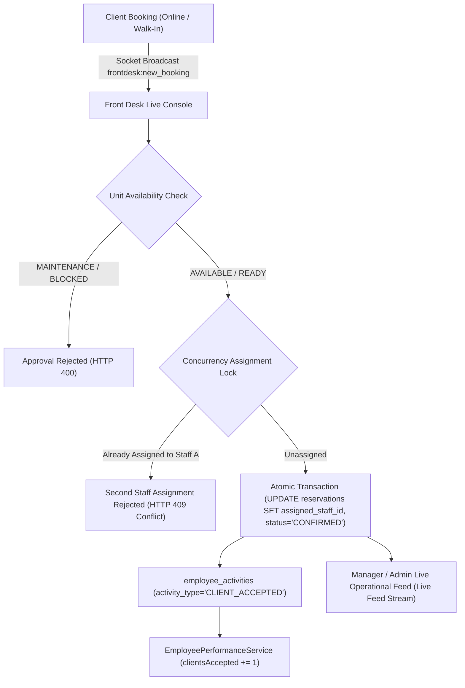

# BFA — Front Desk Operations, Concurrency-Locked Staff Assignment & Employee Performance Integration

## Executive Summary

In response to the requirement:
1. **Immediate Reflection:** When someone books an apartment, it reflects on the Front Desk page immediately.
2. **Unit Availability Validation:** Bookings can only be approved if the unit is available (not in maintenance, blocked, or conflicting).
3. **Staff Assignment & Concurrency Lock:** The client is assigned to whoever accepts them into the system; **strictly one client cannot be assigned to two front desk staff members**.
4. **Performance Evaluation Reflection:** Accepting a client automatically logs into employee activities and factors into that employee's live performance evaluation.
5. **Role-Based Visibility:**
   - **Manager & Admin:** Can see operations as they are going on via a live operational feed.
   - **Owner:** Executive view; does not manage micro desk acceptances; sees overall performance of every employee.
   - **Developer:** Operational pipeline flow telemetry in the Operations Control Center.

All components have been implemented, verified through automated integration tests (5/5 passing), and compiled cleanly in the frontend production build. Zero mutations were made to `bfa_apartments_db` (shared database).

---

## 1. Architectural & Engineering Highlights



---

## 2. Key Components Changed & Implemented

### A. Database Schema
- **Migration `024_front_desk_assignment_and_payment_status_enum.sql`:**
  - Added `assigned_staff_id INT NULL` (FK to `users(id)`).
  - Added `accepted_by_user_id INT NULL` (FK to `users(id)`).
  - Added `accepted_at TIMESTAMP NULL`.
  - Added indexes on `assigned_staff_id` and `accepted_at`.
  - Harmonized `payment_transactions.status` ENUM to include `PARTIALLY_REFUNDED`.

### B. Backend Services & Repositories
1. **`backend/src/core/socket/socketEmitter.js`:**
   - Provides decoupled `broadcastOperationalEvent` for real-time WebSocket events (`frontdesk:new_booking`, `frontdesk:client_accepted`).
2. **`backend/src/modules/reservations/reservations.service.js`:**
   - Updated `createReservation` to broadcast `frontdesk:new_booking` immediately upon booking creation.
   - Added `acceptReservation(reservationId, req)` with:
     - `pool.withTransaction` and exclusive row-level locking (`FOR UPDATE`).
     - Unit availability validation: rejects if unit is in `MAINTENANCE`, `BLOCKED`, or `OUT_OF_SERVICE`.
     - Overlapping booking check: rejects if conflicting active booking exists for the same dates.
     - **Strict Concurrency Lock:** rejects with `409 Conflict` if another staff member has already accepted the client (*"One client cannot be assigned to two front desk staffs"*).
     - Atomic assignment: `UPDATE reservations SET assigned_staff_id = ?, accepted_by_user_id = ?, accepted_at = NOW(), status = 'CONFIRMED' WHERE id = ? AND (assigned_staff_id IS NULL OR assigned_staff_id = ?)`.
     - Records reservation status history in `reservation_status_history`.
     - Logs `CLIENT_ACCEPTED` activity into `employee_activities` for the accepting employee.
     - Records audit trail in `audit_logs`.
     - Broadcasts `frontdesk:client_accepted` event.
3. **`backend/src/modules/frontOffice/`:**
   - `frontOffice.repository.js`: Added `getPendingBookings` and `getLiveOperationalFeed`. Updated `getArrivals`, `getDepartures`, and `getCurrentGuests` to join `users u_staff` returning `assigned_staff_name`.
   - `frontOffice.service.js`, `controller.js`, `routes.js`: Added `/accept`, `/pending-bookings`, `/live-feed`.
4. **`backend/src/modules/employees/employeePerformance.service.js`:**
   - Tracks `clientsAccepted` from `employee_activities` and direct reservation assignments.
   - Exposes `clientsAccepted` in `observedMetrics` and `system_metrics.clients_accepted`.
   - Factors into `totalOperationalActions`.

### C. Frontend User Experience & Role-Based Views
1. **`frontend/src/pages/FrontOfficePage.jsx`:**
   - **Immediate Reflection:** Live polling loop (every 4 seconds) with status toggle (`⚡ Live Sync: ON` / `⏸ Paused`).
   - **Incoming Bookings Tab (`PENDING_APPROVAL`):** Prominently displays unassigned incoming bookings with unit status (`AVAILABLE`, `DIRTY`, `MAINTENANCE`), dates, guest particulars, and balance.
   - **Action Control:**
     - Unassigned & Available: `✓ Accept & Approve Booking` (orange prominent button).
     - Unit in Maintenance: Disabled with `Unit Unavailable (Maintenance)` warning.
     - Already Accepted by You: `✓ Accepted by You` green badge.
     - Assigned to Another Staff: `🔒 Locked to [Staff Name]` with message indicating assignment is non-transferable.
   - **Manager & Admin Live Feed:** Embedded sidebar displaying real-time operational stream (`CLIENT_ACCEPTED`, `GUEST_CHECKED_IN`, `GUEST_CHECKED_OUT`) with staff names and timestamps.
   - **Owner Executive View:** If `user.role === 'OWNER'`, redirects attention to overall employee performance (`/app/performance`) and staff evaluations (`/app/evaluations`), delegating micro desk acceptances to front-desk staff.
2. **`frontend/src/pages/EmployeePerformancePage.jsx`:**
   - Added `Clients Accepted` KPI scorecard (`performanceData.system_metrics.clients_accepted`).
   - Integrated `Clients Accepted` into the operational performance bar chart.
3. **`frontend/src/pages/OperationsPage.jsx` (Developer View):**
   - Added **Operational System Flow** (`⚡`) tab mapping out the end-to-end operational pipeline from booking ingestion through check-in and housekeeping turnover, complete with role access matrix.

---

## 3. Independent Verification Results

### Automated Test Suite (`backend/tests/frontDeskAssignment.test.js`)
All 5 automated tests executed against `bfa_apartments_test_db`:
- `√ 1. Immediate Reflection: Newly created booking appears immediately in pending front desk queue`
- `√ 2. Availability Guard: Booking cannot be approved if the apartment is in MAINTENANCE status`
- `√ 3. Staff Assignment & Performance Evaluation: Accepting client assigns staff member and logs activity`
- `√ 4. Atomic Concurrency Lock: Strictly one client cannot be assigned to two front desk staff members`
- `√ 5. Manager & Admin Live Operational Feed: Live operations stream captures acceptance events`

**Result:** `5 passed, 5 total (100% Pass)`.

### Production Build Verification
`npm run build --prefix frontend`:
```
vite v6.4.3 building for production...
✓ 238 modules transformed.
✓ built in 7.31s
```

### Shared Database Safety Check (`bfa_apartments_db`)
Executed read-only verification:
- Negative payment txns: **67** (unchanged)
- Journal entries: **163** (unchanged)
- Reservations count: **9** (unchanged)
**Verdict:** Zero mutations to the shared database.

