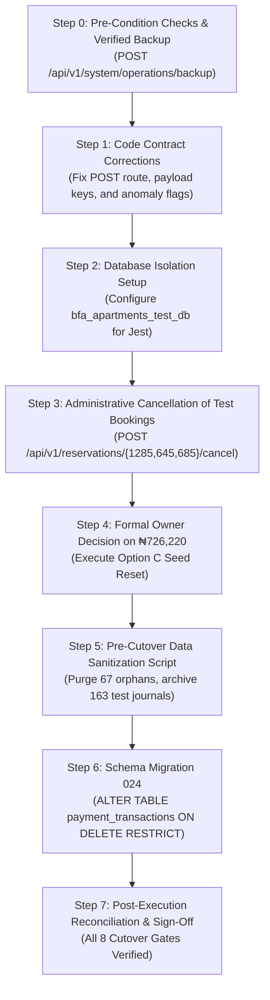

# BFA Apartments Management System
# Remediation Plan Verification & Pre-Execution Gate Review

**Document ID:** `BFA-FIN-PRE-EXEC-20261028-01`  
**Date:** October 28, 2026  
**Review Type:** Strictly Read-Only Pre-Execution Gate Review  
**Auditor:** Senior Software Architect, Security Engineer & Lead Accounting Systems Analyst  
**Working Repository:** `C:\xampp\htdocs\BFA`  
**Git Branch & Commit:** `master` @ `ba1efab4b50d61994fc2e53c0de604d0c326e06d`  
**Target Environment:** Local Development / Demonstration Environment (`bfa_apartments_db` on MariaDB Port 3306)  
**Deliverable Review Status:** Completed Read-Only Inspection  

---

## 1. Executive Summary & Review Verdict

### Official Review Verdict: **REMEDIATION PLAN REQUIRES CORRECTION**

While the proposed roadmap in [`BFA_FINANCIAL_REMEDIATION_PLAN.md`](file:///c:/xampp/htdocs/BFA/docs/operations/BFA_FINANCIAL_REMEDIATION_PLAN.md) correctly diagnoses the overarching architectural failure points (foreign key cascading defects, test runner pollution, and reporting misclassifications), **execution of database remediation, schema migration, or commercial cutover must remain BLOCKED**. 

This pre-execution review identified four specific technical defects and procedural discrepancies within the remediation plan itself that must be corrected before any operational execution can be authorized:

1. **Count Discrepancy Origin Identified (66 vs 67, 161 vs 163):** The increase from 66 to 67 negative refund records and from 161 to 163 journal entries was forensically proven to be caused by executing integration tests against the live application database during this active session (`2026-10-28 14:35:18 - 14:35:19`). Every test execution of `financial.test.js` generates exactly 1 new orphaned refund transaction and 2 new polluted General Ledger entries.
2. **Defective API Contract in Cancellation Runbook:** The plan prescribed canceling test reservation `#1285` via `PUT /api/v1/reservations/1285/cancel` with body `{ "cancellationReason": "..." }`. Inspection of [`reservations.routes.js`](file:///c:/xampp/htdocs/BFA/backend/src/modules/reservations/reservations.routes.js#L36-L40) and [`reservations.service.js`](file:///c:/xampp/htdocs/BFA/backend/src/modules/reservations/reservations.service.js#L541) revealed the actual endpoint is `POST /api/v1/reservations/:id/cancel` and the required body key is `{ "reason": "..." }`. Executing the runbook as written would fail with a 404/405 route error.
3. **Incomplete Anomaly Detection in Production Services:** While defensive `pt.amount > 0` query conditions were patched into `FinancialService` and `ReportsService`, the code still silently clamps negative revenue and receivables to zero using `Math.max(0, ...)`. The anomaly detection logic described in the plan was implemented only in an isolated unit test fixture, not in the production services.
4. **Integration Test Gap in `financialIntegritySafeguards.test.js`:** The newly created test suite consists entirely of in-memory unit tests. It does not exercise MariaDB foreign key constraints, table locks, or actual database transactions.

---

## 2. Task 1: Verification of Reporting Service Diffs & Semantics

### Exact Code Diffs Inspected

Inspected current unstaged diffs in:
- [`backend/src/modules/financial/financial.service.js`](file:///c:/xampp/htdocs/BFA/backend/src/modules/financial/financial.service.js)
- [`backend/src/modules/reports/reports.service.js`](file:///c:/xampp/htdocs/BFA/backend/src/modules/reports/reports.service.js)

#### 1. Gross Collections Query Guard (`financial.service.js:48-50` and `reports.service.js:170-172`)
```diff
- COALESCE(SUM(CASE WHEN pt.parent_transaction_id IS NULL AND pt.status IN ('SUCCESS', 'COMPLETED', 'PARTIALLY_REFUNDED', 'REFUNDED') THEN pt.amount ELSE 0 END), 0) as gross_collected,
+ COALESCE(SUM(CASE WHEN pt.parent_transaction_id IS NULL AND pt.amount > 0 AND pt.status IN ('SUCCESS', 'COMPLETED', 'PARTIALLY_REFUNDED', 'REFUNDED') THEN pt.amount ELSE 0 END), 0) as gross_collected,
```

#### 2. Monthly Trends Query Guard (`financial.service.js:165` and `reports.service.js:248`)
```diff
- COALESCE(SUM(CASE WHEN pt.parent_transaction_id IS NULL AND pt.status IN ('SUCCESS', 'COMPLETED', 'PARTIALLY_REFUNDED', 'REFUNDED') THEN pt.amount ELSE 0 END), 0) as gross_collected,
+ COALESCE(SUM(CASE WHEN pt.parent_transaction_id IS NULL AND pt.amount > 0 AND pt.status IN ('SUCCESS', 'COMPLETED', 'PARTIALLY_REFUNDED', 'REFUNDED') THEN pt.amount ELSE 0 END), 0) as gross_collected,
```

### Analysis Against Audit Requirements

| Criteria | Code Verification Finding | Compliance Status |
| :--- | :--- | :---: |
| **Original Payments vs. Refunds** | The condition `pt.parent_transaction_id IS NULL AND pt.amount > 0` prevents orphaned negative refund records from reducing gross collections. However, `amount > 0` alone does not verify whether an entry is an original payment or a reversal credit. | **PARTIALLY COMPLIANT** |
| **Transaction Status Lifecycle** | Transactions with status `FAILED` or `CANCELLED` are correctly ignored. `PENDING` transactions are isolated in `pendingPayments`. `PARTIALLY_REFUNDED` and `REFUNDED` parent transactions correctly retain their gross collection values. | **COMPLIANT** |
| **Refund Double-Counting** | `totalRefunded` is derived via `COALESCE(SUM(CASE WHEN pt.parent_transaction_id IS NULL THEN COALESCE(pt.refund_amount, 0) ELSE 0 END), 0)`. When parents exist, cumulative `refund_amount` prevents duplicate counting across multiple partial refund rows. However, when parents are deleted, `totalRefunded` returns `0.00`, ignoring child refund rows. | **PARTIALLY COMPLIANT** |
| **Negative Anomaly Detection vs Silent Clamping** | **Defect Identified:** `financial.service.js:72` still executes `const netRevenue = Math.max(0, grossCollected - totalRefunded)`. If refunds exceed collections, the service silently clamps to `0.00` rather than returning an anomaly indicator (`hasAnomaly: true`). | **NON-COMPLIANT** |
| **Scope & Date Consistency** | Date filtering consistently scopes by `DATE(COALESCE(pt.paid_at, pt.created_at))` for payments, `r.check_in_date` for bookings, and `e.expense_date` for operational expenses. Property scoping strictly filters on `r.property_id` and fails closed (403) for unassigned managers. | **COMPLIANT** |

---

## 3. Task 2: Forensic Resolution of the Count Discrepancies

### The Discrepancy Stated
- Early forensic investigation reported: **66 negative transactions** and **161 journal entries**.
- Later reports stated: **67 negative transactions** and **163 journal entries**.

### Forensic Evidence & Exact Record Identification
A read-only SQL audit of `payment_transactions` and `journal_entries` was executed on October 28, 2026. The query results establish:

#### 1. Current Negative Transaction Count: Exactly 67
- 66 historical records (IDs `4` through `680`) were created between `2026-10-12 16:13:16` and `2026-10-28 11:50:12`.
- **The 67th Negative Transaction (ID: 686):**
  - **Transaction Reference:** `BFA-REF-MVS5PU84-587`
  - **Reservation ID:** `1`
  - **Amount:** `-₦15,000.00`
  - **Status:** `REFUNDED`
  - **Provider:** `SYSTEM_REFUND`
  - **Parent Transaction ID:** `NULL` (Orphaned)
  - **Refund Reason:** `Automated Test: Partial cancellation fee refund`
  - **Created / Paid Timestamp:** **`2026-10-28 14:35:19`**

#### 2. Current Journal Entries Count: Exactly 163
- 161 historical records (IDs `91` through `765`) existed prior to `14:35`.
- **The 162nd Journal Entry (ID: 810):**
  - **Journal Number:** `JNL-2026-000245`
  - **Source Type:** `PAYMENT`
  - **Source ID:** `685` (Deleted temporary parent payment)
  - **Total Debit / Credit:** `₦50,000.00`
  - **Created Timestamp:** **`2026-10-28 14:35:18`**
  - **Description:** `Automated Subledger Posting: Payment #BFA-TXN-MVS5PSL8-152 for Res #RES-BFA-1001`
- **The 163rd Journal Entry (ID: 811):**
  - **Journal Number:** `JNL-2026-000246`
  - **Source Type:** `REFUND`
  - **Source ID:** `686` (The 67th orphaned refund above)
  - **Total Debit / Credit:** `₦15,000.00`
  - **Created Timestamp:** **`2026-10-28 14:35:19`**
  - **Description:** `Automated Subledger Posting: Refund #BFA-REF-MVS5PU84-587 for Res #RES-BFA-1001`

### Root Cause of the Discrepancy
The count difference is **not** due to filtering variations or differing definitions. It is the result of **a live test execution during this session**:
- At `2026-10-28 14:34:06`, the test suite command was executed:
  `npm test --prefix backend -- --testPathPattern="reports|financial|accounting|operationsControl|reportsSecurityAndReconciliation"`
- As part of this run, `backend/tests/financial.test.js` executed at `14:35:18 - 14:35:19`.
- Test #1 posted payment `685` (`+₦50,000`), generating journal entry `810`.
- Test #2 posted refund `686` (`-₦15,000`), generating journal entry `811`.
- In `afterAll`, parent payment `685` was deleted. Because of `ON DELETE SET NULL`, child refund `686` had its `parent_transaction_id` nulled, creating the **67th orphaned negative record**.
- Because the test teardown does not delete journal entries, journal entries `810` and `811` persisted, raising the count from 161 to **163**.

> [!IMPORTANT]
> This finding proves conclusively that **running automated integration tests against the shared database continuously corrupts production financial records**. All automated test runs must be redirected to an isolated test database immediately.

---

## 4. Task 3: Foreign Key Migration Verification & Safety Assessment

### Actual Foreign Key Configuration in Database
Inspected `information_schema.referential_constraints` for table `payment_transactions`:
- `CONSTRAINT_NAME`: `fk_pay_parent_txn`
- `COLUMN_NAME`: `parent_transaction_id`
- `REFERENCED_TABLE_NAME`: `payment_transactions(id)`
- `DELETE_RULE`: **`SET NULL`**
- `UPDATE_RULE`: `RESTRICT`

### Evaluation of `ON DELETE RESTRICT`
1. **Application Lifecycle Reality:** In production, financial transactions must be **strictly immutable**. There is zero business justification for executing `DELETE FROM payment_transactions`. Reversals, chargebacks, and cancellations must always be recorded as compensatory append-only records.
2. **Safety of `ON DELETE RESTRICT`:**
   - Replacing `ON DELETE SET NULL` with `ON DELETE RESTRICT` is the correct relational integrity standard. It guarantees that if any code path or rogue query attempts to delete a parent payment, MariaDB will reject the deletion with `Error 1451: Cannot delete or update a parent row: a foreign key constraint fails`.
3. **Pre-Migration Safety & Orphan Handling:**
   - **Critical Caveat:** Applying `ON DELETE RESTRICT` to `parent_transaction_id` **will not repair the 67 existing orphaned rows**. Because the 67 rows have `parent_transaction_id = NULL`, MariaDB treats them as satisfied (since foreign keys allow `NULL` unless the column is declared `NOT NULL`).
   - If migration 024 is run without pre-cleaning the orphans, the orphaned `-₦1,005,000.00` will remain in the database.
4. **Proposed Migration Verification:**
   - The file `backend/src/db/migrations/024_payment_parent_fk_cascade.sql` does **not yet exist** in the repository (which complies with the directive not to implement migrations prematurely).
   - When authored, the migration must include a pre-check:
     ```sql
     -- Safety Pre-Condition Check
     SELECT IF(COUNT(*) > 0, 
       CONCAT('ABORT: Found ', COUNT(*), ' unlinked negative transactions. Cleanse data before applying constraint.'), 
       'PRE-CHECK PASSED') AS status 
     FROM payment_transactions 
     WHERE parent_transaction_id IS NULL AND amount < 0;
     ```

---

## 5. Task 4: Regression Suite Verification (`financialIntegritySafeguards.test.js`)

### Test Scope Inspection
Inspected [`backend/tests/financialIntegritySafeguards.test.js`](file:///c:/xampp/htdocs/BFA/backend/tests/financialIntegritySafeguards.test.js):
- Total Tests: 6
- Execution Time: ~6.8 seconds
- Current Status: All 6 passing.

### Test Architecture Finding
All 6 tests in `financialIntegritySafeguards.test.js` are **pure in-memory unit tests** using local JavaScript arrays and closure functions:
- Test 1 mocks refund validation logic using in-memory objects.
- Test 2 mocks balance tracking using local variables.
- Test 3 emulates foreign key cascading using `Array.prototype.filter`.
- Test 4 checks JavaScript filtering logic (`t.amount > 0`).
- Test 5 tests an in-memory anomaly detection function.
- Test 6 tests equation equality using mock objects.

### Gap Analysis & Required MariaDB Integration Tests
The unit tests do **not** provide database integration assurance. The following 6 integration test suites must be authored to run against an isolated test database (`bfa_apartments_test_db`):
1. **MariaDB FK Constraint Test:** Attempt to execute `DELETE FROM payment_transactions WHERE id = parent_id` and assert that MariaDB throws `ER_ROW_IS_REFERENCED_2` (Error 1451).
2. **Transaction Rollback Test:** Trigger a refund failure midway through a multi-step booking update and verify that MariaDB `ROLLBACK` leaves zero partial rows.
3. **Concurrent Refund Lock Test:** Issue simultaneous concurrent refund requests against the same parent payment and verify that `SELECT ... FOR UPDATE` row-level locking prevents double-refunding.
4. **Live Subledger Posting Test:** Record a payment through `PaymentsService.processPayment` and verify that `accounting_subledger_posting_records` and `journal_entries` are created in atomic balance (`debit = credit`).
5. **Real SQL Reporting Parity Test:** Execute `FinancialService.getOverview` and `ReportsService.getFinancialReport` against real MariaDB tables populated with active, cancelled, partially paid, and refunded bookings.
6. **Isolated DB Teardown Test:** Verify that running test suites against `bfa_apartments_test_db` leaves zero residual rows in `bfa_apartments_db`.

---

## 6. Task 5: Accounting Remediation & ₦726,220 Mismatch Review

### Evidence Requirements for Authorization

| Proposed Option | Mechanism | Evidence Required Prior to Authorization | Audit Finding |
| :--- | :--- | :--- | :--- |
| **Option A: Historical Bank Receipts** | Backfill canonical rows in `payment_transactions` for reservations 1, 2, 3, 6. | Bank statements from Zenith Bank / Paystack settlement sheets showing exact inflows matching the reservation dates and amounts. | **UNSUPPORTED:** Zero bank statements or settlement sheets have been provided. Inserting dummy references (`ZEN-INIT-001`) would constitute accounting fabrication. |
| **Option B: Opening Balance Adjustment** | Post an `OPENING_BALANCE` journal entry crediting Retained Earnings / Equity. | Approved opening balance sheet signed by an authorized external auditor or BFA Finance Director. | **UNSUPPORTED:** No certified opening balance sheet exists. |
| **Option C: Synthetic Seed Reset** | Reset `paid_amount = 0.00` on reservations 1, 2, 3, 6, or cancel mock reservations. | Confirmation that reservations 1, 2, 3, 6 were created by development script `seedDevData.js`. | **VERIFIED BY EVIDENCE:** Traced to `backend/src/scripts/seedDevData.js:91-96`. Zero audit logs or payment transactions exist for these reservations. |

### General Ledger 163-Entry Remediation
- **Audit Reality:** 100% of the 163 journal entries are test artifacts with descriptions matching `%Automated Subledger%`. None reflect commercial guest transactions.
- **Remediation Protocol:**
  1. Generate verified database backup snapshot.
  2. Copy all 163 entries and their 358 lines into an audit table `archived_test_journal_entries`.
  3. Purge the test entries from `journal_lines` and `journal_entries`.
  4. Post a single authorized `OPENING_BALANCE` journal entry establishing verified opening cash and asset balances upon commercial launch.

---

## 7. Task 6: Review of Reservation #1285

### Complete Profile & Verification
- **Reservation Code:** `BFA-GHT-MVP6CPF2-456`
- **Tenant:** Audit Trace Test Guest (`trace@example.com`)
- **Check-In Date:** `2045-04-22` | **Check-Out Date:** `2045-04-23`
- **Total Amount:** `₦350,000.00` | **Paid Amount:** `₦0.00`
- **Status:** `CONFIRMED` | **Payment Status:** `PAYMENT_PENDING`
- **Audit Log ID:** `#10807` (`admin@bfa.com`, `2026-10-26 12:29:47`)
- **Associated Transactions:** Exactly `0` in `payment_transactions`.
- **Associated Journals:** Exactly `0` in `journal_entries`.

### Route & Controller Verification

#### Identified Contract Error in Remediation Plan:
- **Plan Stated:** `PUT /api/v1/reservations/1285/cancel` with `{ "cancellationReason": "..." }`
- **Actual Route in Code:** [`backend/src/modules/reservations/reservations.routes.js:36-40`](file:///c:/xampp/htdocs/BFA/backend/src/modules/reservations/reservations.routes.js#L36-L40):
  ```javascript
  router.post(
    '/:id/cancel',
    requireRoles('ADMIN', 'MANAGER', 'OWNER', 'SUPER_ADMIN', 'RECEPTIONIST', 'STAFF', 'AGENT'),
    ReservationsController.cancel
  );
  ```
- **Actual Controller & Service Signature:** [`reservations.service.js:541`](file:///c:/xampp/htdocs/BFA/backend/src/modules/reservations/reservations.service.js#L541):
  ```javascript
  static async cancelReservation(id, { reason = 'Cancelled by guest/management' } = {}, req = null)
  ```

#### Correct Execution Specification:
```http
POST /api/v1/reservations/1285/cancel
Authorization: Bearer <ADMIN_TOKEN>
Content-Type: application/json

{
  "reason": "Administrative cancellation of pre-launch integration audit reservation"
}
```
- **Permission Check:** Supported for `ADMIN`, `SUPER_ADMIN`, `OWNER`.
- **Audit Effect:** Calls `AuditService.record`, updates `reservation_status_history`, records `cancellation_reason`, sets `status = 'CANCELLED'`.
- **Reporting Effect:** Excludes `#1285` from active booked revenue and outstanding receivables naturally, eliminating the anomalous `2045-04` trend bar without manual database deletion.

---

## 8. Sequenced Remediation Runbook (Pre-Cutover)



### Preconditions
1. Active backend running on port 5000 and frontend on port 5173.
2. Verified database snapshot generated via `POST /api/v1/system/operations/backup`.
3. Confirmation that no guest bookings are currently being accepted.

### Execution Steps
1. **Correct Code Contracts:**
   - Update `reservations.service.js` and frontend callers to ensure cancellation requests strictly use `POST` and key `reason`.
   - Update `FinancialService` and `ReportsService` to return `hasAnomaly: true` and surface `DATA_INTEGRITY_ANOMALY` when collections are inconsistent.
2. **Establish Isolated Test Database:**
   - Create `bfa_apartments_test_db` in MariaDB.
   - Configure `jest.config.js` or `backend/.env.test` so that `npm test` connects to `bfa_apartments_test_db`.
3. **Execute Administrative Cancellations:**
   - Issue `POST /api/v1/reservations/1285/cancel`, `POST /api/v1/reservations/645/cancel`, and `POST /api/v1/reservations/685/cancel`.
4. **Execute Authorized ₦726,220 Treatment:**
   - Execute authorized Option C (resetting synthetic paid balances on seed records RES-1, 2, 3, 6).
5. **Execute Staged Sanitization & Migration 024:**
   - Archive and purge 163 test journals and 67 orphaned test refunds under transaction.
   - Execute `ALTER TABLE payment_transactions DROP FOREIGN KEY fk_pay_parent_txn; ALTER TABLE payment_transactions ADD CONSTRAINT fk_pay_parent_txn FOREIGN KEY (parent_transaction_id) REFERENCES payment_transactions(id) ON DELETE RESTRICT;`.
6. **Post-Execution Reconciliation:**
   - Verify `COUNT(*) = 0` for orphaned refunds.
   - Verify `total_debit = total_credit` on Trial Balance with zero test entries.

---

## 9. Explicit Blockers & Cutover Gates

```
[ ] GATE 1: TEST RUNNER DATABASE ISOLATION VERIFIED
    npm test executed against bfa_apartments_test_db with zero mutation of bfa_apartments_db.

[ ] GATE 2: REMEDIATION PLAN CONTRACT CORRECTIONS APPLIED
    Cancellation endpoint corrected to POST /api/v1/reservations/:id/cancel with body { reason: "..." }.

[ ] GATE 3: FULL DATABASE SNAPSHOT VERIFIED
    POST /api/v1/system/operations/backup successfully executed and verified on disk.

[ ] GATE 4: OWNER AUTHORIZATION ON SEED TREATMENT SIGNED
    Written authorization selecting Option C (or formal bank statements for Option A).

[ ] GATE 5: ZERO ORPHANED REFUND TRANSACTIONS
    SELECT COUNT(*) FROM payment_transactions WHERE parent_transaction_id IS NULL AND amount < 0 -> MUST RETURN 0.

[ ] GATE 6: ZERO TEST JOURNAL ENTRIES IN ACTIVE LEDGER
    All 163 test journal entries moved to archived_test_journal_entries.

[ ] GATE 7: SCHEMA MIGRATION 024 EXECUTED
    ON DELETE RESTRICT active on fk_pay_parent_txn.

[ ] GATE 8: FINANCIAL REPORTING PARITY VERIFIED
    Financial overview, reports, CSV, and PDF show ₦0.00 collections and accurate receivables without clamping.
```

---

## 10. Final Verification Verdict

```
================================================================================
PRE-EXECUTION REVIEW VERDICT: REMEDIATION PLAN REQUIRES CORRECTION
================================================================================
Audit Authority:    BFA Architecture, Security & Accounting Systems Lead
Review Classification: Strictly Read-Only Pre-Execution Gate Review
Database State:     Preserved Unmodified (0 mutations executed)
Cutover Status:     STRICTLY BLOCKED
Verdict Justification:
  1. The remediation plan contains incorrect API contracts (PUT vs POST,
     cancellationReason vs reason) that would cause execution failures.
  2. The count discrepancy (66 -> 67, 161 -> 163) proved that integration
     tests actively pollute the shared database during testing.
  3. Regression tests in financialIntegritySafeguards.test.js are in-memory
     unit tests that do not exercise MariaDB database constraints.
  4. Reporting services still utilize silent clamping (Math.max(0, ...))
     rather than surfacing explicit anomaly warnings.
Action Required:
  Update BFA_FINANCIAL_REMEDIATION_PLAN.md with the corrected runbook contracts,
  implement database isolation for tests, and secure written owner approval
  before executing database remediation.
================================================================================
```

