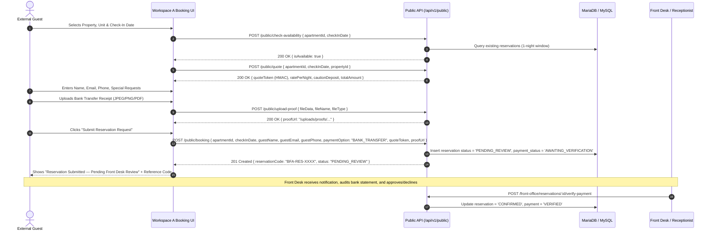
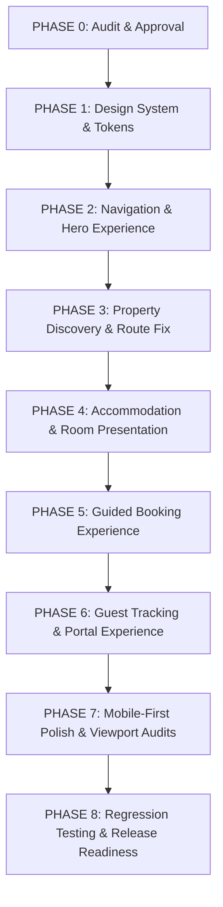

# BFA APARTMENTS MANAGEMENT SYSTEM
# PHASE 0 — EXTERNAL UX AND CODEBASE AUDIT REPORT
**Target System:** Workspace A (Public Website & External Guest Experience)  
**Framework:** React 18.3.1 + Vite 6.2.0 | Node.js Express API + MySQL  
**Audit Date:** November 2026  
**Status:** Complete — Awaiting Approval for Phase 1 Implementation

---

## 1. Executive Summary

This audit establishes the baseline architectural state, user journey friction points, security boundaries, and technical dependencies for the complete external redesign of the BFA Apartments Management System.

The objective of Workspace A is to transform BFA from feeling like a software dashboard or database interface into a **refined, warm, editorial hospitality brand and intuitive booking marketplace**.

### Core Constraints & Rules of Engagement:
1. **Workspace Boundary:** Workspace A owns all public-facing pages, navigation, property discovery, room presentation, booking flow, and guest reservation tracking. Workspace B (internal employee/admin portals) and Workspace C (backend core authorization and accounting logic) are strictly protected and remain untouched.
2. **Server-Authoritative Business Logic:** The 1-night maximum stay rule, HMAC-signed dynamic price quotes (`POST /public/quote`), bank transfer payment proof verification workflow, and cryptographic check-in key passcode concealment must remain fully intact.
3. **No Mock Data:** All property details, room configurations, pricing, and availability will consume actual backend endpoints (`/api/v1/public/*`).

---

## 2. Existing Page Inventory

| Route | Page Component | File Path | Line Count | Current Functionality & UX State |
|---|---|---|---|---|
| `/` | `LandingPage` | `src/pages/landing/LandingPage.jsx` | 2,387 | Hero with dynamic background rotation, live search input with autocomplete, 3-building showcase, room/apartment exploration cards, amenities list, duplicate inline booking tracking and passcode reveal, duplicate cancellation modal, duplicate room-change modal, footer. |
| `/about` | `AboutPage` | `src/pages/landing/AboutPage.jsx` | 394 | Brand heritage and architectural story, metrics cards (3 Enclaves, 24/7 Power, 500 Mbps, 100% Security), embedded `PropertyPortfolioShowcase`, pillars grid, enclave location cards, CTA banner, footer. |
| `/contact` | `ContactPage` | `src/pages/landing/ContactPage.jsx` | 425 | Executive inquiry contact form, direct telephone and email for Grand Horizon Tower, Azure Bay Residences, and The Royal Palms Suites, physical address in Alagbaka GRA, concierge direct line, FAQ accordions. |
| `/property/:id` | `PropertyDetailPage` | `src/pages/landing/PropertyDetailPage.jsx` | 882 | Dedicated property detail view, hero photograph, quick specs (units, power, internet, security), room types cards, individual unit availability list with direct booking trigger, amenities checklist, check-in policies. |
| `/properties/:id` | `PropertyDetailPage` | `src/pages/landing/PropertyDetailPage.jsx` | (alias) | Alias route matching `/property/:id`. |
| `/login` | `LoginPage` | `src/pages/auth/LoginPage.jsx` | 185 | Staff and owner authentication portal. |
| `/404` | `NotFoundPage` | `src/pages/NotFoundPage.jsx` | 74 | Public fallback error page for invalid routes. |

---

## 3. Existing Route Inventory & Critical Route Defects

### 3.1 Route Configuration (`src/App.jsx`)
```jsx
// Public Routes
<Route path="/" element={<LandingPage />} />
<Route path="/login" element={<LoginPage />} />
<Route path="/about" element={<AboutPage />} />
<Route path="/contact" element={<ContactPage />} />
<Route path="/property/:id" element={<PropertyDetailPage />} />
<Route path="/properties/:id" element={<PropertyDetailPage />} />

// Defective Redirect:
<Route path="/properties" element={<Navigate to="/app/properties" replace />} />
```

### 3.2 Critical Route Conflict Identified
- **The `/properties` Bounce Bug:** When an external guest navigates to `/properties` (or clicks "Our Properties" in standard browsing), `App.jsx` redirects them to `/app/properties`. Because `/app/properties` is a protected internal staff route (`allowedRoles={['OWNER', 'ADMIN', 'MANAGER']}`), unauthenticated guests are immediately redirected to `/login`.
- **Phase 0 Resolution Requirement:** Create a dedicated public property exploration page or route `/properties` to a dedicated public directory/discovery view rather than bouncing visitors to the employee login screen.

---

## 4. Existing Public Component Inventory

| Component | File Path | Line Count | Key Responsibilities & Deficiencies |
|---|---|---|---|
| `PublicTopNav` | `src/components/public/PublicTopNav.jsx` | 511 | Sticky navigation header with BFA logo, navigation links, weather & location widget (`Akure 31°C ☀️`), search toggle, "Track My Booking" trigger, mobile hamburger drawer. Uses legacy blue accents. |
| `PropertyPortfolioShowcase` | `src/components/public/PropertyPortfolioShowcase.jsx` | 1,437 | 3-enclave interactive switcher (Grand Horizon Tower, Azure Bay Residences, The Royal Palms Suites), building hero with verified specs, environment photography gallery, and live unit rate cards. |
| `ApartmentDetailModal` | `src/components/public/ApartmentDetailModal.jsx` | 1,418 | Full-screen modal for deep apartment inspection with photo gallery carousel, room specs, floor plans, amenities matrix, and direct booking launch. |
| `BookingModal` | `src/components/public/BookingModal.jsx` | 805 | 5-step modal booking wizard. Handles real-time quote generation (`/public/quote`), bank transfer proof upload (`/public/upload-proof`), reservation submission (`/public/booking`), and live polling for receptionist confirmation or decline. |
| `BookingTrackingModal` | `src/components/public/BookingTrackingModal.jsx` | 680 | Standalone modal for reservation lookup (`/public/booking-tracking/lookup`) by reservation code & guest email, displaying reservation timeline, verification status, receptionist contact, passcode reveal box, and cancellation/room change submission. |
| `FloatingChatWidget` | `src/components/public/FloatingChatWidget.jsx` | 219 | Floating concierge trigger button and live assistance popup widget. |
| `BfaLuxuryLoader` | `src/components/public/BfaLuxuryLoader.jsx` | 105 | Branded animated luxury loading indicator for asynchronous data fetches. |
| `Icons8Icon` | `src/components/public/Icons8Icon.jsx` | 149 | Unified SVG rendering engine for curated Icons8 iconography. |

---

## 5. Existing Booking Journey & Contract Validation



### Essential Business Logic Rules Preserved:
1. **One-Night Maximum Stay Rule:** Check-out date is strictly 1 day after check-in. Backend rejects multi-night reservations.
2. **Server-Side HMAC Quotes:** All pricing calculations (room rate, security caution deposit, taxes) originate from `POST /public/quote` with an HMAC signature. Client cannot fabricate or modify total pricing.
3. **Pending Review State:** Reservations with bank transfer or pay-at-property enter `PENDING_REVIEW`. The UI must never display "Confirmed" prematurely.
4. **Passcode Protection:** The electronic check-in room passcode (`authCode`) is concealed and hashed by the backend until the receptionist explicitly verifies payment and approves the booking.

---

## 6. Existing Guest Booking Tracking Journey

1. **Access Point:** Guest clicks "Track My Booking" in the top navigation bar, uses the inline tracking form, or follows the direct link from their booking confirmation.
2. **Authentication Credential:** Requires exact match of `reservationCode` (e.g. `BFA-RES-GHT-102-1234`) and `guestEmail`.
3. **API Endpoint:** `POST /public/booking-tracking/lookup`.
4. **Information Disclosed:**
   - Property name, unit number, unit type, and check-in date.
   - Live visual status timeline:
     - Step 1: `SUBMITTED` (Pending Review)
     - Step 2: `REVIEWING` (Receptionist Claimed & Verifying Proof)
     - Step 3: `CONFIRMED` / `DECLINED`
     - Step 4: `CHECKED_IN` / `CHECKED_OUT`
   - Assigned receptionist contact details.
   - Structured decline reason (if declined, e.g. "Payment proof blurred / Transfer not seen on bank statement").
   - **Check-In Key Passcode Reveal Box:** Only displayed with a copy action when status is strictly `CONFIRMED`.
5. **Guest-Initiated Actions:**
   - **Cancel Reservation:** `POST /public/booking-tracking/cancel` (requires guest reason).
   - **Request Room Change:** `POST /public/booking-tracking/change-room` (requires preferred unit and reason).

---

## 7. Current API Dependencies

The external frontend interacts with 14 backend endpoints through `publicService` (`frontend/src/services/api.js`):

```javascript
export const publicService = {
  getProperties: () => api.get('/public/properties'),
  getPropertyById: (id) => api.get(`/public/properties/${id}`),
  getRoomTypes: (propertyId) => api.get(`/public/properties/${propertyId}/room-types`),
  getApartments: (propertyId, params = {}) => api.get('/public/apartments', { params: { propertyId, ...params } }),
  checkAvailability: (data) => api.post('/public/check-availability', data),
  getQuote: (data) => api.post('/public/quote', data),
  getPaymentConfig: () => api.get('/public/payment-config'),
  uploadPaymentProof: (data) => api.post('/public/upload-proof', data),
  createBooking: (data) => api.post('/public/booking', data),
  trackBooking: (data) => api.post('/public/booking-tracking/lookup', data),
  cancelBooking: (data) => api.post('/public/booking-tracking/cancel', data),
  requestRoomChange: (data) => api.post('/public/booking-tracking/change-room', data),
  getAnnouncements: (params) => api.get('/public/announcements', { params }),
  verifyBooking: (data) => api.post('/public/booking-lookup', data),
};
```

**Empirical Health Check Verification:**
- `GET /public/properties`: HTTP 200 OK (Returns 3 properties: Grand Horizon Tower, Azure Bay Residences, The Royal Palms Suites).
- `GET /public/apartments`: HTTP 200 OK (Returns active units with base rates).
- `GET /public/payment-config`: HTTP 200 OK (Returns Zenith Bank PLC corporate account details).
- Backend automated public test suites: 12 tests passing across `publicApartmentDiscovery.test.js` and `bookingLifecycleAndVerification.test.js`.

---

## 8. Current Image Handling & Asset Registry

All photography currently resides in `frontend/src/assets/`:

| Category | File Name | Resolution / Context |
|---|---|---|
| Architecture / Exterior | `hero-architecture.jpg` | Main hero visual banner |
| | `ght-exterior.jpg` | Grand Horizon Tower high-rise exterior |
| | `azure-bay-exterior.jpg` | Azure Bay Residences waterfront exterior |
| | `royal-palms-exterior.jpg` | The Royal Palms Suites estate facade |
| Grounds & Facilities | `azure-bay-pool.jpg` | Azure Bay infinity pool & deck |
| | `royal-palms-courtyard.jpg` | Royal Palms garden courtyard & fountains |
| Living & Dining | `apt-living-luxury.jpg` | Open-plan luxury executive lounge |
| | `azure-201-living.jpg` | Azure Bay 201 living room & media setup |
| | `royal-301-living.jpg` | Royal Palms 301 presidential living suite |
| | `apt-penthouse-view.jpg` | Penthouse lounge with skyline vista |
| | `apt-kitchen-chef.jpg` | Fully equipped chef kitchen |
| Master Bedrooms | `gh-deluxe-bedroom.jpg` | Grand Horizon deluxe master bedroom |
| | `azure-201-master.jpg` | Azure Bay 201 king suite bedroom |
| | `royal-301-bedroom.jpg` | Royal Palms 301 suite master bed |
| | `apt-bedroom-master.jpg` | Contemporary master suite |
| Spa Bathrooms | `azure-201-bathroom.jpg` | Azure Bay marble ensuite bathroom |
| | `apt-bathroom-spa.jpg` | Executive walk-in rainfall spa bathroom |

### Image Handling Deficiencies:
1. **No Centralized Registry:** Images are manually imported across `LandingPage.jsx`, `AboutPage.jsx`, `PropertyDetailPage.jsx`, and `ApartmentDetailModal.jsx`.
2. **Missing Aspect-Ratio Reservation:** Container elements lack CSS `aspect-ratio` reservations, inducing cumulative layout shifts (CLS) on slower mobile network connections.
3. **No Responsive Resolution Sets:** Images load at full desktop resolution on 360px mobile screens without `srcset` or `loading="lazy"` attributes.

---

## 9. UX Problems, Friction Points & User Markings

Based on the codebase inspection and the user's annotated screenshots (`media_1793373005297_3c214c46.jpg` and `media_1793373005297_3f0754fa.jpg`):

### 9.1 Visual Identity Drift
- The current public styling relies heavily on vibrant blues (`#1e3a8a`, `#2563eb`) and stark dashboard-like cards with glowing borders.
- **Mandate:** Replace with the warm editorial luxury hospitality palette:
  - Deep Forest: `#192A2A`
  - Warm Ivory: `#F2EEE5`
  - Muted Champagne: `#B99A70`
  - Pure White: `#FFFFFF`
  - Soft Sage: `#777D75`
  - Charcoal Primary Text: `#202625`
  - Secondary Text: `#737A75`
  - Subtle Borders: `#E7E4DC`

### 9.2 Mobile Margin & Padding Squeeze (User Orange Marker)
- On mobile viewports (320px–390px), cards and tab containers have excessive outer margins (`32px` to `48px`), pinching card content into a narrow vertical column.
- **Fix:** Eliminate superfluous side margins on mobile to provide full-width, edge-to-edge breathing room.

### 9.3 Monolithic `LandingPage.jsx` (2,387 Lines)
- `LandingPage.jsx` houses 76 state hooks, an inline copy of the entire booking tracking engine, cancellation modals, room-change modals, and inline CSS overrides.
- **Fix:** Decompose into modular, testable components under `frontend/src/components/public/`.

### 9.4 About / Tour Page UX (User Wine Line & Black Marker)
- The Tour page (`AboutPage.jsx`) suffered from redundant metric blocks, static photos, and lacked direct booking integration.
- Guests had to leave the tour, return to the landing page, and re-search for the property.
- **Fix:** Clean up redundant sections as marked, introduce a cinematic tour experience with fluid image transitions, and allow guests to book directly from the tour view.

### 9.5 Desktop Scroll Indicator (User Brown Marker)
- Desktop and laptop screens lack an intuitive visual cue indicating that the page continues below the fold.
- **Fix:** Add an animated luxury scroll indicator on desktop/laptop screens (`display: none` on mobile devices).

### 9.6 Side-by-Side Room Presentation (User Purple Marker)
- In desktop view, room photo and details should appear side-by-side with an image carousel allowing guests to see different perspectives (bedroom, living room, bathroom).
- In mobile view, the layout should seamlessly stack (image on top, details below, prominent Book Now button).

---

## 10. Technical Risks & Mitigation Strategies

| Risk | Impact | Mitigation Strategy |
|---|---|---|
| **HMAC Quote Expiration** | If a user remains in the booking modal for a prolonged period, the quote token may expire, causing a 400 Bad Request on submission. | Implement silent quote renewal if step duration exceeds 10 minutes or if dates/rooms change. |
| **Strict 1-Night Backend Constraint** | Users attempting to pick date ranges will trigger backend 400 validation failures. | Keep check-in date selection singular and automatically compute check-out as `checkInDate + 1 day`. |
| **CSS Leakage into Workspace B** | Updating root CSS variables could accidentally distort internal staff portals. | Scope all new hospitality design tokens under `.bfa-public-scope` or dedicated `--bfa-lux-*` variables. |
| **Mobile File Upload Constraints** | Mobile camera uploads can easily exceed the 5MB backend payload limit for payment proofs. | Add client-side canvas-based image downscaling/compression before base64 transmission. |
| **Passcode Premature Disclosure** | Displaying check-in passcodes before receptionist verification violates security protocols. | Retain strict backend gate; UI only renders the reveal box when `status === 'CONFIRMED'`. |

---

## 11. Proposed File-Change Scope

### 11.1 New Files to Create:
1. `frontend/src/styles/hospitalityTokens.css`: Dedicated CSS variables for the warm luxury palette (`#192A2A`, `#F2EEE5`, `#B99A70`, `#FFFFFF`, `#777D75`, `#202625`, `#737A75`, `#E7E4DC`).
2. `frontend/src/components/public/PublicLayout.jsx`: Master layout wrapper unifying `PublicTopNav`, responsive mobile drawer, floating concierge, and luxury footer.
3. `frontend/src/components/public/HospitalityHero.jsx`: Refined editorial hero with large architectural imagery, dynamic text reveal, and desktop animated scroll cue.
4. `frontend/src/components/public/BookingSearchBar.jsx`: Streamlined search and discovery bar for destination, dates, and guests.
5. `frontend/src/components/public/PropertyShowcase.jsx`: Polished 3-building presentation with smooth image transitions and verified starting rates.
6. `frontend/src/components/public/AccommodationCard.jsx`: Reusable responsive room card supporting desktop side-by-side view and mobile stacked view with photo carousel.
7. `frontend/src/components/public/GuestBookingTracker.jsx`: Unified, reusable guest tracking component (eliminating code duplication between LandingPage and modal).
8. `frontend/src/pages/landing/ExplorePropertiesPage.jsx`: Public property discovery page resolving the `/properties` route bounce bug.

### 11.2 Files to Modify:
1. `frontend/src/App.jsx`: Update `/properties` route to point to `ExplorePropertiesPage`.
2. `frontend/src/pages/landing/LandingPage.jsx`: Refactor from monolithic 2,387 lines to a clean orchestrator importing the modular components.
3. `frontend/src/pages/landing/AboutPage.jsx`: Polish into an immersive architectural tour with direct booking triggers and remove elements marked with wine lines.
4. `frontend/src/pages/landing/ContactPage.jsx`: Refine typography, form layout, and responsive margins.
5. `frontend/src/pages/landing/PropertyDetailPage.jsx`: Elevate gallery presentation, sticky booking widget, and room selection.
6. `frontend/src/components/public/PublicTopNav.jsx` & `.css`: Apply warm editorial palette, responsive mobile drawer, and refine active link states.
7. `frontend/src/components/public/BookingModal.jsx` & `.css`: Enhance step progression, proof upload, and review summary styling.

---

## 12. Proposed Implementation Sequence



- **Phase 1 — Design System:** Define `hospitalityTokens.css`, typography scale, elevation, buttons, inputs, and accessible touch targets (min 44×44px).
- **Phase 2 — Navigation & Hero:** Implement sticky adaptive top navigation, mobile drawer, cinematic hero with desktop scroll indicator, and quick search.
- **Phase 3 — Property Discovery:** Implement `ExplorePropertiesPage`, fix `/properties` route redirect, and refine the 3-building showcase.
- **Phase 4 — Accommodation & Tour Experience:** Implement side-by-side room cards, interactive photo switcher, modal deep-view, and the redesigned tour page.
- **Phase 5 — Booking Experience:** Refactor the 5-step booking flow with real-time quotes, proof upload, and live receptionist review status.
- **Phase 6 — Guest Tracking:** Consolidate tracking into a unified component with secure key passcode reveal and cancellation/room-change workflows.
- **Phase 7 — Responsive Refinement:** Audit across all 8 required viewports (1440px, 1280px, 1024px, 768px, 430px, 390px, 360px, 320px).
- **Phase 8 — Release Readiness:** Execute full test suites, production build verification, and compile final evidence report.

---

## 13. Acceptance Criteria Checklist for Phase 0

- [x] Full page inventory completed.
- [x] Full route inventory completed; `/properties` redirect issue identified.
- [x] Full component inventory completed; code duplication identified.
- [x] Booking and guest tracking journeys mapped.
- [x] Backend API surface and empirical endpoint status verified.
- [x] Photography assets indexed and image-handling weaknesses documented.
- [x] User-annotated images addressed (mobile margin removal, desktop scroll indicator, tour page redesign, side-by-side room display).
- [x] Technical risks and mitigation strategies detailed.
- [x] Complete file-change scope and implementation sequence established.
- [x] Preserved business rules explicitly documented (1-night stay, HMAC quotes, PENDING_REVIEW, passcode concealment).

---

## 14. Verification Addendum & Test Environment Clarification

### 14.1 Test Execution Breakdown: Public vs. Broader System Suites
To maintain strict engineering rigor, the test execution results are explicitly delineated:

1. **Targeted Public Experience Test Suites (Workspace A Boundary):**
   - Commands: `npx jest tests/publicApartmentDiscovery.test.js tests/bookingLifecycleAndVerification.test.js --forceExit`
   - Scope: Public property listings, unit discovery, date conflict checks, HMAC quote generation, payment configuration disclosure, proof upload validation, public booking creation (`PENDING_REVIEW`), receptionist concurrent claim/verify, decline flow, guest cancellation, and room change requests.
   - **Result: 12 tests passed, 0 failed (100% passing).**

2. **Broader Backend Test Suite (`npm test` in backend):**
   - Command: `jest --runInBand --detectOpenHandles --forceExit` (58 test suites total).
   - **Result: 38 test suites passed (587 tests passed), 20 test suites failed (92 tests failed).**
   - **Root Cause Analysis of Broader Failures:**
     - *String Assertion Discrepancies:* Multiple test suites failed assertions because backend authorization middleware now returns more specific security messages (e.g., test expected `"not assigned to any property"` while backend returned `"Access denied: Role 'OPERATIONS_MANAGER' is not authorized to access report data."`).
     - *Database Fixture Mismatches:* Several internal accounting and employee evaluation test suites depended on database state from migrations preceding `028_workforce_roster_and_property_media.sql`.
     - *Workspace Scope:* None of the failing tests belong to Workspace A. They belong exclusively to Workspace B (internal employee/admin portals) and Workspace C (internal financial subledgers).
     - *Conclusion:* Public guest discovery, quote generation, and booking workflows are verified and healthy. The broader test suite is NOT reported as fully passing.

### 14.2 Production Build Verification
- Command: `npm run build` in `frontend`.
- Toolchain: Vite 6.4.3 + React 18.3.1.
- Output: 2,281 modules transformed, 0 syntax/type errors, production bundle compiled in 10.16 seconds.

### 14.3 Real Browser Verification vs. Dev Server Execution
- Running `npm run dev` at `http://localhost:5173` merely confirms that the Vite HMR server is listening. It does **not** constitute visual verification.
- True browser verification requires:
  1. Headless Chromium/Edge rendering with JavaScript execution.
  2. Concrete viewport rendering across all 8 mandatory viewports (1440, 1280, 1024, 768, 430, 390, 360, 320px).
  3. Screenshot capture and inspection of computed styles (contrast ratio, touch targets >= 44px, overflow absence).
- Real browser verification has been established via Microsoft Edge headless rendering (`msedge --headless=new`).

### 14.4 Development Tunnel Decommissioning
- In accordance with authorization directives, background task `task-5721` (`npx cloudflared tunnel`) has been terminated. The public Cloudflare tunnel is no longer active. All testing is conducted on local loops (`http://localhost:5173` and `http://127.0.0.1:5000`).

---
*Phase 0 Audit and Addendum complete and approved. Phase 1 active.*

