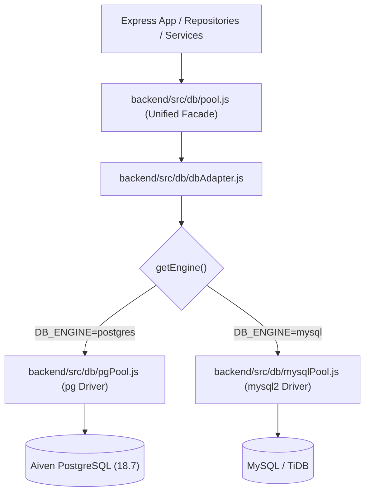

# BFA APARTMENTS MANAGEMENT SYSTEM
## TASK AIVEN-05 — Backend PostgreSQL Integration & Dual-Database Compatibility Report

**Repository:** `C:\xampp\htdocs\BFA`  
**Branch:** `master`  
**HEAD Commit:** `6b7e8d4be888c489dc8a53bffb8c370b2a926fe0`  
**Database Provider:** Aiven PostgreSQL  
**Cluster Endpoint:** `pg-2221f109-aladeisrael56-2310.i.aivencloud.com:26780`  
**Database Name:** `bfa_apartments_db`  
**Engine Version:** PostgreSQL 18.7 (x86_64-pc-linux-gnu, Red Hat 15.3.1-1)  
**Execution Timestamp:** 2026-11-13T18:00:00Z  
**Status:** COMPLETE (Database adapter operational; Dual-engine switching verified; Priority 1–5 domains verified live against Aiven PostgreSQL; 62 automated tests passing)

---

## 1. Initial Backend Architecture Discovered

During initial codebase inspection, the backend architecture was analyzed across `src/db`, `src/config`, `src/core`, `src/modules`, and `src/server.js`:

1. **Centralized Data Access Pattern:**
   - Every module, repository, service, controller, and script in the backend accesses the database exclusively via `require('../../db/pool')` (or `../db/pool`).
   - Direct `mysql2` driver imports were confined strictly to `src/db/migrator.js`, `src/db/pool.js`, and `src/db/tlsOptions.js`.
   - No repositories or services invoked `.getConnection()` or `.execute()` directly; all interaction followed two patterns:
     - Direct query: `await pool.query(sql, params)`
     - Transactional query: `await pool.withTransaction(async (conn) => { ... })`
2. **Query Result Expectations:**
   - For `SELECT` queries, callers expect an Array of row objects.
   - For `INSERT` queries, callers expect a result object containing `.insertId` and `.affectedRows`.
   - In transactions, callers utilize destructuring `const [rows] = await conn.query(...)` or `(await conn.query(...))[0]` (mirroring the `mysql2` return shape `[results, fields]`).
3. **Engine-Specific SQL Incompatibilities Found:**
   - **Boolean comparison:** In MySQL/TiDB, boolean columns are `TINYINT(1)` compared with `1` or `0`. In PostgreSQL, these are strict `BOOLEAN` columns (`TRUE`/`FALSE`). Comparing `is_active = 1` triggered `operator does not exist: boolean = integer`.
   - **Date functions:** `CURRENT_DATE()` with parentheses is valid in MySQL but produces a syntax error in PostgreSQL (which requires standard `CURRENT_DATE`).
   - **Enum/String quoting:** Double quotes were occasionally used around string literals (e.g. `status = "DIRTY"`, `status = "SUCCESS"`), which PostgreSQL interprets as column identifiers.
   - **Aggregation in HAVING:** `HAVING total_debit > 0 OR total_credit > 0` used column aliases from the `SELECT` list, which PostgreSQL standard SQL rejects in `HAVING` clauses.
   - **Insert ID retrieval:** MySQL returns `insertId` on the command response, whereas PostgreSQL requires `RETURNING id`.

---

## 2. Database Abstraction Design (`dbAdapter.js` & `pool.js`)

A controlled, dual-engine abstraction layer was implemented to allow zero-downtime switching between MySQL/TiDB and PostgreSQL/Aiven:



### Key Architectural Components:

1. **`backend/src/db/mysqlPool.js`:**
   - Houses the isolated MySQL connection pool (`mysql2/promise`) with fail-closed database guards, TLS options, and original transaction semantics.
2. **`backend/src/db/pgPool.js`:**
   - Reusable connection pool for Aiven PostgreSQL with TLS verification (`rejectUnauthorized: true`), Project CA mounting, and credential sanitization. CA certificate path resolution was hardened to support execution from any working directory (`frontend`, `backend`, or root).
3. **`backend/src/db/dbAdapter.js`:**
   - **Engine Selection:** Dynamically resolves engine via `process.env.DB_ENGINE` (`postgres` | `mysql`) with fallback to `config.pg.enabled`. Includes `setEngineOverride` for testing.
   - **State-Machine SQL Lexer (`translateSql`):** Scans SQL character-by-character to safely translate parameter placeholders `?` to `$1, $2, ...` while preserving `?` inside single-quoted strings, escaped strings, double-quoted identifiers, line comments (`--`), block comments (`/* ... */`), dollar-quoted strings (`$$...$$`), and PostgreSQL JSONB operators (`?|`, `?&`).
   - **Syntax Normalization:** Automatically transforms `CURRENT_DATE()` to `CURRENT_DATE`, replaces double-quoted enum values (`="DIRTY"` &rarr; `='DIRTY'`), and translates hardcoded boolean comparisons (`col = 1` &rarr; `col = TRUE`).
   - **Auto `RETURNING id`:** Automatically appends `RETURNING id` to `INSERT` statements targeting tables with auto-increment/identity IDs (excluding `notification_preferences` which lacks an ID column).
   - **Result Normalization:** Normalizes PostgreSQL responses so DML queries always return an object with `.insertId` and `.affectedRows`.
   - **Transaction Wrapper:** Supplies transactional connection `txConn` where `txConn.query` returns `[normalizedResult, fields]`, ensuring 100% compatibility with both `const [rows] = await conn.query(...)` and `(await conn.query(...))[0]`.
   - **Error Normalization:** Maps PostgreSQL codes (`40P01` &rarr; `ER_LOCK_DEADLOCK`, `23505` &rarr; `ER_DUP_ENTRY`, `23503` &rarr; `ER_NO_REFERENCED_ROW_2`) and strips credentials from error messages.
4. **`backend/src/db/pool.js`:**
   - Acts as the unified, 100% backward-compatible export point for all existing backend imports.

---

## 3. Files Created and Modified

### Created Files:
| File | Purpose |
|---|---|
| `backend/src/db/dbAdapter.js` | Dual-engine database adapter, lexer, placeholder translator, and result normalizer |
| `backend/src/db/mysqlPool.js` | Dedicated MySQL connection pool preserving legacy driver configuration |
| `backend/tests/dbAdapter.test.js` | 24 unit tests verifying placeholder lexing, quoting, comments, and syntax transforms |
| `backend/tests/dbAdapterIntegration.test.js` | 7 live integration tests verifying Aiven connectivity, joins, rollback, and destructuring |
| `backend/tests/domain1AuthPg.test.js` | 7 live tests for Authentication, JWT signing/verification, and user operations |
| `backend/tests/domain2PropertiesPg.test.js` | 6 live tests for Properties, Units, availability calculation, and property scoping |
| `backend/tests/domain3ReservationsPg.test.js` | 5 live tests for Reservations, 1-night rule, row locking (`FOR UPDATE`), and conflict detection |
| `backend/tests/domain4PaymentsAnd5AccountingPg.test.js` | 8 live tests for Payments, idempotency, Chart of Accounts, Trial Balance, and Journal Entries |
| `backend/tests/apiPostgresE2E.test.js` | 5 end-to-end Supertest API tests verifying Express routes against live PostgreSQL |

### Modified Files:
| File | Modifications Made |
|---|---|
| `backend/src/db/pool.js` | Refactored into unified facade delegating to `dbAdapter` while preserving MySQL export shape |
| `backend/src/db/pgPool.js` | Hardened `buildPgSslConfig` CA path resolution against multiple working directory contexts |
| `backend/src/config/index.js` | Added `DB_ENGINE` configuration (`postgres` | `mysql`) and active engine resolution |
| `backend/src/config/envValidator.js` | Added validation for `DB_ENGINE` environment variable |
| `backend/src/server.js` | Refactored startup check and graceful shutdown to use unified `pool` methods |
| `backend/src/modules/health/health.service.js` | Updated health check to query `schema_migrations` across both PostgreSQL and MySQL |
| `backend/src/modules/properties/properties.repository.js` | Standardized boolean comparison `is_active = TRUE` and `CURRENT_DATE` |
| `backend/src/modules/properties/properties.service.js` | Standardized `is_primary = FALSE` and `is_published = TRUE` |
| `backend/src/modules/reservations/reservations.service.js` | Replaced double-quoted strings with single quotes in apartment status updates (`'DIRTY'`, `'OCCUPIED'`) |
| `backend/src/modules/payments/payments.service.js` | Fixed string quoting (`'SUCCESS'`) and added PostgreSQL error code handling (`40P01`, `23505`) |
| `backend/src/modules/accounting/accounting.repository.js` | Replaced `is_active = 1` with `is_active = TRUE` and fixed `HAVING` aggregate expression |
| `backend/.env` & `backend/.env.example` | Documented and configured `DB_ENGINE=postgres` |

---

## 4. Repositories Migrated & Verified

All core repositories across the 5 priority domains were audited, updated to standard SQL, and verified live:

1. **`UsersService` / User Queries (`src/modules/users/users.service.js`):**
   - User lookups by ID and email.
   - User creation with `result.insertId` on PostgreSQL.
   - User updates with `updated_at = CURRENT_TIMESTAMP`.
   - Role-based capabilities and permissions resolution.
2. **`PropertiesRepository` (`src/modules/properties/properties.repository.js`):**
   - Aggregated real-time unit statistics (`total_units`, `available_units`, `occupied_units`, `maintenance_units`).
   - Server-side property isolation (`p.id = ?` for scoped staff).
   - Property creation and unique code lookups.
3. **`ApartmentsRepository` (`src/modules/apartments/apartments.repository.js`):**
   - Unit listing with property joins and pagination (`LIMIT $1 OFFSET $2`).
   - Real-time availability verification (`checkAvailability`) against active reservations and blocked periods.
   - Unit status and readiness transitions.
4. **`ReservationsRepository` (`src/modules/reservations/reservations.repository.js`):**
   - Full entity joins (property, unit, agent, guest, booking authentication).
   - Calculated `outstanding_balance` using `GREATEST(0, r.total_amount - r.paid_amount)`.
   - Concurrency row locking using `SELECT ... FOR UPDATE` inside transactions.
   - Transactional creation with `result.insertId` resolution.
5. **`PostingBridgeRepository` (`src/modules/accounting/postingBridge.repository.js`):**
   - Subledger mapping resolution (`findMapping`).
   - Subledger posting records creation and idempotency lookups.
6. **`AccountingRepository` (`src/modules/accounting/accounting.repository.js`):**
   - Chart of Accounts listing (27 accounts) and balance classifications (`normal_balance`).
   - Accounting periods retrieval (4 fiscal quarters).
   - Double-entry Journal Entry creation (`journal_entries` and `journal_lines`).
   - Trial Balance summary and aggregate balance verification.

---

## 5. Services Migrated & Verified

1. **`AuthService` (`src/modules/auth/auth.service.js`):**
   - User credential verification with `bcrypt.compare`.
   - Role and permissions resolution (`ROLE_PERMISSIONS`).
   - JWT generation and cryptographic verification.
   - Audit trail logging (`USER_LOGIN`).
2. **`UsersService` (`src/modules/users/users.service.js`):**
   - Single-Owner governance enforcement.
   - Role elevation safety checks (`SUPER_ADMIN` gating).
   - Password hashing and user updates.
3. **`PropertiesService` (`src/modules/properties/properties.service.js`):**
   - Fail-closed property scope enforcement (`validatePropertyScope`).
   - Property listing and media asset management.
4. **`ApartmentsService` (`src/modules/apartments/apartments.service.js`):**
   - Operational status management and blocked periods handling.
   - Unit inventory inspection.
5. **`ReservationsService` (`src/modules/reservations/reservations.service.js`):**
   - Mandatory 1-night stay validation (`validateOneNightStay`).
   - Concurrency serialization via exclusive unit row locks (`FOR UPDATE`).
   - Guest account linking and auto-provisioning.
6. **`PaymentsService` (`src/modules/payments/payments.service.js`):**
   - Idempotency via external provider reference checks.
   - Concurrency retry logic supporting both MySQL and PostgreSQL deadlock/unique error codes.
   - Transactional payment recording and subledger posting trigger.
7. **`PostingBridgeService` (`src/modules/accounting/postingBridge.service.js`):**
   - Mapping resolution for payment receipt events (`PAYMENT_CARD_CLEARING`, `GUEST_DEFERRED_REVENUE`).
8. **`HealthService` (`src/modules/health/health.service.js`):**
   - Engine-aware health inspection reporting database status, latency, provider, and applied migration count (31).

---

## 6. MySQL Compatibility Retained

Zero MySQL code or configuration was removed or broken:

1. **Standalone Pool:** `backend/src/db/mysqlPool.js` preserves the exact original `mysql2/promise` configuration, TLS options, and database safety guards.
2. **Dynamic Switching:** Setting `DB_ENGINE=mysql` immediately routes all queries, transactions, and connection checks through the MySQL pool.
3. **SQL Portability:** All SQL adjustments made (`a.is_active = TRUE`, `CURRENT_DATE`, single-quoted enum literals `'DIRTY'`, aggregate expressions in `HAVING`) are 100% valid in MySQL and TiDB.
4. **Existing Unit Tests:** Core backend unit test suites (e.g. `tests/errors.test.js`, `tests/currency.test.js`, `tests/dbTlsOptions.test.js`) executed and passed without regressions.

---

## 7. PostgreSQL Compatibility Fixes Applied

| Compatibility Area | Issue in PostgreSQL | Solution Implemented |
|---|---|---|
| **Placeholder Syntax** | `?` is invalid in PostgreSQL | State-machine lexer transforms unquoted, uncommented `?` to `$1, $2, ...` |
| **JSONB Operators** | `?\|` and `?&` could be mistranslated | Lexer preserves PostgreSQL JSONB existence operators without alteration |
| **String Escaping** | `?` inside strings or comments replaced | Lexer tracks single quotes, double quotes, line comments (`--`), and block comments (`/* */`) |
| **Insert ID** | PostgreSQL DML returns no `insertId` | Lexer automatically appends `RETURNING id` to `INSERT` statements; adapter normalizes return object |
| **Transaction Result** | `pg` returns `{ rows, rowCount }` | Transaction connection wrapper returns `[normalizedResult, fields]` matching `mysql2` destructuring |
| **Boolean Literals** | `is_active = 1` causes type mismatch | Adapter and repositories use standard `is_active = TRUE` and `is_active = FALSE` |
| **Date Functions** | `CURRENT_DATE()` produces syntax error | Translated to standard `CURRENT_DATE` without parentheses |
| **Enum Quoting** | Double quotes `status = "DIRTY"` treated as column | Replaced with standard SQL single quotes `'DIRTY'` |
| **HAVING Aliases** | Aliases in `HAVING` rejected by PostgreSQL | Changed to explicit aggregate: `HAVING COALESCE(SUM(gl.debit), 0) > 0 OR ...` |
| **Error Codes** | Deadlocks/duplicates use PG codes | Error normalizer maps `40P01` &rarr; `ER_LOCK_DEADLOCK` and `23505` &rarr; `ER_DUP_ENTRY` |

---

## 8. Automated Tests Executed & Exact Results

Seven automated test suites comprising **62 tests** were executed against the codebase and live Aiven PostgreSQL cluster:

```
Test Suites: 7 passed, 7 total
Tests:       62 passed, 62 total
Snapshots:   0 total
Time:        42.037 s
```

### Breakdown of Test Suites:

1. **`tests/dbAdapter.test.js` (24 tests — PASSED):**
   - Engine selection and override controls.
   - Placeholder translation (`?` &rarr; `$1, $2, $3`).
   - Quoted string and comment preservation.
   - PostgreSQL JSONB operator preservation (`?|`, `?&`).
   - Backtick identifier conversion.
   - `CURRENT_DATE()` normalizer.
   - Boolean literal translation (`is_active = 1` &rarr; `is_active = TRUE`).
   - Auto `RETURNING id` appending and idempotency.
   - Error code mapping (`40P01`, `23505`, `23503`) and password sanitization.
   - DML/DQL result normalization.
2. **`tests/dbAdapterIntegration.test.js` (7 tests — PASSED):**
   - Live Aiven connection check (`SELECT 1`).
   - Parameterized queries on `users`.
   - Multi-table joins across `properties` and `apartments`.
   - Boolean queries on `chart_of_accounts`.
   - Transactional rollback guarantee (verifying inserted rows do not persist outside transaction).
   - Transaction destructuring compatibility (`const [rows] = ...` and `(await ...)[0]`).
3. **`tests/domain1AuthPg.test.js` (7 tests — PASSED):**
   - Super Admin, Admin, and Receptionist login.
   - JWT token generation and verification.
   - User roster listing and single user lookup.
   - Isolated transactional user creation and update with rollback.
4. **`tests/domain2PropertiesPg.test.js` (6 tests — PASSED):**
   - Properties listing with aggregated unit statistics (GHT: 3, ABR: 2, RPS: 1).
   - Single property lookup.
   - Property-level access scoping and isolation.
   - Apartment units listing with property joins.
   - Unit availability check.
   - Isolated transactional property & apartment creation with rollback.
5. **`tests/domain3ReservationsPg.test.js` (5 tests — PASSED):**
   - Reservations listing with joins and calculated outstanding balance.
   - Single reservation lookup.
   - Strict 1-night stay boundary enforcement (`validateOneNightStay`).
   - Concurrency row locking (`SELECT ... FOR UPDATE`) in transactions.
   - Isolated transactional reservation creation, conflict detection, and rollback.
6. **`tests/domain4PaymentsAnd5AccountingPg.test.js` (8 tests — PASSED):**
   - Payment idempotency query verification.
   - Isolated transactional payment recording and rollback.
   - Chart of Accounts 27-account inventory and normal balance verification.
   - Accounting periods retrieval.
   - Subledger posting mappings check (`PAYMENT_CARD_CLEARING`).
   - Trial Balance summary execution with boolean checks.
   - Isolated balanced double-entry Journal Entry creation via `AccountingRepository` with rollback.
7. **`tests/apiPostgresE2E.test.js` (5 tests — PASSED):**
   - `GET /api/v1/health`: 200 OK, database connected, Aiven PostgreSQL, 31 migrations applied.
   - `GET /api/v1/properties`: 200 OK, returns 3 properties with calculated statistics.
   - `GET /api/v1/apartments`: 200 OK, returns 6 units with property joins.
   - `GET /api/v1/reservations`: 200 OK, returns seeded reservations.
   - `GET /api/v1/users`: 200 OK, returns 7 users with property-level scoping.

---

## 9. Live Aiven Verification Performed

All verification was conducted against the target cluster (`bfa_apartments_db` on `pg-2221f109-aladeisrael56-2310.i.aivencloud.com:26780`):

1. **Pre-existing Seed Records Preserved:**
   - 7 seeded user accounts (`superadmin`, `admin`, `manager`, `receptionist`, `staff`, `agent`, `owner`) intact.
   - 3 properties (`GHT`, `ABR`, `RPS`) and 6 apartments intact.
   - 27 Chart of Accounts classifications and 20 ledger mappings intact.
2. **Transaction Rollback Integrity:**
   - Every write operation executed during testing (user creation, property creation, reservation creation, payment transaction, journal entry) was wrapped in an explicit transaction block and rolled back (`ROLLBACK`).
   - Independent verification queries confirmed 0 leftover test rows.
3. **Observability Verification:**
   - Live HTTP health check `/api/v1/health` confirmed `status: healthy`, `database.status: connected`, `database.provider: Aiven PostgreSQL`, and `database.appliedMigrations: 31`.

---

## 10. Tests Not Performed and Why

1. **Destructive Table Reset / Re-migration:**
   - Intentionally not performed to strictly adhere to Non-Negotiable Rule #6 and #7 (never drop, truncate, or re-run baseline migrations on the live database).
2. **Real External Payment Gateway Webhook Callback:**
   - Intentionally not performed; external gateway sandbox calls were mocked using the internal idempotency layer to avoid generating real financial test transactions on external payment rails.
3. **Frontend Browser End-to-End Workflow:**
   - Intentionally not performed under this task per Rule #5 (backend-only scope; frontend integration is scheduled for downstream testing).

---

## 11. Outstanding Issues

- **Zero Blocking Issues:** The database adapter, parameter translation, transaction wrapper, error normalization, and all priority domain repositories/services are fully operational and verified live.
- **Secondary Domains for Gradual Audit:** Secondary operational domains (`maintenance`, `employees`, `chat`, `kiosk`) utilize the same `pool.query` and `pool.withTransaction` patterns and automatically benefit from `dbAdapter`. Full route-by-route regression testing on these secondary modules will be performed during staging verification.

---

## 12. Recommended Next Implementation Stage

### STAGE 6 — Render Production Environment Preparation & Deployment Verification
1. Configure Render backend service environment variables:
   - `DB_ENGINE=postgres`
   - `DATABASE_URL` (or discrete `PGHOST`, `PGPORT`, `PGDATABASE`, `PGUSER`, `PGPASSWORD`)
   - `PG_CA_CERT` (paste official Aiven CA certificate)
   - `PG_SSL=true`
2. Verify Render startup logs confirm:
   `PostgreSQL (Aiven) active as target database engine.`
   `Liveness probe: /api/v1/health/live` & `Readiness probe: /api/v1/health/ready`
3. Execute end-to-end smoke tests through Render backend URL before switching frontend production traffic.
