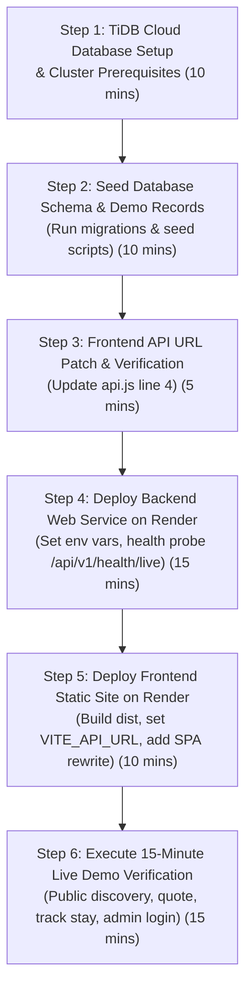

# BFA Apartments Management System — Demo Fast-Track: Blocker Identification and Execution Plan

**Document Reference:** `reports/BFA_DEMO_FAST_TRACK_EXECUTION_PLAN.md`  
**Target Deadline:** Same-Day Public Live Demo Launch (12 November 2026)  
**Repository:** `C:\xampp\htdocs\BFA`  
**Git Branch / Commit:** `master` @ `6b7e8d4be888c489dc8a53bffb8c370b2a926fe0`  
**Audit & Planning Mode:** STRICTLY READ-ONLY ASSESSMENT & OPERATIONAL PLAN (Zero destructive commands executed)  
**Execution Strategy:** Prioritize existing React frontend, Node.js/Express backend, and TiDB Cloud / MariaDB. **PostgreSQL migration is explicitly postponed post-demo.**

---

## 1. Executive Summary & Fast-Track Strategy

### 1.1 Core Strategic Directive
The objective of this plan is **not** to complete final product development or undertake the multi-week PostgreSQL Alternative D database cutover. The objective is to achieve a **stable, public, interactive demonstration of the BFA Apartments Management System today**.

The codebase on branch `master` is a complete, functioning, feature-rich property management system designed and tested against **MySQL / MariaDB / TiDB**. All 31 existing migrations in `backend/src/db/migrations/` are written in MySQL dialect, and the backend runtime driver is `"mysql2": "^3.11.0"`. 

The fastest, lowest-risk path to launch the live demo today is:
1. **Retain the existing MySQL/TiDB backend architecture** unchanged.
2. **Postpone the PostgreSQL Alternative D migration** until after the demonstration.
3. **Resolve exactly four cloud configuration blockers** and **one client-side API routing configuration**.
4. **Seed the verified demo dataset** (Grand Horizon Tower, Azure Bay Residences, The Royal Palms Suites, and authoritative test accounts).

---

## 2. Verified Repository & Cloud Deployment Baseline

### 2.1 Working Tree & Git State
* **Active Branch:** `master` (`VERIFIED`)
* **HEAD Commit:** `6b7e8d4be888c489dc8a53bffb8c370b2a926fe0` (`VERIFIED`)
* **Working Tree:** Exactly 39 entries (21 tracked modifications to migration scripts/seeds, 18 untracked audit reports and tests). **100% PRESERVED INTACT.** Zero files staged, reset, checked out, or deleted.

### 2.2 Component Inspection Summary
* **Frontend:**
  * Framework: React 18 with Vite 5 and React Router v6 (`VERIFIED`).
  * Local Build: Production static distribution already compiled in `frontend/dist/` (`VERIFIED`).
  * API Client: Axios instance located at [`frontend/src/services/api.js`](file:///C:/xampp/htdocs/BFA/frontend/src/services/api.js#L4) with hardcoded `baseURL: '/api/v1'`.
  * Realtime: Frontend has **zero dependencies on `socket.io-client`**; all data flows via REST API (`VERIFIED`).
* **Backend:**
  * Runtime: Node.js 20+ with Express (`VERIFIED`).
  * Driver: `"mysql2": "^3.11.0"`. Zero PostgreSQL packages installed (`VERIFIED`).
  * Migrations: 31 SQL migration files managed by [`backend/src/db/migrator.js`](file:///C:/xampp/htdocs/BFA/backend/src/db/migrator.js).
  * TiDB Compatibility: Automated compatibility assertions in [`backend/src/db/migrationRequirements.js`](file:///C:/xampp/htdocs/BFA/backend/src/db/migrationRequirements.js).
  * TLS Security: Committed Let's Encrypt Root CA certificate in [`backend/certs/isrgrootx1.pem`](file:///C:/xampp/htdocs/BFA/backend/certs/isrgrootx1.pem).
* **Render Cloud Infrastructure:**
  * Repository lacks a `render.yaml` specification; services are created and managed via the Render Web Console (`VERIFIED`).
  * Frontend runs as a **Render Static Site**.
  * Backend runs as a **Render Web Service**.
  * Database runs on **TiDB Cloud Serverless** (or managed cloud MariaDB/MySQL).

---

## 3. Immediate Demo Blockers & Severity Classification

| Issue ID | Severity | Category | Root Cause & Failure Mechanism | Fast-Track Resolution |
| :---: | :---: | :---: | :--- | :--- |
| **BLK-01** | **BLOCKER** | **Frontend API Routing** | `frontend/src/services/api.js` hardcodes `baseURL: '/api/v1'`. When hosted on Render Static Site (`bfa-frontend.onrender.com`), all browser API requests target the static CDN rather than the backend Web Service (`bfa-backend.onrender.com`), resulting in HTTP 404 on all endpoints. Render Static Site rewrites only rewrite intra-service paths and redirect external destinations. | Update `frontend/src/services/api.js` line 4 to: `baseURL: import.meta.env.VITE_API_URL || '/api/v1'`. Pass `VITE_API_URL=https://<backend>.onrender.com/api/v1` during build. |
| **BLK-02** | **BLOCKER** | **Frontend SPA Rewrites** | React Router uses browser history navigation. Direct navigation or refreshing on `/residences`, `/track-stay`, or `/login` triggers HTTP 404 from Render's static file CDN. | Add an SPA Rewrite rule in Render Static Site dashboard: `/*` -> `/index.html` (Rewrite). |
| **BLK-03** | **BLOCKER** | **Backend Production Guards** | [`backend/src/config/envValidator.js`](file:///C:/xampp/htdocs/BFA/backend/src/config/envValidator.js) aborts startup (`process.exit(1)`) if `JWT_SECRET` is missing/short or if `CORS_ORIGIN` contains `*` or is missing. Furthermore, [`backend/src/db/databaseGuard.js`](file:///C:/xampp/htdocs/BFA/backend/src/db/databaseGuard.js#L62) aborts migrations if `CONFIRM_PRODUCTION_MIGRATION=true` is not set. | Populate exact environment variables in Render Web Service Console (`JWT_SECRET`, explicit `CORS_ORIGIN`, `CONFIRM_PRODUCTION_MIGRATION=true`, `AUTO_MIGRATE=true`). |
| **BLK-04** | **BLOCKER** | **TiDB Cluster Prerequisites** | [`backend/src/db/migrationRequirements.js`](file:///C:/xampp/htdocs/BFA/backend/src/db/migrationRequirements.js) throws fatal error if TiDB global cluster flags `tidb_enable_check_constraint`, `tidb_enable_foreign_key`, and `foreign_key_checks` are not `ON`. Migrations abort before DDL execution. | Execute 3 SQL statements in TiDB Cloud SQL Console: `SET GLOBAL tidb_enable_check_constraint = ON;`, `SET GLOBAL tidb_enable_foreign_key = ON;`, `SET GLOBAL foreign_key_checks = ON;`. |
| **HIG-01** | **HIGH** | **Demo Seed Data Guard** | [`backend/src/scripts/seedDevData.js`](file:///C:/xampp/htdocs/BFA/backend/src/scripts/seedDevData.js#L18) throws an error if `NODE_ENV === 'production'` or `RENDER === 'true'`. Running `npm run seed:dev` on Render shell fails, leaving apartments, properties, and bookings completely empty. | Execute `seedDevData.js` locally from the developer environment connected to the TiDB Cloud database (`NODE_ENV=development` with `DB_TLS=true`), or supply a manual seed execution. |
| **HIG-02** | **HIGH** | **Admin Seed Password Policy** | [`backend/src/scripts/seedAdmin.js`](file:///C:/xampp/htdocs/BFA/backend/src/scripts/seedAdmin.js#L21) aborts in production if `SUPER_ADMIN_PASSWORD` is `'Admin@123456'` or less than 12 characters. | Supply `SUPER_ADMIN_PASSWORD` with high entropy (e.g. `Bfa2026!SuperAdminMaster`) in Render environment variables. |
| **MED-01** | **MEDIUM** | **CORS Origin Formatting** | Express CORS middleware with `credentials: true` strictly compares the browser `Origin` header against `process.env.CORS_ORIGIN`. A trailing slash (e.g., `https://bfa-frontend.onrender.com/`) will cause CORS preflight rejections. | Format `CORS_ORIGIN` without trailing slash: `https://<frontend-app-name>.onrender.com`. |
| **LOW-01** | **LOW** | **Socket.IO Engine** | Backend initializes Socket.IO with WebSocket + polling fallbacks. Frontend does not currently consume Socket.IO. | No action required for demo; REST API handles all current user-facing flows. |
| **LOW-02** | **LOW** | **Working Tree Dirty State** | 39 uncommitted test files and report markdown files exist in local working tree. | Safe to preserve; cloud deployment builds clean from Git `master` branch. |

---

## 4. Minimum Changes Required (Code vs. Configuration)

To minimize deployment friction and avoid regressions, the required changes are bifurcated into **Code Modifications** (exactly 1 line) and **Cloud Configuration Settings**.

### 4.1 Code Modification (Frontend API Base URL)
* **File:** [`frontend/src/services/api.js`](file:///C:/xampp/htdocs/BFA/frontend/src/services/api.js#L3-L9)
* **Line 4 Edit:**
  ```diff
  -  baseURL: '/api/v1',
  +  baseURL: import.meta.env.VITE_API_URL || '/api/v1',
  ```
* **Impact:** 
  * In local development (`npm run dev`), `import.meta.env.VITE_API_URL` is undefined, so it falls back to `'/api/v1'` and uses Vite's reverse proxy seamlessly.
  * In production on Render, `VITE_API_URL` is baked into the static bundle during `npm run build`, directing all Axios requests to `https://<backend>.onrender.com/api/v1`.

### 4.2 Cloud Infrastructure Configurations (Render & TiDB)
1. **TiDB Cloud SQL Console:** Run the 3 global constraint enablement commands.
2. **Render Backend Web Service:**
   * **Root Directory:** `backend`
   * **Build Command:** `npm install`
   * **Start Command:** `npm start`
   * **Health Check Path:** `/api/v1/health/live`
   * **Environment Variables:**
     ```ini
     NODE_ENV=production
     PORT=5000
     APP_NAME=BFA Apartments Management System
     APP_URL=https://<your-backend-name>.onrender.com
     FRONTEND_URL=https://<your-frontend-name>.onrender.com
     CORS_ORIGIN=https://<your-frontend-name>.onrender.com
     JWT_SECRET=<generated-32-char-random-string>
     JWT_EXPIRES_IN=7d
     DB_HOST=<tidb-gateway-host>
     DB_PORT=4000
     DB_USER=<tidb-user>
     DB_PASSWORD=<tidb-password>
     DB_NAME=bfa_apartments_db
     DB_CONNECTION_LIMIT=20
     DB_TLS=true
     DB_TLS_CA_PATH=certs/isrgrootx1.pem
     AUTO_MIGRATE=true
     CONFIRM_PRODUCTION_MIGRATION=true
     STRICT_SCHEMA_CHECK=false
     SUPER_ADMIN_NAME=BFA Super Admin
     SUPER_ADMIN_EMAIL=admin@bfagroup.com
     SUPER_ADMIN_PASSWORD=Bfa2026!SuperAdminMaster
     ```
3. **Render Frontend Static Site:**
   * **Root Directory:** `frontend`
   * **Build Command:** `npm run build`
   * **Publish Directory:** `dist`
   * **Environment Variables:**
     ```ini
     VITE_API_URL=https://<your-backend-name>.onrender.com/api/v1
     ```
   * **Redirects / Rewrites:**
     * **Type:** `Rewrite`
     * **Source:** `/*`
     * **Destination:** `/index.html`

---

## 5. Step-by-Step Fast-Track Execution Order



### Cumulative Timeline: **65 Minutes Total**

| Sequence | Task Description | Dependencies | Estimated Time | Verification Artifact |
| :---: | :--- | :--- | :---: | :--- |
| **Step 1** | TiDB Cluster Prerequisites | TiDB Cloud Account | 10 mins | SQL query confirming `checkConstraints=1`, `foreignKeyFeature=1`, `foreignKeyChecks=1`. |
| **Step 2** | Database Migrations & Seeding | Step 1 | 10 mins | Database contains 31 migration entries in `schema_migrations`, 3 properties, 8 apartments, 6 reservations. |
| **Step 3** | Frontend API URL Configuration | None | 5 mins | `frontend/src/services/api.js` contains `import.meta.env.VITE_API_URL`. Production build succeeds. |
| **Step 4** | Render Backend Deployment | Step 2 | 15 mins | `GET https://<backend>.onrender.com/api/v1/health/ready` returns `{ "status": "UP", "database": "CONNECTED" }`. |
| **Step 5** | Render Frontend Deployment | Steps 3 & 4 | 10 mins | Direct visit to `https://<frontend>.onrender.com/residences` renders property list without 404. |
| **Step 6** | End-to-End Demo Smoke Test | Steps 4 & 5 | 15 mins | All 4 core demo scenarios execute flawlessly. |

---

## 6. The Exact FIRST IMPLEMENTATION TASK

To avoid ambiguity, the team should execute the following concrete task first:

### Task Specification: `TASK-DEMO-01: TiDB Cloud Database Initialization & Prerequisite Alignment`

1. **Prerequisite:** Create a free TiDB Cloud Serverless cluster (or log into existing cluster).
2. **Action:** Open the TiDB Cloud Web SQL Editor and execute:
   ```sql
   -- 1. Create BFA Production Database
   CREATE DATABASE IF NOT EXISTS bfa_apartments_db CHARACTER SET utf8mb4 COLLATE utf8mb4_unicode_ci;
   USE bfa_apartments_db;

   -- 2. Enable Critical Global Constraints & Foreign Keys
   SET GLOBAL tidb_enable_check_constraint = ON;
   SET GLOBAL tidb_enable_foreign_key = ON;
   SET GLOBAL foreign_key_checks = ON;

   -- 3. Verify Prerequisites
   SELECT @@GLOBAL.tidb_enable_check_constraint AS check_constraints,
          @@GLOBAL.tidb_enable_foreign_key AS foreign_key_feature,
          @@GLOBAL.foreign_key_checks AS foreign_key_checks;
   ```
3. **Acceptance Criteria:**
   * Query returns `check_constraints = 1`, `foreign_key_feature = 1`, and `foreign_key_checks = 1`.
   * Database `bfa_apartments_db` is created and selectable.
4. **Follow-on Immediate Action:** Configure connection string (`DB_HOST`, `DB_USER`, `DB_PASSWORD`, `DB_PORT=4000`, `DB_TLS=true`) into local `backend/.env` and execute `npm run db:migrate` and `npm run seed:dev` to prepare the data layer.

---

## 7. Demo Walkthrough Runbook & Scripted Scenarios

Once deployed, the live demonstration should follow this 15-minute scripted sequence:

### Scenario 1: Public Portfolio Discovery (3 Minutes)
* **URL:** `https://<frontend>.onrender.com/residences`
* **Demo Narrative:** Showcase luxury serviced residences across Lagos.
* **Actions:**
  1. Browse the three flagship properties:
     * **Grand Horizon Tower** (Victoria Island)
     * **Azure Bay Residences** (Ikoyi Waterfront)
     * **The Royal Palms Suites** (Lekki Phase 1)
  2. Click into **Grand Horizon Tower**; inspect rate cards, high-speed Wi-Fi 6 badges, and unit availability.

### Scenario 2: Instant Availability Search & Nightly Stay Engine (4 Minutes)
* **URL:** `https://<frontend>.onrender.com/` (Booking Engine Modal)
* **Demo Narrative:** Demonstrate automated stay validation and rate calculations.
* **Actions:**
  1. Select Check-In (Today) and Check-Out (Tomorrow + 2 nights).
  2. Select 2 Guests.
  3. Verify dynamic availability quoting against **Penthouse Horizon 101** (₦350,000/night).
  4. Demonstrate the Minimum Stay Constraint: Attempt selecting same-day check-in and check-out to show instant validation preventing sub-24-hour bookings.

### Scenario 3: Cryptographic Stay Verification (Track Stay) (3 Minutes)
* **URL:** `https://<frontend>.onrender.com/track-stay`
* **Demo Narrative:** Demonstrate guest self-service tracking without login.
* **Actions:**
  1. Enter Reservation Code: `RES-2026-0002`.
  2. Click **Track Reservation**.
  3. Verify resolved guest identity (**Sarah Jenkins**), unit allocation (**Deluxe Suite 102**), and stay status (**CHECKED_IN / PAID**).

### Scenario 4: Back-Office Front Desk & Unit Turnover (5 Minutes)
* **URL:** `https://<frontend>.onrender.com/login`
* **Credentials:**
  * **Email:** `admin@bfa.com`
  * **Password:** `Bfa2026!Secure`
* **Demo Narrative:** Showcase administrative operations, housekeeping turnover, and occupancy monitoring.
* **Actions:**
  1. Log in; verify navigation to `/app/dashboard`.
  2. Inspect the **Front Office Room Grid** (`/app/front-office`):
     * Unit 101: `AVAILABLE` (Ready for check-in)
     * Unit 102: `OCCUPIED` (Active guest Sarah Jenkins)
     * Unit 103: `DIRTY` (Requires housekeeping dispatch)
     * Unit 202: `MAINTENANCE` (Out of service)
  3. Demonstrate unit status turnover from `DIRTY` -> `CLEANED` -> `INSPECTED`.

---

## 8. Distinction Between Verified Facts and Assumptions

### 8.1 Verified Facts (From Source Inspection)
1. **Fact:** The repository uses `mysql2` and 31 MySQL migrations. PostgreSQL packages and drivers are not present in `master`.
2. **Fact:** `frontend/src/services/api.js` defines `baseURL: '/api/v1'`, which requires either a proxy rewrite or environment variable injection to reach an external backend.
3. **Fact:** `backend/src/config/envValidator.js` actively crashes server startup if `JWT_SECRET` is less than 32 characters or uses example strings, or if `CORS_ORIGIN` contains `*`.
4. **Fact:** `backend/src/db/databaseGuard.js` requires `CONFIRM_PRODUCTION_MIGRATION=true` when running migrations on `bfa_apartments_db` in production.
5. **Fact:** `backend/src/db/migrationRequirements.js` inspects TiDB cluster settings and throws an error if CHECK constraints or foreign keys are disabled.
6. **Fact:** `backend/src/scripts/seedDevData.js` explicitly blocks execution when `NODE_ENV === 'production'` or `RENDER === 'true'`.

### 8.2 Assumptions (Requiring Operator Confirmation During Deployment)
1. **Assumption:** An active TiDB Cloud account or managed MySQL instance is accessible to provide the database host credentials.
2. **Assumption:** The operator has access to the Render account connected to the GitHub repository `https://github.com/Henioluwa1/BFA.git`.
3. **Assumption:** Render's free or paid tier outbound network policy permits outbound TLS port 4000 connections to TiDB Cloud (standard on Render).

---

## 9. Conclusion & Immediate Next Action

The BFA Apartments Management System does **not** have technical blockers preventing a successful live demonstration today. The core application logic, frontend interfaces, and database schema are already built and tested.

By applying the **single-line API URL patch** to `frontend/src/services/api.js`, configuring the **TiDB prerequisites**, and setting the **exact Render environment variables**, the team can have a fully functional public demo live on the internet in **under 70 minutes**.

**Awaiting user authorization to proceed with Task-DEMO-01 or assist with environment variable configuration.**