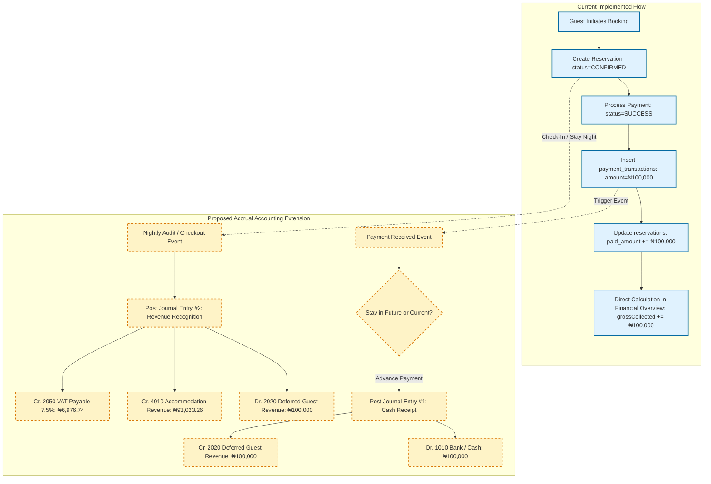
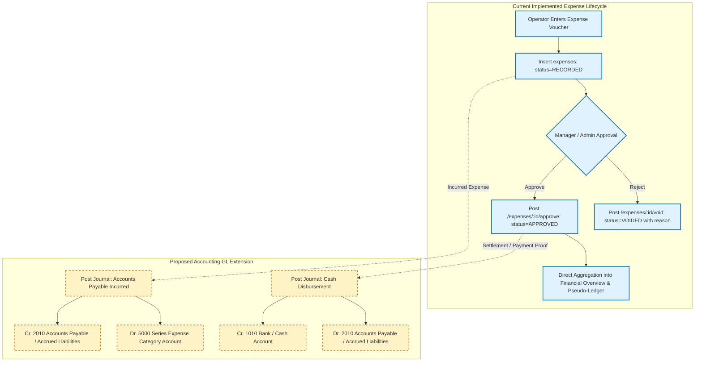
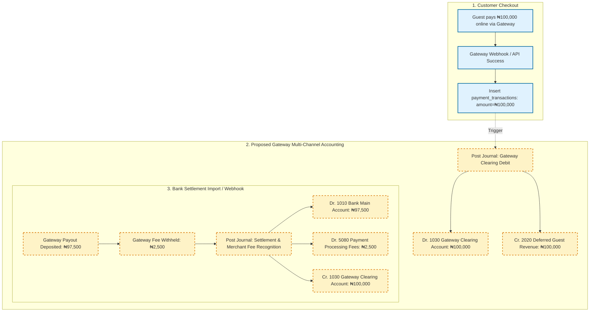
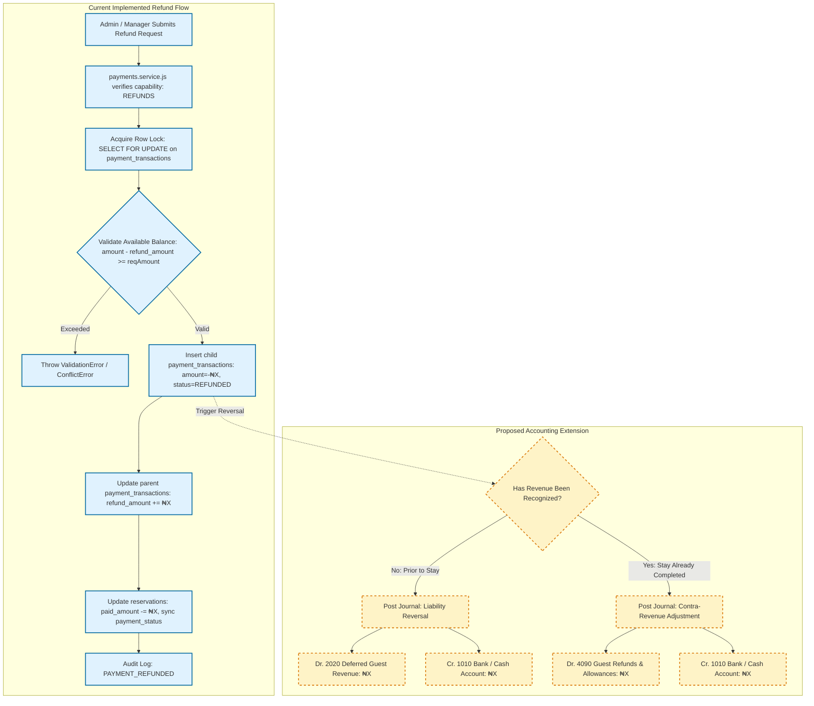
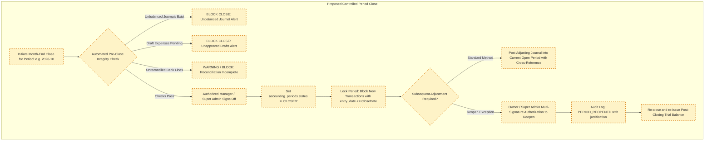
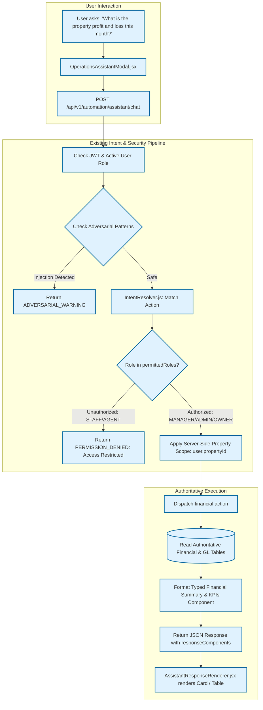

# BFA Apartments Management System — Financial Management & Accounting Architecture Report

**Document ID:** `BFA-FIN-ARCH-2026-001`  
**Classification:** Requirements Refinement & Current-State Architectural Audit  
**Author:** Financial Systems Architect, Domain Expert & Security Engineer  
**Date:** 2026-10-26  
**Status:** **READ-ONLY INVESTIGATION & REQUIREMENTS REFINEMENT (NO IMPLEMENTATION)**  

---

## A. Executive Summary

A comprehensive architectural investigation was conducted on the **BFA Apartments Management System** codebase, database schema, authorization framework, API surface, tests, and automation engine to evaluate the current financial architecture against the target requirement of **full accrual accounting using a double-entry general ledger**.

### Key Findings:

1. **Current State: Operational Cash/Collection Tracking (Not Double-Entry Accrual Accounting)**  
   The application currently possesses an operational cash-collection and expense-recording tracking layer (`payment_transactions`, `expenses`, `reservations`, and `commissions`). What is currently labeled as the "Ledger" (`/api/v1/financial/ledger`) is actually a **SQL `UNION ALL` projection** of unlinked payment receipts and recorded expense vouchers. There is currently **no Chart of Accounts, no General Ledger, no Journal Entry tables, no debit/credit transaction records, no balancing validation, and no balance-sheet tracking of assets, liabilities, or equity**.

2. **Revenue Recognition Gap**  
   Presently, revenue is recognized on a **cash/booking hybrid basis**:
   - `bookedRevenue` is derived from `SUM(reservations.total_amount)` upon reservation creation regardless of stay dates.
   - `grossCollected` / `netRevenue` is derived from `payment_transactions` marked `SUCCESS` minus `refund_amount`.
   - Accommodation revenue is not deferred when paid in advance, nor is it earned ratably across stay nights. There is no concept of unearned revenue liabilities (`Deferred Accommodation Revenue`).

3. **Approval, Voiding, and Refund Controls (Partially Implemented)**  
   - Operational expenses support `RECORDED`, `APPROVED`, and `VOIDED` states with mandatory audit reasons and capability gates (`EXPENSE_APPROVAL`).
   - Payment refunds use database row-level locking (`FOR UPDATE`) within transactions, creating negative transaction rows and cumulative tracking (`refund_amount`), effectively preventing double refunds and preserving audit history.
   - However, dual-control approval (separation of creator and approver), tiered monetary approval thresholds, and automated gateway webhook reconciliation are missing.

4. **Single-Currency Architecture Verified**  
   The system is hardcoded to Nigerian Naira (`NGN`, symbol `₦`, locale `en-NG`) in `system_settings`, migrations, formatters (`formatNaira`), and database schemas (`DECIMAL(10, 2)`). No foreign exchange or multi-currency tables exist.

5. **AI Assistant Financial Capabilities**  
   The AI Assistant is currently read-only for financials (`financial.summarize_outstanding_payments`), with strict server-side property scoping and conversational blocks on refunds, deletions, and role escalation. Conversational general-ledger querying, period closing, or draft journal creation do not yet exist.

6. **Implementation Constraint**  
   In compliance with non-negotiable instructions, **zero code or schema modifications have been made**. This document establishes the factual foundation and requirements traceability matrix needed prior to any authorized development.

---

## B. Existing-System Inventory

### 1. Database Entities & Schemas

| Table Name | Engine & Collation | Primary Key | Key Columns & Types | Financial Role & Current Behavior |
| :--- | :--- | :--- | :--- | :--- |
| `reservations` | InnoDB / utf8mb4 | `id` (INT) | `total_amount` DECIMAL(10,2), `paid_amount` DECIMAL(10,2), `payment_status` VARCHAR(50), `payment_method` VARCHAR(50) | Operational source for booking fees; tracks cumulative `paid_amount` vs `total_amount`. Constrained to 1-night stays (`chk_one_night`). |
| `payment_transactions` | InnoDB / utf8mb4 | `id` (INT) | `reservation_id` INT, `amount` DECIMAL(10,2), `refund_amount` DECIMAL(10,2), `currency` VARCHAR(10), `status` ENUM, `parent_transaction_id` INT | Authoritative cash-in and refund transactions. Enforces row-level locking during refunds; negative amounts recorded for reversals. |
| `expenses` | InnoDB / utf8mb4 | `id` (INT) | `property_id` INT, `amount` DECIMAL(10,2), `category` ENUM, `status` ENUM('DRAFT','RECORDED','APPROVED','VOIDED'), `approved_by_id` INT | Authoritative operational expense vouchers. Supports 9 categories, soft-voiding with mandatory reasons, and approval stamps. |
| `commissions` | InnoDB / utf8mb4 | `id` (INT) | `agent_id` INT, `reservation_id` INT, `commission_amount` DECIMAL(10,2), `status` ENUM('PENDING','CALCULATED','APPROVED','PAID','CANCELLED','VOIDED') | Agent partner commission obligations and settlement status. Linked to reservations; auto-reconciled on reservation cancellation/full refund. |
| `maintenance_requests` | InnoDB / utf8mb4 | `id` (INT) | `estimated_cost` DECIMAL(10,2), `actual_cost` DECIMAL(10,2), `cost` DECIMAL(10,2) | Tracks repair work order costs; linked to `expenses.maintenance_id`. |
| `capabilities` | InnoDB / utf8mb4 | `id` (INT) | `name` VARCHAR(100), `is_enabled` BOOLEAN, `restriction_level` ENUM | Fine-grained financial policy toggles: `EXPENSE_APPROVAL`, `REFUNDS`, `DISCOUNTS`, `COMMISSION_APPROVAL`, `COMMISSION_PAYOUT`. |
| `audit_logs` | InnoDB / utf8mb4 | `id` (INT) | `actor_id` INT, `actor_role` VARCHAR(50), `action` VARCHAR(100), `old_values` JSON, `new_values` JSON, `request_id` VARCHAR(100) | Immutable system-wide audit trail capturing payment processing, refunds, expense creation, approvals, and voids. |
| `system_settings` | InnoDB / utf8mb4 | `id` (INT) | `setting_key` VARCHAR(100), `setting_value` TEXT | Holds `default_currency: 'NGN'`, `currency_symbol: '₦'`, and `currency_locale: 'en-NG'`. |

*Note: There are currently **NO** tables for `chart_of_accounts`, `general_ledger`, `journal_entries`, `journal_lines`, `accounting_periods`, `bank_accounts`, `tax_rates`, or `reconciliation_batches`.*

### 2. Backend Modules, Services & Controllers

| Module Path | Controller | Service | Repository | Primary Responsibilities |
| :--- | :--- | :--- | :--- | :--- |
| `backend/src/modules/financial/` | `FinancialController` | `FinancialService` | N/A (Direct Pool Queries) | Serves `/overview` (KPIs, profit derivation) and `/ledger` (UNION ALL pseudo-ledger of payments + expenses). |
| `backend/src/modules/payments/` | `PaymentsController` | `PaymentsService` | N/A (Direct Pool Queries) | Gateway process simulation, pay-at-property logging, and atomic partial/full refunds with row locking. |
| `backend/src/modules/expenses/` | `ExpensesController` | `ExpensesService` | `ExpensesRepository` | Expense draft logging, updates, capability-checked approval, soft-voiding, and category aggregations. |
| `backend/src/modules/commissions/` | `CommissionsController` | `CommissionsService` | `CommissionsRepository` | Commission rate calculation, approval workflow, payout recording, and voiding. |
| `backend/src/modules/analytics/` | `AnalyticsController` | `AnalyticsService` | `AnalyticsRepository` | Operational KPIs: ADR, RevPAR, Occupancy rate, Net Operating Income (NOI). |
| `backend/src/modules/reports/` | `ReportsController` | `ReportsService` | N/A (Direct Pool Queries) | Exportable reports for payments, expenses, commissions, and reservations. |
| `backend/src/modules/automation/` | `AutomationController` | `AssistantService`, `IntentResolver` | Action Registry | Executes `financial.summarize_outstanding_payments` and parses financial inquiries. |

### 3. Role Authorization Matrix for Financial Operations

| Operation | Endpoint | SUPER_ADMIN | OWNER | ADMIN | MANAGER | RECEPTIONIST | STAFF | AGENT |
| :--- | :--- | :---: | :---: | :---: | :---: | :---: | :---: | :---: |
| View Financial Overview | `GET /api/v1/financial/overview` | ✅ All | ✅ All/Scoped | ✅ All | ✅ Scoped | ❌ (403) | ❌ (403) | ❌ (403) |
| View Unified Ledger | `GET /api/v1/financial/ledger` | ✅ All | ✅ All/Scoped | ✅ All | ✅ Scoped | ❌ (403) | ❌ (403) | ❌ (403) |
| Process Payment | `POST /api/v1/payments/process` | ✅ | ✅ | ✅ | ✅ | ✅ | ❌ | ❌ |
| View Payments List | `GET /api/v1/payments` | ✅ All | ✅ All/Scoped | ✅ All | ✅ Scoped | ❌ (403) | ❌ (403) | ❌ (403) |
| Refund Payment | `POST /api/v1/payments/:id/refund` | ✅ | ✅ | ✅ | ✅ | ❌ (403) | ❌ (403) | ❌ (403) |
| Create Expense | `POST /api/v1/expenses` | ✅ All | ✅ All/Scoped | ✅ All | ✅ Scoped | ❌ (403) | ❌ (403) | ❌ (403) |
| Approve Expense | `POST /api/v1/expenses/:id/approve`| ✅ | ✅ | ✅ | ✅ | ❌ (403) | ❌ (403) | ❌ (403) |
| Void Expense | `POST /api/v1/expenses/:id/void` | ✅ | ✅ | ✅ | ✅ | ❌ (403) | ❌ (403) | ❌ (403) |
| View Commissions | `GET /api/v1/commissions` | ✅ All | ✅ All | ✅ All | ✅ Scoped | ✅ Scoped | ❌ (403) | ✅ Own |
| Approve Commission | `PATCH /api/v1/commissions/:id/approve`| ✅ | ✅ | ✅ | ✅ | ❌ (403) | ❌ (403) | ❌ (403) |
| Payout Commission | `POST /api/v1/commissions/:id/payout` | ✅ | ✅ | ✅ | ✅ | ❌ (403) | ❌ (403) | ❌ (403) |

### 4. Verified Automated Tests Covering Financial Logic

- `backend/tests/financial.test.js` (10/10 tests passing):
  - Payment recording and `paid_amount` synchronization.
  - Partial refund execution creating negative transaction records.
  - Refund validation preventing amounts exceeding the refundable balance.
  - Expense creation in `RECORDED` status.
  - Expense approval updating ledger state.
  - Mandatory reason validation on expense voiding.
  - Financial overview KPI calculation and net profit derivation.
  - Unified ledger retrieval via SQL union.
  - Agent role forbidden from financial overview and expense creation.
- `backend/tests/payments.test.js` (Passing):
  - Payment processing and capability enforcement (`ONLINE_PAYMENT`, `PAY_AT_PROPERTY`).
- `backend/tests/commissions.test.js` (Passing):
  - Commission rate calculation, approval, payout, and cancellation reconciliation.
- `backend/tests/assistant.test.js` (Section 2 & 4, Passing):
  - `financial.summarize_outstanding_payments` role restriction and execution.

---

## C. Requirements Traceability Matrix

| Req ID | Requirement Description | Existing Repository Evidence | Current Status | Architectural Gap or Risk | Proposed Accounting Architecture | Open Decision Requiring Approval | Dependencies |
| :--- | :--- | :--- | :---: | :--- | :--- | :--- | :--- |
| **REQ-3.1-01** | Chart of Accounts (COA) | None | **MISSING** | No structured account hierarchy (Asset, Liability, Equity, Revenue, Expense). | Implement normalized `chart_of_accounts` with code, name, type, subtype, and active flags. | Standard account numbering scheme (e.g., 1000 Assets, 2000 Liabilities, etc.). | None |
| **REQ-3.1-02** | Double-Entry General Ledger | `financial.service.js` uses dynamic `UNION ALL` of `payment_transactions` and `expenses`. | **MISSING** | No debit/credit pairs, no balance enforcement ($\sum \text{Debits} = \sum \text{Credits}$), no historical balance persistence. | Implement `journal_entries` (header) and `journal_entry_lines` (detail debits/credits) posting into an immutable `general_ledger_entries` table. | Whether posting should be synchronous on transaction creation or asynchronous via an event bus. | REQ-3.1-01 |
| **REQ-3.1-03** | Trial Balance | None | **MISSING** | Inability to verify mathematical integrity of ledger accounts. | Implement `TrialBalanceService` generating unadjusted, adjusted, and post-closing trial balances. | Whether to allow closing periods with non-zero trial balance variances (should be strictly blocked). | REQ-3.1-02 |
| **REQ-3.1-04** | Accrual Financial Statements (P&L, Balance Sheet, Cash Flow) | `FinancialService.getOverview` calculates cash-basis net profit (`netRevenue - approvedExpenses`). | **PARTIAL** | Existing P&L is cash/hybrid, ignores unpaid liabilities, deferred revenues, prepayments, and non-cash items. Balance Sheet and Cash Flow do not exist. | Establish dedicated accrual report generators based on classified COA and posted general ledger lines. | Final statement format layouts and level of account aggregation for Owner vs Admin view. | REQ-3.1-01, REQ-3.1-02 |
| **REQ-3.2-01** | Single Currency (NGN) Scope | `system_settings` (`default_currency: NGN`), `005_currency_settings.sql`, `formatNaira` utility. | **VERIFIED** | Multi-currency is not supported; foreign credit cards must settle in NGN. | Retain strict NGN standard across all journal entries and financial reports. | How to handle foreign card payments where gateway reports both USD gross and NGN settled. | None |
| **REQ-3.3-01** | Multi-Channel Financial Accounts | `payment_method` strings (`CARD`, `BANK_TRANSFER`, `CASH`, `POS`) stored in columns. | **PARTIAL** | Financial channels are plain text strings; no tracking of individual bank accounts, cash registers, or gateway merchant balances. | Create `financial_accounts` linked to COA asset accounts (Cash on Hand, Bank A, Gateway Wallet) with balance tracking. | Whether each physical property operates its own petty cash account and bank account. | REQ-3.1-01 |
| **REQ-3.3-02** | Non-Revenue Internal Account Transfers | None | **MISSING** | Moving funds from gateway to bank or bank to petty cash could be misclassified as expense/income. | Create `account_transfers` entity producing balanced asset-to-asset journal entries (Dr. Destination Bank, Cr. Source Bank). | Approval requirements for internal bank/cash transfers. | REQ-3.3-01 |
| **REQ-3.4-01** | Automatic Journal Generation from Source Events | Operational updates directly mutate `reservations.paid_amount` and `payment_transactions`. | **MISSING** | Operational modules mutate balances without generating balancing GL journal entries. | Implement event-driven `AccountingPostingEngine` listening to payment, refund, checkout, and expense events. | Backfill policy for existing historical reservations and payments. | REQ-3.1-02 |
| **REQ-3.5-01** | Tiered Approval & Dual-Control | `expenses.service.js` checks `EXPENSE_APPROVAL` capability and role; any Manager/Admin can approve. | **PARTIAL** | Creator can currently approve their own expense; no amount-based tiered thresholds (e.g., > ₦500k requiring Owner). | Implement dual-control validation (`creator_id != approver_id`) and configurable approval thresholds. | Specific monetary threshold amounts requiring Super Admin or Owner approval. | REQ-3.1-01 |
| **REQ-3.6-01** | Property-Level vs Consolidated Scoping | `FinancialService.validatePropertyScope`, `user.propertyId` filtering in all queries. | **VERIFIED** | Shared company-wide expenses (e.g. corporate audit, central marketing) lack automated allocation keys. | Introduce property-level GL segments (`property_id` on journal lines) and automated allocation rules for corporate overhead. | Allocation methodology (by unit count, by property revenue ratio, or explicit percentage). | REQ-3.1-02 |
| **REQ-3.7-01** | Supporting Document Management | `employee_documents` table exists; no expense receipt or bank slip tables exist. `file_url` strings only. | **MISSING** | No attachment handling for invoice receipts, payment proofs, or bank deposit slips. No `multer` in backend. | Create `financial_documents` table with cryptographic hash, file storage provider, and mandatory upload policies by category. | Storage destination (local encrypted directory vs S3/cloud bucket) and allowed file types. | None |
| **REQ-3.8-01** | Opening Balances & Historical Imports | Migrations seed demo rows using direct `INSERT` statements into operational tables. | **MISSING** | No opening balance journal entry mechanism or historical import reconciliation staging table. | Implement `OpeningBalanceService` posting to an `Opening Balance Equity` offset account with pre-import validation. | Cutoff date for initial balance sheet conversion and opening bank balances. | REQ-3.1-01, REQ-3.1-02 |
| **REQ-3.9-01** | Bank & Payment Gateway Reconciliation | Mock gateway references in `payments.service.js`; no settlement or statement upload tables. | **MISSING** | Settlements are assumed instantaneous; gateway processing deductions (merchant fees) are not split or reconciled. | Create `bank_statements` and `reconciliation_batches` to match bank lines against ledger cash entries and record gateway fee expenses. | Formats of bank statement imports supported (CSV, OFX, MT940). | REQ-3.3-01 |
| **REQ-3.10-01**| Configurable Tax Handling | None | **MISSING** | Room rates and expenses are flat amounts; VAT (7.5%) and State Consumption Tax (5%) are not tracked or separated into liability accounts. | Implement `tax_rates`, `tax_jurisdictions`, and automatic tax liability journal splitting (Dr. Cash/AR, Cr. Room Revenue, Cr. VAT Payable). | Whether BFA apartment rates are legally VAT inclusive or exclusive under Nigerian tax regulations. | REQ-3.1-01 |
| **REQ-3.11-01**| Single Source of Truth / Idempotency | `payment_transactions` linked to `reservations.id`; unique references generated (`BFA-TXN-...`). | **PARTIAL** | While operational payments are decoupled, future accounting entries risk duplication if triggered repeatedly. | Enforce unique composite constraint on journal headers (`source_entity_type`, `source_entity_id`, `event_type`). | None | REQ-3.1-02 |

---

## D. Financial Data-Flow Diagrams

### 1. Reservation & Payment to Accounting Entry



---

### 2. Expense Creation, Approval, Posting, and Settlement



---

### 3. Payment Gateway Payment, Fee Deduction, and Bank Settlement



---

### 4. Refund & Reversal Lifecycle



---

### 5. Accounting Period Closing & Adjustments



---

### 6. AI Assistant Financial Query & Authorization Flow



---

## E. Accounting Treatment Examples (Standard Worked Cases)

The following worked accounting examples illustrate the target double-entry entries required under accrual accounting for typical BFA business events.

### Example 1: Advance Accommodation Payment
*Scenario:* On October 25, 2026, a guest books a 1-night stay for November 10, 2026, paying ₦300,000 via online card transfer.

```
[Date: 2026-10-25] - Payment Received in Advance
  Debit:  1030 Payment Gateway Clearing / Merchant Account  ₦300,000.00
  Credit: 2020 Deferred Guest Revenue (Liability)             ₦300,000.00
  (To record advance receipt from guest for November stay; zero revenue recognized in October)

[Date: 2026-11-10] - Guest Checks In / Stay Completed
  Debit:  2020 Deferred Guest Revenue (Liability)             ₦300,000.00
  Credit: 4010 Accommodation Revenue (Income)                 ₦279,069.77
  Credit: 2050 State Consumption Tax Payable 5% (Liability)    ₦13,953.49
  Credit: 2051 VAT Payable 7.5% (Liability)                     ₦7,076.74
  (To recognize earned accommodation revenue and tax liabilities upon service delivery)
```

---

### Example 2: Incurred Expense Prior to Payment
*Scenario:* On October 28, 2026, Danfoss HVAC completes emergency compressor repair on Apartment 202 for ₦120,000. The invoice is approved on October 29, but BFA pays via bank transfer on November 5.

```
[Date: 2026-10-29] - Expense Incurred and Approved (October P&L)
  Debit:  5010 Maintenance & Repair Expense                   ₦120,000.00
  Credit: 2010 Accounts Payable / Accrued Liabilities          ₦120,000.00
  (To accrue HVAC repair expense in October period when maintenance was performed)

[Date: 2026-11-05] - Bank Disbursement (November Cash Flow)
  Debit:  2010 Accounts Payable / Accrued Liabilities         ₦120,000.00
  Credit: 1010 Main Operating Bank Account                     ₦120,000.00
  (To record settlement of trade liability; zero impact on November P&L)
```

---

### Example 3: Payment Gateway Fee Deduction and Bank Settlement
*Scenario:* A guest pays ₦100,000 online. The payment gateway charges a 2.5% fee (₦2,500), and subsequently settles ₦97,500 into BFA's Zenith Bank account two days later.

```
[Date: Day 1] - Guest Payment Confirmation
  Debit:  1030 Payment Gateway Clearing                       ₦100,000.00
  Credit: 2020 Deferred Guest Revenue                          ₦100,000.00
  (Gross customer payment captured; full guest booking balance credited)

[Date: Day 3] - Bank Settlement Deposit
  Debit:  1010 Zenith Bank Operating Account                   ₦97,500.00
  Debit:  5080 Payment Processing & Gateway Fees (Expense)       ₦2,500.00
  Credit: 1030 Payment Gateway Clearing                        ₦100,000.00
  (Clearing account cleared to zero; fee recognized as financial expense; net bank cash increased)
```

---

### Example 4: Full Refund upon Cancellation Before Arrival
*Scenario:* Guest cancels booking prior to check-in. Management approves a full refund of the ₦300,000 advance payment from Example 1.

```
[Date: 2026-10-30] - Cancellation & Refund Disbursement
  Debit:  2020 Deferred Guest Revenue (Liability)             ₦300,000.00
  Credit: 1010 Main Operating Bank Account                     ₦300,000.00
  (Reverses guest liability; zero effect on revenue accounts; cash balance reduced)
```

---

### Example 5: Partial Refund with Cancellation Fee Retention
*Scenario:* Guest cancels within 24 hours of arrival. Under management policy, a ₦50,000 cancellation fee is retained, and ₦250,000 is refunded to the guest.

```
[Date: 2026-10-31] - Cancellation with Penalty
  Debit:  2020 Deferred Guest Revenue (Liability)             ₦300,000.00
  Credit: 1010 Main Operating Bank Account (Refunded)          ₦250,000.00
  Credit: 4050 Cancellation & Forfeiture Fee Income (Revenue)   ₦46,511.63
  Credit: 2051 VAT Payable 7.5% (Liability)                     ₦3,488.37
  (Refund disbursed; retained deposit recognized as non-refundable fee revenue)
```

---

### Example 6: Internal Account Transfer (Bank to Petty Cash)
*Scenario:* BFA withdraws ₦150,000 from the operating bank account to replenish the front desk petty cash box for Property 1.

```
[Date: 2026-11-01] - Cash Replenishment Transfer
  Debit:  1020 Petty Cash - Property 1 (Asset)                ₦150,000.00
  Credit: 1010 Main Operating Bank Account (Asset)             ₦150,000.00
  (Asset-to-asset balance shift; strictly ZERO impact on income or expense accounts)
```

---

### Example 7: Opening Balance Entry on Conversion Date
*Scenario:* On system conversion date (November 1, 2026), BFA establishes starting bank balances of ₦5,200,000, trade payables of ₦450,000, and unearned guest deposits of ₦800,000.

```
[Date: 2026-11-01] - Opening Balance Journal Entry
  Debit:  1010 Main Operating Bank Account                   ₦5,200,000.00
  Credit: 2010 Accounts Payable                                ₦450,000.00
  Credit: 2020 Deferred Guest Revenue                          ₦800,000.00
  Credit: 3010 Owner Equity / Opening Balance Offset         ₦3,950,000.00
  (Establishes balance sheet opening positions without distorting historical operational records)
```

---

## F. Security, Audit & Internal Controls Review

### 1. Role-Based Access & Property Isolation
- **Server-Side Enforcement Verified:** Access to financial routes is strictly governed by `requireRoles('SUPER_ADMIN', 'OWNER', 'ADMIN', 'MANAGER')`. Low-privilege roles (`STAFF`, `RECEPTIONIST`, `AGENT`) are forbidden (HTTP 403) from viewing overview KPIs, ledger records, and expense lists.
- **Property Isolation:** `FinancialService.validatePropertyScope` ensures `MANAGER` and single-property `STAFF` are strictly bound to their assigned `user.propertyId`. Requests with mismatched IDs are rejected with `ForbiddenError`. Only `SUPER_ADMIN`, `ADMIN`, and enterprise `OWNER` can query consolidated cross-property metrics.

### 2. Separation of Duties (Maker-Checker Gap)
- **Current Limitation:** In `expenses.service.js`, an Admin or Manager who records an expense (`created_by_id`) can currently approve the same expense (`approveExpense`), violating strict separation of duties.
- **Proposed Control:** Enforce rule `creator_id != approver_id` for expenses above a configurable baseline (e.g. ₦50,000), requiring dual authorization.

### 3. Concurrency, Row Locking & Idempotency
- **Refund Concurrency Verified:** `payments.service.js` uses `pool.withTransaction` and `SELECT ... FOR UPDATE` row-level locks on both `payment_transactions` and `reservations`. Concurrent double-refund requests are serialized and safely rejected once cumulative `refund_amount >= amount`.
- **Idempotency Strategy for General Ledger:** To prevent duplicate journal entries from repeated webhooks or operational triggers, future journal entry headers must include a unique compound key:
  $$\text{UQ}(\text{source\_entity\_type}, \text{source\_entity\_id}, \text{event\_type})$$

### 4. Non-Destructive Corrections (Immutability)
- **Zero Physical Deletions:** Verified in source code that expenses are never deleted via `DELETE FROM expenses`. Instead, they transition to `status = 'VOIDED'` with a mandatory `void_reason` text string, recording `voided_by_id` and timestamp.
- **General Ledger Immutability Rule:** Posted journal entries must never be updated or deleted (`UPDATE`/`DELETE` prohibited). All adjustments must take the form of authorized adjusting journal entries with full audit linkage.

---

## G. Financial Reporting Requirements Mapping

| Report Name | Accounting Basis | Required Source Tables | Filter Parameters | Authorization Scope | Drill-Down Capability |
| :--- | :--- | :--- | :--- | :--- | :--- |
| **Profit & Loss (Income Statement)** | Accrual Basis | `general_ledger_entries`, `chart_of_accounts`, `properties` | Date Range, Property ID, Account Subcategory | Super Admin, Owner, Admin (All); Manager (Assigned Property) | From Category Summary $\to$ Account Level $\to$ Journal Entry Lines $\to$ Source Expense / Reservation Voucher. |
| **Balance Sheet** | Accrual Basis | `general_ledger_entries`, `chart_of_accounts` | As-of Date, Property ID (or Consolidated) | Super Admin, Owner, Admin only | From Line Item $\to$ General Ledger Account Transactions. |
| **Cash Flow Statement** | Direct / Indirect Method | `general_ledger_entries`, `financial_accounts` | Period Date Range, Property ID | Super Admin, Owner, Admin only | From Operating/Investing/Financing Totals $\to$ Cash Account Ledger Lines. |
| **Trial Balance** | Double-Entry Basis | `general_ledger_entries`, `chart_of_accounts` | As-of Date, Period ID | Super Admin, Owner, Admin only | From Account Ending Balance $\to$ Full General Ledger Running Register. |
| **General Ledger Register** | Continuous Running Balance | `general_ledger_entries`, `journal_entries` | Account Code, Date Range, Property ID | Super Admin, Owner, Admin, Manager (Scoped) | Direct link to original operational source (Guest Reservation Code, Expense Voucher Code). |
| **Accounts Receivable (AR) Aging** | Accrual Invoicing Basis | `reservations`, `payment_transactions` | As-of Date, Property ID, Age Bucket (Current, 1-30, 31-60, 60+) | Super Admin, Owner, Admin, Manager | From Aging Bucket $\to$ Specific Guest Reservation $\to$ Payment History. |
| **Tax Liability Summary (VAT & SCT)** | Accrual / Collection Basis | `general_ledger_entries`, `tax_entries` | Monthly Tax Period, Property ID, Tax Category | Super Admin, Owner, Admin | From Monthly Tax Payable $\to$ Individual Guest Invoices / Transactions. |

---

## H. Unresolved Decisions Requiring Business Approval

### 1. Blocking Decisions (Must be resolved before data modeling or development)

1. **Accommodation Revenue Recognition Timing & Stay Allocation:**
   - *Issue:* When should accommodation revenue be recognized on the General Ledger?
   - *Option A (Nightly Accrual):* Recognize revenue each night of the stay during the daily night audit.
   - *Option B (Checkout Event):* Recognize 100% of room revenue on the date of checkout/completion.
   - *Option C (Check-In Event):* Recognize revenue immediately upon check-in.
   - *Default Recommendation:* **Option A (Nightly Accrual)** for multi-night stays, or Option B upon checkout for 1-night stays (since BFA currently enforces a 1-night maximum stay constraint under Section 16).

2. **Deposit & No-Show Forfeiture Accounting Policy:**
   - *Issue:* When a guest pays in advance but does not arrive (`NO_SHOW`), or cancels past the allowable window:
   - *Option A:* Automatically recognize 100% of the forfeited advance payment as Cancellation Fee Income (`Account #4050`) on the scheduled check-in date.
   - *Option B:* Hold the funds in Deferred Guest Deposits for 30/60 days pending management review before recognizing as income.

3. **Nigerian Tax Treatment on Short-Stay Apartments:**
   - *Issue:* Are apartment rates inclusive or exclusive of VAT (7.5%) and State Consumption Tax (5%)?
   - *Option A (Inclusive):* The total room rate includes all taxes; the system extracts the tax base automatically.
   - *Option B (Exclusive):* Taxes are added on top of the base rate at checkout.

4. **Chart of Accounts Standardization:**
   - Approval required for the standard 4-digit or 5-digit account code structure and account numbering hierarchy.

### 2. Deferrable Decisions (Can be refined during Phase 2/3)

1. **Direct Bank Feed Integrations:** Whether to support direct Nigerian open banking APIs (Mono, Stitch) vs manual bank statement CSV/OFX uploads.
2. **Document Cloud Storage:** Whether to store supporting receipts on local encrypted server storage or AWS S3/Azure Blob.
3. **Automated Inter-Property Cost Allocation Keys:** Methodology for apportioning shared corporate expenses across properties.

---

## I. Proposed Phased Implementation Roadmap (Pre-Authorization Plan)

*Note: Execution of these phases is subject to future authorization; no implementation has begun.*

```
Phase FIN-1: Core Accounting Engine & Double-Entry Schema
├── 1.1 Provision Chart of Accounts (COA) and Financial Accounts tables.
├── 1.2 Provision Journal Entries and General Ledger tables with balance triggers.
├── 1.3 Implement AccountingPeriod model and period boundary validation.
└── 1.4 Automated Unit Tests: Balanced Entry Verification & Account Types.

Phase FIN-2: Automated Posting Engine & Operational Synchronization
├── 2.1 Implement AccountingPostingEngine listening to Reservation, Payment, and Expense events.
├── 2.2 Wire Advance Payment and Deferred Revenue recognition.
├── 2.3 Wire Expense Accruals and Vendor Payable settlements.
├── 2.4 Wire Refund Contra-Revenue / Liability debiting.
└── 2.5 Automated Integration Tests: Full operational-to-accounting lifecycle.

Phase FIN-3: Bank Reconciliation, Gateway Clearing & Document Management
├── 3.1 Provision Reconciliation Batches and Gateway Clearing Account tracking.
├── 3.2 Implement Statement Import (CSV) and Auto-Matching Algorithm.
├── 3.3 Provision Financial Documents table with receipt upload validation.
└── 3.4 Automated Tests: Gateway fee deduction, settlement variance, and document checks.

Phase FIN-4: Financial Reporting & Statements Engine
├── 4.1 Implement Trial Balance generation service.
├── 4.2 Implement Accrual Profit & Loss statement with property scoping.
├── 4.3 Implement Balance Sheet and Statement of Cash Flows.
├── 4.4 Build Frontend Accounting UI (COA manager, Journal Explorer, Period Close Console).
└── 4.5 Automated End-to-End Tests & Export Verification.

Phase FIN-5: AI Assistant Financial Expansion
├── 5.1 Register read-only accounting tool: financial.get_trial_balance.
├── 5.2 Register read-only accounting tool: financial.get_accrual_pnl.
├── 5.3 Register read-only accounting tool: financial.get_unreconciled_transactions.
├── 5.4 Update OperationsAssistantModal with typed financial statement cards.
└── 5.5 Regression testing across complete automation suite.
```

---

## J. Verification Evidence & Audit Log

### Inspected Files:
- Database Migrations: `001_create_schema_migrations.sql` through `018_create_internal_chat_tables.sql`
- Core Financial Logic:
  - `backend/src/modules/financial/financial.service.js`
  - `backend/src/modules/financial/financial.routes.js`
  - `backend/src/modules/financial/financial.controller.js`
  - `backend/src/modules/payments/payments.service.js`
  - `backend/src/modules/payments/payments.routes.js`
  - `backend/src/modules/expenses/expenses.service.js`
  - `backend/src/modules/expenses/expenses.routes.js`
  - `backend/src/modules/commissions/commissions.service.js`
  - `backend/src/modules/commissions/commissions.routes.js`
  - `backend/src/modules/reservations/reservations.service.js`
  - `backend/src/modules/reservations/reservations.routes.js`
  - `backend/src/modules/analytics/analytics.repository.js`
  - `backend/src/modules/reports/reports.routes.js`
- Automation & AI Assistant:
  - `backend/src/modules/automation/actions/financial.summarize_outstanding_payments.js`
  - `backend/src/modules/automation/assistant/intentResolver.js`
  - `backend/src/modules/automation/assistant/assistant.service.js`
- Frontend UI:
  - `frontend/src/pages/FinancialPage.jsx`
  - `frontend/src/App.jsx`

### Executed Verification Commands:
- Safe Database Inspection: `node -e "const pool = require('./src/db/pool'); pool.query('SHOW TABLES').then(...)`
  - *Result:* Confirmed exactly 41 tables exist in `bfa_apartments_db`; verified 0 general ledger or COA tables exist.
- Test Suite Execution: `npx jest tests/financial.test.js --runInBand --forceExit`
  - *Result:* 10/10 tests passed (3.40s) confirming payment recording, refund row-locking, and expense approval/voiding behavior.
- Git Working Tree Inspection: `git status --short`
  - *Result:* Verified working tree state is clean and no application code was altered.

---
*Report complete. Ready for architectural and business review.*
