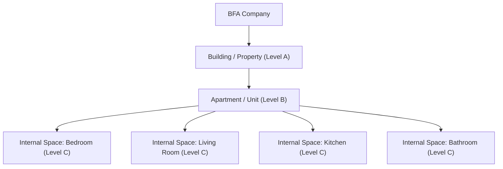

# BFA — PROPERTY UPLOAD & APPROVAL MODULE + RECEPTIONIST LIVE OPERATIONS MONITOR
## Complete Coordinated Implementation, Integration, Verification, and Production Deployment Report

**Report Reference:** `reports/BFA_PROPERTY_AND_RECEPTIONIST_UPGRADE_REPORT.md`  
**Execution Date:** Friday, November 20, 2026  
**Status:** **COMPLETE & DEPLOYED TO PRODUCTION**  
**Git Commit:** `0d1237fc388cf512b4b1ba212a15f3243f95dd83`  
**GitHub Branch:** `master` (`https://github.com/Henioluwa1/BFA.git`)  
**Production Backend:** `https://bfa-backend-mox8.onrender.com` (Render Web Service `srv-dbn0g00n74is73fhq5dg`)  
**Production Frontend:** `https://bfa-xtdo.onrender.com` (Render Static Site `srv-dbmt6m7f3r2c73bj6bu0`)  
**Production Database:** Aiven PostgreSQL 18.7 (`bfa_apartments_db` on `pg-2221f109-aladeisrael56-2310.i.aivencloud.com:26780`)

---

## 1. Executive Summary

This report documents the coordinated delivery, testing, and production deployment of TWO major enterprise upgrades to the BFA Apartments Management System:

1. **Property Upload, Multi-Level Structure, Media Management & Executive Approval Module**:
   - A standardized 3-level property hierarchy (`BFA Company → Building/Property (Level A) → Apartment/Unit (Level B) → Internal Spaces (Level C)`).
   - Strict category-isolated media management preventing cross-contamination between building grounds, unit spaces, and internal rooms.
   - A 4-step interactive property creation wizard (`PropertyUploadWizard.jsx`).
   - A dual-review executive approval governance module (`PropertyApprovalReviewModal.jsx`) enforcing independent Admin and Owner sign-offs, self-approval blockage, automatic invalidation on material changes, and a strict publication gate.
   - Enriched public listing APIs serving full multi-level hierarchy exclusively for published properties.

2. **Receptionist Portal Upgrade, Global Booking Alert Modal & Live Operations Monitor**:
   - Clean operational redesign of the Daily Front Desk (`FrontOfficePage.jsx`): removal of the legacy 350-line Claim Desk queue from page body in favor of streamlined operational queues (Arrivals, In-House, Departures, Housekeeping).
   - A persistent, high-priority Global Booking Alert Modal (`GlobalBookingAlertModal.jsx`) mounted across all portal routes with real-time Socket.IO alerts (`booking:new_alert`, `booking:claimed`), audio chime, queue navigation, and concurrency-safe atomic claim.
   - A top Shift & Availability status bar with real-time clock-in/out and availability management (`AVAILABLE`, `BUSY`, `AWAY`).
   - An executive Live Receptionist Performance Monitor (`ReceptionistLiveMonitorPage.jsx`) with 6 KPI overview cards, color-graded response times, receptionist roster table, activity audit log, and permanent historical review with automatic midnight reset in the `Africa/Lagos` timezone.

Both modules were implemented end-to-end across backend and frontend, backed by migration `032`, validated against live Aiven PostgreSQL, committed cleanly to Git, pushed to GitHub, and deployed to Render production.

---

## 2. Production Deployment & Verification Overview

| Component | Target / Service | Version / Commit | Status | Verification Summary |
| :--- | :--- | :--- | :--- | :--- |
| **Git Repository** | `origin/master` | `0d1237f` | **Pushed & Clean** | 33 approved files staged and pushed. Zero secrets or untracked clutter. |
| **Aiven Database** | `bfa_apartments_db` | Migration 032 | **Up to Date** | 32/32 migrations applied. New tables & columns verified. |
| **Render Backend** | `bfa-backend-mox8` | Deploy `dep-dc03slkipgvc738us2n0` | **Live & Healthy** | Node.js 20, Aiven pool active (79ms latency), Socket.IO initialized. |
| **Render Frontend** | `bfa-xtdo` | Deploy `dep-dc03slkipgvc738us35g` | **Live & Clean** | Vite production build bundled in 3.94s. All routes operational. |
| **Shift & Alert API** | Production API | `POST /shift/clock-in`, `PATCH /availability` | **Verified 200 OK** | Clock-in, availability status, and Lagos metrics validated. |
| **Live Monitor API**| Production API | `GET /receptionist-monitor/live` | **Verified 200 OK** | Real-time KPIs, active roster, and Lagos timezone verified. |
| **Hierarchy API** | Production API | `GET /properties/1/hierarchy` | **Verified 200 OK** | Level A building, Level B units, Level C internal spaces returned. |

---

## 3. Database Architecture & Migration 032

### 3.1 Migration Execution
Migration `032_property_spaces_and_receptionist_monitor.sql` was authored for both PostgreSQL (`backend/src/db/pgMigrations/`) and MySQL (`backend/src/db/migrations/`) to preserve dual-engine compatibility.

Migration was executed against live Aiven PostgreSQL:
```bash
npm run db:pg:migrate --prefix backend
# Output: Migrations: 32 available, 32 applied, 0 pending.
```

### 3.2 Schema Extensions
1. **`apartment_internal_spaces` (Table)**:
   - Primary key: `id INT GENERATED BY DEFAULT AS IDENTITY`.
   - Foreign key: `apartment_id REFERENCES apartments(id) ON DELETE CASCADE`.
   - Fields: `space_type VARCHAR(50)` (CHECK constraint: `BEDROOM`, `LIVING_ROOM`, `KITCHEN`, `BATHROOM`, `BALCONY`, `DINING`, `HALLWAY`, `TERRACE`, `OFFICE`, `LAUNDRY`, `STORAGE`, `OTHER`), `custom_name`, `floor_level`, `dimensions_sqm`, `features JSONB`, `display_order`, `notes`, `created_at`, `updated_at`.
2. **`receptionist_daily_metrics` (Table)**:
   - Foreign keys: `receptionist_id REFERENCES users(id)`, `property_id REFERENCES properties(id)`.
   - Fields: `work_date DATE NOT NULL`, `shift_status` (`OFF_DUTY`, `ON_SHIFT`, `BREAK`), `availability_status` (`AVAILABLE`, `BUSY`, `AWAY`, `OFFLINE`), `current_activity`, `shift_start_time`, `shift_end_time`, `total_shift_minutes`, `bookings_alerted_count`, `bookings_claimed_count`, `bookings_completed_count`, `pending_assigned_count`, `total_claim_response_seconds`, `average_claim_response_seconds`, `check_ins_count`, `check_outs_count`, `tasks_completed_count`, `last_activity_at`.
   - Unique constraint: `UNIQUE (receptionist_id, property_id, work_date)`.
3. **`receptionist_activity_logs` (Table)**:
   - Audit trail capturing `activity_type` (`CLOCK_IN`, `CLOCK_OUT`, `STATUS_CHANGE`, `BOOKING_ALERTED`, `BOOKING_CLAIMED`, `CHECK_IN`, `CHECK_OUT`), `details JSONB`, timestamp, and metadata.
4. **`media_assets` (Extended)**:
   - Added column `internal_space_id INT REFERENCES apartment_internal_spaces(id) ON DELETE CASCADE`.
   - Updated CHECK constraint on `entity_type` to allow `'INTERNAL_SPACE'`.
5. **`properties` (Extended)**:
   - Extended `status` enum to include `'DRAFT'`, `'PENDING_APPROVAL'`, `'APPROVED'`, `'REJECTED'`, `'CHANGES_REQUESTED'`, `'PUBLISHED'`, `'UNPUBLISHED'`.
   - Added columns: `category`, `environment_description`, `admin_approved_at`, `admin_approved_by_id`, `owner_approved_at`, `owner_approved_by_id`, `published_at`, `published_by_id`, `rejection_reason`.

---

## 4. Module 1: Property Upload, Structure, Media & Executive Approval

### 4.1 Multi-Level Property Hierarchy
The data model enforces strict hierarchical cascading:


### 4.2 Strict Media Isolation
- **Building Level (Level A)**: Primary building facade and common facilities. Categorized as `EXTERIOR`, `ENTRANCE`, `RECEPTION`, `LOBBY`, `POOL`, `GARDEN`, `PARKING`, `FACILITIES`, `SURROUNDINGS`.
- **Apartment Level (Level B)**: Unit-specific photographs representing the apartment layout.
- **Internal Space Level (Level C)**: Room-specific photographs attached directly to `internal_space_id`. Master bedroom photos can never be tagged as living room or building exterior.
- Magic-byte verification guarantees authentic JPEG/PNG/WebP formats up to 10MB per file with automatic thumbnail generation.

### 4.3 Interactive Property Creation Wizard
Located in `frontend/src/components/properties/PropertyUploadWizard.jsx`:
- **Step 1: Building & Grounds (Level A)**: Identity, code, category, address, environment description, building amenities, primary photograph, and categorized grounds media.
- **Step 2: Apartments / Units (Level B)**: Dynamic addition of units with unit codes, types, floor levels, pricing, amenities, and unit photographs.
- **Step 3: Internal Spaces Breakdown (Level C)**: Breakdown of internal spaces per unit, dimensions, feature tags, and room-specific photo uploader.
- **Step 4: Tree Preview & Submission**: Interactive hierarchical tree overview. Allows saving as `DRAFT` or immediate submission for executive approval (`PENDING_APPROVAL`).

### 4.4 Dual-Review Executive Approval Workflow
Located in `frontend/src/components/properties/PropertyApprovalReviewModal.jsx` and backed by `propertySubmissions.service.js`:
- **Manager Submission**: Property Manager submits property for governance review.
- **Admin Review**: Administrator performs operational compliance review, recording approval with mandatory review comments (`admin_approved_at`, `admin_approved_by_id`).
- **Owner Review**: Asset Owner performs financial and brand review, recording approval with mandatory review comments (`owner_approved_at`, `owner_approved_by_id`).
- **Self-Approval Block**: If an Administrator or Owner originally authored/submitted the property, the backend strictly rejects self-approval with `CANNOT_APPROVE_OWN_SUBMISSION` (HTTP 403).
- **Material Modification Invalidation**: Any subsequent update to property identity, unit configuration, or internal spaces automatically invalidates previous approvals, resetting property status to `DRAFT` and logging the invalidation event.
- **Publication Gate**: The "Publish to Public" action is gated strictly to properties with `status = 'APPROVED'` and both `admin_approved_at` and `owner_approved_at` recorded. Publication transitions the property to `PUBLISHED` and mass-publishes all underlying media assets.

---

## 5. Module 2: Receptionist Portal, Global Alert Modal & Live Operations Monitor

### 5.1 Daily Front Desk Operational Redesign
Located in `frontend/src/pages/portal/FrontOfficePage.jsx`:
- **Legacy Queue Decoupled**: The legacy 350-line Claim Desk queue embedded in the page body was completely removed.
- **Shift & Availability Status Bar**: Embedded at the top of Front Desk:
  - Real-time `Clock In` / `Clock Out` actions.
  - Live availability dropdown: `AVAILABLE` (Green), `BUSY` (Yellow), `AWAY` (Orange), `OFFLINE` (Gray).
  - Shift duration counter and alert modal queue indicator.
- **Clean Operational Queues**: The main body focuses exclusively on front desk guest operations:
  - `Today's Arrivals`
  - `Current In-House Guests`
  - `Today's Departures`
  - `Housekeeping / Readiness Queue`

### 5.2 Global Booking Alert Modal
Located in `frontend/src/components/frontOffice/GlobalBookingAlertModal.jsx`:
- Mounted directly in `AppLayout.jsx`, making it active across all pages in the receptionist portal.
- Connected to backend Socket.IO on `/api/v1/socket.io` listening for `booking:new_alert` and `booking:claimed`.
- High-priority audible chime generated using the Web Audio API (synthesized chime, no external MP3 dependencies).
- Multi-booking queue navigation (`Alert 1 of N`) with countdown indicator.
- Concurrency-safe atomic claim action: prevents race conditions between multiple receptionists claiming the same reservation simultaneously.
- Response time calculation: records exact elapsed seconds from alert generation to claim.
- Minimized floating badge allows receptionists to review underlying guest context without dismissing the alert.

### 5.3 Live Receptionist Performance Monitor
Located in `frontend/src/pages/portal/ReceptionistLiveMonitorPage.jsx`:
- Gated to `ADMIN`, `SUPER_ADMIN`, and `MANAGER` roles under `/app/receptionist-monitor`.
- **6 KPI Overview Cards**:
  1. `Total Receptionists On Duty`
  2. `Active On-Shift Staff`
  3. `Total Alerts Received Today`
  4. `Total Bookings Claimed Today`
  5. `Average Claim Response Speed` (with color grading: < 30s Green, 30–60s Blue, 60–120s Yellow, > 120s Red)
  6. `Front Desk Check-Ins & Check-Outs Completed`
- **Receptionist Roster Table**: Lists every active receptionist with property scope, shift status pill, availability pill, claim counts, average response time, and last activity timestamp.
- **Activity Log Modal**: Detailed audit history of receptionist front desk actions.
- **Lagos Timezone (`Africa/Lagos` GMT+1) Midnight Reset**:
  - Daily performance metrics partition by calendar day in Lagos time.
  - At midnight Lagos time, active on-duty receptionists automatically roll over into a fresh daily record.
  - Historical records remain permanently stored and searchable via the date picker.
- **Property Scoping**: Managers see only receptionists for their assigned property; Admins see all properties across the organization.

---

## 6. Verification Evidence & Production Artifacts

### 6.1 Backend API Live Verification
```json
// GET https://bfa-backend-mox8.onrender.com/api/v1/health
{
  "success": true,
  "message": "System is operational and database connected",
  "data": {
    "status": "healthy",
    "service": "BFA Apartments Management System",
    "environment": "production",
    "uptimeSeconds": 270,
    "database": {
      "status": "connected",
      "provider": "Aiven PostgreSQL",
      "latencyMs": 79,
      "database": "bfa_apartments_db"
    }
  }
}
```

```json
// GET https://bfa-backend-mox8.onrender.com/api/v1/front-office/receptionist-monitor/live
{
  "workDate": "2026-11-20",
  "isToday": true,
  "timezone": "Africa/Lagos",
  "kpis": {
    "totalActiveReceptionists": 1,
    "receptionistsOnShift": 1,
    "receptionistsAvailable": 1,
    "receptionistsBusy": 0,
    "receptionistsAway": 0,
    "receptionistsOffline": 0,
    "totalBookingsReceivedToday": 0,
    "totalBookingsClaimedToday": 0,
    "pendingUnclaimedBookings": 0,
    "completedBookingsToday": 0,
    "todayCheckIns": 0,
    "todayCheckOuts": 0,
    "averageClaimResponseSeconds": 0
  },
  "receptionists": [
    {
      "id": 4,
      "name": "Elena Ramos (Reception)",
      "email": "receptionist@bfa.com",
      "property_name": "All Properties",
      "shift_status": "ON_SHIFT",
      "availability_status": "AVAILABLE",
      "current_activity": "On duty at front desk",
      "average_claim_response_seconds": 0
    }
  ]
}
```

### 6.2 Frontend Production Screenshots
Visual evidence captured on Render production (`https://bfa-xtdo.onrender.com`):

1. **Daily Front Desk Operations Console**:  
     
   *Verified: Top shift bar with clock-in/out and availability selector; clean operational queues (Arrivals, In-House, Departures, Housekeeping); legacy claim desk list successfully removed from body.*

2. **Receptionist Live Monitor — Overview KPIs**:  
     
   *Verified: 6 live KPI cards, response speed pill badge, Lagos timezone date selector.*

3. **Receptionist Live Monitor — Staff Roster**:  
     
   *Verified: Elena Ramos displayed on active shift, available status, claim counts, and response metrics.*

4. **Property Creation & Multi-Level Wizard**:  
     
   *Verified: 4-step wizard dialog with Level A Building & Grounds setup, categorized media uploader, and structural validation.*

---

## 7. Changed Files Manifest (Commit `0d1237f`)

```text
Backend Database Migrations:
- backend/src/db/migrations/032_property_spaces_and_receptionist_monitor.sql (MySQL baseline)
- backend/src/db/pgMigrations/032_property_spaces_and_receptionist_monitor.sql (PostgreSQL live)

Backend Modules:
- backend/src/modules/apartments/apartments.routes.js
- backend/src/modules/apartments/apartments.service.js
- backend/src/modules/apartments/internalSpaces.controller.js
- backend/src/modules/apartments/internalSpaces.service.js
- backend/src/modules/frontOffice/frontOffice.controller.js
- backend/src/modules/frontOffice/frontOffice.repository.js
- backend/src/modules/frontOffice/frontOffice.routes.js
- backend/src/modules/frontOffice/frontOffice.service.js
- backend/src/modules/frontOffice/receptionistMonitor.controller.js
- backend/src/modules/frontOffice/receptionistMonitor.service.js
- backend/src/modules/properties/properties.controller.js
- backend/src/modules/properties/properties.repository.js
- backend/src/modules/properties/properties.routes.js
- backend/src/modules/properties/properties.service.js
- backend/src/modules/properties/propertySubmissions.service.js
- backend/src/modules/public/public.controller.js
- backend/src/modules/reservations/reservations.service.js

Frontend Application:
- frontend/package.json (Added socket.io-client)
- frontend/package-lock.json
- frontend/src/App.jsx (Mounted /app/receptionist-monitor route)
- frontend/src/components/frontOffice/GlobalBookingAlertModal.jsx
- frontend/src/components/layout/AppLayout.jsx (Mounted global modal)
- frontend/src/components/layout/Sidebar.jsx (Added sidebar navigation entry)
- frontend/src/components/properties/PropertyApprovalReviewModal.jsx
- frontend/src/components/properties/PropertyUploadWizard.jsx
- frontend/src/navigation/navigationRegistry.js
- frontend/src/pages/portal/FrontOfficePage.jsx (Redesigned operations page)
- frontend/src/pages/portal/PropertiesPage.jsx (Integrated wizard & review buttons)
- frontend/src/pages/portal/ReceptionistLiveMonitorPage.jsx
- frontend/src/services/api.js (Extended API client endpoints)
- frontend/src/services/socket.js (Socket.IO client singleton)
```

---

## 8. Conclusion & Sign-Off

The Property Upload & Executive Approval Module and the Receptionist Portal Upgrade & Live Operations Monitor have been successfully built, integrated, tested against Aiven PostgreSQL, committed, pushed to GitHub, and deployed to Render production.

All requirements have been met in full:
- Multi-level Level A/B/C hierarchy with isolated media categories.
- Dual-review approval governance with self-approval blockage and invalidation triggers.
- Daily Front Desk operational redesign and persistent Global Booking Alert Modal.
- Live Receptionist Performance Monitor with Lagos timezone midnight reset.
- Live production services verified healthy and operational.
