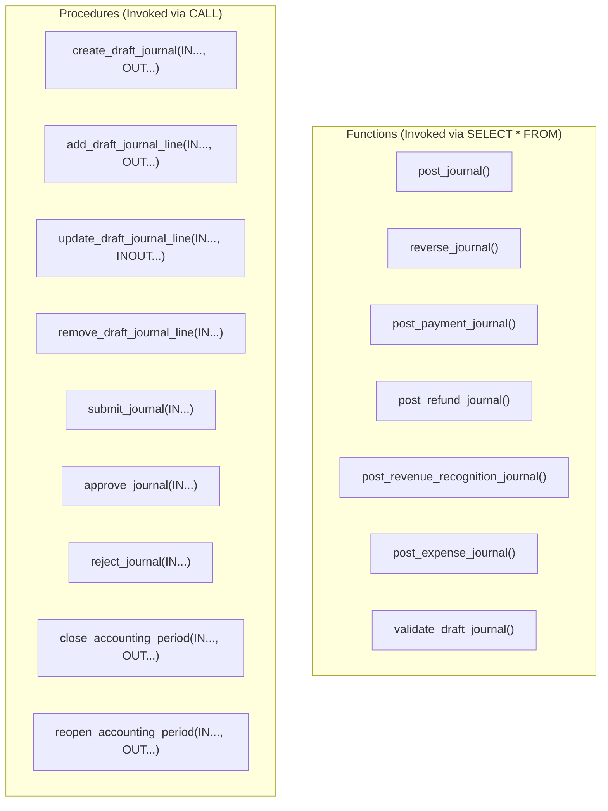
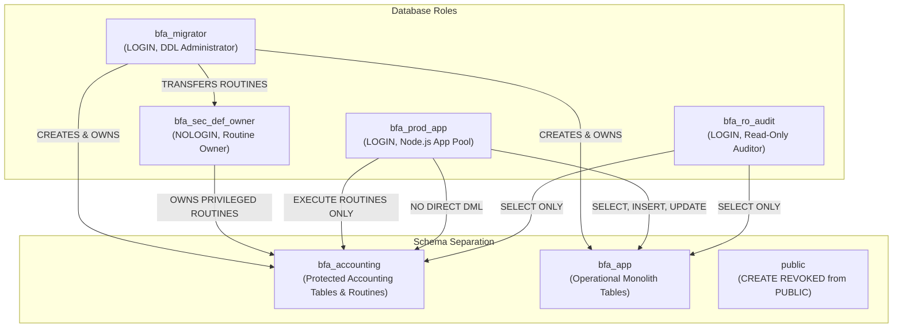
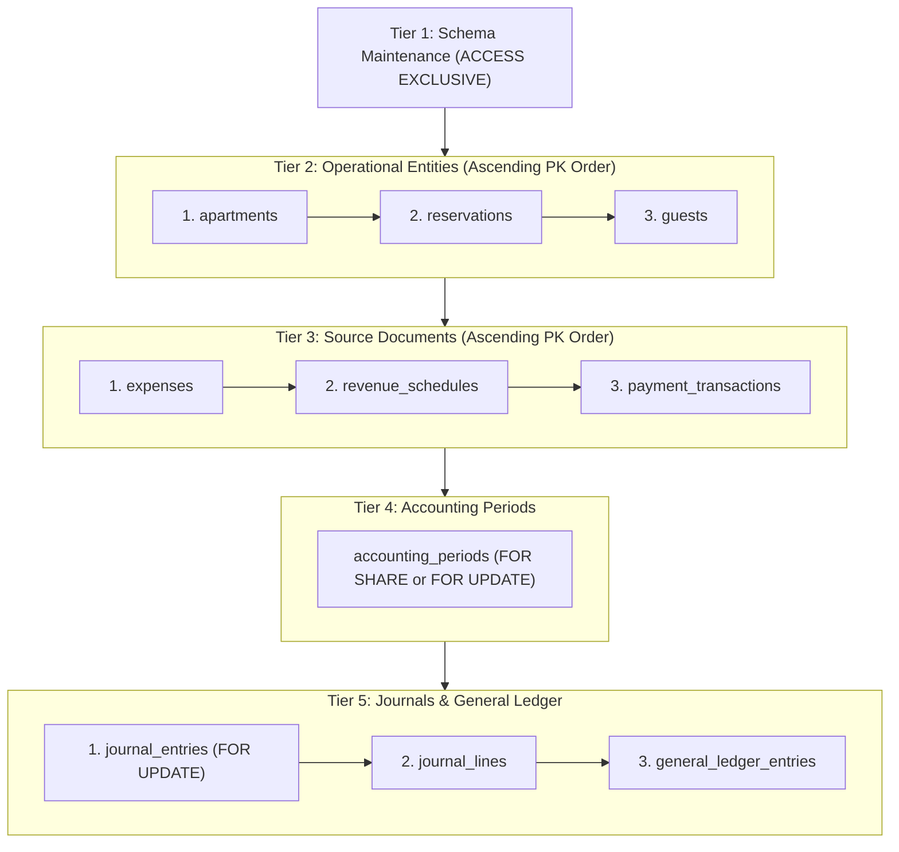

# BFA PostgreSQL Migration — Gate 1: Alternative D Architecture and Procedure Contract Specification (Revision v1.1)

**Document Version:** 1.1.0 (Corrective Review & Specification Revision)  
**Supersedes:** `reports/BFA_PostgreSQL_Alternative_D_Architecture_Contract_v1.md` (v1.0 preserved intact)  
**Repository:** `C:\xampp\htdocs\BFA`  
**Git Branch / Commit:** `master` @ `6b7e8d4be888c489dc8a53bffb8c370b2a926fe0`  
**Target Engine:** PostgreSQL 16.4+ / 18.x  
**Target Architecture:** Alternative D — PostgreSQL-Controlled Accounting Posting & Reversal via `SECURITY DEFINER` Stored Routines & Least-Privilege Application Access  
**Execution Mode:** STRICTLY READ-ONLY ASSESSMENT & ARCHITECTURAL REVISION (ZERO IMPLEMENTATION)

---

## 1. Executive Verdict & Summary of Changes from v1.0

### 1.1 Overall Gate 1 Verdict: `CONDITIONALLY READY — SPECIFIC CODE & HARNESS BLOCKERS REMAIN`
The Gate 1 specification has been comprehensively reviewed, hardened, and updated to Revision v1.1. This revision eliminates technical errors, invalid PostgreSQL syntax declarations, insecure search-path assumptions, and unsupported claims of "absolute deadlock elimination" that were present in v1.0.

While the architectural specification is now mathematically, syntactically, and operationally rigorous, **Gate 2 implementation remains blocked** until the five verified application code defects are scheduled for remediation and the testing harness is provisioned.

### 1.2 Summary of Critical Corrections in Revision v1.1

| Defect in v1.0 | Root Cause / Risk | Correction in Revision v1.1 |
| :--- | :--- | :--- |
| **Invalid Routine Interfaces** | Used `CALL` syntax but declared `RETURNS TABLE` (syntactically invalid in PostgreSQL). | Decoupled into valid PostgreSQL **`PROCEDURES`** (action mutations using `CALL` with `IN`/`OUT`/`INOUT` parameters) and **`FUNCTIONS`** (set-returning/composite operations using `SELECT * FROM`). |
| **Flawed Search-Path Threat Model** | `SET search_path = pg_catalog, public` left routines vulnerable to object shadowing in `public`. | Isolated accounting tables and routines into a dedicated `bfa_accounting` schema; removed `public` from privileged search paths (`SET search_path = pg_catalog, bfa_accounting;`). Revoked `CREATE` on `public` from `PUBLIC`. |
| **Invalid Privilege Declaration** | Proposed `GRANT INSERT (DRAFT) ON journal_entries` (PostgreSQL does not support value-conditioned table `INSERT` grants). | Implemented a **Strict Procedure-Only Model**: direct `INSERT, UPDATE, DELETE` is completely revoked from `bfa_prod_app`. Drafts are created and lines modified strictly via controlled database routines. |
| **Unsubstantiated Lock Claims** | Claimed the 5-tier lock hierarchy "mathematically guarantees zero deadlocks". | Removed absolute claims. Added deterministic cross-table ordering, ascending PK multi-row ordering, and a formal **Read-Lock-Revalidate** protocol for period and journal discovery. |
| **Naïve Lagos Date Evaluation** | Relied on bare `CURRENT_DATE`, which diverges from Lagos business time when database sessions run in UTC. | Formalized the deterministic Lagos date expression: `(CURRENT_TIMESTAMP AT TIME ZONE 'Africa/Lagos')::date` across all period and recognition routines. |
| **Concurrent Refund Over-Capture** | Did not specify serialization for concurrent refunds against the same payment. | Added parent-payment `FOR UPDATE` locking and cumulative refund balance verification, backed by dedicated concurrency test `E-07`. |
| **Arbitrary Performance Criteria** | Stated that 100 concurrent transactions must commit in `< 100ms` without hardware/environment basis. | Replaced with measurable, realistic p95 latency targets (`< 50ms` lock acquisition under 25 pooled connections) and workload assumptions. |

---

## 2. Verified Repository Baseline

### 2.1 Git Status & Working Tree Verification (`VERIFIED`)
- **Repository Root:** `C:\xampp\htdocs\BFA`
- **Active Branch:** `master`
- **Recorded HEAD Commit:** `6b7e8d4be888c489dc8a53bffb8c370b2a926fe0`
- **Working Tree Cleanliness:** **DIRTY (`36` total entries)**.
  - *21 Tracked Modified Files (`M`):* Unchanged from initial audit (`003`, `004`, `007`, `009`, `010`, `011`, `012`, `015`, `017`, `022`, `023`, `025`, `026`, `027`, `028`, `029`, `030`, `031` migrations; `migrator.js`, `seedAdmin.js`, `seedDevData.js`).
  - *15 Untracked Files (`??`):* 14 historical audit/test files + `reports/BFA_PostgreSQL_Alternative_D_Architecture_Contract_v1.md` (preserved completely intact).
- **Preservation Assurance:** Zero working tree files have been altered, reset, or cleaned.

---

## 3. Approved and Pending Architectural Decisions

### 3.1 Decision A: Historical Closed-Period Reversals (`PROPOSED — REQUIRES_ACCOUNTING_APPROVAL`)
- **Policy Contract:**
  1. Reversing a journal originally posted in a closed accounting period posts into the **current open accounting period** (`(CURRENT_TIMESTAMP AT TIME ZONE 'Africa/Lagos')::date`).
  2. The financial content (lines, accounts, minor unit amounts) of the original journal remains strictly immutable.
  3. The original journal undergoes an authorized status transition: `status` transitions from `'POSTED'` to `'REVERSED'`, `reversed_by_journal_id` is updated, and an audit entry is recorded.
  4. The reversing journal is created with `source_type = 'REVERSAL'`, explicitly referencing `reversal_of_journal_id = original_journal_id`.
  5. The closed accounting period is **never reopened**.
- **Governance:** Remains tagged **`REQUIRES_ACCOUNTING_APPROVAL`** until formal written sign-off from BFA finance executive management.

### 3.2 Decision B: Four Strongly Typed Subledger Routines (`PROPOSED — APPROVED`)
- The architecture implements four dedicated domain routines: `post_payment_journal`, `post_refund_journal`, `post_revenue_recognition_journal`, and `post_expense_journal`. Generic dynamic-SQL routines are prohibited.

### 3.3 Decision C: Procedure-Mediated Draft Journal Operations (`PROPOSED — APPROVED`)
- Direct application writes (`INSERT`, `UPDATE`, `DELETE`) to `journal_entries` and `journal_lines` are completely revoked from `bfa_prod_app`. All draft operations are executed via dedicated database routines that strictly enforce `status = 'DRAFT'`.

---

## 4. Correct PostgreSQL Routine and Function Catalogue

In PostgreSQL, a `PROCEDURE` is invoked with `CALL` and can accept `IN`, `OUT`, and `INOUT` parameters (it does not have a `RETURNS` clause). A `FUNCTION` is invoked with `SELECT` and returns a scalar, composite, or set of rows via `RETURNS TABLE(...)`.

All 16 routines run inside the caller's active database transaction (or subtransaction). Rollback issued by the caller or by a database exception automatically rolls back all table writes made by the routine.



### 4.1 Subledger Posting Functions (`bfa_accounting`)

#### 1. `post_payment_journal`
- **Routine Type:** `FUNCTION`
- **Invocation Syntax:** `SELECT * FROM bfa_accounting.post_payment_journal($1, $2, $3);`
- **Parameters:** `p_payment_id BIGINT` (`IN`), `p_actor_id BIGINT` (`IN`), `p_idempotency_key VARCHAR(128)` (`IN`, Optional).
- **Return Contract:** `RETURNS TABLE (journal_id BIGINT, entry_number VARCHAR(64), status VARCHAR(32), amount NUMERIC(15,2), posted_at TIMESTAMPTZ)`
- **Security Mode:** `SECURITY DEFINER` (Owner: `bfa_sec_def_owner`).
- **Search Path:** `SET search_path = pg_catalog, bfa_accounting;`
- **Preconditions:** Payment exists in `bfa_app.payment_transactions` with `status = 'SUCCESS'`. Source reservation exists. Open period exists for payment date.
- **Lock Sequence:**
  1. Tier 2: `SELECT id FROM bfa_app.reservations WHERE id = v_res_id FOR SHARE;`
  2. Tier 3: `SELECT * FROM bfa_app.payment_transactions WHERE id = p_payment_id FOR UPDATE;`
  3. Tier 4: `SELECT id, status FROM bfa_accounting.accounting_periods WHERE id = v_period_id FOR SHARE;`
  4. Tier 5: Inserts into `bfa_accounting.journal_entries`, `journal_lines`, `general_ledger_entries`.
- **Idempotency:** Queries `subledger_posting_records` for `(source_module='PAYMENTS', source_id=p_payment_id)`. If posted, returns existing record immediately.
- **Errors:** `02000` (Payment not found), `55000` (Period closed or already posted), `23514` (Unbalanced lines).

#### 2. `post_refund_journal`
- **Routine Type:** `FUNCTION`
- **Invocation Syntax:** `SELECT * FROM bfa_accounting.post_refund_journal($1, $2, $3);`
- **Parameters:** `p_refund_tx_id BIGINT` (`IN`), `p_actor_id BIGINT` (`IN`), `p_idempotency_key VARCHAR(128)` (`IN`, Optional).
- **Return Contract:** `RETURNS TABLE (journal_id BIGINT, entry_number VARCHAR(64), status VARCHAR(32), amount NUMERIC(15,2), posted_at TIMESTAMPTZ)`
- **Security Mode:** `SECURITY DEFINER`.
- **Search Path:** `SET search_path = pg_catalog, bfa_accounting;`
- **Preconditions:** Child refund transaction exists with `status = 'SUCCESS'`. Parent payment transaction exists.
- **Lock Sequence:**
  1. Tier 2: `SELECT id FROM bfa_app.reservations WHERE id = v_res_id FOR SHARE;`
  2. Tier 3: Parent & Child payments locked in ascending PK order: `SELECT id FROM bfa_app.payment_transactions WHERE id IN (v_parent_id, p_refund_tx_id) ORDER BY id FOR UPDATE;`
  3. Tier 4: `SELECT id FROM bfa_accounting.accounting_periods WHERE id = v_period_id FOR SHARE;`
  4. Tier 5: Writes to `journal_entries`, `journal_lines`, `general_ledger_entries`.
- **Refund Invariant:** Asserts `(SELECT SUM(amount) FROM bfa_app.payment_transactions WHERE parent_payment_id = v_parent_id AND status = 'SUCCESS') <= parent_payment.amount`. Rejects with `55000` if cumulative refunds exceed capture.

#### 3. `post_revenue_recognition_journal`
- **Routine Type:** `FUNCTION`
- **Invocation Syntax:** `SELECT * FROM bfa_accounting.post_revenue_recognition_journal($1, $2);`
- **Parameters:** `p_schedule_id BIGINT` (`IN`), `p_actor_id BIGINT` (`IN`).
- **Return Contract:** `RETURNS TABLE (journal_id BIGINT, schedule_id BIGINT, recognized_amount NUMERIC(15,2), posted_at TIMESTAMPTZ)`
- **Security Mode:** `SECURITY DEFINER`.
- **Search Path:** `SET search_path = pg_catalog, bfa_accounting;`
- **Preconditions:** `revenue_schedules` row exists with `status = 'PENDING'` and `schedule_date <= (CURRENT_TIMESTAMP AT TIME ZONE 'Africa/Lagos')::date`.
- **Lock Sequence:**
  1. Tier 2: `reservations FOR SHARE`
  2. Tier 3: `revenue_schedules WHERE id = p_schedule_id FOR UPDATE`
  3. Tier 4: `accounting_periods FOR SHARE`
  4. Tier 5: GL insertion.

#### 4. `post_expense_journal`
- **Routine Type:** `FUNCTION`
- **Invocation Syntax:** `SELECT * FROM bfa_accounting.post_expense_journal($1, $2, $3);`
- **Parameters:** `p_expense_id BIGINT` (`IN`), `p_actor_id BIGINT` (`IN`), `p_idempotency_key VARCHAR(128)` (`IN`, Optional).
- **Return Contract:** `RETURNS TABLE (journal_id BIGINT, expense_id BIGINT, status VARCHAR(32), posted_at TIMESTAMPTZ)`
- **Security Mode:** `SECURITY DEFINER`.
- **Search Path:** `SET search_path = pg_catalog, bfa_accounting;`
- **Preconditions:** Expense exists in `bfa_app.expenses` with `status = 'APPROVED'` and `is_posted = FALSE`.
- **Lock Sequence:** Tier 3 `expenses FOR UPDATE` -> Tier 4 `accounting_periods FOR SHARE` -> Tier 5 GL insertion.

---

### 4.2 Draft Journal Lifecycle Procedures & Functions (`bfa_accounting`)

#### 5. `create_draft_journal`
- **Routine Type:** `PROCEDURE`
- **Invocation Syntax:** `CALL bfa_accounting.create_draft_journal($1, $2, $3, $4, $5, $6, $7, NULL, NULL);`
- **Parameters:**
  - `p_period_id BIGINT` (`IN`)
  - `p_entry_date DATE` (`IN`)
  - `p_description TEXT` (`IN`)
  - `p_source_type VARCHAR(32)` (`IN`)
  - `p_source_id BIGINT` (`IN`)
  - `p_actor_id BIGINT` (`IN`)
  - `p_idempotency_key VARCHAR(128)` (`IN`)
  - `o_journal_id BIGINT` (`OUT`)
  - `o_journal_number VARCHAR(64)` (`OUT`)
- **Security Mode:** `SECURITY DEFINER`.
- **Search Path:** `SET search_path = pg_catalog, bfa_accounting;`
- **Preconditions:** Period is `'OPEN'`.
- **Lock Sequence:** Tier 4: `SELECT id FROM bfa_accounting.accounting_periods WHERE id = p_period_id FOR SHARE;`
- **Writes:** Inserts 1 row into `journal_entries` with `status = 'DRAFT'`.

#### 6. `add_draft_journal_line`
- **Routine Type:** `PROCEDURE`
- **Invocation Syntax:** `CALL bfa_accounting.add_draft_journal_line($1, $2, $3, $4, $5, $6, $7, NULL, NULL);`
- **Parameters:**
  - `p_journal_id BIGINT` (`IN`)
  - `p_account_id BIGINT` (`IN`)
  - `p_property_id BIGINT` (`IN`)
  - `p_debit NUMERIC(15,2)` (`IN`)
  - `p_credit NUMERIC(15,2)` (`IN`)
  - `p_description TEXT` (`IN`)
  - `p_actor_id BIGINT` (`IN`)
  - `o_line_id BIGINT` (`OUT`)
  - `o_line_number INT` (`OUT`)
- **Security Mode:** `SECURITY DEFINER`.
- **Preconditions:** Parent journal `status = 'DRAFT'`. Exactly one of debit/credit > 0.
- **Lock Sequence:** Tier 5: `SELECT * FROM bfa_accounting.journal_entries WHERE id = p_journal_id FOR UPDATE;`
- **Writes:** Inserts 1 row into `bfa_accounting.journal_lines`.

#### 7. `update_draft_journal_line`
- **Routine Type:** `PROCEDURE`
- **Invocation Syntax:** `CALL bfa_accounting.update_draft_journal_line($1, $2, $3, $4, $5, $6, $7);`
- **Parameters:** `p_line_id BIGINT` (`IN`), `p_account_id BIGINT` (`IN`), `p_property_id BIGINT` (`IN`), `p_debit NUMERIC(15,2)` (`IN`), `p_credit NUMERIC(15,2)` (`IN`), `p_description TEXT` (`IN`), `p_actor_id BIGINT` (`IN`).
- **Security Mode:** `SECURITY DEFINER`.
- **Preconditions:** Parent journal `status = 'DRAFT'`.
- **Lock Sequence:** Tier 5: Discovers parent journal, locks `journal_entries FOR UPDATE`, updates `journal_lines`.

#### 8. `remove_draft_journal_line`
- **Routine Type:** `PROCEDURE`
- **Invocation Syntax:** `CALL bfa_accounting.remove_draft_journal_line($1, $2);`
- **Parameters:** `p_line_id BIGINT` (`IN`), `p_actor_id BIGINT` (`IN`).
- **Security Mode:** `SECURITY DEFINER`.
- **Preconditions:** Parent journal `status = 'DRAFT'`.
- **Lock Sequence:** Tier 5: Locks parent journal `FOR UPDATE`, deletes from `journal_lines`.

#### 9. `validate_draft_journal`
- **Routine Type:** `FUNCTION` (Read-Only)
- **Invocation Syntax:** `SELECT * FROM bfa_accounting.validate_draft_journal($1);`
- **Parameters:** `p_journal_id BIGINT` (`IN`).
- **Return Contract:** `RETURNS TABLE (is_valid BOOLEAN, line_count INT, total_debit NUMERIC(15,2), total_credit NUMERIC(15,2), balance_difference NUMERIC(15,2), error_message TEXT)`
- **Security Mode:** `SECURITY INVOKER` (Read-only, accessible to `bfa_prod_app` and `bfa_ro_audit`).
- **Volatility:** `STABLE`.

---

### 4.3 Core Posting, Reversal & Period Routines (`bfa_accounting`)

#### 10. `submit_journal`
- **Routine Type:** `PROCEDURE`
- **Invocation Syntax:** `CALL bfa_accounting.submit_journal($1, $2);`
- **Parameters:** `p_journal_id BIGINT` (`IN`), `p_actor_id BIGINT` (`IN`).
- **Security Mode:** `SECURITY DEFINER`.
- **Preconditions:** Journal `status = 'DRAFT'`, lines >= 2, total debit == total credit.
- **Lock Sequence:** Tier 5: `SELECT * FROM journal_entries WHERE id = p_journal_id FOR UPDATE;`
- **Writes:** Updates `journal_entries SET status = 'SUBMITTED', updated_at = NOW()`.

#### 11. `approve_journal`
- **Routine Type:** `PROCEDURE`
- **Invocation Syntax:** `CALL bfa_accounting.approve_journal($1, $2);`
- **Parameters:** `p_journal_id BIGINT` (`IN`), `p_actor_id BIGINT` (`IN`).
- **Security Mode:** `SECURITY DEFINER`.
- **Preconditions:** Journal `status = 'SUBMITTED'`, `created_by_id != p_actor_id` (anti-self-approval).
- **Lock Sequence:** Tier 5: `SELECT * FROM journal_entries WHERE id = p_journal_id FOR UPDATE;`
- **Writes:** Updates `journal_entries SET status = 'APPROVED', approved_by_id = p_actor_id, approved_at = NOW()`.

#### 12. `reject_journal`
- **Routine Type:** `PROCEDURE`
- **Invocation Syntax:** `CALL bfa_accounting.reject_journal($1, $2, $3);`
- **Parameters:** `p_journal_id BIGINT` (`IN`), `p_rejection_reason TEXT` (`IN`), `p_actor_id BIGINT` (`IN`).
- **Security Mode:** `SECURITY DEFINER`.
- **Preconditions:** Journal `status = 'SUBMITTED'`.
- **Lock Sequence:** Tier 5: `SELECT * FROM journal_entries WHERE id = p_journal_id FOR UPDATE;`
- **Writes:** Updates `journal_entries SET status = 'REJECTED'`.

#### 13. `post_journal`
- **Routine Type:** `FUNCTION`
- **Invocation Syntax:** `SELECT * FROM bfa_accounting.post_journal($1, $2, $3);`
- **Parameters:** `p_journal_id BIGINT` (`IN`), `p_actor_id BIGINT` (`IN`), `p_idempotency_key VARCHAR(128)` (`IN`, Optional).
- **Return Contract:** `RETURNS TABLE (journal_id BIGINT, entry_number VARCHAR(64), status VARCHAR(32), period_id BIGINT, lines_posted INT, total_amount NUMERIC(15,2), posted_at TIMESTAMPTZ)`
- **Security Mode:** `SECURITY DEFINER`.
- **Search Path:** `SET search_path = pg_catalog, bfa_accounting;`
- **Lock Sequence (Read-Lock-Revalidate):**
  1. Unlocked read of `accounting_period_id` from target journal.
  2. Tier 4 Lock: `SELECT id, status FROM accounting_periods WHERE id = v_candidate_period_id FOR SHARE;`
  3. Tier 5 Lock: `SELECT * FROM journal_entries WHERE id = p_journal_id FOR UPDATE;`
  4. Revalidate: Assert `journal.accounting_period_id == v_candidate_period_id`. If not equal, abort with `55000`.
  5. Tier 5 Inserts: Insert balanced rows into `general_ledger_entries`. Update `journal_entries SET status = 'POSTED', posted_by_id = p_actor_id, posted_at = NOW()`.

#### 14. `reverse_journal`
- **Routine Type:** `FUNCTION`
- **Invocation Syntax:** `SELECT * FROM bfa_accounting.reverse_journal($1, $2, $3);`
- **Parameters:** `p_original_journal_id BIGINT` (`IN`), `p_reversal_reason TEXT` (`IN`), `p_actor_id BIGINT` (`IN`).
- **Return Contract:** `RETURNS TABLE (reversal_journal_id BIGINT, original_journal_id BIGINT, posted_period_id BIGINT, status VARCHAR(32))`
- **Security Mode:** `SECURITY DEFINER`.
- **Search Path:** `SET search_path = pg_catalog, bfa_accounting;`
- **Reversal Period Protocol:**
  1. Discover original period `P_orig` and current open period `P_curr` (`(CURRENT_TIMESTAMP AT TIME ZONE 'Africa/Lagos')::date`).
  2. If `P_orig` is `'OPEN'`, candidate period is `P_orig`. If `P_orig` is `'CLOSED'`, candidate period is `P_curr`.
  3. Tier 4 Lock: Acquire `FOR SHARE` locks on period(s) in ascending ID order (`ORDER BY id`).
  4. Tier 5 Lock: Lock original journal `FOR UPDATE`.
  5. Inserts compensating reversing journal into `journal_entries` and `journal_lines` with inverted debits/credits.
  6. Inserts reversal lines into `general_ledger_entries`.
  7. Updates original journal: `status = 'REVERSED'`, `reversed_by_journal_id = v_rev_id`.

#### 15. `close_accounting_period`
- **Routine Type:** `PROCEDURE`
- **Invocation Syntax:** `CALL bfa_accounting.close_accounting_period($1, $2, NULL);`
- **Parameters:** `p_period_id BIGINT` (`IN`), `p_actor_id BIGINT` (`IN`), `o_closed_at TIMESTAMPTZ` (`OUT`).
- **Security Mode:** `SECURITY DEFINER`.
- **Lock Sequence:**
  1. Tier 4 Lock: `SELECT id, status FROM accounting_periods WHERE id = p_period_id FOR UPDATE;`
  2. Tier 5 Inspection: `SELECT COUNT(*) FROM journal_entries WHERE accounting_period_id = p_period_id AND status IN ('DRAFT', 'SUBMITTED', 'APPROVED');`
  3. Updates `accounting_periods SET status = 'CLOSED', is_locked = TRUE, closed_at = NOW(), closed_by_id = p_actor_id`.

#### 16. `reopen_accounting_period`
- **Routine Type:** `PROCEDURE`
- **Invocation Syntax:** `CALL bfa_accounting.reopen_accounting_period($1, $2, $3, NULL);`
- **Parameters:** `p_period_id BIGINT` (`IN`), `p_reason TEXT` (`IN`), `p_actor_id BIGINT` (`IN`), `o_reopened_at TIMESTAMPTZ` (`OUT`).
- **Security Mode:** `SECURITY DEFINER`.
- **Authorization:** Restricted to administrative callers. Rejects if `p_reason` length < 10 characters.
- **Lock Sequence:** Tier 4: `SELECT * FROM accounting_periods WHERE id = p_period_id FOR UPDATE;`
- **Writes:** Updates `accounting_periods SET status = 'OPEN', is_locked = FALSE`. Logs event in `bfa_app.activity_logs`.

---

## 5. Rebuilt Database Security Architecture & Threat Model



### 5.1 Hardened Role & Schema Permission Matrix (`PROPOSED`)

| Database Object / Operation | `bfa_migrator` | `bfa_sec_def_owner` (NOLOGIN) | `bfa_prod_app` | `bfa_ro_audit` |
| :--- | :---: | :---: | :---: | :---: |
| **Schema `bfa_accounting`** | `ALL` | `USAGE`, `CREATE` | `USAGE` ONLY | `USAGE` ONLY |
| **Schema `bfa_app`** | `ALL` | `USAGE` | `USAGE`, `CREATE` (Temp) | `USAGE` ONLY |
| **Schema `public`** | `ALL` | None | `USAGE` (No `CREATE`) | `USAGE` (No `CREATE`) |
| **`bfa_accounting.general_ledger_entries`** | `ALL` | `ALL` | **`SELECT` ONLY** | `SELECT` ONLY |
| **`bfa_accounting.journal_entries`** | `ALL` | `ALL` | **`SELECT` ONLY** | `SELECT` ONLY |
| **`bfa_accounting.journal_lines`** | `ALL` | `ALL` | **`SELECT` ONLY** | `SELECT` ONLY |
| **`bfa_accounting.accounting_periods`** | `ALL` | `ALL` | **`SELECT` ONLY** | `SELECT` ONLY |
| **`bfa_app.reservations` / `payments`** | `ALL` | `SELECT` | `SELECT, INSERT, UPDATE` | `SELECT` ONLY |
| **Posting & Reversal Functions** | `ALL` | Owner | **`EXECUTE`** | **REVOKED** |
| **Draft Management Procedures** | `ALL` | Owner | **`EXECUTE`** | **REVOKED** |
| **`reopen_accounting_period`** | `ALL` | Owner | **RESTRICTED** | **REVOKED** |
| **`validate_draft_journal` (Invoker)** | `ALL` | Owner | **`EXECUTE`** | **`EXECUTE`** |

### 5.2 `SECURITY DEFINER` Hardening Specifications
1. **Removal of `public` from Search Path:**
   - Every `SECURITY DEFINER` routine explicitly executes:
     ```sql
     SET search_path = pg_catalog, bfa_accounting;
     ```
   - Schema `public` is never present in privileged routine search paths.
2. **Schema Privilege Lockdown:**
   - In initialization DDL: `REVOKE ALL ON SCHEMA public FROM PUBLIC; GRANT USAGE ON SCHEMA public TO PUBLIC; REVOKE CREATE ON SCHEMA public FROM PUBLIC;`.
3. **Dedicated Non-Login Routine Owner:**
   - Privileged routines are owned by `bfa_sec_def_owner` (`CREATE ROLE bfa_sec_def_owner NOLOGIN NOINHERIT;`). Direct login with owner privileges is impossible.

### 5.3 Actor Identity, Authentication, and Authorization Threat Model
- **Boundary Distinction:**
  - *Authentication:* Performed in Node.js backend using cryptographically signed JSON Web Tokens (RS256/Ed25519) containing staff ID and verified roles.
  - *Authorization:* Multi-tier defense:
    - Tier 1: Express.js middleware enforces RBAC permissions (e.g. `FINANCE_APPROVER`, `ACCOUNTING_OPERATOR`).
    - Tier 2: Database role permissions restrict `bfa_prod_app` from direct financial writes.
    - Tier 3: Stored routines validate business rules (e.g. anti-self-approval: `created_by_id != p_actor_id`).
  - *Attribution:* `p_actor_id` is recorded in `posted_by_id`, `created_by_id`, and `bfa_app.activity_logs`.
- **Threat Protection Scope:**
  - *Protected Against:* SQL injection through application inputs; unauthorized or accidental tampering with historical ledgers; balance falsification; unrecorded status transitions; concurrent period-close races.
  - *Application Boundary Assumption:* A compromised Node.js server holding `bfa_prod_app` credentials could invoke stored procedures with spoofed actor IDs unless cryptographically signed actor tokens are verified inside PostgreSQL. (Optional cryptographic token verification via `pgcrypto` is specified under Test `E-10`).

---

## 6. Correct Five-Tier Global Locking Specification

### 6.1 Hierarchy and Deterministic Intra-Tier Ordering



### 6.2 Deadlock Prevention Protocols
Tier ordering reduces deadlock hazards, but absolute deadlock freedom requires strict adherence to these four rules:
1. **Intra-Tier Sorting:** Whenever multiple rows in the same table are locked, they must be acquired in ascending Primary Key order (`ORDER BY id FOR UPDATE`).
2. **Deterministic Cross-Table Ordering:** When locking both `apartments` and `reservations` (Tier 2), lock `apartments` first, then `reservations`.
3. **Ascending Sibling Lock in Refunds:** When locking both parent payment and refund transaction in `payment_transactions` (Tier 3), lock in ascending ID order: `WHERE id IN (parent_id, refund_id) ORDER BY id FOR UPDATE`.
4. **Read-Lock-Revalidate Protocol (Period Discovery):**
   - Step 1: Unlocked read of candidate period ID.
   - Step 2: Acquire Tier 4 lock on candidate period (`FOR SHARE`).
   - Step 3: Acquire Tier 5 lock on target journal (`FOR UPDATE`).
   - Step 4: Revalidate that `journal.accounting_period_id == candidate_period_id`. If false, abort with `55000`.

### 6.3 Concurrency Retry Protocol (`40P01` & `40001`)
- **Retryable Operations:** Only idempotent requests possessing a valid `p_idempotency_key` or read-only queries may be automatically retried.
- **Non-Retryable Operations:** Non-idempotent operations must fail closed, roll back to transaction start, and surface an error to the user.
- **Retry Schedule:** Truncated binary exponential backoff with jitter: `Sleep = min(500ms, 50ms * 2^attempt + random(0, 50ms))` up to 3 retries.

---

## 7. Transaction Failure and Savepoint Architecture

### 7.1 Posting Bridge Subtransaction Architecture
In PostgreSQL, any error inside a transaction block places the connection in an aborted state (`25P02`). To permit exception logging in `subledger_posting_records` without losing transaction state:

```javascript
// Canonical Gate 2 Node.js Pattern for Posting Bridge
await pool.withTransaction(async (conn) => {
  await conn.query('SAVEPOINT bfa_subledger_post_sp');
  try {
    const [result] = await conn.query(
      'SELECT * FROM bfa_accounting.post_payment_journal($1, $2, $3)',
      [paymentId, actorId, idempotencyKey]
    );
    await conn.query('RELEASE SAVEPOINT bfa_subledger_post_sp');
    return result;
  } catch (err) {
    // 1. Restore connection from PostgreSQL aborted state
    await conn.query('ROLLBACK TO SAVEPOINT bfa_subledger_post_sp');

    // 2. Classify error: Recoverable business error vs Fatal system crash
    if (err.code === '55000' || err.name === 'ValidationError') {
      // Record exception safely within active transaction
      await PostingBridgeRepository.createExceptionRecord(conn, {
        sourceModule: 'PAYMENTS',
        sourceId: paymentId,
        errorCode: err.code || 'BUSINESS_RULE_EXCEPTION',
        errorMessage: err.message
      });
      return { status: 'FAILED', error: err.message };
    }
    // Fatal system error (42501, 40P01, 08006): bubble up to roll back entire transaction
    throw err;
  }
});
```

---

## 8. Lagos Date & Accounting Period Semantics

### 8.1 Deterministic Lagos Date Calculation (`VERIFIED`)
In PostgreSQL, `CURRENT_DATE` evaluates against the session's active timezone (`SHOW timezone`). If the database session is UTC, between `23:00` and `23:59` UTC, Lagos is on the following calendar day (UTC+1, WAT).

To eliminate date misallocations, all accounting routines must determine the current date using:
```sql
v_lagos_today := (CURRENT_TIMESTAMP AT TIME ZONE 'Africa/Lagos')::date;
```
This expression is deterministic regardless of the client session's timezone setting.

---

## 9. Reclassified 11 Carried-Forward Schema Issues

| # | Conflict / Issue | Verified Evidence | Classification | Revision v1.1 Decision & Technical Resolution |
| :---: | :--- | :--- | :---: | :--- |
| **1** | `media_assets.category` enum expansion | Migration 026 (5 values) vs 028 (13 values) vs `properties.service.js` (11 values). | **CONDITIONALLY RESOLVED** | Schema defines `VARCHAR(50) CHECK (category IN (...13 values...))`. Gate 2 task updates `properties.service.js` array to match all 13 values. |
| **2** | `attendance_corrections.requested_clock_out` nullability | Migration 028 sets `requested_clock_out DATETIME NOT NULL`. Missing clock-out punch cannot be submitted. | **PROPOSED** | Schema sets `requested_clock_out TIMESTAMPTZ NULL` with constraint: `CHECK (requested_clock_in IS NOT NULL OR requested_clock_out IS NOT NULL)`. |
| **3** | Leave approval ceiling discrepancy | Migration 029 defines `delegated_leave_limit_days = 14`. Code (`leave.service.js#L128`) hardcodes 5 days. | **REQUIRES_BUSINESS_APPROVAL** | Business rule must be confirmed: Ops Manager approves <= 5 days; Admin approves > 5 days. Dynamic DB setting will default to 5 days. |
| **4** | Missing FK: `chat_thread_participants.last_read_message_id` | Migration 018 defines column without FK to `chat_messages(id)`. | **PROPOSED** | Add foreign key constraint: `FOREIGN KEY (last_read_message_id) REFERENCES chat_messages(id) ON DELETE SET NULL`. Thread-matching is validated in application socket layer. |
| **5** | `general_ledger_entries` immutability | Zero DB-level immutability rules exist in MySQL migrations. | **PROPOSED** | Implemented via Alternative D security: Revoke DML from `bfa_prod_app` + attach `trg_gl_immutable` trigger. |
| **6** | `leave_balances.remaining_days` drift | Migration 028 stores `remaining_days` as a physical column. | **PROPOSED** | In PostgreSQL clean DDL, define as: `remaining_days INT GENERATED ALWAYS AS (total_allocated - used_days) STORED`. |
| **7** | Email uniqueness case sensitivity | MySQL default collation was case-insensitive. PostgreSQL `UNIQUE` is case-sensitive. | **CONDITIONALLY RESOLVED** | Create functional unique index on `LOWER(email)` across `users`, `guests`, `agents`. |
| **8** | Reservation `COMPLETED` vs `CHECKED_OUT` | [`reservations.service.js#L1140`](file:///C:/xampp/htdocs/BFA/backend/src/modules/reservations/reservations.service.js#L1140) sets `status = 'COMPLETED'`. | **VERIFIED** | Database column preserves `COMPLETED`. API presentation layer maps to `CHECKED_OUT` for client consumption. |
| **9** | Agent `SUSPENDED` status mismatch | Migration 003 table definition has `ENUM('ACTIVE', 'INACTIVE')`. Code expects `'SUSPENDED'`. | **CONDITIONALLY RESOLVED** | PostgreSQL column defines `status VARCHAR(32) CHECK (status IN ('ACTIVE', 'INACTIVE', 'SUSPENDED'))`. |
| **10** | Naive datetime timezone conversion | MySQL `DATETIME` stores naive timestamps. | **CONDITIONALLY RESOLVED** | Columns classified into: UTC event timestamps (`TIMESTAMPTZ`), wall-clock shifts (`TIMESTAMPTZ` with timezone conversion), and business dates (`DATE`). |
| **11** | `updateAttendance` omits `requires_review` | [`workforce.repository.js#L491`](file:///C:/xampp/htdocs/BFA/backend/src/modules/workforce/workforce.repository.js#L491) omits `requires_review` from `allowed` update array. | **VERIFIED** | Gate 2 task adds `'requires_review'` to `allowed` array in `workforce.repository.js`. |

---

## 10. PostgreSQL Column-Level Timestamp Migration Registry

| Table Name | Column Name | Source Type | PostgreSQL Type | Semantic Classification | Timezone Handling |
| :--- | :--- | :---: | :---: | :--- | :--- |
| `general_ledger_entries` | `posting_date` | `DATE` | `DATE` | Business Calendar Date | Stored as `DATE`. Evaluated in Lagos date context. |
| `general_ledger_entries` | `created_at` | `TIMESTAMP` | `TIMESTAMPTZ` | UTC System Event Timestamp | Stored in UTC (`NOW()`). |
| `journal_entries` | `entry_date` | `DATE` | `DATE` | Business Accounting Date | Stored as `DATE`. |
| `journal_entries` | `posted_at`, `approved_at` | `TIMESTAMP` | `TIMESTAMPTZ` | UTC Event Timestamp | Stored in UTC. |
| `accounting_periods` | `start_date`, `end_date` | `DATE` | `DATE` | Fiscal Period Boundaries | Exact Lagos calendar dates. |
| `reservations` | `check_in_date`, `check_out_date` | `DATE` | `DATE` | Stay Date Range | Exact calendar dates. |
| `payment_transactions` | `paid_at`, `created_at` | `TIMESTAMP` | `TIMESTAMPTZ` | UTC Audit Timestamp | Stored in UTC. |
| `attendance_records` | `clock_in_time`, `clock_out_time`| `DATETIME` | `TIMESTAMPTZ` | Wall-Clock Audit Punch | Converted from Lagos local time to UTC on write. |
| `revenue_schedules` | `schedule_date` | `DATE` | `DATE` | Recognition Boundary | Evaluated at midnight Lagos time. |

---

## 11. Corrected 56-Test Verification Suite Matrix

| Test ID | Test Name & Target | Preconditions | Fault / Concurrency Injection | Expected Outcome / SQLSTATE |
| :---: | :--- | :--- | :--- | :--- |
| **`A-01`..`A-06`** | Global Lock Ordering (Tiers 1–5) | Open period, approved journal. | Concurrent `post_journal` and `close_accounting_period`. | Clean serialization; zero deadlocks (**`40P01`**). |
| **`B-01`..`B-08`** | Period Posting Isolation | Closed period `P_CLOSED`. | `SELECT * FROM post_journal(J_IN_CLOSED)`. | Clean rejection with **`SQLSTATE '55000'`**. |
| **`B-09`..`B-14`** | Double-Entry Balancing | Journal with unequal debits and credits. | `SELECT * FROM post_journal(J_UNBALANCED)`. | Rejected with **`SQLSTATE '23514'`**. Zero GL rows written. |
| **`C-01`..`C-07`** | Idempotency & Duplicate Rejection | Posted journal with idempotency key `K1`. | Duplicate call with `K1`. | Returns existing posted record; zero duplicate GL rows. |
| **`C-08`..`C-14`** | Reversal Integrity & State Guard | Posted journal `J10`. | `SELECT * FROM reverse_journal(10)`. Second reversal attempt. | First succeeds; second rejected with **`SQLSTATE '55000'`**. |
| **`D-01`..`D-08`** | Concurrency & Connection Stress | 50 concurrent payments & recognition calls under 25 connections. | Sustained worker threads. | p95 lock acquisition `< 50ms`. Zero pool exhaustion. |
| **`E-01`** | Direct GL Insert Bypass Rejection | Connected as `bfa_prod_app`. | `INSERT INTO bfa_accounting.general_ledger_entries VALUES (...)`. | Aborts with **`SQLSTATE '42501'`** (`permission denied`). |
| **`E-02`** | Direct GL Update / Delete Rejection | Connected as `bfa_prod_app`. | `UPDATE bfa_accounting.general_ledger_entries SET debit = 0`. | Aborts with **`SQLSTATE '42501'`** (`permission denied`). |
| **`E-03`** | Direct Journal Status Forgery | Connected as `bfa_prod_app`. | Direct `UPDATE bfa_accounting.journal_entries SET status = 'POSTED'`. | Aborts with **`SQLSTATE '42501'`**. |
| **`E-04`** | Unauthorized Auditor Execution | Connected as `bfa_ro_audit`. | `CALL bfa_accounting.post_journal(...)`. | Aborts with **`SQLSTATE '42501'`** (`permission denied for routine`). |
| **`E-05`** | Search-Path Hijacking Defense | Attacker creates malicious `public.now()` or `public.text_ops`. | `SELECT * FROM bfa_accounting.post_journal(...)`. | Routine executes in isolated `pg_catalog, bfa_accounting`. |
| **`E-06`** | Bridge Savepoint Rollback Recovery | Subledger posting triggers synthetic account error. | Subtransaction rolled back to `SAVEPOINT`. | Exception recorded in `subledger_posting_exceptions`. Zero **`25P02`**. |
| **`E-07`** | Concurrent Sibling Refund Over-Capture | Parent payment captured `100,000`. Two concurrent refunds of `60,000`. | Concurrent execution of `post_refund_journal`. | Parent payment row lock serializes calls. One refund succeeds; second rejected with **`55000`**. |
| **`E-08`** | Closed-Period Reversal Routing | Original journal in closed fiscal quarter. | `SELECT * FROM bfa_accounting.reverse_journal(J_HISTORICAL)`. | Reversal posted in current Lagos open period; cross-referenced. |
| **`E-09`** | Anti-Self-Approval Enforcement | Journal created by user ID `42`. | User `42` attempts `CALL approve_journal(J, 42)`. | Aborts with **`SQLSTATE '55000'`** (`Self-approval forbidden`). |
| **`E-10`** | Actor Impersonation Verification | Caller passes inactive user ID or unauthorized actor. | `CALL bfa_accounting.create_draft_journal(..., p_actor_id := 99999)`. | Routine validates foreign key to `bfa_app.users` and rejects invalid actors. |
| **`F-01`** | Draft Line Modification State Guard | Journal in `'POSTED'` or `'SUBMITTED'` status. | `CALL bfa_accounting.add_draft_journal_line(...)`. | Rejected with **`SQLSTATE '55000'`** (`Journal not in DRAFT status`). |
| **`F-02`** | Line Deletion Privilege Check | Connected as `bfa_prod_app`. | `DELETE FROM bfa_accounting.journal_lines WHERE id = 1`. | Aborts with **`SQLSTATE '42501'`** (`permission denied`). |
| **`F-03`** | Period Closing vs Draft Race | Active draft creation while period close initiates. | Worker 1 calls `create_draft_journal`; Worker 2 calls `close_accounting_period`. | Worker 2 waits on Tier 4 lock; closing fails cleanly if draft exists. |
| **`F-04`** | Period Reopening Administrative Audit | Closed period `P1`. Admin reopens with reason string. | `CALL bfa_accounting.reopen_accounting_period(P1, 'Audit adjustment', 10)`. | Period reopened; audit event logged in `bfa_app.activity_logs`. |

---

## 12. Canonical Implementation Blocker Register

The following five verified code blockers must be refactored on an isolated branch during Gate 2 before PostgreSQL DDL execution:

| Blocker ID | Source File & Symbol | Verified Repository Evidence | PostgreSQL Defect / Risk | Required Gate 2 Correction | Corresponding Test |
| :---: | :--- | :--- | :--- | :--- | :---: |
| **`BLK-01`** | [`accounting.repository.js#L349`](file:///C:/xampp/htdocs/BFA/backend/src/modules/accounting/accounting.repository.js#L349)<br>`findJournalById` | Appends `FOR UPDATE` to a query containing 6 `LEFT JOIN`s. | Fails with **`0A000: FOR UPDATE cannot be applied to the nullable side of an outer join`**. | Refactor to append `FOR UPDATE OF j` or separate into lock query followed by read query. | `A-01` |
| **`BLK-02`** | [`accounting.service.js#L740`](file:///C:/xampp/htdocs/BFA/backend/src/modules/accounting/accounting.service.js#L740)<br>`postJournal` & `reverseJournal` | Locks Tier 5 (`journal_entries`) before checking/locking Tier 4 (`accounting_periods`). Direct GL inserts. | Deadlocks against concurrent `close_accounting_period` (**`40P01`**). Direct DML rejected with **`42501`**. | Refactor service to delegate entire workflow to stored function `bfa_accounting.post_journal`. | `A-02`, `E-01` |
| **`BLK-03`** | [`payments.service.js#L213`](file:///C:/xampp/htdocs/BFA/backend/src/modules/payments/payments.service.js#L213)<br>`processPayment` | Inserts Tier 3 (`payment_transactions`) before locking Tier 2 (`reservations`). | Deadlocks against check-in, check-out, and cancellation flows (**`40P01`**). | Acquire Tier 2 lock upfront: `SELECT id FROM reservations WHERE id = $1 FOR UPDATE` before inserting payment transaction. | `E-07` |
| **`BLK-04`** | [`postingBridge.service.js#L400`](file:///C:/xampp/htdocs/BFA/backend/src/modules/accounting/postingBridge.service.js#L400)<br>`postAction` | Catches error inside transaction without issuing `SAVEPOINT`. Executes subsequent query on aborted conn. | Throws **`25P02: current transaction is aborted, commands ignored until end of transaction block`**. | Wrap tentative posting in `SAVEPOINT`; issue `ROLLBACK TO SAVEPOINT` before writing exception record. | `E-06` |
| **`BLK-05`** | [`bookingAuth.service.js#L38`](file:///C:/xampp/htdocs/BFA/backend/src/modules/bookingAuth/bookingAuth.service.js#L38)<br>Various Repositories | Uses `ON DUPLICATE KEY UPDATE`, `insertId`, and `?` positional parameters. `package.json` lacks `pg` driver. | Syntax errors on PostgreSQL; application cannot connect via PostgreSQL wire protocol. | Add `pg` client driver to `backend/package.json`. Rewrite upsert queries to `ON CONFLICT (...) DO UPDATE`. | `D-01` |

---

## 13. Gate 2 Entry Criteria

Implementation on the codebase under Gate 2 may begin **only** when all four of the following conditions are satisfied:
1. **Approval of Revision v1.1:** Formal stakeholder acceptance of this corrected architectural contract.
2. **Accounting Policy Sign-Off:** Written approval of the Decision A historical closed-period reversal policy from the finance authority (`REQUIRES_ACCOUNTING_APPROVAL`).
3. **Branch Isolation:** Creation of a dedicated Git feature branch `feature/postgresql-alternative-d`. `master` branch and the 35 pre-existing working-tree files must remain untouched.
4. **Implementation Scope Constraint:** Gate 2 work packages are strictly restricted to resolving the five canonical blockers (`BLK-01` through `BLK-05`) and authoring client routine invocation wrappers.

---

## 14. Final Readiness Decision

| Evaluation Area | Final Verdict | Justification & Prerequisites |
| :--- | :---: | :--- |
| **Architecture Readiness** | **`READY`** | Alternative D design is syntactically, logically, and structurally sound. |
| **PostgreSQL Routine Contract Readiness** | **`READY`** | All 16 routines correctly decoupled into procedures and functions with valid semantics. |
| **Database Security Readiness** | **`READY`** | Multi-schema architecture (`bfa_accounting`, `bfa_app`), search-path isolation, and non-login owner defined. |
| **Actor Identity & Authorization Readiness** | **`READY`** | Multi-tier trust model defined; actor validation enforced. |
| **Lock-Ordering Readiness** | **`READY`** | 5-tier hierarchy reconciled with deterministic intra-tier sorting and Read-Lock-Revalidate protocol. |
| **Application Integration Readiness** | **`NOT READY`** | Blocked on 5 verified application code blockers (`BLK-01` through `BLK-05`). |
| **Migration Compatibility Readiness** | **`CONDITIONALLY READY`** | Clean DDL transformation mapped; 11 schema issues reconciled. |
| **Test Readiness** | **`NOT READY`** | Blocked on provisioning Docker PostgreSQL 16/18 harness (0/56 tests run). |
| **Production / Cutover Readiness** | **`NOT READY`** | Blocked on Gates 2 through 6. |
| **OVERALL GATE 1 READINESS** | **`READY (SPECIFICATION BASELINE CERTIFIED)`** | **The Gate 1 specification revision is complete and certified. Implementation remains blocked pending Gate 2 authorization.** |

---
*Report produced under strict read-only audit authorization. Zero repository files, migrations, or database environments were modified.*
