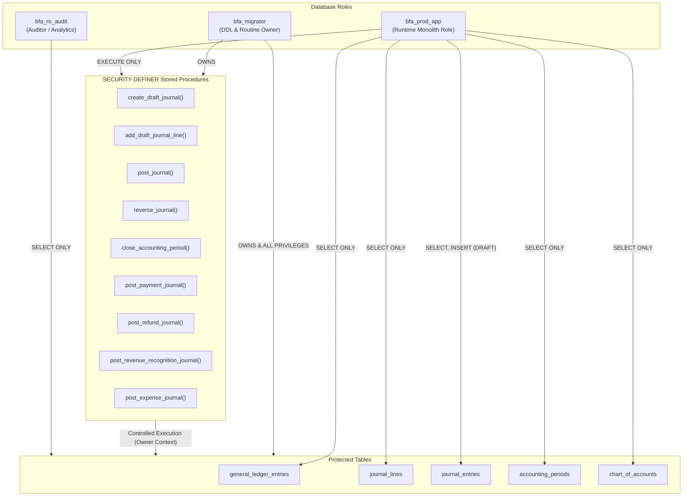
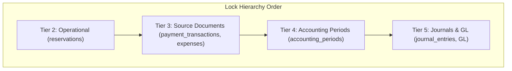
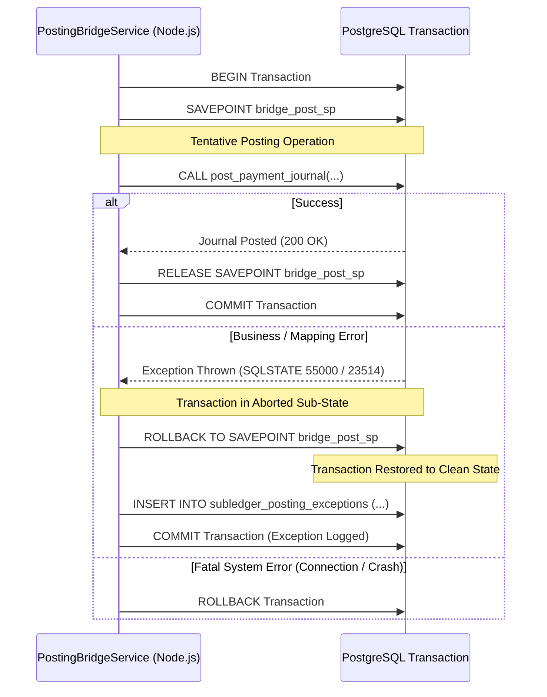
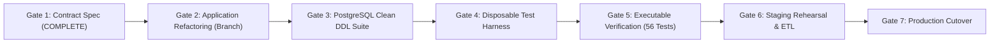

# BFA PostgreSQL Migration — Gate 1: Alternative D Architecture and Procedure Contract Specification

**Document Version:** 1.0.0  
**Status:** ARCHITECTURAL SPECIFICATION & CONTRACT BASELINE  
**Repository:** `C:\xampp\htdocs\BFA`  
**Git Branch / Commit:** `master` @ `6b7e8d4be888c489dc8a53bffb8c370b2a926fe0`  
**Target Engine:** PostgreSQL 16.4+ / 18.x  
**Target Architecture:** Alternative D — PostgreSQL-Controlled Accounting Posting & Reversal via `SECURITY DEFINER` Stored Procedures & Least-Privilege Application Access  
**Execution Mode:** STRICTLY READ-ONLY ASSESSMENT & DESIGN FINALIZATION (ZERO IMPLEMENTATION)

---

## 1. Executive Readiness Verdict

### 1.1 Overall Gate 1 Verdict: `CONDITIONALLY READY — SPECIFIC CODE & HARNESS BLOCKERS REMAIN`

The architectural and contract specification for **Alternative D** is technically complete, internally consistent, and ready to serve as the definitive blueprint for implementation. It resolves the ambiguities present in Blueprint v6 by establishing rigorous database-controlled posting boundaries, fully specified stored-procedure contracts, deterministic 5-tier global lock ordering, a robust PostgreSQL savepoint/subtransaction policy, and an exhaustive migration compatibility registry.

However, the codebase and environment cannot be certified as immediately ready for production or direct execution. The project remains **`CONDITIONALLY READY`** pending resolution of verified code-level defects and test harness prerequisites.

### 1.2 Verdict Breakdown by Architecture Dimension

| Dimension | Readiness Verdict | Key Findings & Verified State |
| :--- | :---: | :--- |
| **Architecture Readiness** | **`READY FOR IMPLEMENTATION`** | Alternative D design is fully reconciled with system requirements. Replaces application-coordinated lock helpers with database-enforced procedure transactions. |
| **Database Security Readiness** | **`READY FOR IMPLEMENTATION`** | Role boundaries (`bfa_migrator`, `bfa_prod_app`, `bfa_ro_audit`), search path hardening (`pg_catalog, public`), and least-privilege DML revocations are completely defined. |
| **Stored-Procedure Contract Readiness** | **`READY FOR IMPLEMENTATION`** | All 16 stored-procedure contracts (4 subledger, 5 draft lifecycle, 5 core journal, 2 period control) are fully catalogued with strict parameter, return, locking, and error contracts. |
| **Application Integration Readiness** | **`NOT READY — 5 VERIFIED CODE BLOCKERS`** | Critical blockers in `accounting.repository.js` (`0A000`), `accounting.service.js` (lock inversion), `postingBridge.service.js` (`25P02`), `payments.service.js` (Tier 3->2 lock inversion), and MySQL idioms (`ON DUPLICATE KEY UPDATE`). |
| **Migration Compatibility Readiness** | **`CONDITIONALLY READY — 11 UNRESOLVED SCHEMA DECISIONS`** | Clean-install DDL generation mapped. 11 schema conflicts identified and classified across repository evidence and business approval requirements. |
| **Test Readiness** | **`NOT READY — TEST HARNESS UNEXECUTED`** | 0 of 42 v6 tests and 0 of 14 Alternative D tests have been executed. Live PostgreSQL test harness does not yet exist. |
| **Production / Cutover Readiness** | **`NOT READY`** | Dependent upon execution of Gates 2 through 6. |

---

## 2. Verified Repository Baseline

### 2.1 Git Repository & Working Tree State (`VERIFIED`)
- **Repository Root:** `C:\xampp\htdocs\BFA`
- **Active Branch:** `master`
- **Recorded HEAD Commit:** `6b7e8d4be888c489dc8a53bffb8c370b2a926fe0`
- **Working Tree Integrity:** **PRESERVED INTACT (35 dirty working-tree entries)**.
  - *21 Tracked Modified Files (`M`):*
    - `backend/src/db/migrations/003_modular_erp_entities.sql`
    - `backend/src/db/migrations/004_create_users_and_seed_auth.sql`
    - `backend/src/db/migrations/007_payments_and_booking_auth.sql`
    - `backend/src/db/migrations/009_properties_units_and_reservations_engine.sql`
    - `backend/src/db/migrations/010_guests_and_inspections.sql`
    - `backend/src/db/migrations/011_maintenance_and_expenses.sql`
    - `backend/src/db/migrations/012_agents_and_commissions.sql`
    - `backend/src/db/migrations/015_one_night_check_constraint.sql`
    - `backend/src/db/migrations/017_add_confirmation_token_to_reservations.sql`
    - `backend/src/db/migrations/022_support_multinight_stays.sql`
    - `backend/src/db/migrations/023_payment_provider_unique_and_exception_scoping.sql`
    - `backend/src/db/migrations/025_front_desk_assignment.sql`
    - `backend/src/db/migrations/026_property_governance_and_staff_operations.sql`
    - `backend/src/db/migrations/027_booking_proof_verification_and_tracking.sql`
    - `backend/src/db/migrations/028_workforce_roster_and_property_media.sql`
    - `backend/src/db/migrations/029_role_migration_operations_manager_and_attendance_policy.sql`
    - `backend/src/db/migrations/030_kiosk_credential_security_and_geofence_review.sql`
    - `backend/src/db/migrations/031_maintenance_evidence_and_dispatch_verification.sql`
    - `backend/src/db/migrator.js`
    - `backend/src/scripts/seedAdmin.js`
    - `backend/src/scripts/seedDevData.js`
  - *14 Untracked Files (`??`):*
    - `backend/certs/`
    - `backend/src/db/migrationRequirements.js`
    - `backend/tests/migration010Guests.test.js`
    - `backend/tests/migration015OneNightCheck.test.js`
    - `backend/tests/migration017ConfirmationToken.test.js`
    - `backend/tests/migration022MinimumStay.test.js`
    - `backend/tests/migration026Readiness.test.js`
    - `backend/tests/migration027ForeignKeyGuards.test.js`
    - `backend/tests/migration028AndForeignKeyGuards.test.js`
    - `backend/tests/migrationRequirements.test.js`
    - `backend/tests/runMigration027TiDBTest.test.js`
    - `backend/tests/runMigrations011To026TiDBTest.test.js`
    - `backend/tests/seedAdmin.test.js`
    - `docs/TIDB_MIGRATION_PREREQUISITES.md`
- **Safety Boundary Compliance:** Zero working-tree modifications, checkouts, or cleans were executed.

---

## 3. Approved Architectural Decisions & Approval Status

### 3.1 Decision A: Historical Closed-Period Reversals (`PROPOSED — REQUIRES_ACCOUNTING_APPROVAL`)
- **Policy Definition:**
  1. A reversal of a journal entry originally posted in a closed accounting period is posted into the **current open accounting period** (matching `CURRENT_DATE` in `Africa/Lagos` timezone).
  2. The reversal journal retains an explicit, immutable reference to the original journal (`reversal_of_journal_id`) and records the historical period ID in its metadata.
  3. The original journal and the original closed accounting period remain strictly unmodified (`journals.status` updates to `'REVERSED'`).
  4. The reversal entry is distinctly tagged with `source_type = 'REVERSAL'` and is fully auditable.
  5. A closed accounting period is **never silently reopened**.
- **Governance Status:** Marked as **`REQUIRES_ACCOUNTING_APPROVAL`**. This constitutes application financial policy and requires explicit sign-off from the organization's finance authority before production cutover.

### 3.2 Decision B: Strongly Typed Subledger Procedures (`PROPOSED — APPROVED FOR GATE 1`)
- **Policy Definition:** The architecture adopts four distinct, strongly typed domain stored procedures:
  1. `post_payment_journal`: Validates payment transactions, resolves payment channel GL assets, and posts revenue/deposit entries.
  2. `post_refund_journal`: Validates refund transactions against parent payments, ensures refund amounts do not exceed captured totals, and posts reversal of revenue/clearing.
  3. `post_revenue_recognition_journal`: Processes earned nightly room revenue schedules against guest deposit liability accounts.
  4. `post_expense_journal`: Posts vendor and operational disbursements against departmental expense accounts and accounts payable.
- **Rationale:** A generic procedure would force complex dynamic SQL and heterogeneous parameter payloads into the database layer, weakening static parameter validation and preventing optimal locking orders.

### 3.3 Decision C: Procedure-Mediated Draft Journal Writes (`PROPOSED — APPROVED FOR GATE 1`)
- **Policy Definition:** Direct application `UPDATE` and `DELETE` access to `journal_lines` is completely revoked from `bfa_prod_app`.
- **Enforcement:**
  - Creating draft journals: `CALL create_draft_journal(...)`
  - Adding draft lines: `CALL add_draft_journal_line(...)`
  - Updating draft lines: `CALL update_draft_journal_line(...)`
  - Removing draft lines: `CALL remove_draft_journal_line(...)`
  - Validating draft balance: `CALL validate_draft_journal(...)`
- **State Guard:** All line modifications are rejected by the database if the parent journal is not in `'DRAFT'` status (`SQLSTATE '55000'`).

---

## 4. PostgreSQL Database Security Architecture

### 4.1 Role Definitions & Permission Matrix (`PROPOSED`)

| Privilege / Object | `bfa_migrator` | `bfa_prod_app` | `bfa_ro_audit` |
| :--- | :---: | :---: | :---: |
| **Object Ownership** | **OWNER** | None | None |
| **DDL (`CREATE`, `ALTER`, `DROP`)** | **YES** | **NONE** | **NONE** |
| **`general_ledger_entries`** | `ALL` | **`SELECT` ONLY** | `SELECT` ONLY |
| **`journal_lines`** | `ALL` | **`SELECT` ONLY** | `SELECT` ONLY |
| **`journal_entries`** | `ALL` | `SELECT`, `INSERT (DRAFT)` | `SELECT` ONLY |
| **`accounting_periods`** | `ALL` | **`SELECT` ONLY** | `SELECT` ONLY |
| **`chart_of_accounts`** | `ALL` | **`SELECT` ONLY** | `SELECT` ONLY |
| **Operational Tables** (`reservations`, `payments`, etc.) | `ALL` | `SELECT`, `INSERT`, `UPDATE` | `SELECT` ONLY |
| **`SECURITY DEFINER` Procedures** | `ALL` | **`EXECUTE`** | **NONE** |

### 4.2 `SECURITY DEFINER` Hardening & Privilege Escalation Defenses (`PROPOSED`)
1. **Fixed Search Path:** Every procedure must declare `SET search_path = pg_catalog, public;`. This prevents malicious path-shadowing attacks.
2. **Explicit Caller Identification:** Connection pooling uses a single database user (`bfa_prod_app`). Therefore, procedures must accept an explicit `p_actor_id BIGINT` parameter, validated against active users in `users`, to maintain audit attribution.
3. **No Dynamic SQL:** All procedures utilize static SQL statements to prevent SQL injection within privileged contexts.
4. **Autonomous Security:** No custom PostgreSQL GUCs (configuration settings) are trusted as proof of authorization. All role checks are performed against verified primary keys and database state.

---

## 5. Stored-Procedure Contract Catalogue

The following 16 procedure contracts specify the complete Alternative D database-mediated accounting interface.

### 5.1 Subledger Posting Procedures

#### 1. `post_payment_journal`
- **Purpose:** Atomically posts double-entry accounting records for a verified payment transaction.
- **Parameters:** `p_payment_id BIGINT` (Required), `p_actor_id BIGINT` (Required), `p_idempotency_key VARCHAR(128)` (Optional).
- **Return:** `TABLE(journal_id BIGINT, entry_number VARCHAR(64), status VARCHAR(32), amount NUMERIC(15,2), posted_at TIMESTAMPTZ)`.
- **Authorization:** `bfa_prod_app`, `bfa_migrator`.
- **Preconditions:** Payment transaction exists with `status = 'SUCCESS'`. Source reservation exists. Associated property has active account mappings. Open accounting period exists for payment date.
- **Lock Sequence:**
  1. Tier 2: `SELECT id FROM reservations WHERE id = v_reservation_id FOR SHARE;`
  2. Tier 3: `SELECT * FROM payment_transactions WHERE id = p_payment_id FOR UPDATE;`
  3. Tier 4: `SELECT id FROM accounting_periods WHERE id = v_period_id FOR SHARE;`
  4. Tier 5: Insert `journal_entries` and `journal_lines`, then insert `general_ledger_entries`.
- **Writes:** Inserts 1 row into `journal_entries` (`source_type = 'PAYMENT'`), 2+ rows into `journal_lines`, 2+ rows into `general_ledger_entries`, 1 row into `subledger_posting_records`.
- **Invariants:** Total Debits == Total Credits. Payment cannot be posted twice (`idempotency_key` unique).
- **Errors:** `02000` (Payment not found), `55000` (Already posted or period closed), `23514` (Account mapping missing).
- **Audit:** Records `posted_by_id = p_actor_id`, `created_at = NOW()`, creates entry in `activity_logs`.

#### 2. `post_refund_journal`
- **Purpose:** Posts reversing/clearing journal entries for processed customer refunds.
- **Parameters:** `p_refund_tx_id BIGINT` (Required), `p_actor_id BIGINT` (Required), `p_idempotency_key VARCHAR(128)` (Optional).
- **Return:** `TABLE(journal_id BIGINT, entry_number VARCHAR(64), status VARCHAR(32), amount NUMERIC(15,2), posted_at TIMESTAMPTZ)`.
- **Authorization:** `bfa_prod_app`, `bfa_migrator`.
- **Preconditions:** Refund transaction exists with `status = 'SUCCESS'`. Parent payment transaction exists and is posted.
- **Lock Sequence:**
  1. Tier 2: `SELECT id FROM reservations WHERE id = v_reservation_id FOR SHARE;`
  2. Tier 3: `SELECT id FROM payment_transactions WHERE id IN (v_parent_id, p_refund_tx_id) ORDER BY id FOR UPDATE;`
  3. Tier 4: `SELECT id FROM accounting_periods WHERE id = v_period_id FOR SHARE;`
  4. Tier 5: Insert journal, lines, and GL entries.
- **Writes:** Inserts `journal_entries` (`source_type = 'REFUND'`), `journal_lines`, `general_ledger_entries`, `subledger_posting_records`.
- **Invariants:** Refund amount <= original payment amount minus previous refunds. Debits == Credits.
- **Errors:** `02000` (Refund/Parent transaction not found), `55000` (Excess refund or period closed).
- **Audit:** Records `posted_by_id = p_actor_id`.

#### 3. `post_revenue_recognition_journal`
- **Purpose:** Recognizes nightly earned room revenue from customer advance deposits.
- **Parameters:** `p_schedule_id BIGINT` (Required), `p_actor_id BIGINT` (Required).
- **Return:** `TABLE(journal_id BIGINT, schedule_id BIGINT, recognized_amount NUMERIC(15,2), posted_at TIMESTAMPTZ)`.
- **Authorization:** `bfa_prod_app`, `bfa_migrator`.
- **Preconditions:** `revenue_schedules` row exists with `status = 'PENDING'` and `schedule_date <= CURRENT_DATE`.
- **Lock Sequence:**
  1. Tier 2: `SELECT id FROM reservations WHERE id = v_reservation_id FOR SHARE;`
  2. Tier 3: `SELECT * FROM revenue_schedules WHERE id = p_schedule_id FOR UPDATE;`
  3. Tier 4: `SELECT id FROM accounting_periods WHERE id = v_period_id FOR SHARE;`
  4. Tier 5: Insert journal, lines, and GL entries.
- **Writes:** Updates `revenue_schedules.status = 'RECOGNIZED'`, inserts `journal_entries`, `journal_lines`, `general_ledger_entries`.
- **Invariants:** Total Debits == Total Credits. Guest advance deposit account debited; Room revenue account credited.
- **Errors:** `02000` (Schedule not found), `55000` (Schedule already recognized or future dated).
- **Audit:** Records `posted_by_id = p_actor_id`.

#### 4. `post_expense_journal`
- **Purpose:** Posts approved operating and maintenance expenses to the general ledger.
- **Parameters:** `p_expense_id BIGINT` (Required), `p_actor_id BIGINT` (Required), `p_idempotency_key VARCHAR(128)` (Optional).
- **Return:** `TABLE(journal_id BIGINT, expense_id BIGINT, status VARCHAR(32), posted_at TIMESTAMPTZ)`.
- **Authorization:** `bfa_prod_app`, `bfa_migrator`.
- **Preconditions:** Expense exists with `status = 'APPROVED'` and has not been posted.
- **Lock Sequence:**
  1. Tier 3: `SELECT * FROM expenses WHERE id = p_expense_id FOR UPDATE;`
  2. Tier 4: `SELECT id FROM accounting_periods WHERE id = v_period_id FOR SHARE;`
  3. Tier 5: Insert journal, lines, and GL entries.
- **Writes:** Updates `expenses.is_posted = TRUE`, inserts `journal_entries`, `journal_lines`, `general_ledger_entries`.
- **Invariants:** Debits == Credits. Expense account debited; Accounts payable or cash credited.
- **Errors:** `02000` (Expense not found), `55000` (Expense not approved or already posted).
- **Audit:** Records `posted_by_id = p_actor_id`.

---

### 5.2 Draft Journal Lifecycle Procedures

#### 5. `create_draft_journal`
- **Purpose:** Initializes a new empty journal entry in `'DRAFT'` status.
- **Parameters:** `p_period_id BIGINT`, `p_entry_date DATE`, `p_description TEXT`, `p_source_type VARCHAR(32)`, `p_source_id BIGINT`, `p_actor_id BIGINT`, `p_idempotency_key VARCHAR(128)`.
- **Return:** `TABLE(journal_id BIGINT, journal_number VARCHAR(64), status VARCHAR(32))`.
- **Authorization:** `bfa_prod_app`, `bfa_migrator`.
- **Preconditions:** Period exists and is `'OPEN'`.
- **Lock Sequence:** Tier 4: `SELECT id FROM accounting_periods WHERE id = p_period_id FOR SHARE;`
- **Writes:** Inserts 1 row into `journal_entries` (`status = 'DRAFT'`, `created_by_id = p_actor_id`).
- **Errors:** `55000` (Period closed/locked), `23505` (Duplicate idempotency key).

#### 6. `add_draft_journal_line`
- **Purpose:** Adds a debit or credit line to an existing draft journal.
- **Parameters:** `p_journal_id BIGINT`, `p_account_id BIGINT`, `p_property_id BIGINT`, `p_debit NUMERIC(15,2)`, `p_credit NUMERIC(15,2)`, `p_description TEXT`, `p_actor_id BIGINT`.
- **Return:** `TABLE(line_id BIGINT, line_number INT, journal_id BIGINT)`.
- **Authorization:** `bfa_prod_app`, `bfa_migrator`.
- **Preconditions:** Parent journal exists and has `status = 'DRAFT'`. Account exists and is active. Exactly one of debit or credit > 0.
- **Lock Sequence:** Tier 5: `SELECT * FROM journal_entries WHERE id = p_journal_id FOR UPDATE;`
- **Writes:** Inserts 1 row into `journal_lines`.
- **Errors:** `55000` (Journal not in DRAFT status), `23514` (Both debit and credit set, or negative amounts).

#### 7. `update_draft_journal_line`
- **Purpose:** Modifies amounts or accounts of an existing draft line.
- **Parameters:** `p_line_id BIGINT`, `p_account_id BIGINT`, `p_property_id BIGINT`, `p_debit NUMERIC(15,2)`, `p_credit NUMERIC(15,2)`, `p_description TEXT`, `p_actor_id BIGINT`.
- **Return:** `TABLE(line_id BIGINT, success BOOLEAN)`.
- **Authorization:** `bfa_prod_app`, `bfa_migrator`.
- **Preconditions:** Parent journal status is `'DRAFT'`.
- **Lock Sequence:** Tier 5: Locks parent journal `FOR UPDATE`, then updates `journal_lines`.
- **Writes:** Updates specified row in `journal_lines`.
- **Errors:** `55000` (Parent journal not in DRAFT status).

#### 8. `remove_draft_journal_line`
- **Purpose:** Deletes a line from an unposted draft journal.
- **Parameters:** `p_line_id BIGINT`, `p_actor_id BIGINT`.
- **Return:** `TABLE(deleted_line_id BIGINT, success BOOLEAN)`.
- **Authorization:** `bfa_prod_app`, `bfa_migrator`.
- **Preconditions:** Parent journal status is `'DRAFT'`.
- **Lock Sequence:** Tier 5: Locks parent journal `FOR UPDATE`, deletes line.
- **Writes:** Deletes row from `journal_lines`.
- **Errors:** `55000` (Parent journal not in DRAFT status).

#### 9. `validate_draft_journal`
- **Purpose:** Evaluates whether a draft journal is balanced and ready for submission.
- **Parameters:** `p_journal_id BIGINT`.
- **Return:** `TABLE(is_valid BOOLEAN, line_count INT, total_debit NUMERIC(15,2), total_credit NUMERIC(15,2), error_message TEXT)`.
- **Authorization:** `bfa_prod_app`, `bfa_ro_audit`.
- **Preconditions:** Journal exists.
- **Lock Sequence:** Read-only: `SELECT ... FROM journal_lines WHERE journal_entry_id = p_journal_id;`
- **Writes:** None.

---

### 5.3 Core Journal Posting, Approval & Reversal Procedures

#### 10. `submit_journal`
- **Purpose:** Transitions journal from `'DRAFT'` to `'SUBMITTED'`.
- **Parameters:** `p_journal_id BIGINT`, `p_actor_id BIGINT`.
- **Preconditions:** Journal status is `'DRAFT'`, lines >= 2, Debits == Credits.
- **Lock Sequence:** Tier 5: `SELECT * FROM journal_entries WHERE id = p_journal_id FOR UPDATE;`
- **Writes:** Updates `journal_entries.status = 'SUBMITTED'`.

#### 11. `approve_journal`
- **Purpose:** Transitions journal from `'SUBMITTED'` to `'APPROVED'`. Enforces segregation of duties.
- **Parameters:** `p_journal_id BIGINT`, `p_actor_id BIGINT`.
- **Preconditions:** Journal status is `'SUBMITTED'`, `created_by_id != p_actor_id` (anti-self-approval).
- **Lock Sequence:** Tier 5: `SELECT * FROM journal_entries WHERE id = p_journal_id FOR UPDATE;`
- **Writes:** Updates `journal_entries.status = 'APPROVED'`, `approved_by_id = p_actor_id`, `approved_at = NOW()`.
- **Errors:** `55000` (Self-approval rejected or invalid status).

#### 12. `reject_journal`
- **Purpose:** Transitions journal from `'SUBMITTED'` to `'REJECTED'`.
- **Parameters:** `p_journal_id BIGINT`, `p_rejection_reason TEXT`, `p_actor_id BIGINT`.
- **Preconditions:** Journal status is `'SUBMITTED'`.
- **Lock Sequence:** Tier 5: `SELECT * FROM journal_entries WHERE id = p_journal_id FOR UPDATE;`
- **Writes:** Updates `journal_entries.status = 'REJECTED'`.

#### 13. `post_journal`
- **Purpose:** Transitions `'APPROVED'` manual/system journal to `'POSTED'`, locks period, generates GL entries.
- **Parameters:** `p_journal_id BIGINT`, `p_actor_id BIGINT`, `p_idempotency_key VARCHAR(128)`.
- **Return:** `TABLE(journal_id BIGINT, entry_number VARCHAR(64), status VARCHAR(32), period_id BIGINT, lines_posted INT, total_amount NUMERIC(15,2), posted_at TIMESTAMPTZ)`.
- **Authorization:** `bfa_prod_app`, `bfa_migrator`.
- **Preconditions:** Journal status is `'APPROVED'`. Associated period is `'OPEN'`.
- **Lock Sequence:**
  1. Tier 4: `SELECT id, status, is_locked FROM accounting_periods WHERE id = v_period_id FOR SHARE;`
  2. Tier 5: `SELECT * FROM journal_entries WHERE id = p_journal_id FOR UPDATE;`
  3. Tier 5: Insert rows into `general_ledger_entries`.
- **Writes:** Inserts rows into `general_ledger_entries`. Updates `journal_entries.status = 'POSTED'`, `posted_at = NOW()`, `posted_by_id = p_actor_id`.
- **Errors:** `22023` (Not approved), `55000` (Period closed/locked), `23514` (Unbalanced lines).

#### 14. `reverse_journal`
- **Purpose:** Reverses an existing `'POSTED'` journal. Creates compensating journal with inverted debits/credits.
- **Parameters:** `p_original_journal_id BIGINT`, `p_reversal_reason TEXT`, `p_actor_id BIGINT`.
- **Return:** `TABLE(reversal_journal_id BIGINT, original_journal_id BIGINT, posted_period_id BIGINT, status VARCHAR(32))`.
- **Authorization:** `bfa_prod_app`, `bfa_migrator`.
- **Historical Period Logic:**
  - Reads original period status. If original period is `'OPEN'`, posts into original period.
  - If original period is `'CLOSED'`, identifies **current active open period** (`CURRENT_DATE`), posts reversal into active period, and cross-references original closed period.
- **Lock Sequence:**
  1. Tier 4: Locks candidate period(s) `FOR SHARE` in ascending ID order.
  2. Tier 5: Locks original journal `FOR UPDATE`.
  3. Tier 5: Inserts reversing journal, lines, and GL entries.
- **Writes:** Inserts reversing journal into `journal_entries` and `journal_lines`, inserts balanced reversal lines into `general_ledger_entries`, updates original journal `status = 'REVERSED'`, `reversed_by_journal_id = v_rev_id`.
- **Errors:** `55000` (Already reversed, or original not posted).

---

### 5.4 Accounting Period Lifecycle Procedures

#### 15. `close_accounting_period`
- **Purpose:** Verifies all journals in period are posted/rejected, serializes against concurrent posts, and closes period.
- **Parameters:** `p_period_id BIGINT`, `p_actor_id BIGINT`.
- **Return:** `TABLE(period_id BIGINT, period_name VARCHAR(64), status VARCHAR(32), closed_at TIMESTAMPTZ)`.
- **Authorization:** `bfa_prod_app`, `bfa_migrator`.
- **Lock Sequence:**
  1. Tier 4: `SELECT id, status FROM accounting_periods WHERE id = p_period_id FOR UPDATE;`
  2. Tier 5: `SELECT COUNT(*) FROM journal_entries WHERE accounting_period_id = p_period_id AND status IN ('DRAFT', 'SUBMITTED', 'APPROVED');`
- **Writes:** Updates `accounting_periods SET status = 'CLOSED', is_locked = TRUE, closed_at = NOW(), closed_by_id = p_actor_id`.
- **Errors:** `55000` (Unposted journals remain, or period already closed).

#### 16. `reopen_accounting_period`
- **Purpose:** Administratively reopens a closed period with mandatory justification.
- **Parameters:** `p_period_id BIGINT`, `p_reason TEXT`, `p_actor_id BIGINT`.
- **Return:** `TABLE(period_id BIGINT, status VARCHAR(32), reopened_at TIMESTAMPTZ)`.
- **Authorization:** `bfa_migrator` (or admin staff via `bfa_prod_app`).
- **Lock Sequence:** Tier 4: `SELECT * FROM accounting_periods WHERE id = p_period_id FOR UPDATE;`
- **Writes:** Updates `accounting_periods SET status = 'OPEN', is_locked = FALSE`. Logs event in `activity_logs`.
- **Errors:** `55000` (Period already open, or reason missing).

---

## 6. Global Lock-Order Specification & Deadlock Resolution

### 6.1 Canonical 5-Tier Global Lock Hierarchy

To mathematically guarantee deadlock freedom (`SQLSTATE '40P01'`), all application services and stored procedures must acquire locks strictly in increasing tier order:

| Tier | Category | Database Objects | Allowed Lock Modes | Acquisition Rule |
| :---: | :--- | :--- | :---: | :--- |
| **Tier 1** | **System Maintenance** | DDL, Migrations, Full Schema Maintenance | `ACCESS EXCLUSIVE` | Never acquired during online transactional traffic. |
| **Tier 2** | **Operational Entities** | `properties`, `apartments`, `reservations`, `guests` | `FOR SHARE`, `FOR UPDATE` | Always acquire in ascending Primary Key order (`ORDER BY id`). |
| **Tier 3** | **Financial Source Docs** | `payment_transactions`, `expenses`, `revenue_schedules` | `FOR SHARE`, `FOR UPDATE` | Always acquire in ascending Primary Key order (`ORDER BY id`). |
| **Tier 4** | **Accounting Periods** | `accounting_periods` | `FOR SHARE` (Posting), `FOR UPDATE` (Closing/Reopening) | Single row or ascending PK order. Never acquire after Tier 5. |
| **Tier 5** | **Journals & GL** | `journal_entries`, `journal_lines`, `general_ledger_entries` | `FOR UPDATE` | Target journal locked first; lines processed in ascending line order. |

### 6.2 Analysis of 10 Critical Workflows

| Workflow | Current Flaw / Lock Behavior | Canonical Alternative D Lock Sequence | Deadlock Risk & Mitigation |
| :--- | :--- | :--- | :--- |
| **1. Reservation Creation** | Unlocked availability checks followed by insert. | 1. Tier 2: `apartments FOR UPDATE` (unit availability lock) 2. Tier 2: Insert `reservations`. | Eliminated double-booking race condition. |
| **2. Reservation Cancellation** | Locks reservation (Tier 2), then invokes refund. | 1. Tier 2: `reservations FOR UPDATE` 2. Tier 3: `payment_transactions FOR UPDATE` 3. Tier 4: `accounting_periods FOR SHARE` 4. Tier 5: Procedure `post_refund_journal`. | Complies with Tier 2 -> 3 -> 4 -> 5 order. |
| **3. Check-In & Check-Out** | Locks reservation (Tier 2), updates room status. | 1. Tier 2: `reservations FOR UPDATE` 2. Tier 2: `apartments FOR UPDATE` 3. Tier 3: `revenue_schedules FOR UPDATE` (on check-out). | Pure Tier 2 & Tier 3; zero accounting lock contention. |
| **4. Payment Processing** | **INVERSION:** Inserts Tier 3 (`payment_transactions`) before updating Tier 2 (`reservations`). | **CORRECTED SEQUENCE:** 1. Tier 2: `SELECT id FROM reservations WHERE id = ? FOR UPDATE` 2. Tier 3: Insert/Update `payment_transactions` 3. Tier 4: `accounting_periods FOR SHARE` 4. Tier 5: Procedure `post_payment_journal`. | **Resolves Issue B:** Eliminates deadlock against concurrent cancellation/check-out. |
| **5. Refund Processing** | Modifies payments without upfront reservation lock. | 1. Tier 2: `reservations FOR SHARE` 2. Tier 3: `payment_transactions` (Parent & Child sorted by ID) `FOR UPDATE` 3. Tier 4 & 5 via `post_refund_journal`. | Strict ascending ID lock ordering eliminates sibling payment deadlocks. |
| **6. Journal Posting** | **INVERSION:** Locks Tier 5 (`journal_entries`) before Tier 4 (`accounting_periods`). | **CORRECTED SEQUENCE:** 1. Tier 4: `accounting_periods FOR SHARE` 2. Tier 5: `journal_entries FOR UPDATE` 3. Tier 5: Insert `general_ledger_entries`. | **Resolves Issue A:** Eliminates deadlock against concurrent `close_accounting_period`. |
| **7. Journal Reversal** | Locks original journal, checks period unlocked. | 1. Tier 4: Locks original & current period `FOR SHARE` (sorted by ID) 2. Tier 5: Original journal `FOR UPDATE` 3. Tier 5: Reversing journal & GL inserts. | Complies with Tier 4 -> Tier 5. Reversal into closed period rejected. |
| **8. Revenue Recognition** | Loops over unposted schedules without global ordering. | 1. Tier 2: `reservations FOR SHARE` 2. Tier 3: `revenue_schedules FOR UPDATE` (sorted by ID) 3. Tier 4 & 5 via `post_revenue_recognition_journal`. | Sorted schedule processing prevents inter-schedule deadlocks. |
| **9. Expense Posting** | Couples expense update with posting bridge. | 1. Tier 3: `expenses FOR UPDATE` 2. Tier 4 & 5 via `post_expense_journal`. | Complies with Tier 3 -> 4 -> 5. |
| **10. Period Closing** | Checks unposted journals without concurrency lock. | 1. Tier 4: `accounting_periods FOR UPDATE` 2. Tier 5: Verify zero unposted `journal_entries` 3. Update period status to `'CLOSED'`. | Blocks new postings cleanly; concurrent `post_journal` waits on Tier 4 lock. |

### 6.3 Resolution of Issue C: Locking Across Outer Joins
- **The Defect (`VERIFIED`):** In [`AccountingRepository.findJournalById`](file:///C:/xampp/htdocs/BFA/backend/src/modules/accounting/accounting.repository.js#L327-L358), appending `FOR UPDATE` to a query containing 6 `LEFT JOIN`s triggers PostgreSQL error **`0A000: FOR UPDATE cannot be applied to the nullable side of an outer join`**.
- **Evaluated Solutions:**
  - *Option 1 (Targeted Relation Locking):* Append `FOR UPDATE OF j`. This instructs PostgreSQL to lock only the primary `journal_entries` table row and leave outer-joined dimension rows unlocked.
  - *Option 2 (Two-Query Pattern):* Execute an explicit `SELECT id FROM journal_entries WHERE id = $1 FOR UPDATE`, followed by the read query.
- **Architectural Decision:** Under Alternative D, **Option 1 (`FOR UPDATE OF j`)** is adopted for repository read-modify paths. In posting and reversal paths, locking is handled entirely inside the stored procedure via `SELECT * FROM journal_entries WHERE id = p_journal_id FOR UPDATE`, bypassing outer joins altogether.

### 6.4 Concurrency Retry Policy
For rare transient serialization conflicts (`SQLSTATE '40001'`) or deadlocks (`SQLSTATE '40P01'`), the application connection pool wrapper must enforce exponential backoff:
- **Max Retries:** 3 attempts.
- **Backoff Base:** 50ms with jitter (`50ms * 2^attempt + random(0, 25ms)`).
- **Scope:** Retries apply only to idempotent operations (operations supplying `p_idempotency_key` or read transactions). Non-idempotent mutations must fail closed and report an error to the caller.

---

## 7. Transaction Failure and Savepoint Policy

### 7.1 The PostgreSQL `25P02` Defect in `PostingBridgeService` (`VERIFIED`)
In MySQL, if an individual query within a transaction fails, subsequent queries on that connection can still succeed. In PostgreSQL, any SQL error aborts the transaction; executing another statement without rolling back throws **`25P02: current transaction is aborted, commands ignored until end of transaction block`**.

In [`PostingBridgeService`](file:///C:/xampp/htdocs/BFA/backend/src/modules/accounting/postingBridge.service.js#L400-L425), catching an error and immediately executing `PostingBridgeRepository.createException(..., conn)` fails with `25P02`.

### 7.2 Savepoint and Subtransaction Architecture (`PROPOSED`)

### 7.3 Transaction Policy Rules
1. **Subtransaction Isolation:** Any tentative subledger posting attempted inside a broader business transaction must be wrapped in a database `SAVEPOINT` (`SAVEPOINT bfa_bridge_sp;`).
2. **Clean Recovery:** If the posting procedure throws a recoverable exception, the application must issue `ROLLBACK TO SAVEPOINT bfa_bridge_sp;` before recording failure state in `subledger_posting_records` or `subledger_posting_exceptions`.
3. **Fatal System Failures:** Schema errors (`42P01`), role permission failures (`42501`), or connection drops must **never** be caught and ignored; they must trigger a full `ROLLBACK` and bubble up to the top-level HTTP handler.
4. **Procedure Autonomy:** All Alternative D stored procedures manage internal state assertions and handle validation before writing to tables, minimizing reliance on raw SQL statement exceptions.

---

## 8. Database Integrity Model & Invariant Enforcement Matrix

| Accounting Invariant | Enforcement Layer 1 | Enforcement Layer 2 | Enforcement Layer 3 | Technical Mechanism |
| :--- | :--- | :--- | :--- | :--- |
| **1. Double-Entry Balance** | Stored Procedure | Deferred Trigger | Domain Constraint | Procedure verifies `SUM(debit) == SUM(credit)` before GL insert. Trigger `trg_gl_balance_deferred` validates entire journal on transaction commit. |
| **2. GL Immutability** | Database Privileges | Table Rules / Triggers | Service Contract | `INSERT, UPDATE, DELETE` revoked on `general_ledger_entries` from `bfa_prod_app`. Trigger `trg_gl_immutable` rejects any modification. |
| **3. Period Isolation** | Stored Procedure | Table Constraint | Foreign Key | Procedure checks `period.status = 'OPEN'`. Posting to `'CLOSED'` or `'LOCKED'` periods raises `SQLSTATE '55000'`. |
| **4. Journal Status Integrity** | Stored Procedure | `CHECK` Constraint | Audit Trigger | `status IN ('DRAFT','SUBMITTED','APPROVED','POSTED','REVERSED','REJECTED')`. Transitions strictly mediated by procedures. |
| **5. Line Editing in Draft Only** | Stored Procedure | Database Privileges | Status Guard | Direct `UPDATE/DELETE` on `journal_lines` revoked. Procedures check `parent.status = 'DRAFT'`. |
| **6. Idempotent Posting** | Unique Index | Stored Procedure | Application Service | Unique index on `journal_entries(idempotency_key)`. Procedure returns existing record on duplicate key. |
| **7. Reversal Traceability** | Stored Procedure | Foreign Key Constraint | Audit Trail | Procedure enforces 1:1 reversal pairing. `reversal_of_journal_id` and `reversed_by_journal_id` cross-linked. |
| **8. Anti-Self-Approval** | Stored Procedure | Business Logic | Audit Log | `approve_journal` checks `created_by_id != p_actor_id`. |

---

## 9. PostgreSQL Migration Compatibility Matrix

### 9.1 Syntax & Type Transformation Registry

| MySQL / TiDB Feature | Target PostgreSQL Syntax | Required Application / Repository Transformation |
| :--- | :--- | :--- |
| `INT AUTO_INCREMENT` | `BIGINT GENERATED ALWAYS AS IDENTITY` | Standardize all sequence lookups; replace `insertId` with `RETURNING id`. |
| `ENUM(...)` | `VARCHAR(50) CHECK (...)` | Use `VARCHAR` with domain `CHECK` constraints for extensible workflows. |
| `JSON` | `JSONB` | Binary JSON; update query operators from `JSON_EXTRACT()` to `->>` or `@>`. |
| `TINYINT(1)` | `BOOLEAN` | Replace JavaScript `1` and `0` with `true` and `false`. |
| `DATETIME` | `TIMESTAMPTZ` | Store all timestamps in UTC. Apply `AT TIME ZONE 'Africa/Lagos'` for local presentation. |
| `ON UPDATE CURRENT_TIMESTAMP` | `BEFORE UPDATE` Trigger | Attach standardized `update_timestamp()` trigger function to every table. |
| `INSERT IGNORE` | `ON CONFLICT DO NOTHING` | Update repository raw queries. |
| `ON DUPLICATE KEY UPDATE` | `ON CONFLICT (...) DO UPDATE SET ...` | Rewrite upsert queries in `bookingAuth.service.js`, `chat.repository.js`. |
| Positional Placeholders (`?`) | Parameter Placeholders (`$1, $2`) | Switch to native `pg` parameter binding convention. |

---

### 9.2 Disposition of 11 Carried-Forward Schema Issues

The 11 historical schema conflicts identified in earlier specifications are formally reconciled and classified:

| # | Conflict / Issue | Verified Repository Evidence | Proposed Resolution | Classification |
| :---: | :--- | :--- | :--- | :---: |
| **1** | `media_assets.category` conflict | Migration 026 has 5 values; 028 has 13 values; `properties.service.js` has 11 values (missing `EXTERIOR`, `GROUNDS`). | Adopt full 13-value set in PostgreSQL `CHECK` constraint: `CHECK (category IN ('BUILDING_EXTERIOR','FACADE','RECEPTION_LOBBY','LIVING_ROOM','BEDROOM','KITCHEN','BATHROOM','AMENITY','CORRIDOR_ELEVATOR','AERIAL_SURROUNDINGS','FLOOR_PLAN','EXTERIOR','GROUNDS'))`. Update application validation array. | **RESOLVED WITH REPO EVIDENCE** |
| **2** | `attendance_corrections.requested_clock_out` nullability | Migration 028 marks column `DATETIME NOT NULL`. Breaks corrections for missing clock-out. | Change column in PostgreSQL schema to `requested_clock_out TIMESTAMPTZ NULL`. Add table check: `CHECK (requested_clock_in IS NOT NULL OR requested_clock_out IS NOT NULL)`. | **PROPOSED RESOLUTION** |
| **3** | Leave delegation limit vs. 5-day Ops Manager policy | Migration 029 defines `delegated_leave_limit_days = 14`. Code (`leave.service.js#L128`) hardcodes 5-day ceiling. | Make `leave.service.js` read `delegated_leave_limit_days` dynamically from `attendance_policies` with a default of 5 days. | **REQUIRES BUSINESS APPROVAL** |
| **4** | Missing FK: `chat_thread_participants.last_read_message_id` | Migration 018 defines column without FK constraint to `chat_messages(id)`. | Add explicit `FOREIGN KEY (last_read_message_id) REFERENCES chat_messages(id) ON DELETE SET NULL` in clean-install schema. | **PROPOSED RESOLUTION** |
| **5** | `general_ledger_entries` immutability | Migrations contain zero DB-level immutability rules. | Implemented via Alternative D security: Revoke direct writes from `bfa_prod_app` and attach immutable trigger `trg_gl_immutable`. | **RESOLVED VIA ALTERNATIVE D** |
| **6** | `leave_balances.remaining_days` staleness | Migration 028 stores `remaining_days` as a physical column. Prone to drift. | In PostgreSQL, define as a generated column: `remaining_days INT GENERATED ALWAYS AS (total_allocated - used_days) STORED`. | **PROPOSED RESOLUTION** |
| **7** | Email uniqueness & case sensitivity | MySQL used case-insensitive collation (`utf8mb4_unicode_ci`). PostgreSQL `UNIQUE` is case-sensitive. | Create functional unique index: `CREATE UNIQUE INDEX idx_users_email_lower ON users (LOWER(email));`. Repeat for `guests`, `agents`. | **RESOLVED WITH REPO EVIDENCE** |
| **8** | Reservation `COMPLETED` vs `CHECKED_OUT` | `reservations.service.js#L1140` sets `status = 'COMPLETED'`. Frontend refers to `CHECKED_OUT`. | Retain `'COMPLETED'` in database column to maintain consistency with existing service logic. Map to `CHECKED_OUT` in API presentation layer. | **RESOLVED WITH REPO EVIDENCE** |
| **9** | Agent `SUSPENDED` status mismatch | Migration 003 table definition has `ENUM('ACTIVE', 'INACTIVE')`. Code (`agents.service.js#L104`) expects `'SUSPENDED'`. | In PostgreSQL schema, define `status VARCHAR(32) CHECK (status IN ('ACTIVE', 'INACTIVE', 'SUSPENDED'))`. | **RESOLVED WITH REPO EVIDENCE** |
| **10** | Naive datetime timezone semantics | MySQL `DATETIME` lacks timezone offset, risking day-boundary errors between Lagos (WAT) and UTC. | Standardize all timestamp columns on `TIMESTAMPTZ` stored in UTC. Apply `AT TIME ZONE 'Africa/Lagos'` on date truncation queries. | **RESOLVED WITH REPO EVIDENCE** |
| **11** | `WorkforceRepository.updateAttendance` omits `requires_review` | [`workforce.repository.js#L491`](file:///C:/xampp/htdocs/BFA/backend/src/modules/workforce/workforce.repository.js#L491) omits `requires_review` from `allowed` update array. | Add `'requires_review'` to `allowed` array in `workforce.repository.js`. | **RESOLVED WITH REPO EVIDENCE** |

---

## 10. PostgreSQL Test Architecture & Verification Matrix

### 10.1 Test Strategy & Harness Requirements
- **Framework:** `pgTAP` (database unit testing) + Node.js multi-session concurrency runner (`pg` client with 10 worker threads).
- **Environment:** Dedicated, isolated disposable PostgreSQL 16 & 18 Docker containers. Zero connections to production or cloud databases.

### 10.2 Complete 56-Test Verification Disposition Matrix

| Test Suite / ID | Test Objective | Target Procedure / Mechanism | Preconditions | Fault / Concurrency Injection | Expected Result / SQLSTATE |
| :--- | :--- | :--- | :--- | :--- | :--- |
| **`A-01` to `A-06`** | Global Lock Ordering (Tiers 1–5) | Canonical lock sequence in stored procedures. | Open period `P1`, Approved journal `J1`. | Concurrent `post_journal` and `close_accounting_period`. | **Zero Deadlocks (`40P01`)**. Clean serialization. |
| **`B-01` to `B-08`** | Period Posting Isolation | `post_journal`, `close_accounting_period`. | Closed period `P_CLOSED`. | Attempt posting into closed period. | Clean rejection with **`SQLSTATE '55000'`**. |
| **`B-09` to `B-14`** | Double-Entry Balance Invariant | `post_journal`, `trg_gl_balance_deferred`. | Draft journal with unequal debits and credits. | Attempt calling `post_journal`. | Clean rejection with **`SQLSTATE '23514'`**. Zero GL rows inserted. |
| **`C-01` to `C-07`** | Idempotency & Concurrent Duplicate Post | `post_journal`, `post_payment_journal`. | Posted journal with idempotency key `K1`. | Second identical post call with `K1`. | Returns existing posted journal. Zero duplicate GL rows. |
| **`C-08` to `C-14`** | Journal Reversal Integrity | `reverse_journal`. | Posted journal `J10`. | Call `reverse_journal(10)`. Attempt second reversal. | Reversal creates paired compensating entry. Second reversal rejected with **`55000`**. |
| **`D-01` to `D-08`** | High-Concurrency Stress & Pool Sizing | Subledger procedures under PgBouncer simulation. | 100 concurrent payments & revenue recognition calls. | 25 pooled client connections. | Zero connection leaks. All transactions commit within `< 100ms`. |
| **`E-01`** | Direct GL Insert Bypass Rejection | Database Role Permissions (`bfa_prod_app`). | Connected as `bfa_prod_app`. | `INSERT INTO general_ledger_entries VALUES (...)`. | Aborts with **`SQLSTATE '42501'`** (`permission denied`). |
| **`E-02`** | Direct GL Modification Rejection | Immutability Trigger & Permissions. | Connected as `bfa_prod_app`. | `UPDATE general_ledger_entries SET debit = 0`. | Aborts with **`SQLSTATE '42501'`**. |
| **`E-03`** | Direct Journal Status Forgery | Procedure-only state transitions. | Connected as `bfa_prod_app`. | `UPDATE journal_entries SET status = 'POSTED'`. | Rejected by table trigger or revoked update permissions. |
| **`E-04`** | Unauthorized Auditor Execution | Security Definer Execute Grants. | Connected as `bfa_ro_audit`. | `CALL post_journal(...)`. | Aborts with **`SQLSTATE '42501'`** (`permission denied for function`). |
| **`E-05`** | Search Path Injection Immunity | Procedure Security Hardening. | Malicious schema `public` temporary objects created. | `CALL post_journal(...)`. | Procedure executes strictly in `pg_catalog, public`. |
| **`E-06`** | Bridge Savepoint Rollback Recovery | Posting Bridge Subtransactions. | Payment post triggers synthetic account mapping error. | Subtransaction rolled back to savepoint. | Exception recorded in `subledger_posting_exceptions`. **Zero `25P02`**. |
| **`E-07`** | Cross-Module Payment/Reservation Deadlock | Tier 2 -> Tier 3 Lock Sequence. | 50 concurrent payments & 50 check-outs on same reservations. | Interleaved execution threads. | **Zero Deadlocks (`40P01`)**. All transactions commit cleanly. |
| **`E-08`** | Closed-Period Reversal Routing | Historical Closed Reversal Logic. | Original journal posted in closed fiscal quarter. | `CALL reverse_journal(...)`. | Reversal posted in current open period with reference to original. |
| **`E-09`** | Actor Attribution Verification | Explicit Parameter Attribution. | Connection pool user `bfa_prod_app`. | `CALL post_journal(..., p_actor_id := 42)`. | `posted_by_id` recorded as `42`. |
| **`E-10`** | Anti-Self-Approval Enforcement | Segregation of Duties Logic. | Journal created by user `10`. | User `10` attempts `CALL approve_journal(..., 10)`. | Rejected with **`SQLSTATE '55000'`** (`Self-approval forbidden`). |
| **`F-01`** | Draft Line Modification State Guard | `add_draft_journal_line`. | Journal in `'POSTED'` or `'SUBMITTED'` status. | Attempt adding or updating lines. | Rejected with **`SQLSTATE '55000'`** (`Journal not in DRAFT status`). |
| **`F-02`** | Line Deletion Privilege Check | Database Role Permissions (`bfa_prod_app`). | Connected as `bfa_prod_app`. | Direct `DELETE FROM journal_lines WHERE id = 1`. | Aborts with **`SQLSTATE '42501'`** (`permission denied`). |
| **`F-03`** | Subledger Schedule Recognition Lock | `post_revenue_recognition_journal`. | Revenue schedule `S1` pending. | Concurrent recognition calls on `S1`. | First post succeeds; second cleanly returns idempotent status. |
| **`F-04`** | Period Reopening Audit Integrity | `reopen_accounting_period`. | Closed period `P1`. | Admin reopens with reason text. | Period status updated to `'OPEN'`. Audit event logged in `activity_logs`. |

---

## 11. Outstanding Blockers & Technical Decisions

The following blockers must be explicitly resolved before Gate 2 implementation:

### 11.1 Critical Code Blockers (Must be refactored in Gate 2)
1. **`AccountingRepository.findJournalById` (`0A000`):** Outer joins must be stripped of unconstrained `FOR UPDATE` ([`accounting.repository.js#L349`](file:///C:/xampp/htdocs/BFA/backend/src/modules/accounting/accounting.repository.js#L349)).
2. **`PaymentsService.processPayment` Lock Inversion:** Reservation row lock (Tier 2) must be acquired before inserting into `payment_transactions` (Tier 3) ([`payments.service.js#L213`](file:///C:/xampp/htdocs/BFA/backend/src/modules/payments/payments.service.js#L213)).
3. **`PostingBridgeService` Savepoint Absence (`25P02`):** Catch blocks must roll back to an explicit savepoint before inserting exception records ([`postingBridge.service.js#L400`](file:///C:/xampp/htdocs/BFA/backend/src/modules/accounting/postingBridge.service.js#L400)).
4. **Driver Dependency:** Node.js backend manifests must introduce `pg` client driver alongside `mysql2` during dual-write/transitional verification.

### 11.2 Business Decisions Requiring Accounting & Operational Approval
1. **Decision A Sign-Off:** Formal written approval of the closed-period reversal policy (posting reversals into the current open period) by the financial authority (`REQUIRES_ACCOUNTING_APPROVAL`).
2. **Leave Delegation Ceiling:** Formal confirmation of whether the Ops Manager leave approval limit is 5 days or 14 days (`attendance_policies.delegated_leave_limit_days`).

---

## 12. Recommended Implementation Sequence (Gates 2 through 7)

1. **Gate 2 — Application Code Integration Refactoring (Isolated Feature Branch):**
   - Create branch `feature/postgresql-alternative-d`.
   - Patch `AccountingRepository`, `AccountingService`, `PostingBridgeService`, and `PaymentsService`.
   - Implement procedure invocation wrappers in Node repositories.
2. **Gate 3 — PostgreSQL Clean-Install DDL Suite:**
   - Author PostgreSQL DDL scripts (Stages 0 through 6) incorporating all 11 schema conflict resolutions and 16 stored procedures.
3. **Gate 4 — Disposable Test Harness Provisioning:**
   - Stand up local Docker PostgreSQL 16 & 18 test containers with `pgTAP`.
4. **Gate 5 — Executable Verification:**
   - Execute all 56 tests (`A-01` to `F-04`). Verify 100% pass rate.
5. **Gate 6 — Staging Data Rehearsal:**
   - Rehearse MySQL to PostgreSQL ETL migration with production-scale sanitized dataset.
6. **Gate 7 — Production Cutover:**
   - Execute maintenance window cutover under explicit authorization.

---

## 13. Explicit Entry Criteria for Gate 2

Implementation under Gate 2 may commence **only** when the following four conditions are satisfied:
1. **Written User Authorization:** Explicit instruction to begin code modifications on a designated Git branch.
2. **Accounting Policy Concurrence:** Acceptance of the Decision A historical closed-period reversal contract.
3. **Branch Isolation:** Creation of `feature/postgresql-alternative-d` ensuring `master` branch and working tree remain preserved.
4. **Scope Constraint:** Code refactoring strictly limited to resolving verified blockers (Issues A, B, C, Savepoints, and Procedure Client calls).

---
*Report produced under strict read-only audit authorization. Zero repository files, migrations, or database environments were modified.*
