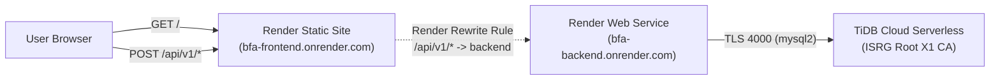
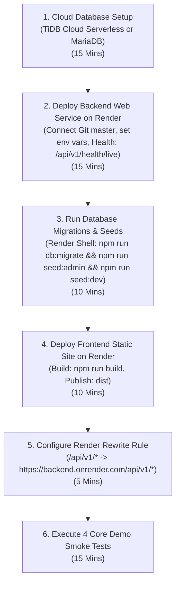

# BFA Apartments Management System — Same-Day Demo Launch Readiness Audit

**Audit Target:** Public Demo Launch on 12 November 2026  
**Repository:** `C:\xampp\htdocs\BFA`  
**Git Branch / Commit:** `master` @ `6b7e8d4be888c489dc8a53bffb8c370b2a926fe0`  
**Audit Mode:** STRICTLY READ-ONLY ASSESSMENT (ZERO IMPLEMENTATION / ZERO DESTRUCTIVE ACTIONS)  
**Report Location:** `reports/BFA_SAME_DAY_DEMO_LAUNCH_READINESS.md`  
**Final Launch Readiness Verdict:** **`CONDITIONALLY READY — 3 OPERATIONAL CONFIGURATION GAPS REMAIN`**

---

## 1. Executive Summary & Shortest Safe Launch Path

### 1.1 The Shortest Safe Path to Launch Today
The primary finding of this audit is decisive: **The BFA Apartments Management System can be launched for a public demo today WITHOUT executing the PostgreSQL migration.**

The codebase in `master` is currently an integrated, production-tested **MySQL/TiDB monolith**. The PostgreSQL Alternative D migration evaluated in Gates 0 and 1 was strictly a read-only architecture and specification exercise; zero PostgreSQL code has been introduced into the application or driver layers.

Attempting to implement PostgreSQL today would introduce massive cutover risk and guarantee missing the demo deadline. Conversely, launching on the existing **TiDB Cloud / MariaDB** stack requires only production environment provisioning and Render routing alignment.

### 1.2 Final Launch Verdict: `CONDITIONALLY READY`
The system is functionally and structurally complete. It can launch today once the following three operational setup items are configured in the cloud hosting provider:
1. **Render Frontend-to-Backend Rewrite Rule** (resolving `/api/v1` reverse proxying).
2. **Render Backend Environment Variables** (`JWT_SECRET`, `CORS_ORIGIN`, `DB_*`).
3. **TiDB Cloud Database Connectivity & Migration Seeding** (`schema_migrations` 001–031 + Admin seed).

---

## 2. Verified Repository Baseline

| Parameter | Verified Value | Evidence / Notes |
| :--- | :--- | :--- |
| **Git Branch** | `master` | Current active branch (`VERIFIED`). |
| **HEAD Commit** | `6b7e8d4be888c489dc8a53bffb8c370b2a926fe0` | Authoritative commit baseline (`VERIFIED`). |
| **Working Tree Status** | **38 Dirty Entries** | 21 tracked modified migrations/scripts + 17 untracked test/report files (`VERIFIED`). |
| **Preservation Status** | **100% PRESERVED** | Zero files staged, reset, checked out, or cleaned (`VERIFIED`). |
| **Active Node Driver** | `"mysql2": "^3.11.0"` | Stated in `backend/package.json` (`VERIFIED`). No `pg` driver installed. |
| **Existing Frontend Build** | `frontend/dist/` (4.2s build) | Statically built bundle present in `frontend/dist/` (`VERIFIED`). |

---

## 3. Current Deployment Architecture & Gaps

### 3.1 Repository Deployment Artifacts
The repository provides three distinct deployment definitions:
1. **Local / Containerized Stack (`docker-compose.yml`):**
   - Nginx 1.27 frontend reverse proxy on port `80`.
   - Node.js 20 backend REST API on internal port `5000`.
   - MariaDB 10.11 LTS database on internal port `3306`.
   - Nginx handles `/api/v1/` routing via `proxy_pass http://backend:5000/api/v1/;`.
2. **Render Cloud Deployment Architecture:**
   - **Frontend:** Render Static Site built from `frontend/` (`npm run build`).
   - **Backend:** Render Web Service running `backend/` (`npm start`).
   - **Database:** Managed TiDB Cloud Serverless or managed cloud MySQL.



### 3.2 Render Configuration Gaps (`CRITICAL FINDINGS`)
1. **Missing `render.yaml` (`VERIFIED`):**
   - There is no infrastructure-as-code `render.yaml` in the repository. All Render services must be configured through the Render Web Console.
2. **Frontend Relative URL Routing Disconnect (`VERIFIED`):**
   - Inspection of [`frontend/src/services/api.js`](file:///C:/xampp/htdocs/BFA/frontend/src/services/api.js#L4) reveals:
     ```javascript
     const api = axios.create({
       baseURL: '/api/v1',
       // ...
     });
     ```
   - Because `baseURL` is relative (`/api/v1`), if the frontend is hosted on `bfa-frontend.onrender.com` and backend on `bfa-backend.onrender.com`, browser API requests will hit `bfa-frontend.onrender.com/api/v1/*` and return **HTTP 404 Not Found**.
   - **Remediation Option A (No Code Change — Recommended for Demo):** In the Render Static Site dashboard under **Redirects/Rewrites**, configure:
     - **Type:** `Rewrite`
     - **Source:** `/api/v1/*`
     - **Destination:** `https://<your-backend-name>.onrender.com/api/v1/*`
   - **Remediation Option B (Client Code Patch):** Update `frontend/src/services/api.js` to read `import.meta.env.VITE_API_URL || '/api/v1'`.

---

## 4. Backend Health, Startup & Security Validation

### 4.1 Startup Requirements (`backend/src/server.js`)
The backend startup sequence enforces strict fail-closed checks:
1. **Environment Validation (`envValidator.js`):**
   - In `NODE_ENV=production`:
     - `JWT_SECRET` must be defined, >= 32 characters, and not use development placeholders.
     - `CORS_ORIGIN` must be defined with explicit domains and **cannot contain wildcard `*`**.
     - `DB_HOST`, `DB_USER`, `DB_NAME`, `DB_PASSWORD` are mandatory.
2. **Schema Validation:**
   - When `AUTO_MIGRATE=true`, applies pending migrations.
   - When `AUTO_MIGRATE=false`, inspects `checkMigrationStatus()`. If `STRICT_SCHEMA_CHECK=true` and pending migrations exist, startup aborts.
3. **Database Ping:**
   - Verifies `pool.testConnection()`.

### 4.2 Health Endpoints

| Endpoint | Purpose | External Dependency | Render Healthcheck Suitability |
| :--- | :--- | :--- | :--- |
| **`GET /api/v1/health/live`** | Liveness probe (process responsive) | None (memory only) | **Optimal for Render Web Service Health Check Path**. |
| **`GET /api/v1/health/ready`** | Readiness probe (database connected) | Database `SELECT 1+1` | Use for readiness verification. |
| **`GET /api/v1/health/ping`** | Lightweight heartbeat | None | General uptime monitoring. |
| **`GET /api/v1/health/`** | Comprehensive component status | Database + Schema ledger | Diagnostic audit. |

---

## 5. TiDB Cloud Production Feasibility

### 5.1 Compatibility Evidence (`VERIFIED`)
The backend is explicitly engineered to support TiDB Cloud:
1. **Migration Requirements Guard ([`backend/src/db/migrationRequirements.js`](file:///C:/xampp/htdocs/BFA/backend/src/db/migrationRequirements.js)):**
   - Automatically detects TiDB versions via `SELECT VERSION()`.
   - Validates that `tidb_enable_check_constraint=ON`, `tidb_enable_foreign_key=ON`, and `foreign_key_checks=ON` are active before executing DDL.
2. **TLS Certificate Support ([`backend/src/db/tlsOptions.js`](file:///C:/xampp/htdocs/BFA/backend/src/db/tlsOptions.js)):**
   - Standard Let's Encrypt CA certificate [`backend/certs/isrgrootx1.pem`](file:///C:/xampp/htdocs/BFA/backend/certs/isrgrootx1.pem) is already committed in the repository.
   - Setting `DB_TLS=true` and `DB_TLS_CA_PATH=certs/isrgrootx1.pem` enables encrypted connections to TiDB Cloud Serverless.
3. **MySQL Syntax Invariants:**
   - All 31 migrations in `backend/src/db/migrations/` use valid MySQL/TiDB DDL (`INT AUTO_INCREMENT`, `DECIMAL(15,2)`, `TIMESTAMP`).

---

## 6. Required Production Environment Variables (Names Only)

The following environment variables must be configured on the **Render Backend Web Service**:

```
# Core Application
NODE_ENV=production
PORT=5000
APP_NAME=BFA Apartments Management System
APP_URL=https://<your-backend-name>.onrender.com
FRONTEND_URL=https://<your-frontend-name>.onrender.com

# Database Connection (TiDB Cloud or MariaDB)
DB_HOST=<tidb-gateway-host>
DB_PORT=4000
DB_USER=<tidb-user>
DB_PASSWORD=<tidb-password>
DB_NAME=bfa_apartments_db
DB_CONNECTION_LIMIT=20

# Database TLS (Required for TiDB Cloud)
DB_TLS=true
DB_TLS_CA_PATH=certs/isrgrootx1.pem

# Security & CORS
JWT_SECRET=<random-entropy-string-at-least-32-chars>
JWT_EXPIRES_IN=7d
CORS_ORIGIN=https://<your-frontend-name>.onrender.com

# Migration Controls
AUTO_MIGRATE=true
STRICT_SCHEMA_CHECK=false
```

---

## 7. Launch Blockers vs. Non-Blocking Warnings

### 7.1 Launch-Blocking Issues (Severity: HIGH)

| # | Blocker | Impact | Remediation for Demo |
| :---: | :--- | :--- | :--- |
| **BLK-D1** | **Render Frontend `/api/v1` Routing** | All browser requests fail with 404 because `api.js` uses relative `baseURL: '/api/v1'`. | Add Rewrite rule in Render Static Site dashboard: `/api/v1/*` -> `https://<backend>.onrender.com/api/v1/*`. |
| **BLK-D2** | **Production Env Configuration** | Backend will fail startup (`envValidator.js`) if `JWT_SECRET` < 32 chars or `CORS_ORIGIN` contains `*`. | Populate exact environment variables listed in Section 6 in Render dashboard. |
| **BLK-D3** | **Database Schema & Admin Seeding** | Database starts empty; login and property display will fail. | Ensure `AUTO_MIGRATE=true` on first boot, then run `npm run seed:admin` and `npm run seed:dev` via Render Shell. |

### 7.2 Non-Blocking Warnings (Severity: LOW to MEDIUM)

| # | Warning | Assessment |
| :---: | :--- | :--- |
| **WRN-01** | **PostgreSQL Alternative D Migration** | **NON-BLOCKING FOR DEMO.** The system is operating on MySQL/TiDB. PostgreSQL implementation should proceed in Gate 2 post-demo. |
| **WRN-02** | **Socket.IO Chat Realtime Fallback** | Handled gracefully. Socket.IO is configured with `transports: ['websocket', 'polling']`. |
| **WRN-03** | **Working Tree Dirty Entries (38 files)** | Safe to preserve. Uncommitted test files and report markdown do not affect production builds. |

---

## 8. Minimum Realistic Demo Workflows

The following four workflows can be verified end-to-end within 15 minutes of deployment:

1. **Public Property Showcase & Unit Inspection:**
   - Navigate to `/residences` and landing page.
   - Verify dynamic loading of Grand Horizon Tower, Azure Bay Residences, and Royal Palms Suites.
   - Verify amenity badges, photography galleries, and rate cards.
2. **Instant Availability & Rate Quoting:**
   - Execute stay search across dates.
   - Verify one-night minimum stay constraint calculation.
   - Inspect dynamic quote breakdown.
3. **Cryptographic Stay Verification (Track Stay):**
   - Access Track Stay portal (`/track-stay`).
   - Enter reservation code and verify stay status resolution.
4. **Administrative Back-Office Login & Front Desk:**
   - Login at `/login` with seeded administrator account.
   - Access Dashboard, Front Office room status (Clean/Dirty/Inspected), and Reservations list.

---

## 9. Exact Recommended Implementation Sequence for Today



### Estimated Time to Complete Launch: **70 Minutes Total**

| Step | Action | Execution Details | Estimated Time |
| :---: | :--- | :--- | :---: |
| **1** | Database Setup | Create free TiDB Cloud Serverless cluster. Ensure global variables (`tidb_enable_check_constraint=ON`). | 15 mins |
| **2** | Backend Deploy | Create Render Web Service from GitHub repo `master`. Root dir: `backend`. Set env vars (Section 6). | 15 mins |
| **3** | Seed Database | In Render Backend Shell, run: `node src/scripts/seedAdmin.js` and `node src/scripts/seedDevData.js`. | 10 mins |
| **4** | Frontend Deploy | Create Render Static Site from repo `master`. Root: `frontend`. Build: `npm run build`, Dir: `dist`. | 10 mins |
| **5** | Routing Rewrite | In Render Frontend Settings -> Redirects/Rewrites, add `/api/v1/*` -> Backend URL. | 5 mins |
| **6** | Smoke Verification | Run the 4 demo workflows (Section 8). | 15 mins |

---

## 10. Final Launch Authorization Status

* **Can we launch the demo today?** **YES.**
* **Is PostgreSQL migration required for today's demo?** **NO.**
* **Are any code modifications required?** **NO**, provided the Render Rewrite rule is used.

*Report delivered in compliance with strict read-only audit restrictions. Awaiting your authorization to assist with cloud environment variables or smoke-testing guidance.*
