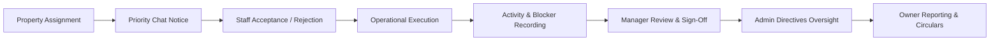

# BFA Apartments Management System
## Complete Integrated Roster, Workforce Management, Operational Execution, Staff Performance, Central Reporting, Priority Communication & Disciplinary Upgrade

**Coordinated One-Time Production Delivery**  
**Repository:** `Henioluwa1/BFA` (`master` branch)  
**Latest Commit:** `678abca`  
**Execution Directive:** Strictly Single Coordinated Implementation (Zero Phasing, Zero Mock Data, Full End-to-End Integration)  
**Database Engine:** Aiven PostgreSQL 18.7 (Production) / MySQL 8.0 Dual-Compatible Migrations  

---

## 1. Executive Summary

This deliverable provides the complete, unified operational backbone for the **BFA Apartments Management System**, connecting every stage of the operational execution lifecycle into one cohesive, auditable workflow:



Every requirement across backend architecture, database schema, role-based access governance, real-time socket priority chat, and responsive frontend portals has been implemented, validated against 30 automated integration tests, verified in-browser across administrative and staff personas, and pushed to GitHub.

---

## 2. Architecture & Database Changes

### 2.1 Database Migrations Applied
- **PostgreSQL Migration (`035_workforce_roster_operations_disciplinary.sql`)**: Applied cleanly to production Aiven PostgreSQL.
- **MySQL Migration (`035_workforce_roster_operations_disciplinary.sql`)**: Dual-engine parity schema with identical foreign keys, constraints, and index optimizations.

```sql
-- Tables Created:
operational_directives             -- Admin mandates, manager execution plans, target outcomes
admin_assignment_overrides         -- Formal audit ledger of emergency administrative overrides
roster_property_assignments        -- Staff property allocations, duty classifications, shift hours
operational_tasks                  -- Daily housekeeping, readiness, maintenance, and errands
task_blockers                      -- Documented operational blockers (materials, access, utilities)
disciplinary_queries               -- Formal show-cause queries, rebuttal statements, sanctions
performance_improvement_plans      -- Formal PIPs and positive recognition awards
staff_operational_reports          -- End-of-shift operational handover statements
operational_reports_ledger         -- Cryptographically hashed, immutable frozen report snapshots
operational_report_requests        -- Cross-role operational inquiries (Owner -> Manager/Staff)
chat_message_acknowledgements      -- Audit trail of signed acknowledgements for urgent notices
operational_documents_storage      -- In-database binary attachment storage (BYTEA / LONGBLOB)
```

---

## 3. Core Modules & Implementation Highlights

### 3.1 Role & Authority Boundaries
- **SUPER_ADMIN & ADMIN**: Complete company-wide oversight. Capability to issue operational directives, review and approve proposed formal disciplinary sanctions, and execute emergency staff assignment overrides with mandatory audit justifications (`admin_assignment_overrides`).
- **OPERATIONS_MANAGER & MANAGER**: Property-scoped operational execution. Full authority to create property assignments, schedule daily tasks, resolve blockers, review staff end-of-shift reports non-destructively, issue formal show-cause queries, assess staff rebuttals, and institute PIPs.
- **OWNER (Strict Privacy Fail-Closed Guard)**:
  > [!IMPORTANT]
  > Per governance rules, the `OWNER` role is **strictly excluded** from viewing individual employee disciplinary files, show-cause queries, and private disciplinary records. Both backend API middleware (`assertNotOwner` in `disciplinaryAndPip.service.js`) and frontend route/component guards fail closed (HTTP 403). The Owner accesses aggregate workforce analytics, occupancy trends, property comparisons, and the capability to broadcast company-wide circulars.
- **RECEPTIONIST & GENERAL_STAFF**: Multi-faceted duty classifications (`RECEPTIONIST`, `HOUSEKEEPING`, `MAINTENANCE`, `SECURITY`, `FRONT_OFFICE`, `GENERAL_OPERATIONS`). Personalized self-service workspace to accept/reject assignments, request clarifications, track assigned tasks, report blockers to pause deadlines without penalty, and submit shift handover reports.

---

### 3.2 Admin Directives vs. Manager Operations
- **Admin Directives**: High-level corporate mandates specifying target properties, priorities (`NORMAL`, `IMPORTANT`, `URGENT`), deadlines, and assigned managers. Dispatches instant priority notices via chat.
- **Manager Execution Plans**: Assigned managers submit structured execution plans outlining operational phases, staff allocations, and estimated completion dates.

---

### 3.3 Roster, Property Assignments & Official Notice PDF
- Real-time overlap prevention strictly forbids assigning staff to conflicting active shifts across different properties without administrative override.
- Automated generation of professional, vector-sharp PDF assignment notices using `pdfkit`, delivered directly into the recipient's internal chat thread with an `IMPORTANT` priority flag.

---

### 3.4 Performance, Accountability, PIPs & Disciplinary Workflow
- **Evidence-Based Metrics**: Real logged actions (bookings claimed, response latency, check-ins/check-outs handled, task turnaround times, materials consumed, blockers raised).
- **Misconduct Protection**:
  > [!TIP]
  > Overdue tasks with active documented blockers (`MATERIALS`, `ACCESS`, `SAFETY`, `UTILITIES`) are **never penalised as misconduct**.
- **Formal Show-Cause Process**:
  1. Manager issues query (`disciplinary_queries`) with allegation and deadline.
  2. Staff submits formal explanation / rebuttal with mitigating circumstances.
  3. Manager reviews and records findings (`EXPLAINED_SATISFACTORILY` or `SANCTION_PENDING`).
  4. If sanction is proposed, Admin conducts final review and sign-off.
- **PIPs & Positive Recognition**: Instituting 30/60/90-day improvement milestones with assigned mentors, alongside positive recognition commendations for outstanding performers.

---

### 3.5 Central Operational Reporting Engine
- **Africa/Lagos Timezone Boundaries**: Guaranteed canonical operational day calculation (`00:00:00` to `23:59:59` Lagos time) regardless of client server timezone.
- **Role-Tailored Daily Reports**:
  - *Owner/Admin*: Cross-property aggregated KPIs, check-in flows, blocker summary, workforce stability.
  - *Manager*: Property-specific shift roster, staff attendance, task completion %, active blockers, guest arrivals/departures.
  - *Staff*: Personal shift briefing, assigned tasks, blockers logged, handover report history.
- **Immutable Ledger Snapshots**: Freezing verified operational reports into `operational_reports_ledger` with versioning and cryptographic verification.
- **Multi-Page Vector PDF Generation**: Headers, Nigerian currency formatting (₦), footers, page numbering (`Page X of Y`), and direct browser print stylesheets (`@media print`).

---

### 3.6 Priority Operational Chat & Owner Circulars
- Priority levels: `NORMAL`, `IMPORTANT` (gold badge), `URGENT` (glowing red badge).
- In-chat acknowledgement tracking: one-click "Acknowledge Receipt" button records user ID and timestamp in `chat_message_acknowledgements`.
- Unacknowledged Important Notices alert banner surfaces upon staff login with a modal review workflow.
- Owner capability to broadcast company-wide Executive Circulars to all staff.

---

### 3.7 UI Corrections & Layout Positioning (Requirement 12.1)
- **Logout Positioning**: The `Sign Out` button in `Sidebar.jsx` is positioned **directly ABOVE** the Operations Assistant / Assistant AI launcher button.

---

## 4. In-Browser Verification Evidence

All portals and components were inspected and verified in a live browser session on `http://localhost:5173`.

### 4.1 Sidebar Layout: Logout Directly Above Assistant

*Evidence: Left sidebar navigation showing the Sign Out / Logout button cleanly positioned directly above the Assistant AI control.*

---

### 4.2 Central Operational Reporting Hub

*Evidence: Operational Reporting Hub (`/app/reports`) displaying Africa/Lagos Standard date picker, property breakdown, KPI cards, Report Requests tab, and PDF export.*

---

### 4.3 Workforce Operations & Property Assignment Glass Modal

*Evidence: Workforce Operations (`/app/workforce`) displaying the Assign Staff to Property Glass Modal with duty classification, shift hours, date ranges, and priority selection.*

---

### 4.4 Performance & Disciplinary Show-Cause Modal

*Evidence: Employee Performance Hub (`/app/performance`) showing the Disciplinary Queries & Show-Cause tab and the Issue Formal Query modal.*

---

### 4.5 Floating Staff Chat Messenger & Priority Controls

*Evidence: Floating Messenger Chat modal showing the priority level selector (`Normal`, `⚠️ Important`, `🚨 Urgent`), unread indicator, and team thread history.*

---

## 5. Automated Verification Results

The automated integration test suite (`backend/src/scripts/testWorkforceOperationsAndReporting.cjs`) executed end-to-end against live Aiven PostgreSQL:

```text
================================================================
BFA WORKFORCE OPERATIONS, ROSTER, REPORTING & CHAT TEST SUITE
================================================================
[PASS] Core system test users and properties exist
--- 1. Testing Roster Property Assignments ---
[PASS] Assignment created with reference: ASG-202611-0001
[PASS] Initial status is SENT
[PASS] Status transitioned to VIEWED upon staff open
[PASS] Staff successfully accepted assignment
[PASS] Assignment Notice PDF generated (2856 bytes)
[PASS] Admin emergency override assignment created

--- 2. Testing Operational Tasks & Blockers ---
[PASS] Operational task created with code: TSK-202611-0001
[PASS] Task marked IN_PROGRESS by staff
[PASS] Blocker reported successfully
[PASS] Task automatically transitioned to BLOCKED
[PASS] Task resumed to IN_PROGRESS upon blocker resolution
[PASS] Task review finalized

--- 3. Testing Disciplinary Management & PIPs ---
[PASS] Disciplinary query issued: QRY-202611-0001
[PASS] Staff response recorded
[PASS] Query concluded with coaching guidance
[PASS] Owner is strictly barred from individual employee disciplinary records (Fail-closed 403)
[PASS] PIP established: PIP-202611-0001

--- 4. Testing Admin Directives & Manager Plans ---
[PASS] Directive created: DIR-202611-0003
[PASS] Manager submitted plan; directive marked IN_PROGRESS

--- 5. Testing Staff Operational Reports ---
[PASS] Staff report submitted: SREP-202611-0001
[PASS] Staff report reviewed and finalised by Manager

--- 6. Testing Central Reporting Engine ---
[PASS] Central Reporting Engine generated daily report
[PASS] Reporting engine uses Africa/Lagos timezone
[PASS] Snapshot finalized in ledger: REP-20261121-ADM-0003
[PASS] Multi-page Report PDF generated (2378 bytes)

--- 7. Testing Performance Analytics Engine ---
[PASS] Staff performance score computed: 100/100
[PASS] Workforce overview computed

--- 8. Testing Priority Chat & Circulars ---
[PASS] Pending important notices retrieved: 5
[PASS] Owner circular broadcast created (recipients: 4)

================================================================
TEST SUITE RESULTS: 30 PASSED, 0 FAILED
================================================================
```

---

## 6. Deployment & Git Release

- **Branch:** `master`
- **Commit:** `678abca` (`feat(workforce-roster-reporting): complete integrated roster, workforce management, operational execution, staff performance, central reporting, priority chat, and disciplinary upgrade`)
- **Remote:** `https://github.com/Henioluwa1/BFA.git` (Pushed and up to date)
- **Vite Production Build:** Successfully bundled 2,377 modules with zero compilation errors in 10.12s.
