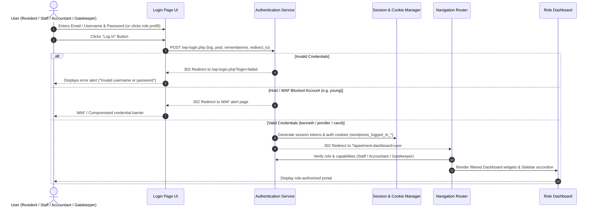
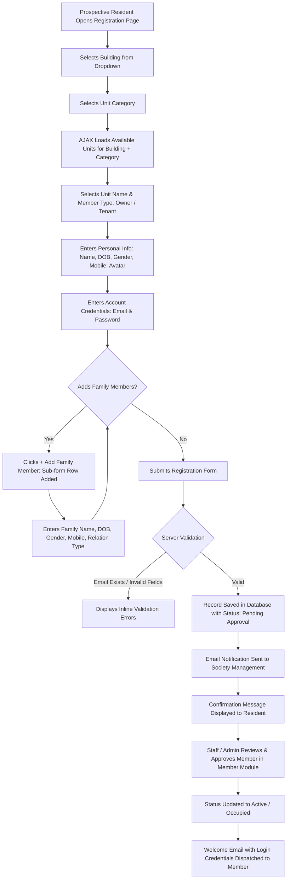
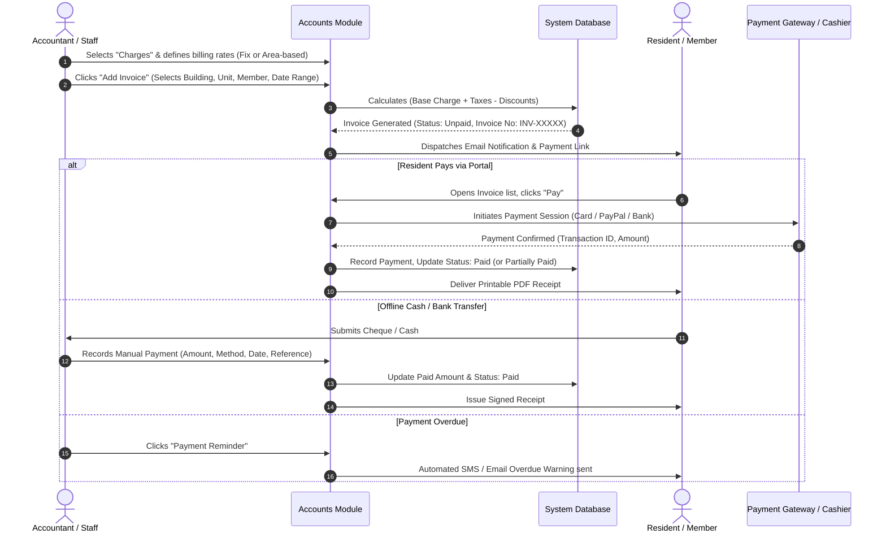
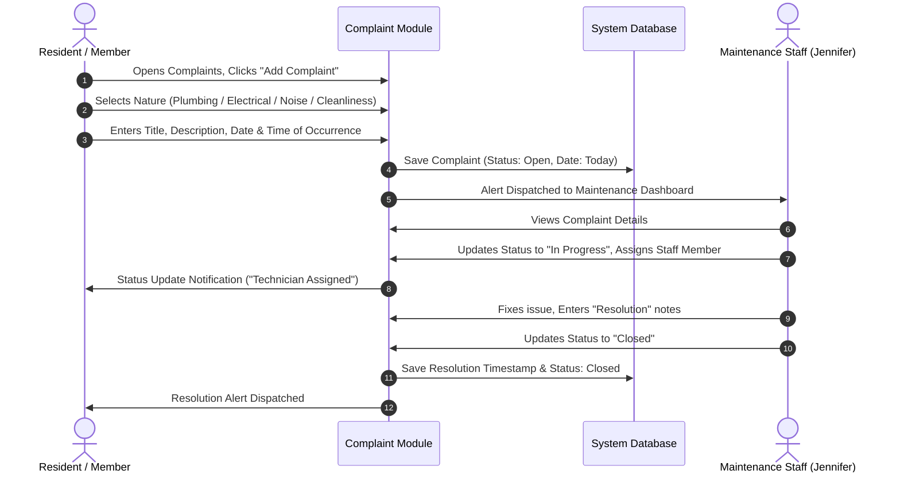
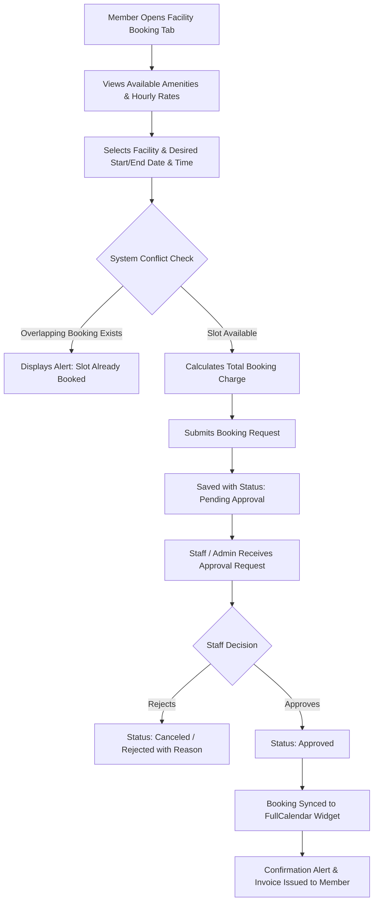
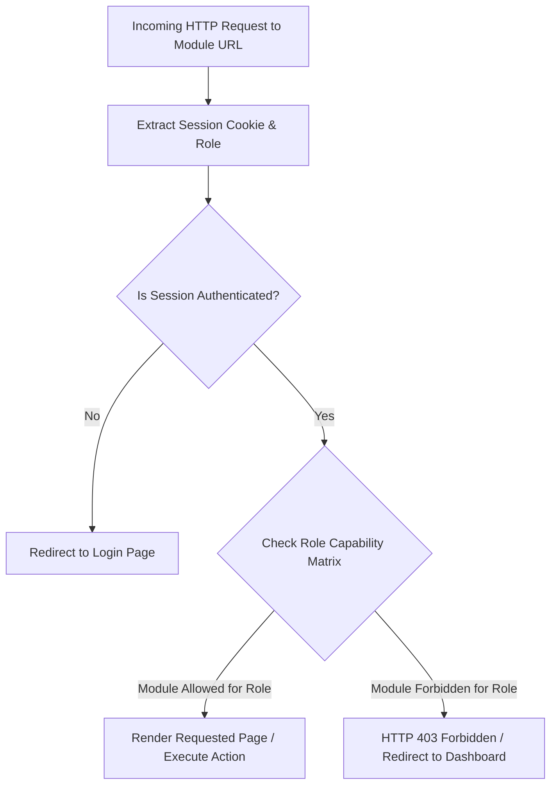

# Reference Workflow Specification

**Target System:** WPAMS (Apartment Management System for WordPress)  
**Inspection Date:** October 22, 2026  
**Status:** Empirically Verified & Specified for Clean Independent Reconstruction

---

## 1. Authentication and Role-Based Redirection Workflow

### Overview
Handles credential verification, session initialization, role extraction, and automatic routing to role-specific dashboard views.



### Specification Details
1. **Actor:** Any registered user (Member, Accountant, Staff Member, Gatekeeper, Committee Admin).
2. **Preconditions:** Active user account exists with designated role in system.
3. **Trigger:** Form submit on `/apartment-management-login-page/`.
4. **Validation:** Non-empty username, password validation; sanitization of input characters.
5. **State Transition:** `Unauthenticated` -> `Authenticated (Role: Member | Staff | Accountant | Gatekeeper)`.
6. **Acceptance Criteria:**
   - Valid credentials route user to `?apartment-dashboard=user`.
   - Sidebar displays only authorized module categories.
   - Session logout clears auth tokens and redirects to homepage.

---

## 2. Member Self-Registration & Approval Workflow

### Overview
Allows a prospective or current resident (Owner or Tenant) to submit their building, unit, personal, contact, and family information for onboarding.



### Specification Details
1. **Actor:** Resident (Owner or Tenant).
2. **Preconditions:** Building and Unit must already exist in system database.
3. **Trigger:** Click *"Submit"* on `/apartment-management-member-registration-page/`.
4. **Processing & Business Rules:**
   - Unit selection must cascade dynamically: `building_id` -> `unit_cat_id` -> available `unit_name`.
   - Email uniqueness checked asynchronously via AJAX (`admin-ajax.php`).
   - Occupied date defaults to current date if occupied immediately.
   - Member status initialized to `Pending Approval` until verified by management.
5. **Acceptance Criteria:**
   - Registration creates primary Member record and multiple child Family records.
   - Password stored as secure Argon2/bcrypt hash.
   - Successful submission returns success notification banner.

---

## 3. Invoice Generation and Payment Recording Workflow

### Overview
Allows accountants to generate recurring or ad-hoc maintenance bills for units, track payment statuses, issue reminders, and accept online or manual payments.



### Specification Details
1. **Actor:** Accountant (Kenneth) or Resident (Young).
2. **Preconditions:** Active residential unit, assigned member, and configured charge type.
3. **Calculation Formula:**
   $$\text{Subtotal} = \begin{cases} \text{Fixed Rate} & \text{if Fixed Charge} \\ \text{Unit Area} \times \text{Rate per sq ft} & \text{if Area Based} \end{cases}$$
   $$\text{Total Amount} = (\text{Subtotal} - \text{Discount}) + \text{Tax Amount}$$
   $$\text{Due Amount} = \text{Total Amount} - \text{Paid Amount}$$
4. **Status Transitions:**
   - If $\text{Paid Amount} = 0$: `Unpaid`
   - If $0 < \text{Paid Amount} < \text{Total Amount}$: `Partially Paid`
   - If $\text{Paid Amount} \ge \text{Total Amount}$: `Paid`
5. **Acceptance Criteria:**
   - Payment reminders can be triggered with one click per row.
   - Printable invoice layout reproduces society header, invoice number, itemization, and stamp.

---

## 4. Visitor Request, Gate Check-In, and Departure Workflow

### Overview
Tracks visitors, contractors, and delivery personnel entering society premises via gatekeeper authorization.

```mermaid
flowchart TD
    A[Visitor Arrives at Society Gate] --> B[Gatekeeper Opens Visitor Module]
    B --> C[Gatekeeper Clicks 'Add Visitor Request']
    C --> D[Selects Gate, Building, Unit Number]
    D --> E[Enters Visitor Name, Mobile, ID Proof, Vehicle No]
    E --> F[Selects Visit Purpose: Guest, Delivery, Service, Cab]
    F --> G[Submits Check-In: Record created with Check-In Date & Time]
    G --> H[Automated Notification Sent to Resident App / SMS]
    H --> I[Visitor Enters Premises (Status: Entered)]
    I --> J[Visitor Finishes Visit & Returns to Gate]
    J --> K[Gatekeeper Locates Record in Datatable]
    K --> L[Clicks 'Check-Out Now']
    L --> M[System Records Check-Out Time]
    M --> N[Status Updated to 'Checked Out']
    N --> O[Record Locked in Historical Audit Log]
```

### Specification Details
1. **Actor:** Gatekeeper (Carol) or Resident (pre-announcing visitor).
2. **Preconditions:** Registered gate (e.g. Gate 1 - Main Gate) and destination unit.
3. **Table Columns:** `Visitor Name - ID Number - Vehicle Number` | `Gate Name` | `Building & Unit Name` | `Check-In Date` | `Check-In Time` | `Check-Out Time` | `Status`.
4. **State Transition:** `Pre-Approved (Optional)` -> `Entered / Checked In` -> `Checked Out`.
5. **Acceptance Criteria:**
   - System automatically timestamps Check-In and Check-Out.
   - Gatekeepers can filter by active visitors currently on premises (`Check-Out Time IS NULL`).

---

## 5. Complaint Submission and Maintenance Resolution Workflow

### Overview
Allows residents to report facility or unit issues, and enables staff to assign, investigate, resolve, and close tickets.



### Specification Details
1. **Actor:** Resident (Reporter) and Staff (Resolver).
2. **Statuses:** `Open` (Red) -> `In Progress` (Yellow) -> `Closed` (Green).
3. **Fields:** Complaint Nature, Title, Unit, Date, Time, Description, Resolution Notes, Assigned Technician.
4. **Acceptance Criteria:**
   - Closed complaints cannot be re-opened by non-staff without admin privilege.
   - Status transitions reflect immediately in Dashboard metrics and Complaint reports.

---

## 6. Facility Reservation and Approval Workflow

### Overview
Manages shared society amenities (Club House, Swimming Pool, Tennis Court, Banquet Hall) with hourly/daily pricing and conflict prevention.



### Specification Details
1. **Actor:** Member (Requester) and Staff / Accountant (Approver).
2. **Pricing Model:** Charge Per Hour, Charge Per Day, or Fixed Flat Fee.
3. **Validation:** No two approved bookings may overlap for the same facility on identical time slots.
4. **Status Transitions:** `Pending Approval` -> `Approved` or `Canceled`.
5. **Acceptance Criteria:**
   - Approved facility reservations appear on the public/authenticated FullCalendar dashboard.

---

## 7. Role-Permission Enforcement Workflow

### Overview
Guarantees strict separation of concerns across Member, Staff, Accountant, and Gatekeeper roles.



### Role-Capability Matrix
| Module / Capability | Super Admin | Accountant (Kenneth) | Staff (Jennifer) | Gatekeeper (Carol) | Member (Young) |
|---|:---:|:---:|:---:|:---:|:---:|
| **Dashboard KPI Metrics** | Full | Accounts/Complaints | Operations/Visitors | Security/Visitors | Personal Only |
| **Manage Buildings & Units** | Full | View / Edit | View / Edit | View Only | View Assigned |
| **Member Management** | Full | View / Edit | View / Edit | View Only | View Profile |
| **Invoices & Charges** | Full | Full Access | View Only | Forbidden | View / Pay Self |
| **Expenses Recording** | Full | Full Access | Forbidden | Forbidden | Forbidden |
| **Visitor Check-In/Out** | Full | View Only | Full Access | Full Access | Request Only |
| **Parking Slot Assignment** | Full | View Only | Full Access | View Only | View Assigned |
| **Facility Approvals** | Full | Approve / Invoice | Approve / Manage | Forbidden | Book / Pay |
| **Complaints Handling** | Full | View Only | Resolve / Close | View Only | Submit / Track |
| **Notice Board Management** | Full | Create / View | Create / View | View Only | View Only |
| **Financial Reports** | Full | Full Access | Forbidden | Forbidden | Forbidden |
